# Assignment 2 — Deploy a React App on an Azure VM (Ubuntu + Nginx)

Part of the DevOps Micro Internship (DMI) with Agentic AI

---

## Purpose

In this assignment, you will provision a secure Ubuntu virtual machine in Microsoft Azure, build the `my-react-app` React application, and serve the production static build through Nginx. You will validate the deployment from the VM's public IP.

---

# Task 1 — Create a Resource Group

## Goal

Create the Azure Resource Group `react-app-rg` in a region close to you.

### Evidence

#### Screenshot 1 — Resource Group overview showing the name and region

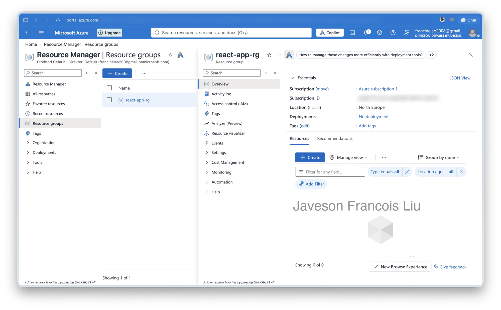

I created the Resource Group `react-app-rg` in North Europe from the Azure Portal. A Resource Group is the container for everything in this lab, so deleting it at the end removes the VM, disk, IP and network rules in one step.

---

# Task 2 — Provision Ubuntu VM with Correct Networking

## Goal

Create a VM that can be accessed securely and can serve HTTP traffic.

### Evidence

#### Screenshot 2 — Azure VM overview page showing the VM name, Resource Group, and region

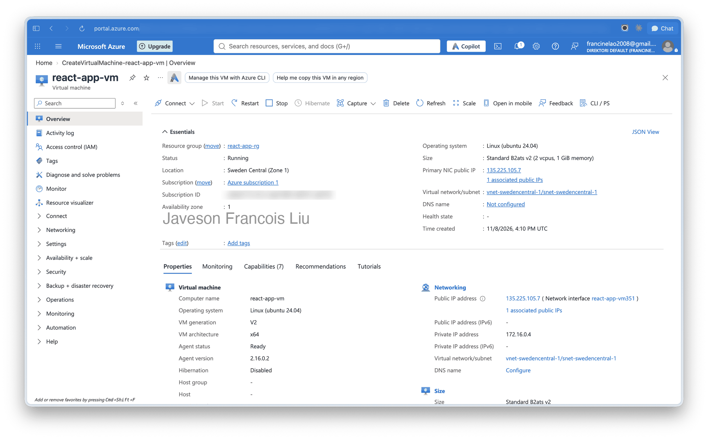

The VM is `react-app-vm` in the Resource Group `react-app-rg`, running in Sweden Central with the size Standard B2ats v2 (2 vCPUs, 1 GiB memory) and Ubuntu 24.04 LTS. The Standard B1s size was not offered to my subscription in the regions I checked, so I used B2ats v2, the closest burstable B-series size that was available. I picked SSH-key authentication with the user `azureuser`.

---

#### Screenshot 3 — Network Security Group inbound rules showing ports 22 and 80 allowed

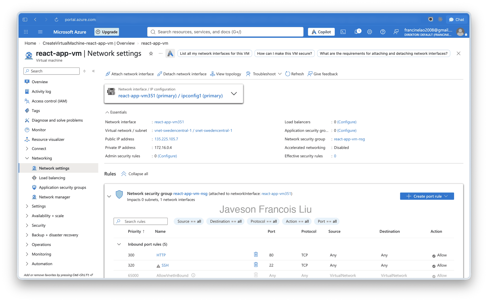

The Network Security Group `react-app-vm-nsg` allows TCP 80 (HTTP) and TCP 22 (SSH). The Network Security Group decides what the internet can reach, so only these two ports are open to the VM.

---

# Task 3 — SSH into the Azure VM

## Goal

Connect to the VM over SSH and confirm the Linux prompt is visible.

### Evidence

#### Screenshot 4 — Terminal showing a successful SSH login with the prompt visible

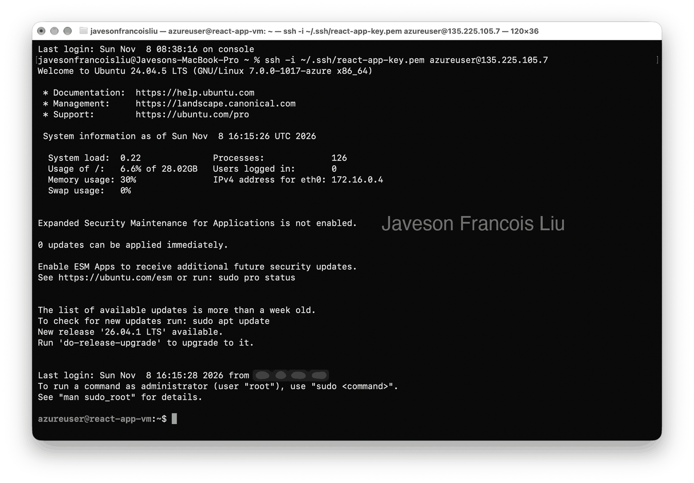

I connected with `ssh -i ~/.ssh/react-app-key.pem azureuser@<PUBLIC_IP>`. The key file has permission 600 and is stored in `~/.ssh`, outside the repository. The login shows the Ubuntu welcome banner and the `azureuser@react-app-vm:~$` prompt.

---

# Task 4 — Update OS and Install Prerequisites (Git, Node.js, npm)

## Goal

Update Ubuntu and install Git, Node.js, and npm.

### Evidence

#### Screenshot 5 — Terminal output showing `node -v` and `npm -v`

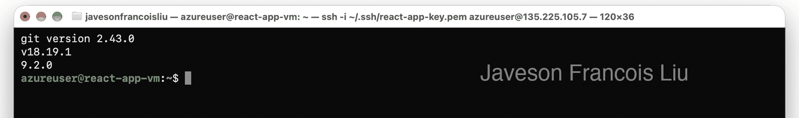

I ran `sudo apt update && sudo apt upgrade -y`, then installed `git`, `nodejs` and `npm` with apt. The versions are Git 2.43.0, Node.js v18.19.1 and npm 9.2.0. Node 18 is new enough to build this app, so the NodeSource upgrade was not needed.

---

# Task 5 — Clone, Personalize, and Build the React App

## Goal

Update the React application with your full name and deployment date, then create the production build.

### Evidence

#### Screenshot 6 — Terminal showing successful `npm run build` completion and `ls -la build` output

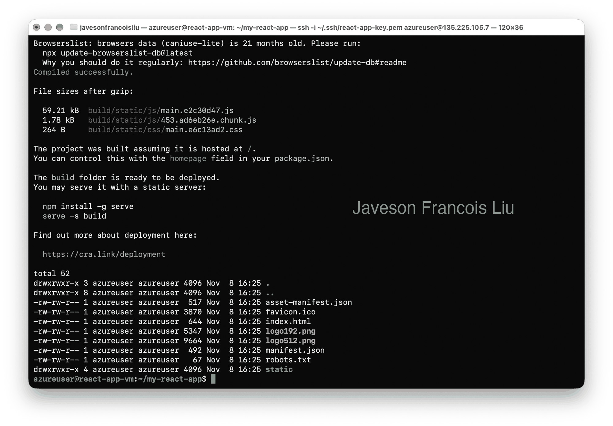

I cloned `my-react-app`, edited `src/App.js` to show `Javeson Francois Liu` and the date `08/11/2026` while keeping the JSX structure, then ran `npm install` and `npm run build`. The build compiled successfully, and `build/` contains `index.html` and the `static/` folder with the minified JavaScript and CSS.

---

# Task 6 — Install and Configure Nginx to Serve the React Build

## Goal

Serve the application through Nginx with SPA routing support.

### Evidence

#### Screenshot 7 — Successful `sudo nginx -t` output

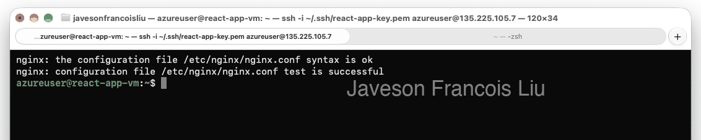

I installed Nginx, enabled it to start on boot and started it. `sudo nginx -t` reports that the syntax is ok and the test is successful. I run this test before every reload so a typo cannot take the site down.

---

#### Screenshot 8 — Nginx configuration snippet showing the build root and `try_files` directive

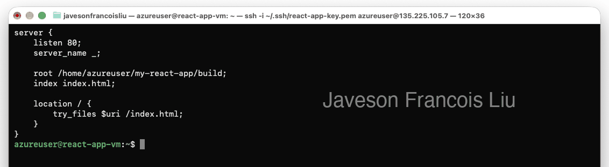

The server block sets `root /home/azureuser/my-react-app/build;` and `try_files $uri /index.html;`. The `try_files` rule serves a real file when it exists and otherwise returns the app entry page, so a deep link still loads after a refresh instead of returning a 404. I also ran `chmod o+x /home/azureuser` so Nginx can read the build folder.

---

# Task 7 — Test the Deployment (Public IP)

## Goal

Confirm that the React app loads from the internet.

### Evidence

#### Screenshot 9 — Browser showing the deployed React app with the full name, deployment date, and VM public IP visible

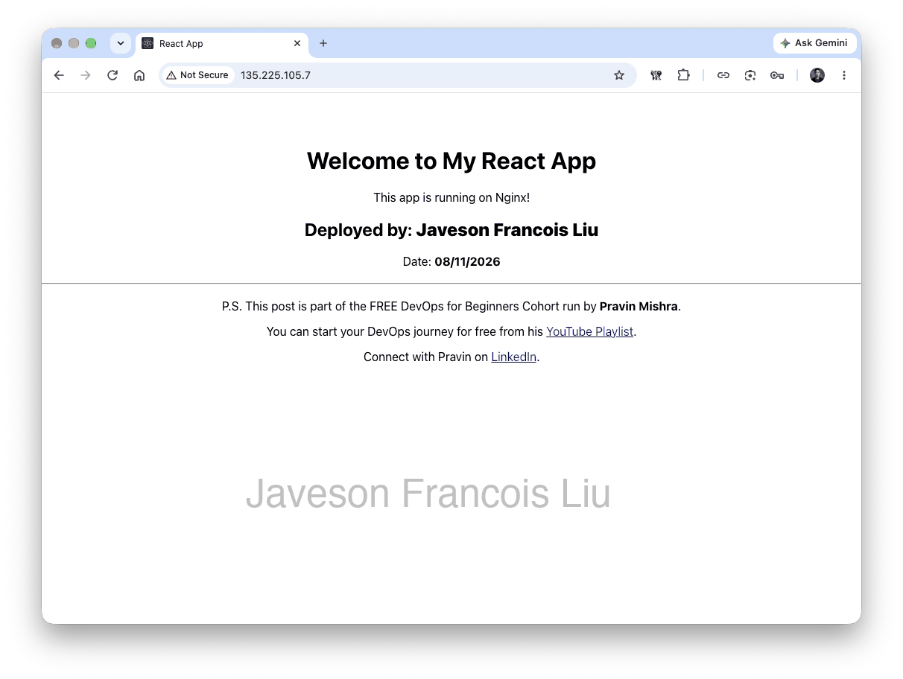

The app loads at `http://<PUBLIC_IP>` and shows `Deployed by: Javeson Francois Liu` and `Date: 08/11/2026`. I also requested `/about` and a nested path directly, and both returned HTTP 200 with the app, which confirms the SPA routing rule works on direct requests and refresh.

---

# Task 8 — Basic Hardening (Recommended)

## Goal

Apply basic security hygiene.

### Evidence

#### Screenshot 10 (optional) — Network Security Group rule showing SSH restricted to your IP

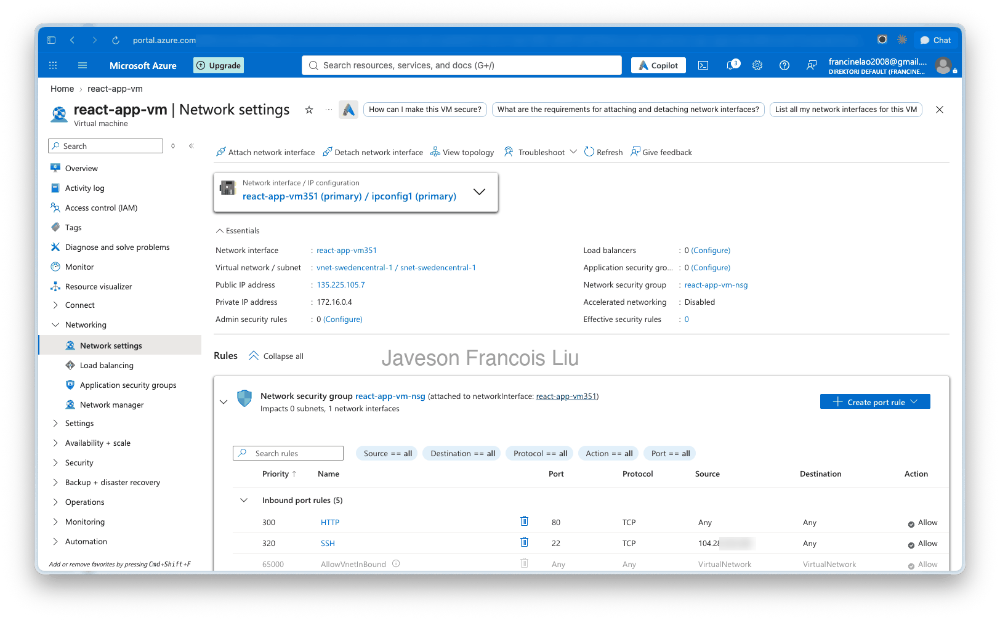

I changed the SSH rule's source from Any to my own IP address, so only my connection can reach port 22. I then opened a new SSH session to confirm I still had access. `sudo ufw status` shows `Status: inactive`, so the host firewall does not block port 80; the Network Security Group is the only filter.

---

# Submission Instructions

- Add all required screenshots in your submission
- Do not expose SSH private keys, passwords, or Azure account information

---

# LinkedIn Post

LinkedIn post URL: https://www.linkedin.com/posts/javeson-francois-liu-999135437_dmibypravinmishra-azure-cloudengineering-share-7525394003479998464-dusk

#### Screenshot 11 — Published LinkedIn post

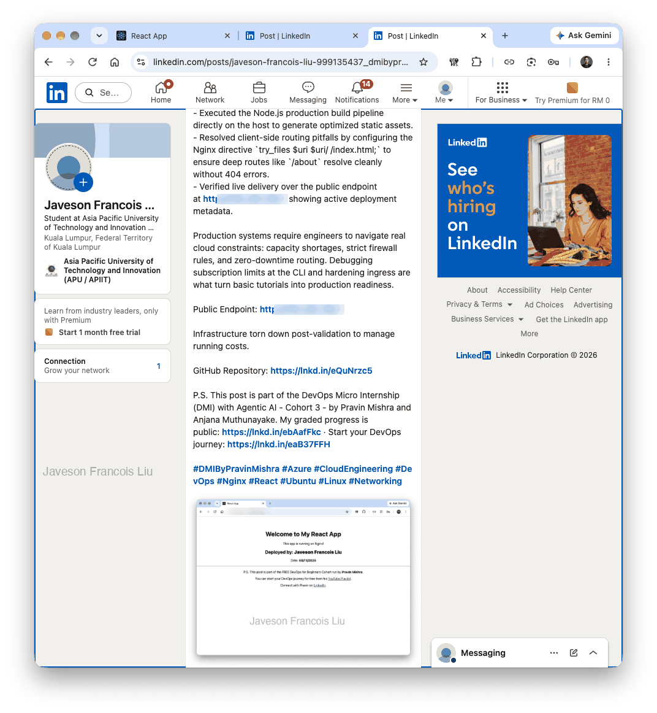

---

# Completion Checklist

- [x] Created the Resource Group
- [x] Provisioned an Ubuntu VM (24.04 LTS)
- [ ] Selected B1s where available (B1s was not available; used B2ats v2)
- [x] Allowed SSH 22 and HTTP 80 through the Network Security Group
- [x] Restricted SSH to my IP where possible
- [x] Connected to the VM through SSH
- [x] Updated Ubuntu packages
- [x] Installed and verified Git, Node.js, and npm
- [x] Cloned the my-react-app repository
- [x] Installed the React dependencies
- [x] Updated src/App.js with my full name and deployment date before building
- [x] Completed npm run build
- [x] Verified the build/ directory
- [x] Installed, enabled, and started Nginx
- [x] Configured the Nginx root to the React build
- [x] Configured try_files for SPA routing
- [x] Passed sudo nginx -t
- [x] Reloaded Nginx
- [x] Loaded the app through the VM public IP
- [x] Confirmed that my full name and deployment date appear in the deployed application
- [x] Tested navigation and route refresh
- [x] Captured Screenshots 1–11
- [x] Captured optional Screenshot 10
- [x] Checked that the evidence does not expose sensitive information

---

## 📌 About DMI & CloudAdvisory

DevOps Micro Internship (DMI) is a project-based DevOps program run by Pravin Mishra (The CloudAdvisory) focused on real-world execution, systems thinking, and career readiness.

It helps learners build strong DevOps foundations with hands-on experience.

---

## 📌 Resources

- 🌐 DMI Official Website: https://dmi.pravinmishra.com?utm_source=github&utm_medium=readme  
- 🎓 University: https://university.pravinmishra.com?utm_source=github&utm_medium=readme  
- 💬 Discord Community: https://discord.pravinmishra.com?utm_source=github&utm_medium=readme  
- 📝 Blog: https://dmi.pravinmishra.com/blog?utm_source=github&utm_medium=readme  
- ▶️ YouTube Playlist: https://www.youtube.com/playlist?list=PLFeSNDtI4Cho  
- 🔗 Pravin Mishra (LinkedIn): https://www.linkedin.com/in/pravin-mishra-aws-trainer/  
- 🏢 CloudAdvisory (LinkedIn): https://www.linkedin.com/company/thecloudadvisory/

---

*This submission is part of DevOps Micro Internship (DMI) — Agentic AI Track.*
