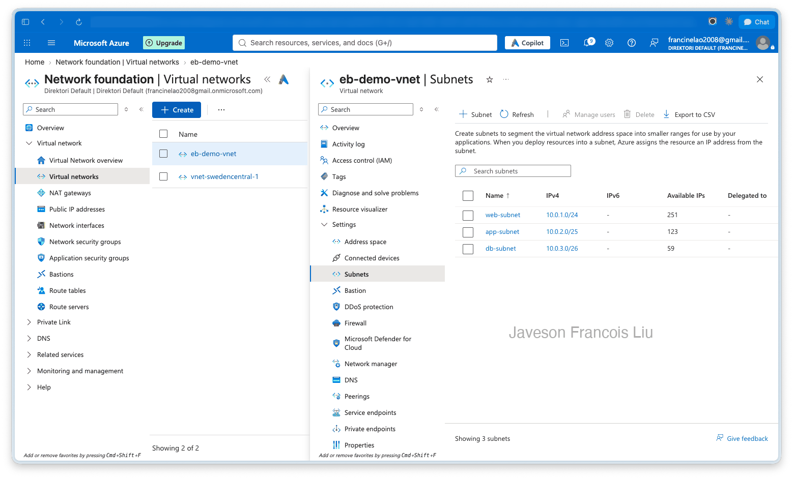
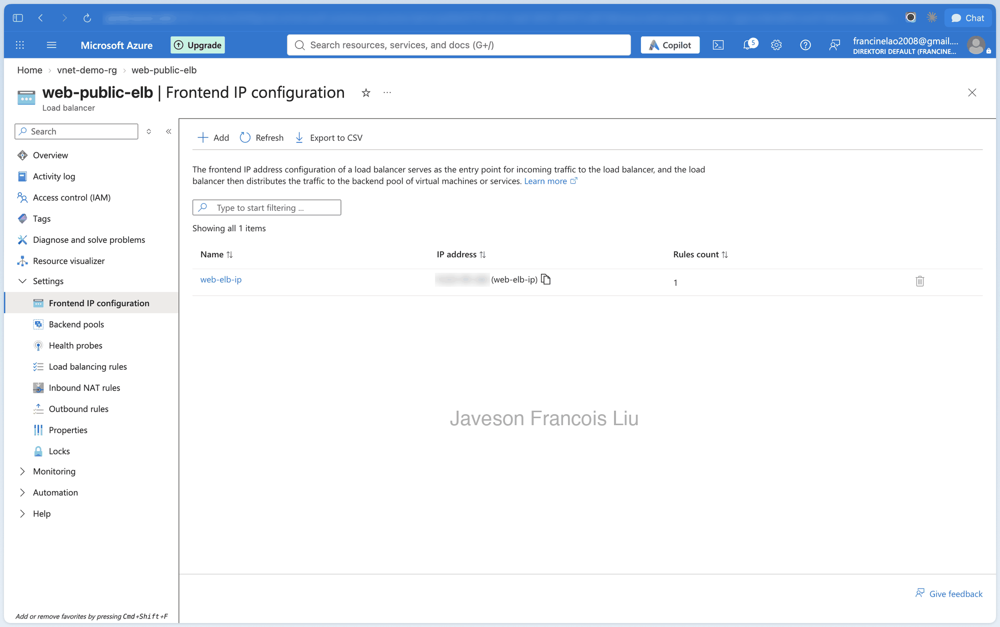
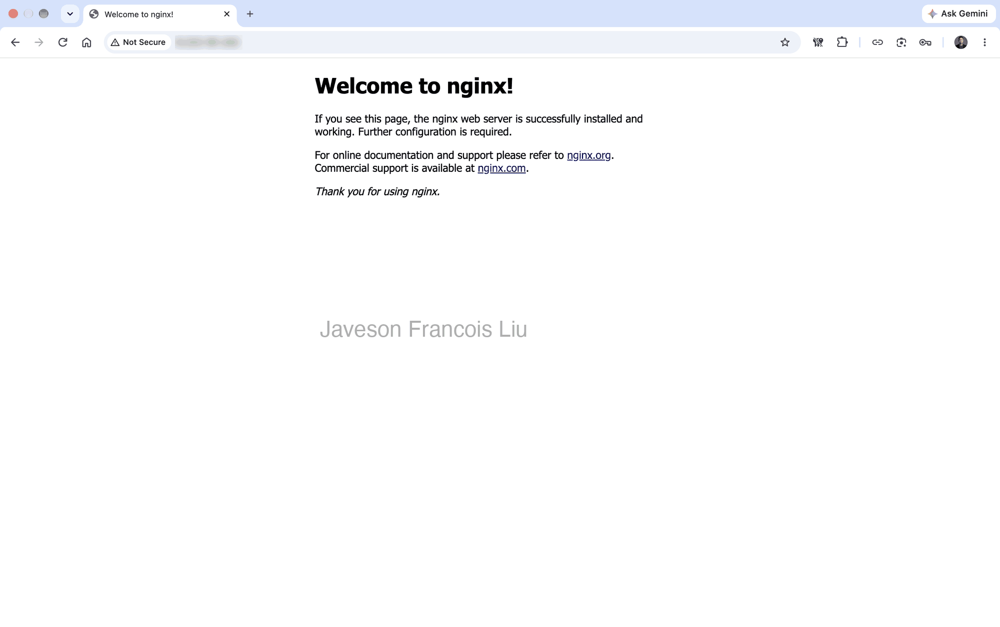
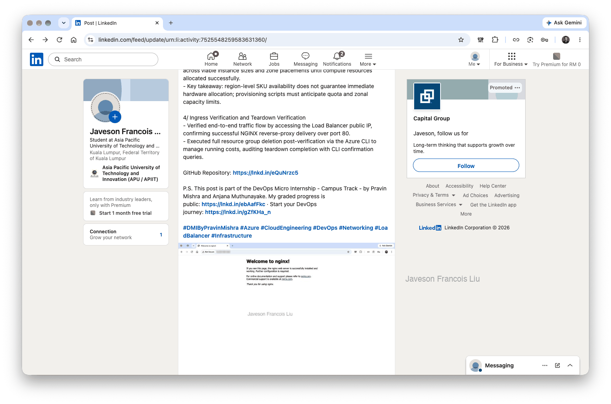

# Assignment 3 — Design a Three-Tier Network with Load Balancer on Azure

Part of the DevOps Micro Internship (DMI) with Agentic AI

---

## Purpose

In this assignment, you will design and deploy a three-tier network architecture on Azure using a Virtual Network, subnets, a Virtual Machine, NGINX, and a Public Load Balancer. The web, application, and database tiers are separated into dedicated subnets, and a Public Load Balancer provides the application entry point.

---

# Task 1 — Create a Virtual Network with Three Subnets

## Goal

Create `eb-demo-vnet` (10.0.0.0/16) with `web-subnet` (10.0.1.0/24), `app-subnet` (10.0.2.0/25), and `db-subnet` (10.0.3.0/26), inside Resource Group `vnet-demo-rg`.

### Evidence

#### Screenshot 1 — Subnet configuration screen showing the three subnets and Bastion subnet (if enabled)

I created the Resource Group `vnet-demo-rg` and the Virtual Network `eb-demo-vnet` (10.0.0.0/16) in Sweden Central. It has three subnets, one per tier: `web-subnet` 10.0.1.0/24, `app-subnet` 10.0.2.0/25 and `db-subnet` 10.0.3.0/26. Bastion was not enabled, so there is no Bastion subnet. Separate subnets let each tier get its own network rules later.

---

# Task 2 — Deploy the Web VM and Install NGINX

## Goal

Create Ubuntu 22.04 LTS VM `web-nginx` in `web-subnet` with a public IP and inbound SSH (22) and HTTP (80), then install and start NGINX and verify the default page via the VM's public IP.

> No screenshot required for this task. Completion is verified through Task 4.

I created `web-nginx` from the Azure CLI with Ubuntu Server 22.04 LTS in `web-subnet`, with a Standard public IP and a network security group allowing SSH (22) and HTTP (80). The VM size is Standard B2ls v2 in Zone 1, not B2ats v2: B2ats v2 returned "ZonalAllocationFailed" in all three zones, so I used the next 2-vCPU burstable size that Azure could allocate. I installed NGINX with `az vm run-command invoke`, which reported the service as `active` and the local page as HTTP 200, and I confirmed the default page through the VM's public IP.

---

# Task 3 — Create a Public Load Balancer

## Goal

Create Standard Public Load Balancer `web-public-elb` with frontend IP `web-elb-ip`, backend pool `web-backend-pool` (containing `web-nginx`), a TCP port-80 health probe `web-health-probe`, and load-balancing rule `web-http-rule`.

### Evidence

#### Screenshot 2 — Load Balancer frontend IP configuration

I created the Standard, Regional Public Load Balancer `web-public-elb` with the static frontend IP `web-elb-ip`. The backend pool `web-backend-pool` contains the network interface of `web-nginx`. The health probe `web-health-probe` checks TCP port 80, and the rule `web-http-rule` forwards frontend port 80 to backend port 80. The screenshot shows the frontend IP with one rule attached.

---

# Task 4 — Test the Architecture

## Goal

Confirm the NGINX default page is reachable through the Load Balancer's public IP.

### Evidence

#### Screenshot 3 — Browser showing the NGINX welcome page through the Load Balancer Public IP

Opening the load balancer's public IP in the browser shows the "Welcome to nginx!" page, so traffic reaches the VM through the load balancer and not directly through the VM's own IP.

---

# Task 5 — Clean Up Resources

## Goal

After capturing all required evidence, delete the `vnet-demo-rg` Resource Group to avoid ongoing charges.

> No screenshot required for this task.

After all three screenshots were captured, I deleted the Resource Group with `az group delete -n vnet-demo-rg --yes`. The VM, load balancer, public IPs, disk and network rules went with it, so nothing keeps billing. I then confirmed with `az group exists -n vnet-demo-rg`, which returned `false`.

---

# LinkedIn Post

LinkedIn post URL: https://www.linkedin.com/posts/javeson-francois-liu-999135437_dmibypravinmishra-azure-cloudengineering-share-7525548258161672192-ioVX

---

# Submission Instructions

- Add all required screenshots in your submission
- Capture all evidence before deleting the Resource Group
- Do not expose passwords or sensitive Azure account information

---

# Completion Checklist

- [x] Task 1: VNet and three subnets created (Screenshot 1)
- [x] Task 2: Web VM created and NGINX installed and verified
- [x] Task 3: Public Load Balancer configured (Screenshot 2)
- [x] Task 4: NGINX reachable through the Load Balancer public IP (Screenshot 3)
- [x] Task 5: Resource Group deleted after evidence was captured
- [x] No sensitive data exposed

---

## 📌 About DMI & CloudAdvisory

DevOps Micro Internship (DMI) is a project-based DevOps program run by Pravin Mishra (The CloudAdvisory) focused on real-world execution, systems thinking, and career readiness.

It helps learners build strong DevOps foundations with hands-on experience.

---

## 📌 Resources

- 🌐 DMI Official Website: https://dmi.pravinmishra.com?utm_source=github&utm_medium=readme  
- 🎓 University: https://university.pravinmishra.com?utm_source=github&utm_medium=readme  
- 💬 Discord Community: https://discord.pravinmishra.com?utm_source=github&utm_medium=readme  
- 📝 Blog: https://dmi.pravinmishra.com/blog?utm_source=github&utm_medium=readme  
- ▶️ YouTube Playlist: https://www.youtube.com/playlist?list=PLFeSNDtI4Cho  
- 🔗 Pravin Mishra (LinkedIn): https://www.linkedin.com/in/pravin-mishra-aws-trainer/  
- 🏢 CloudAdvisory (LinkedIn): https://www.linkedin.com/company/thecloudadvisory/

---

*This submission is part of DevOps Micro Internship (DMI) — Agentic AI Track.*
