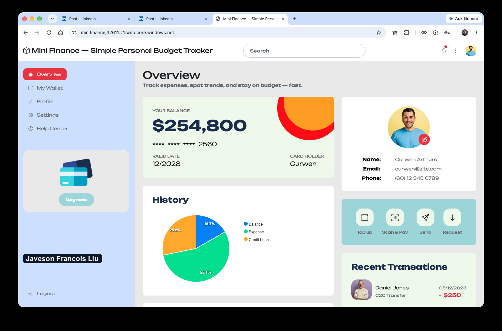

# Assignment 4 — Host a Static Website on Azure Storage

Part of the DevOps Micro Internship (DMI) with Agentic AI

---

## Purpose

In this assignment, you will deploy the Mini Finance static web application directly from an Azure Storage Account by enabling Static Website Hosting. The completed website must be publicly accessible through the Azure Storage primary endpoint URL.

---

# Task 1 — Download the Mini Finance Application

## Goal

Download and extract the Mini Finance static website files (`index.html`, `style.css`, images, and other assets) from `https://github.com/pravinmishraaws/mini_finance`.

> No screenshot required for this task.

I cloned `https://github.com/pravinmishraaws/mini_finance` and made a clean copy of the files with `git archive`, so the upload has no `.git` folder. It contains `index.html`, `style.css`, the images and the other assets.

---

# Task 2 — Create a Storage Account and Enable Static Website Hosting

## Goal

Create Resource Group `mini-finance-rg` and a globally unique Storage Account named `minifinance<uniqueid>` (Standard performance, LRS redundancy), then enable Static Website Hosting with `index.html` as the index document.

> No screenshot required for this task. Completion is verified through Task 4.

I created the Resource Group `mini-finance-rg` and the Storage Account `minifinancejfl2611` with the Azure CLI (Standard performance, LRS redundancy). I then enabled Static Website Hosting with `index.html` as the index document, which creates the `$web` container.

---

# Task 3 — Upload Your Website Files

## Goal

Upload all Mini Finance project files to the `$web` container.

> No screenshot required for this task.

I uploaded the 36 files to the `$web` container with `az storage blob upload-batch`. Before taking the screenshot I requested the pages, CSS, fonts and images from the primary endpoint with `curl`. Every one returned HTTP 200 with the right content type.

---

# Task 4 — Test Your Website

## Goal

Open the primary endpoint URL and confirm the Mini Finance application, styling, and images all load correctly.

### Evidence

#### Screenshot 1 — Mini Finance website running in the browser

The page opens on the Azure Storage primary endpoint and shows the Mini Finance overview with its styling, charts and images. The address bar shows the static website URL, and no subscription information is visible.

---

#### Website URL

`https://minifinancejfl2611.z1.web.core.windows.net/`

---

# Submission Instructions

- Add the required screenshot and URL in your submission
- Do not expose subscription identifiers or other sensitive account information

---

# Completion Checklist

- [x] Mini Finance project downloaded and extracted
- [x] Storage Account created with Static Website Hosting enabled
- [x] All website files uploaded to the `$web` container
- [x] Website verified through the primary endpoint (Screenshot 1)
- [x] Website URL included
- [x] No sensitive account information exposed

---

## 📌 About DMI & CloudAdvisory

DevOps Micro Internship (DMI) is a project-based DevOps program run by Pravin Mishra (The CloudAdvisory) focused on real-world execution, systems thinking, and career readiness.

It helps learners build strong DevOps foundations with hands-on experience.

---

## 📌 Resources

- 🌐 DMI Official Website: https://dmi.pravinmishra.com?utm_source=github&utm_medium=readme  
- 🎓 University: https://university.pravinmishra.com?utm_source=github&utm_medium=readme  
- 💬 Discord Community: https://discord.pravinmishra.com?utm_source=github&utm_medium=readme  
- 📝 Blog: https://dmi.pravinmishra.com/blog?utm_source=github&utm_medium=readme  
- ▶️ YouTube Playlist: https://www.youtube.com/playlist?list=PLFeSNDtI4Cho  
- 🔗 Pravin Mishra (LinkedIn): https://www.linkedin.com/in/pravin-mishra-aws-trainer/  
- 🏢 CloudAdvisory (LinkedIn): https://www.linkedin.com/company/thecloudadvisory/

---

*This submission is part of DevOps Micro Internship (DMI) — Agentic AI Track.*
