# Assignment 5 — Deploy EpicBook Web App on Azure VM with Azure Database for MySQL

Part of the DevOps Micro Internship (DMI) with Agentic AI

---

## Purpose

In this assignment, you will deploy the EpicBook web application on Azure using an Ubuntu Virtual Machine to host the frontend and backend, and Azure Database for MySQL Flexible Server (private access) to store user and product data. You will build the network, provision the resources, deploy the application, and prove that the complete user flow works through the VM's public IP.

---

# Task 1 — Create Network Infrastructure

## Goal

Create a VNet (10.0.0.0/16) with a public subnet (10.0.1.0/24) for the VM and a private subnet (10.0.2.0/24) for MySQL, with NSGs allowing HTTP (80)/SSH (22) publicly and MySQL (3306) only from the VM subnet, plus a Public IP and Network Interface for the VM.

### Evidence

#### Screenshot 1 — Virtual Network overview showing the 10.0.0.0/16 address space and both subnets

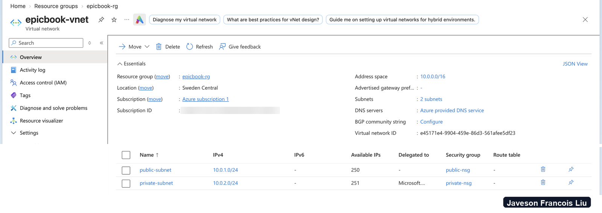

I created the Resource Group `epicbook-rg` in Sweden Central and the VNet with `az network vnet create` (10.0.0.0/16), with `public-subnet` 10.0.1.0/24 for the VM and `private-subnet` 10.0.2.0/24 for MySQL. The screenshot shows the address space and both subnets.

---

#### Screenshot 2 — Public and private NSG inbound rules showing ports 80, 22, and restricted 3306 access

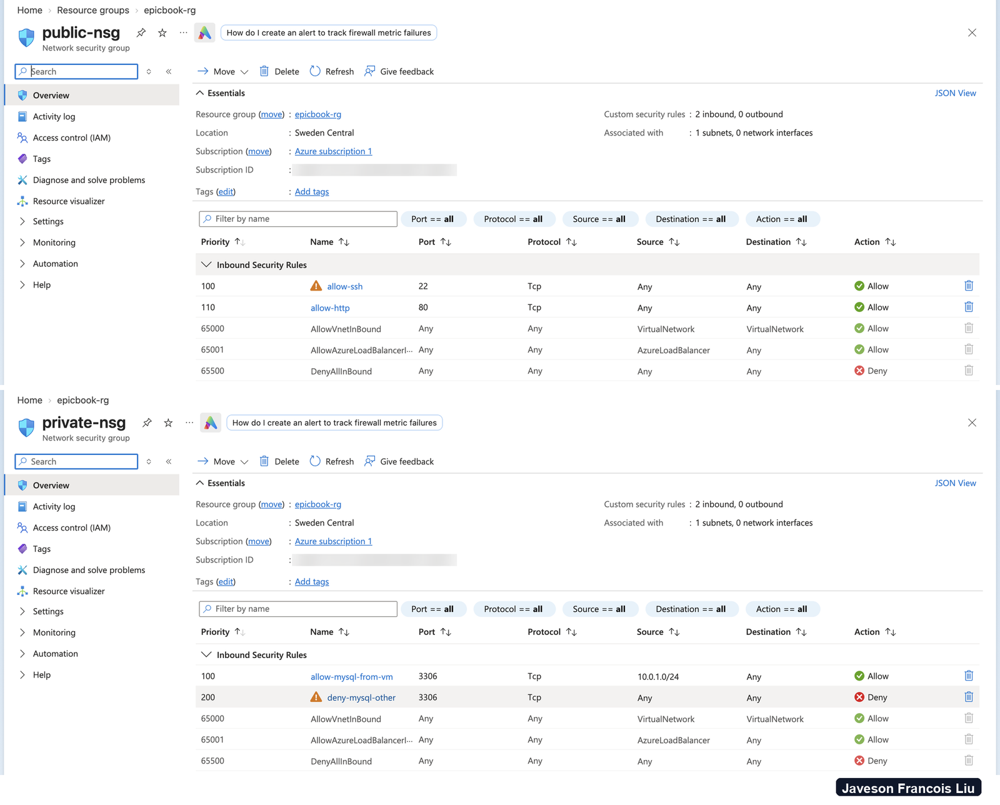

The public NSG allows TCP 80 and 22 from the internet. The private NSG allows TCP 3306 only from the public subnet range 10.0.1.0/24, so nothing else can reach the database port. Both were created with `az network nsg create` and `az network nsg rule create` and attached to their subnets.

---

#### Screenshot 3 — Public IP and Network Interface association for the Virtual Machine

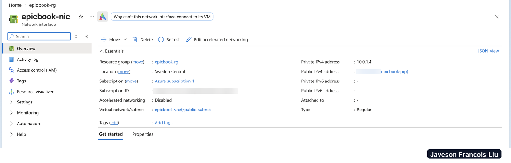

I created a Standard static public IP and a network interface in `public-subnet`, then attached the public IP to the NIC. The VM was created with `--nics` so it uses this NIC and not one the wizard would invent.

---

# Task 2 — Provision Azure Virtual Machine

## Goal

Launch an Ubuntu 22.04 LTS VM (Standard B1s or equivalent) in the public subnet, and install Node.js, npm, Nginx, Git, and MySQL Client.

### Evidence

#### Screenshot 4 — Virtual Machine overview showing Ubuntu, size, public IP, and subnet

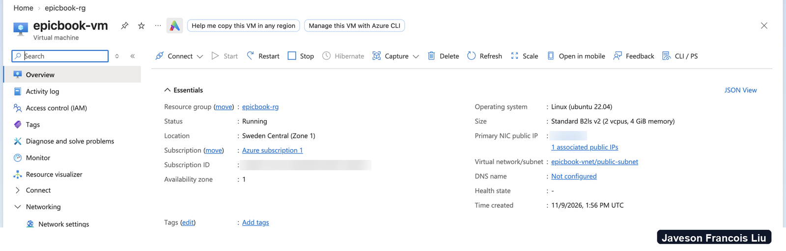

The VM runs Ubuntu Server 22.04 LTS in `public-subnet`. The size is Standard B2ls v2 in Zone 1, not B1s: B1s is not available to this subscription, and B2ats v2 failed with "ZonalAllocationFailed" in the zones I tried. A small loop with `az vm create` tried each size and zone until one succeeded.

---

#### Screenshot 5 — Terminal showing successful software installation or installed-version checks

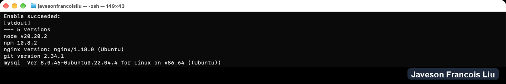

I installed Node.js, npm, Nginx, Git and the MySQL client with `az vm run-command invoke`, so no SSH was needed. The screenshot shows the version of each tool.

---

# Task 3 — Deploy the EpicBook Application

## Goal

Clone the EpicBook repository, install dependencies, build the frontend, configure Nginx to serve it, and configure the Node.js/Express.js backend to connect to MySQL using environment variables.

### Evidence

#### Screenshot 6 — Terminal showing the EpicBook repository cloned and dependencies installed

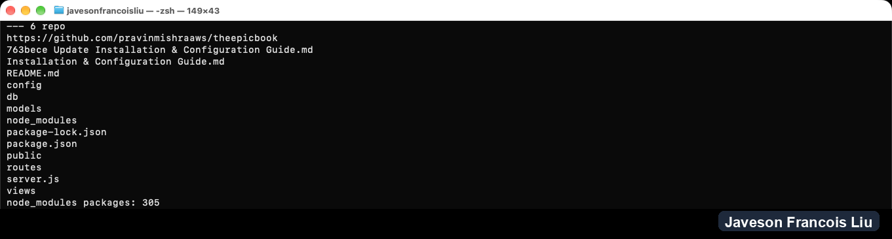

I cloned `theepicbook` as `azureuser` and ran `npm install`, which installed 305 packages. EpicBook renders its pages on the server with Handlebars, so there is no separate frontend build step; Express serves the pages and static files itself.

---

#### Screenshot 7 — Nginx configuration or service status proving the frontend is configured to be served

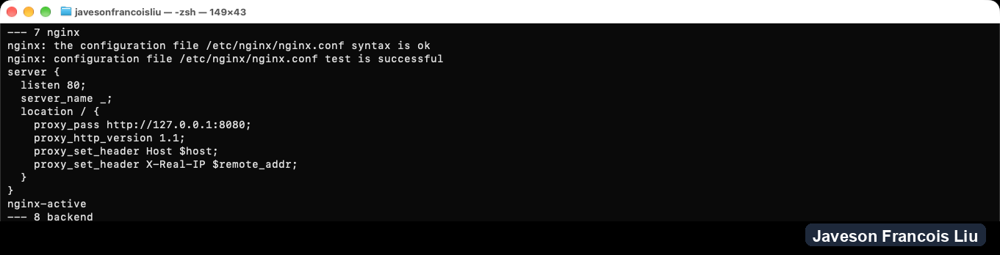

Nginx listens on port 80 and proxies every request to the Node app on 127.0.0.1:8080. `nginx -t` passes and the service is active.

---

#### Screenshot 8 — Backend process or listening-port evidence (without exposing environment-variable secrets)

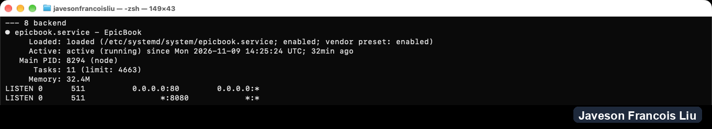

The backend runs as the systemd service `epicbook`. It reads its database settings from `/etc/epicbook.env`, a root-owned file with mode 600, through `EnvironmentFile=`, so nothing secret is in the repository, the unit file or this screenshot. The screenshot shows the service active, with Nginx on port 80 and Node on port 8080.

---

# Task 4 — Setup Azure Database for MySQL

## Goal

Create a private Azure Database for MySQL Flexible Server (VNet Integration) in the private subnet, create the database user and schema, import the SQL dump, and restrict access to the VM subnet only.

### Evidence

#### Screenshot 9 — MySQL Flexible Server overview showing Private access (VNet Integration)

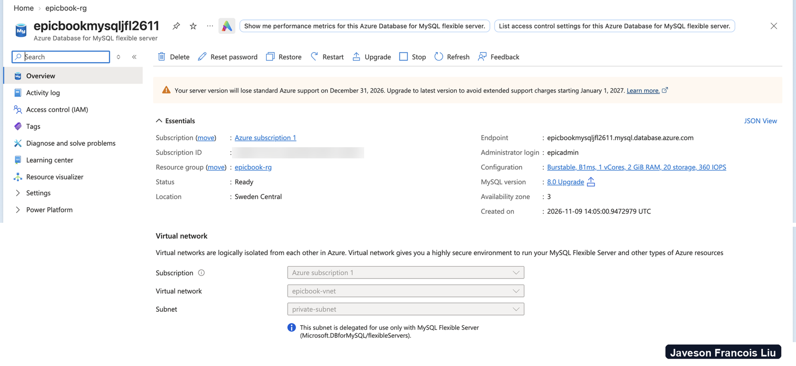

I created the Burstable Flexible Server with `az mysql flexible-server create --vnet --subnet`, which delegated `private-subnet` to the service. The overview shows Private access (VNet Integration).

---

#### Screenshot 10 — Networking configuration showing the private subnet and restricted access

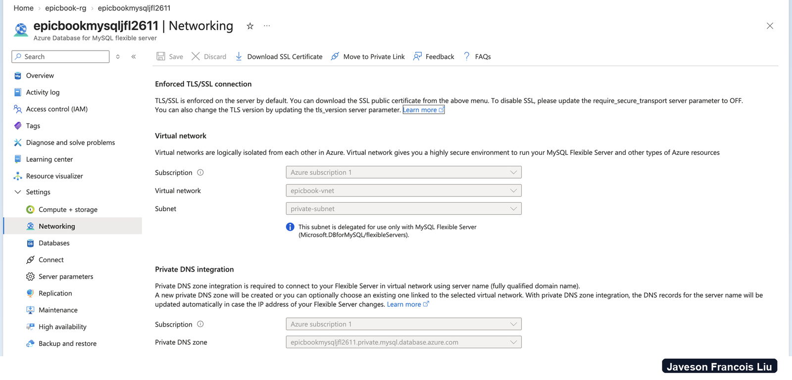

The server has no public endpoint. It sits in `private-subnet` and resolves through a private DNS zone that Azure created, and the private NSG only lets the VM subnet reach port 3306. One setting to disclose: I set `require_secure_transport` to OFF so the app connects without a CA bundle. The traffic stays inside the VNet, but in production I would keep TLS on and give the app the CA certificate.

---

#### Screenshot 11 — MySQL Client output showing the EpicBook database or imported tables (no password visible)

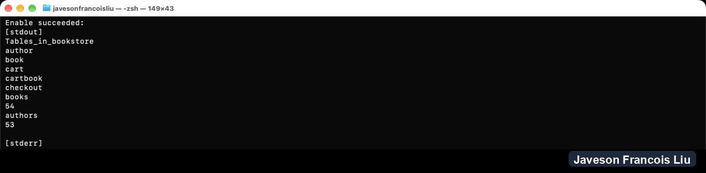

I created the `bookstore` database and a dedicated app user `epicapp`, then imported the SQL dump from the VM with the MySQL client. The output lists the tables `author`, `book`, `cart`, `cartbook` and `checkout`, with 54 books and 53 authors. The passwords were read from files with mode 600 and never typed or shown.

---

# Task 5 — Test End-to-End Functionality

## Goal

Confirm the EpicBook application loads through the VM's public IP and that viewing products, adding items to the cart, and placing orders all work.

### Evidence

#### Screenshot 12 — Browser showing the EpicBook application with the Virtual Machine public IP visible

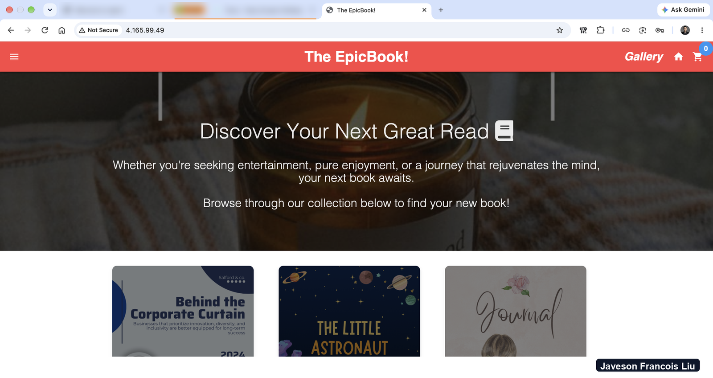

The EpicBook home page loads over HTTP at the VM's public IP, through Nginx and the Node backend.

---

#### Screenshot 13 — Proof of a successful database-backed action (viewing products, adding to cart, or placing an order)

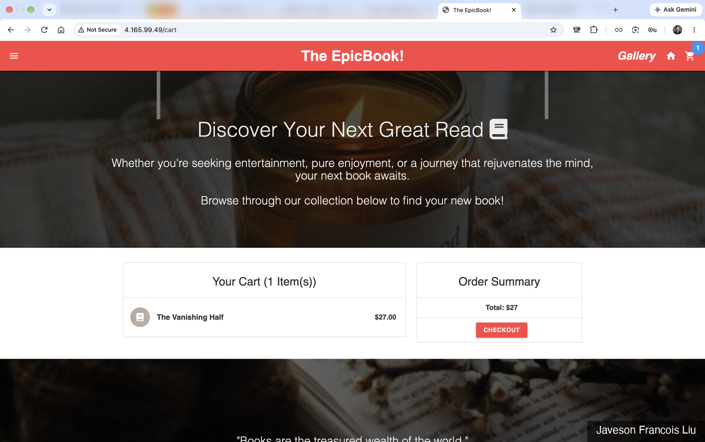

I added "The Vanishing Half" to the cart from the gallery. The cart page reads it back from the private MySQL server and shows 1 item and a total of $27. The gallery itself also reads all 54 books from the database.

---

#### Public IP URL

Paste the public IP URL of your Virtual Machine here:

`http://4.165.99.49`

---

# Submission Instructions

- Add all required screenshots in your submission
- Include the Virtual Machine public IP URL
- Do not expose database passwords, connection strings, or subscription IDs

---

# Completion Checklist

- [x] Task 1: Network foundation created with public/private subnets and NSGs (Screenshots 1–3)
- [x] Task 2: VM provisioned and required software installed (Screenshots 4–5)
- [x] Task 3: EpicBook frontend and backend deployed (Screenshots 6–8)
- [x] Task 4: Private Azure Database for MySQL created and data imported (Screenshots 9–11)
- [x] Task 5: End-to-end functionality validated (Screenshots 12–13, Public IP URL)
- [x] No sensitive data exposed

---

## 📌 About DMI & CloudAdvisory

DevOps Micro Internship (DMI) is a project-based DevOps program run by Pravin Mishra (The CloudAdvisory) focused on real-world execution, systems thinking, and career readiness.

It helps learners build strong DevOps foundations with hands-on experience.

---

## 📌 Resources

- 🌐 DMI Official Website: https://dmi.pravinmishra.com?utm_source=github&utm_medium=readme  
- 🎓 University: https://university.pravinmishra.com?utm_source=github&utm_medium=readme  
- 💬 Discord Community: https://discord.pravinmishra.com?utm_source=github&utm_medium=readme  
- 📝 Blog: https://dmi.pravinmishra.com/blog?utm_source=github&utm_medium=readme  
- ▶️ YouTube Playlist: https://www.youtube.com/playlist?list=PLFeSNDtI4Cho  
- 🔗 Pravin Mishra (LinkedIn): https://www.linkedin.com/in/pravin-mishra-aws-trainer/  
- 🏢 CloudAdvisory (LinkedIn): https://www.linkedin.com/company/thecloudadvisory/

---

*This submission is part of DevOps Micro Internship (DMI) — Agentic AI Track.*
