# Assignment 6 — Capstone: Deploy Book Review App (Three-Tier Architecture) on Azure

Part of the DevOps Micro Internship (DMI) with Agentic AI

---

## Purpose

This is the most important assignment of the course. You will deploy the Book Review App in a production-ready, best-practice-compliant three-tier architecture on Azure: separated presentation, application, and database tiers, least-privilege network access, a controlled public entry point, protected secrets, and availability/monitoring evidence.

---

# Task 1 — Design the Azure Three-Tier Architecture

## Goal

Create an architecture diagram and implementation plan identifying the presentation, application, and database components, the chosen Azure services, the public entry point, and the internal traffic paths.

### Evidence

#### Screenshot 1 — Architecture diagram showing the public entry point, three tiers, network boundaries, and traffic flow

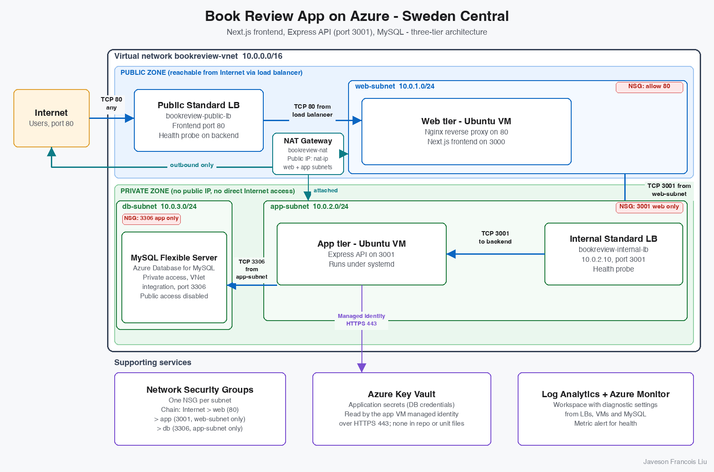

A public Standard Load Balancer is the only entry point. It sends port 80 to the web VM (Nginx serving the Next.js frontend), which proxies `/api/` to an internal Standard Load Balancer at 10.0.2.10:3001 in front of the app VM (Express API). The API talks to a private Azure Database for MySQL Flexible Server. Key Vault holds the secrets, and a NAT gateway gives the two private subnets outbound access.

---

#### Screenshot 2 — Written architecture assumptions and selected Azure services

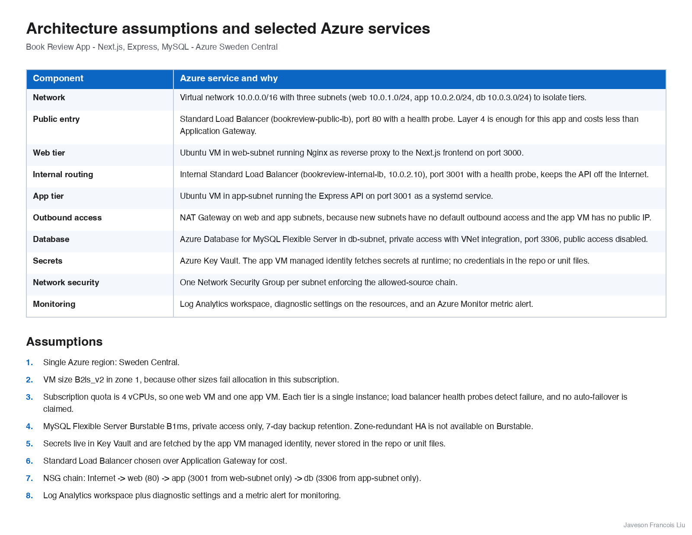

The table lists the region (Sweden Central), the services chosen for each tier, and the limits I accepted. The vCPU quota is 4, so each tier runs one B2ls v2 instance, and the MySQL tier is Burstable, which has no high availability. Private subnets have no default outbound access, so I added a NAT gateway for package installs.

---

# Task 2 — Create the Azure Network Foundation

## Goal

Create a dedicated Resource Group and VNet with separate subnets for the web, application, and database tiers, keeping the application and database tiers without direct public access.

### Evidence

#### Screenshot 3 — Resource Group overview showing the assignment resources

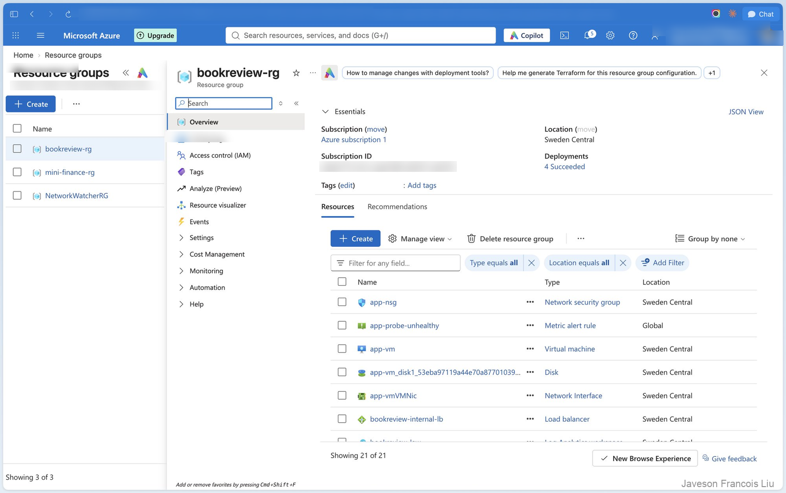

All 21 resources live in `bookreview-rg` (Sweden Central): VNet, three NSGs, NAT gateway, two VMs with their disks and NICs, two load balancers, Key Vault, MySQL server, private DNS zone, Log Analytics workspace and the alert rules.

---

#### Screenshot 4 — VNet overview showing the address space and all required subnets

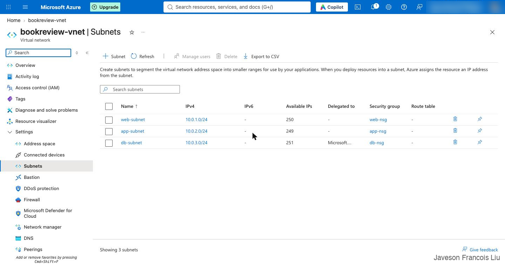

`bookreview-vnet` uses 10.0.0.0/16 with three /24 subnets: `web-subnet` (10.0.1.0/24), `app-subnet` (10.0.2.0/24) and `db-subnet` (10.0.3.0/24, delegated to MySQL Flexible Server). Each subnet has its own NSG.

---

#### Screenshot 5 — Route-table or Private DNS evidence where applicable

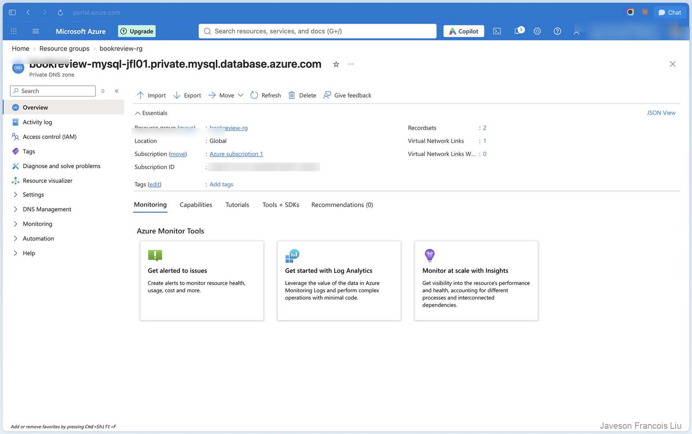

The private DNS zone `bookreview-mysql-jfl01.private.mysql.database.azure.com` has two record sets and one virtual network link to `bookreview-vnet`, so the database resolves to a private address inside the VNet. I did not need a custom route table: system routes handle traffic between subnets and the NAT gateway handles outbound.

---

# Task 3 — Configure Security and Secret Management

## Goal

Apply least-privilege NSG rules so traffic flows Internet → public entry point → web tier → application tier → database tier, and store credentials in Azure Key Vault or another approved secure mechanism.

### Evidence

#### Screenshot 6 — NSG rules proving least-privilege access between the tiers

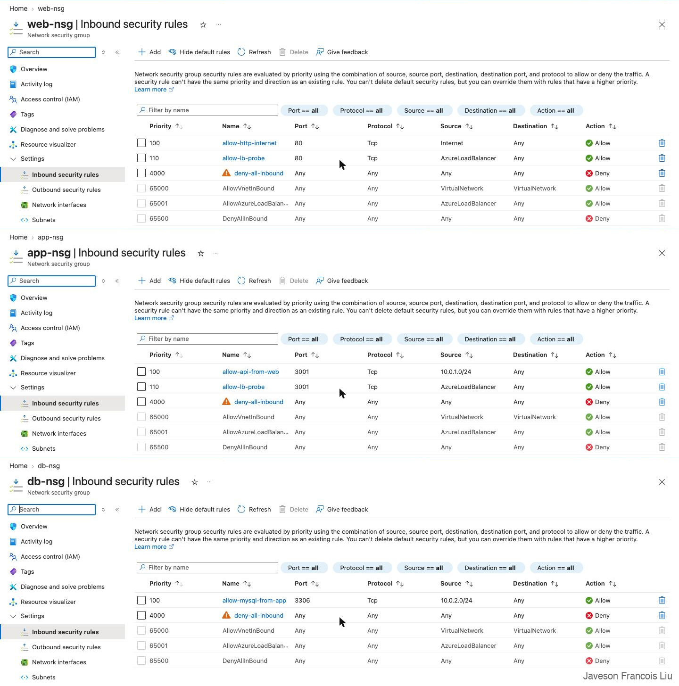

`web-nsg` allows port 80 from the internet and the load balancer probe. `app-nsg` allows port 3001 only from 10.0.1.0/24 plus the probe. `db-nsg` allows port 3306 only from 10.0.2.0/24. Each NSG ends with an explicit deny-all inbound rule at priority 4000.

---

#### Screenshot 7 — Key Vault or approved secret-management configuration (without displaying secret values)

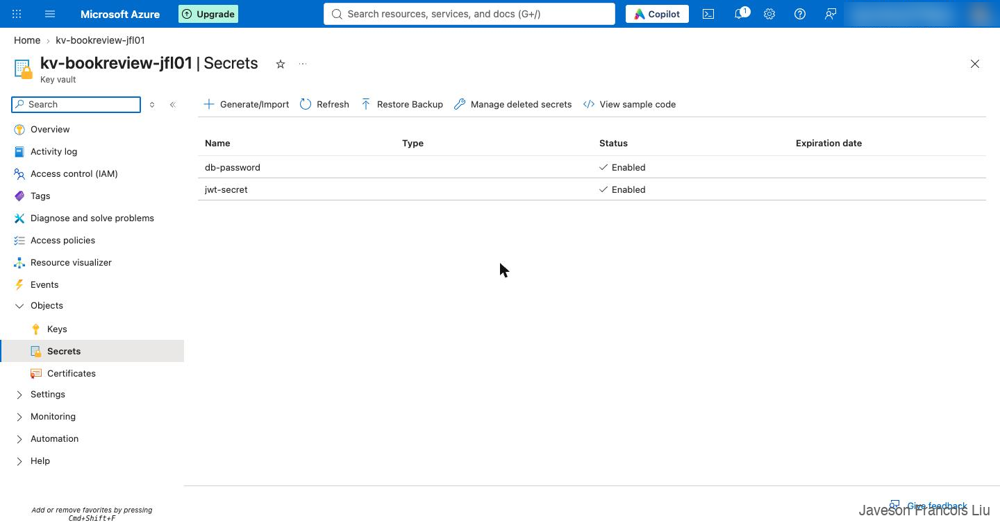

`kv-bookreview-jfl01` uses Azure RBAC and holds `db-password` and `jwt-secret`, both enabled. The app VM has a system-assigned managed identity with the Key Vault Secrets User role, and its service reads the secrets from the instance metadata endpoint at start. No secret value is stored in the repo or in the unit file.

---

# Task 4 — Deploy the Presentation (Web) Tier

## Goal

Deploy the Book Review App presentation layer on the approved web-tier compute service, configured to route requests to the internal application-tier endpoint, and not directly exposed except through the public entry service.

### Evidence

#### Screenshot 8 — Web-tier compute overview showing subnet and availability configuration

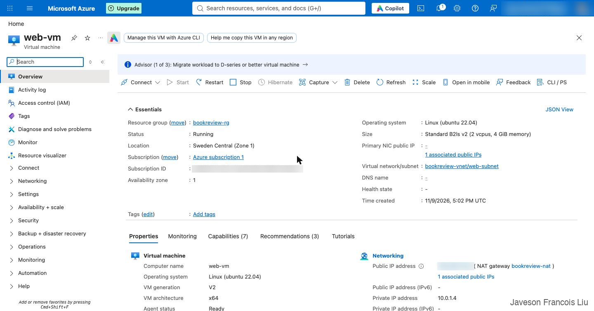

`web-vm` is a Standard B2ls v2 in Zone 1 on Ubuntu 22.04, in `web-subnet` with private IP 10.0.1.4 and no public IP of its own. Outbound traffic goes through the NAT gateway.

---

#### Screenshot 9 — Terminal or service output proving the presentation layer is running

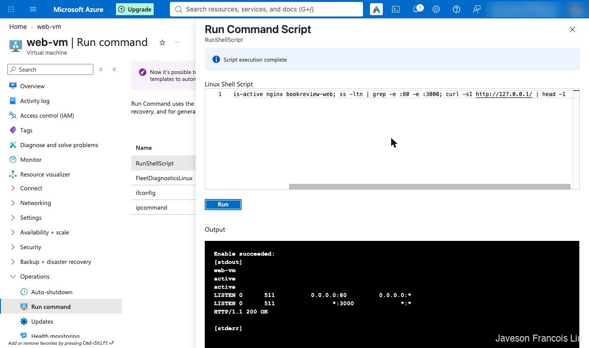

Run command output from `web-vm` shows Nginx and `bookreview-web` both active, Nginx listening on port 80, the Next.js server on port 3000, and Nginx answering `HTTP/1.1 200 OK` locally.

---

# Task 5 — Deploy the Business (Application) Tier

## Goal

Deploy the Book Review App backend privately in the application subnet, configured to use the private database endpoint and secured environment values, reachable only through its internal endpoint.

### Evidence

#### Screenshot 10 — Application-tier compute overview showing private subnet placement

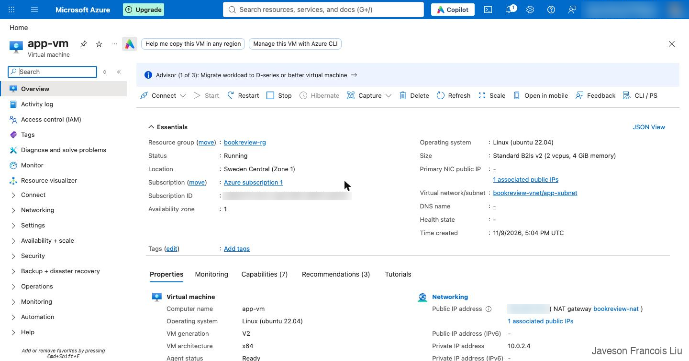

`app-vm` is a Standard B2ls v2 in Zone 1 in `app-subnet` with private IP 10.0.2.4 and no public IP. Its system-assigned managed identity is used for Key Vault.

---

#### Screenshot 11 — Backend process, service, or listening-port evidence

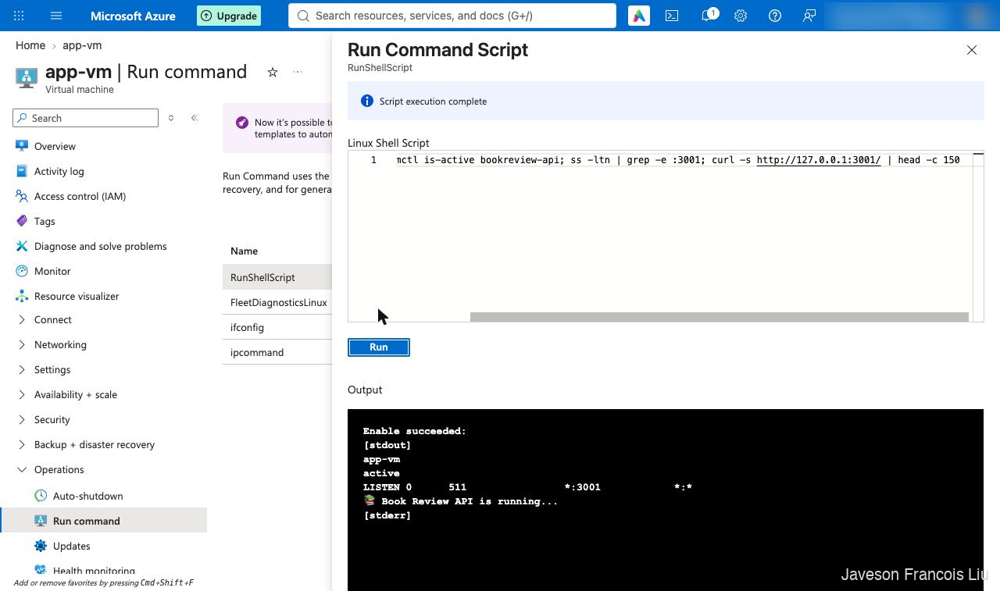

On `app-vm`, the `bookreview-api` systemd service is active, port 3001 is listening, and the API root returns its running message. The service runs as a non-root user and writes its environment file to `/run` at start.

---

#### Screenshot 12 — Internal health-check or API response (without exposing secrets)

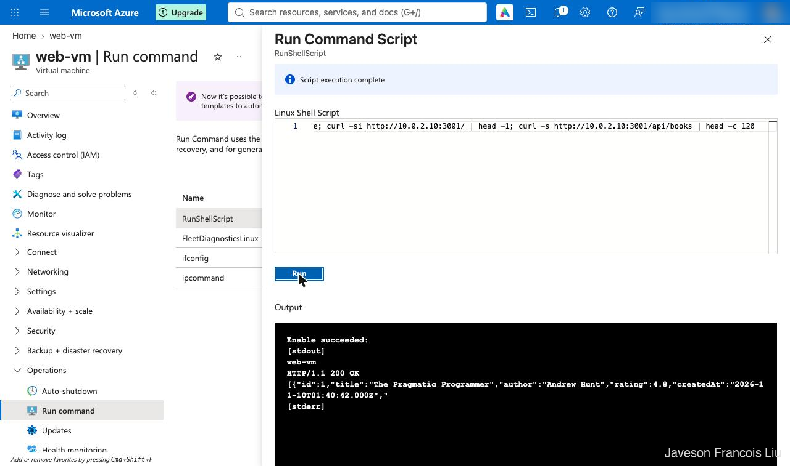

From `web-vm`, a request to the internal load balancer frontend `10.0.2.10:3001` returns `HTTP/1.1 200 OK`, and `/api/books` returns the book JSON. This proves the web tier reaches the app tier only through the internal load balancer.

---

# Task 6 — Deploy the Managed Database Tier

## Goal

Create a private Azure managed database (public access disabled), with availability/backup/retention settings, the Book Review App schema imported, and access restricted to the application tier only.

### Evidence

#### Screenshot 13 — Database overview showing private connectivity and public access disabled

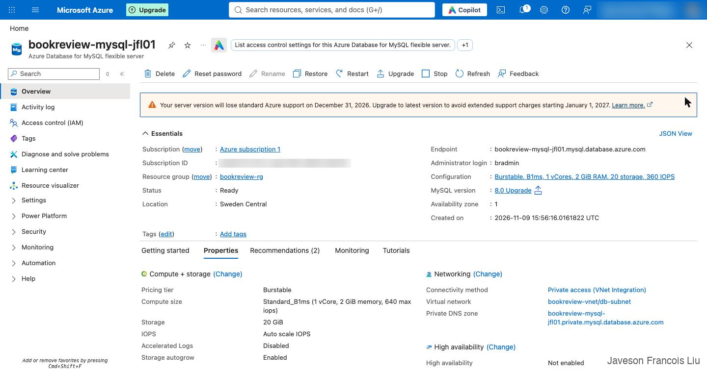

The Flexible Server is Burstable B1ms (MySQL 8.0) in Sweden Central, with connectivity method Private access (VNet Integration) in `db-subnet` and the private DNS zone attached. Public network access is disabled, so the server has no public endpoint.

---

#### Screenshot 14 — Availability, backup, and retention configuration

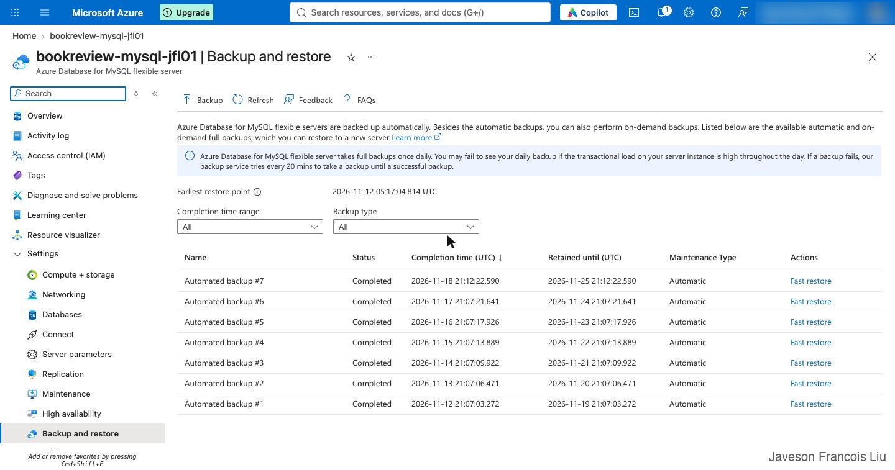

Automated daily backups are running with 7-day retention, and the list shows seven completed backups. High availability is not enabled: the Burstable tier does not offer zone-redundant HA, so a database outage would mean a restore.

---

#### Screenshot 15 — Successful schema or connectivity verification (without exposing credentials)

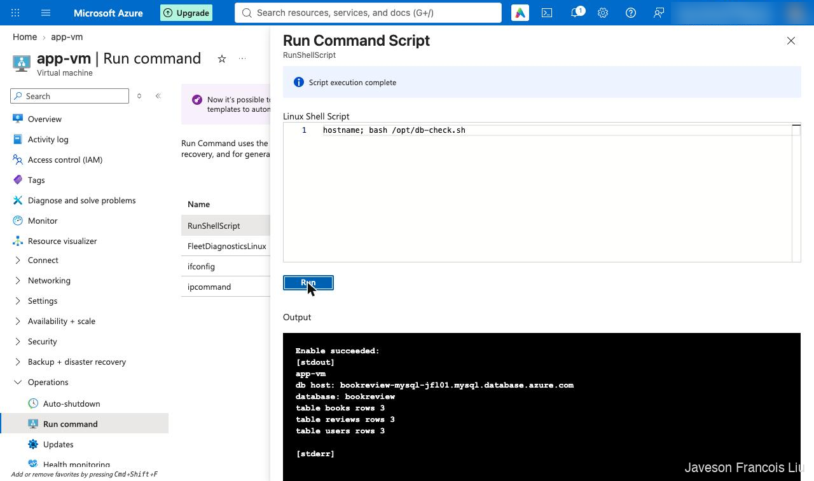

From `app-vm`, a read-only check connects with the stored credentials over TLS and lists the `bookreview` tables: `books`, `reviews` and `users`, with row counts. The credentials are loaded from the environment file and are never printed. The schema is created by the app on first start (Sequelize sync), not by importing a SQL file.

---

# Task 7 — Configure Traffic Management, Availability, and Monitoring

## Goal

Configure the approved public entry service with health probes and backend pools, internal routing for the application tier where required, and enable Azure Monitor/diagnostics/logs/alerts for the key resources.

### Evidence

#### Screenshot 16 — Public entry service showing listener, frontend endpoint, and healthy web targets

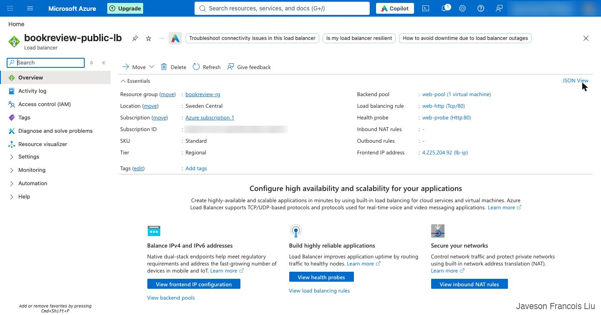

`bookreview-public-lb` (Standard, regional) has frontend IP 4.225.204.92, rule `web-http` (TCP 80), health probe `web-probe` (HTTP 80) and backend pool `web-pool` with one VM.

---

#### Screenshot 17 — Internal application-tier load-balancing or routing configuration where applicable

`bookreview-internal-lb` has the private frontend 10.0.2.10, rule `app-api` (TCP 3001), health probe `app-probe` (HTTP 3001) and backend pool `app-pool` with the app VM.

---

#### Screenshot 18 — Azure Monitor, diagnostic settings, logs, metrics, or alert evidence

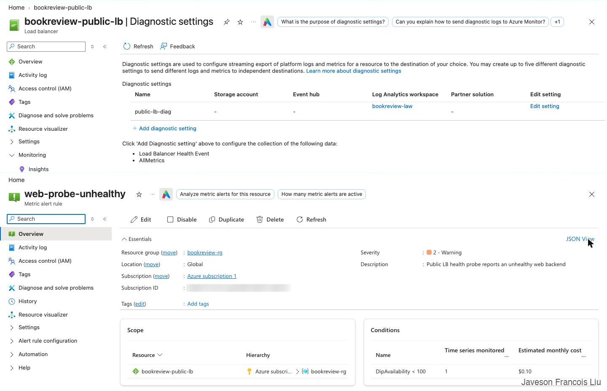

Diagnostic settings send the load balancers, Key Vault and MySQL to the `bookreview-law` Log Analytics workspace. Two metric alerts watch the health probes: `web-probe-unhealthy` (public LB) and `app-probe-unhealthy` (internal LB), both firing when `DipAvailability` is below 100. The screenshot shows the public LB setting and the web alert.

---

# Task 8 — Validate the Production-Style Deployment

## Goal

Confirm the Book Review App works end to end through the public endpoint, with at least one database read and one write, confirm private tiers are not internet-reachable, and complete a safe availability test.

### Evidence

#### Screenshot 19 — Browser showing the Book Review App through the public endpoint

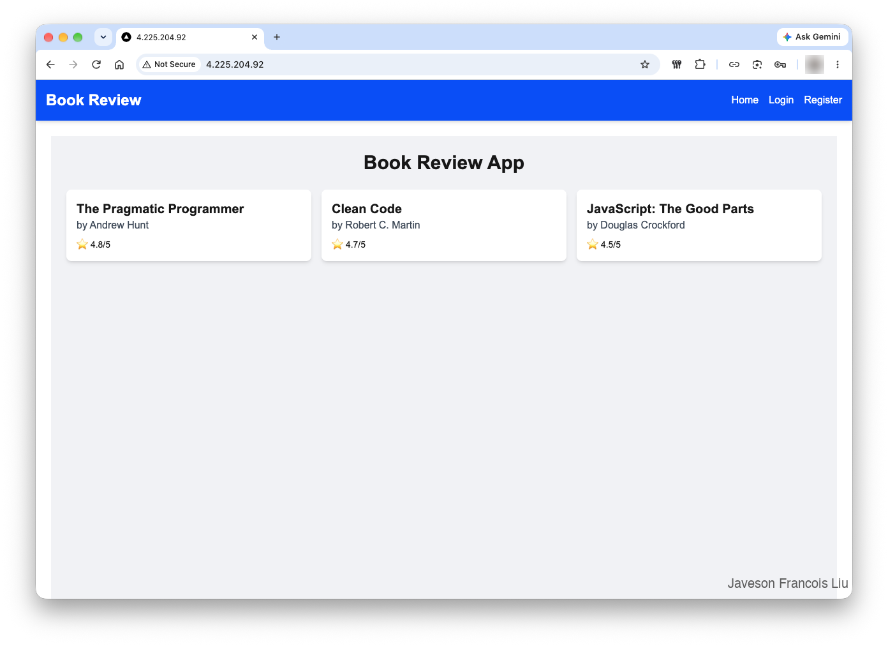

The Book Review App loads in the browser at `http://4.225.204.92` with its three books, served through the public load balancer.

---

#### Screenshot 20 — Proof of successful database-backed read and write operations

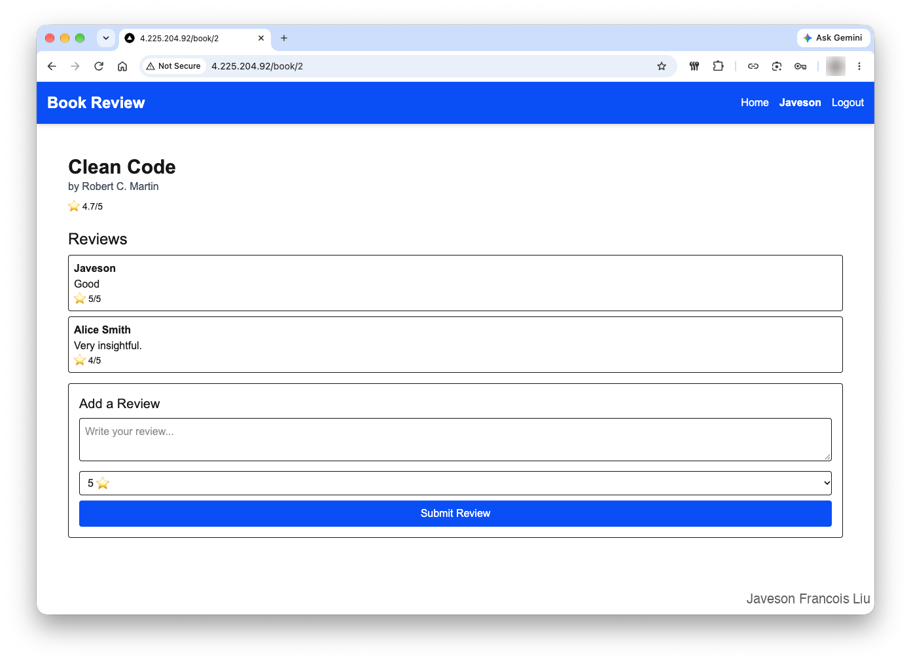

I registered a user, logged in, and posted a review on Clean Code. After a page reload the review is listed next to the seeded review by Alice Smith, so the write and the read both go through the private MySQL database.

---

#### Screenshot 21 — Evidence that private tiers are not publicly accessible

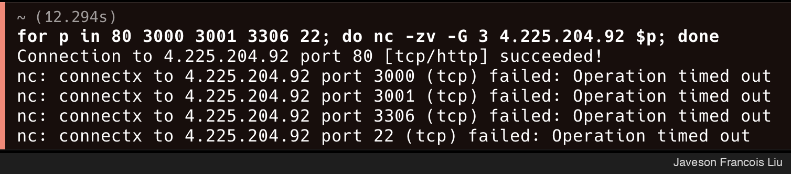

From my laptop, a TCP test to the public IP opens port 80 and times out on 3000, 3001, 3306 and 22. The web, API and database ports are not exposed to the internet.

---

#### Screenshot 22 — Availability-test and healthy-target evidence

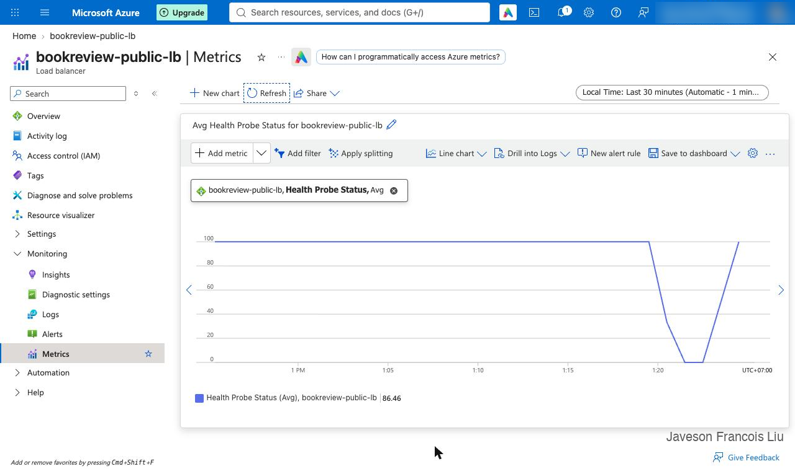

I stopped the `bookreview-web` service on `web-vm` for about three minutes. The Health Probe Status metric fell to 0 and the site stopped answering. After I started the service again the metric returned to 100 and the site answered HTTP 200. With one instance per tier this is an outage that recovers, not a failover.

---

#### Public Endpoint

Paste your public endpoint URL here:

`http://4.225.204.92`

---

### Notes

Summarize what worked, issues encountered and how they were fixed, and the availability/security/secrets/monitoring/backup choices made.

I built the Book Review App as a three-tier deployment in one resource group: a public Standard Load Balancer, a web VM (Nginx and Next.js), an internal Standard Load Balancer, an app VM (Express) and a private MySQL Flexible Server with public access disabled. It works end to end: the public IP serves the app, a registered user can post a review that is stored in MySQL, and ports 3000, 3001, 3306 and 22 are closed from the internet.

**What went wrong and how I fixed it**
- **Quota:** the subscription allows 4 vCPUs, so each tier is a single B2ls v2 instance. The load balancers are in place, but there is no second instance to fail over to.
- **No outbound access:** new private subnets have no default outbound route, so package installs failed. I added a NAT gateway on the web and app subnets.
- **Database hostname:** the app could not connect because the `.private.` DNS name does not resolve for the client. I pointed it at the server FQDN, which resolves to the private address 10.0.3.4 inside the VNet.
- **Doubled API path:** the frontend build baked in `/api` and the code appends `/api/books`, so the browser called `/api/api/books` and the home page showed no books. I added an Nginx rule that maps `/api/api/` to `/api/`. The proper fix is rebuilding with an empty API base URL.
- **Alerts:** the monitoring command failed until I registered the `Microsoft.Insights` provider.

**Choices**
- **Availability:** two load balancers with health probes, and an availability test that showed the probe drop and recover. Single instances mean no automatic failover.
- **Security:** NSGs allow only the previous tier, each ends with a deny-all rule, and the VMs have no public IPs.
- **Secrets:** Key Vault with RBAC, read by the app VM's managed identity at service start, so no password is in the repo or the unit file.
- **Database:** private access with TLS, 7-day automated backups. The Burstable tier has no high availability.
- **Monitoring:** Log Analytics workspace, diagnostic settings on the load balancers, Key Vault and MySQL, and two probe alerts.

**Limits I accepted:** single instance per tier, no HA database, HTTP only on port 80 (no certificate), and the Nginx rewrite as a workaround.

---

# LinkedIn Post (Required)

## Goal

Publish a LinkedIn post about the three-tier Azure build.

## Evidence

#### LinkedIn Post URL

https://www.linkedin.com/posts/javeson-francois-liu-999135437_dmibypravinmishra-azure-cloudengineering-share-7529072779493662721-UqY6

---

#### Screenshot of LinkedIn post

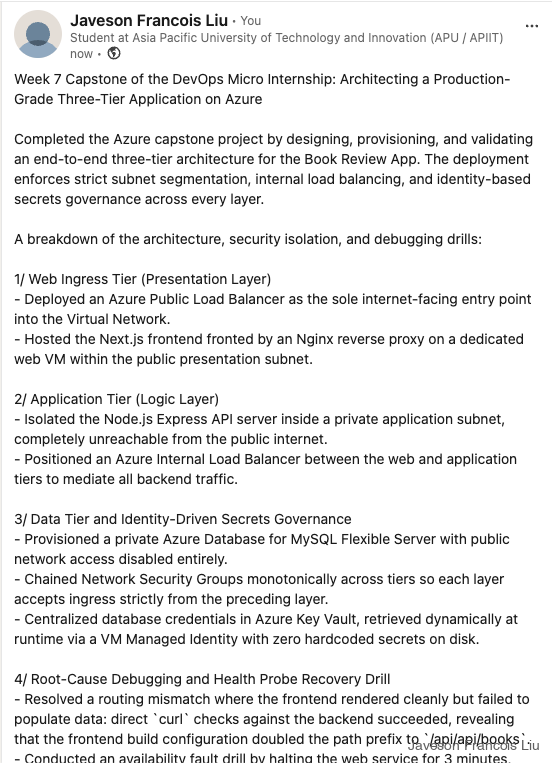

---

# Submission Instructions

- Add all required screenshots and links in your submission
- Do not expose passwords, keys, connection strings, or subscription IDs

---

# Completion Checklist

- [x] Task 1: Architecture diagram and assumptions documented (Screenshots 1–2)
- [x] Task 2: Network foundation created with isolated tiers (Screenshots 3–5)
- [x] Task 3: Least-privilege security and secret management configured (Screenshots 6–7)
- [x] Task 4: Presentation tier deployed (Screenshots 8–9)
- [x] Task 5: Application tier deployed privately (Screenshots 10–12)
- [x] Task 6: Managed database tier deployed privately (Screenshots 13–15)
- [x] Task 7: Public entry, internal routing, and monitoring configured (Screenshots 16–18)
- [x] Task 8: End-to-end validation and availability test completed (Screenshots 19–22, Public Endpoint, Notes)
- [x] LinkedIn post published and URL submitted
- [x] No sensitive data exposed

---

## 📌 About DMI & CloudAdvisory

DevOps Micro Internship (DMI) is a project-based DevOps program run by Pravin Mishra (The CloudAdvisory) focused on real-world execution, systems thinking, and career readiness.

It helps learners build strong DevOps foundations with hands-on experience.

---

## 📌 Resources

- 🌐 DMI Official Website: https://dmi.pravinmishra.com?utm_source=github&utm_medium=readme  
- 🎓 University: https://university.pravinmishra.com?utm_source=github&utm_medium=readme  
- 💬 Discord Community: https://discord.pravinmishra.com?utm_source=github&utm_medium=readme  
- 📝 Blog: https://dmi.pravinmishra.com/blog?utm_source=github&utm_medium=readme  
- ▶️ YouTube Playlist: https://www.youtube.com/playlist?list=PLFeSNDtI4Cho  
- 🔗 Pravin Mishra (LinkedIn): https://www.linkedin.com/in/pravin-mishra-aws-trainer/  
- 🏢 CloudAdvisory (LinkedIn): https://www.linkedin.com/company/thecloudadvisory/

---

*This submission is part of DevOps Micro Internship (DMI) — Agentic AI Track.*
