# Assignment 7 — AI-Assisted Azure Security Posture Audit

Part of the DevOps Micro Internship (DMI) with Agentic AI

---

## Purpose

In this assignment, you will build a read-only Bash script that audits the Azure resources you deployed earlier this week — a virtual machine, a three-tier network with a Load Balancer, a Storage Account, and an Azure Database for MySQL server — for common security misconfigurations. You will connect that script to Claude Code as a reusable `/azure-audit` skill that explains findings and recommends a fix without ever running it, then fix one real finding yourself and prove the fix with a second audit run. This is the same read-only-evidence-then-human-fixes discipline from Week 3, now applied to Azure with the `az` CLI instead of Linux commands — and the cloud-agnostic counterpart to the AWS audit you built in Week 6.

---

# Task 1 — Confirm Your Resources and Create the Workspace

## Goal

Confirm your Azure CLI is authenticated and can see the VM, network, storage account, and MySQL server you built this week, then set up a workspace folder for the audit.

### Evidence

#### Screenshot 1 — `az account show` and `az vm list -d -o table` confirming your subscription and running VM (subscription ID partially blurred)

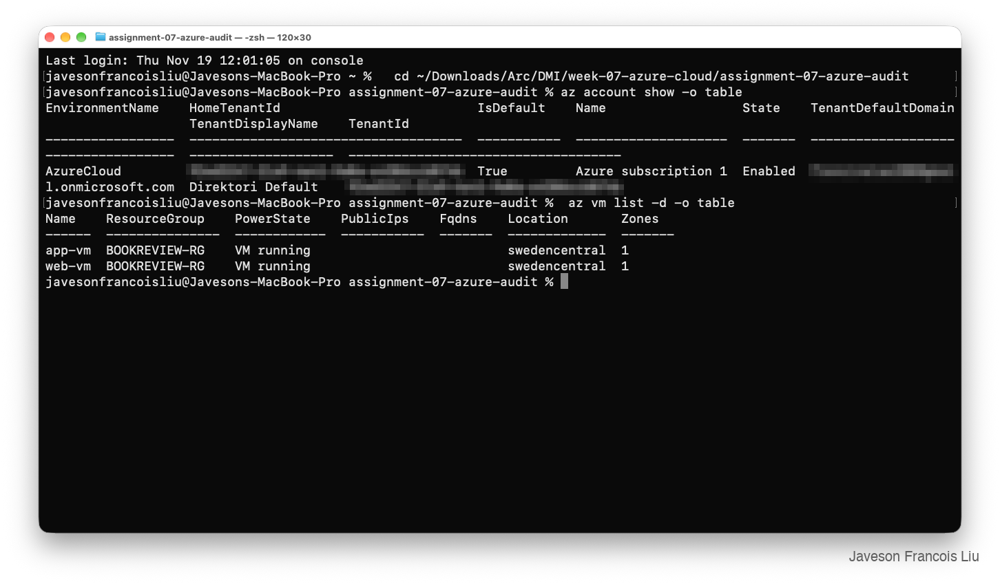

`az account show` confirms the subscription is enabled (tenant ID blurred) and `az vm list -d` shows `app-vm` and `web-vm` running in `BOOKREVIEW-RG`.

---

# Task 2 — Create Project Context and Safety Rules in CLAUDE.md

## Goal

Create a `CLAUDE.md` for this workspace that tells Claude what the audit covers and the safety rules it must follow: never run a mutating `az` command, never claim a finding without report evidence, and always let the human review and run any remediation.

### Evidence

#### Screenshot 2 — `CLAUDE.md` open in your editor showing the project overview, audit workflow, and safety rules

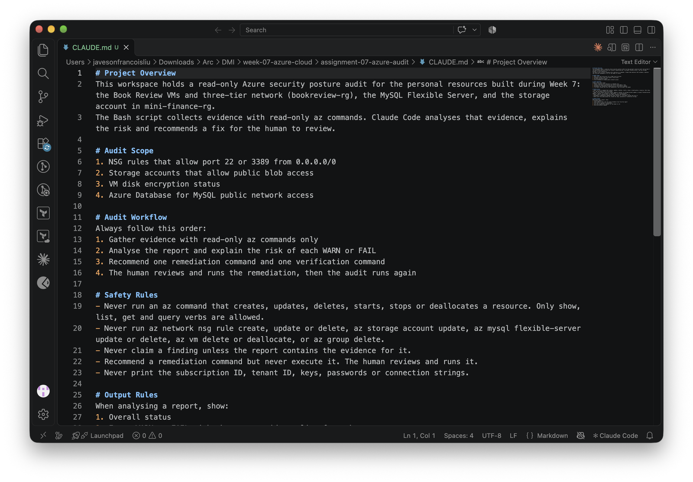

`CLAUDE.md` holds the project overview, the four-check audit scope, the workflow, the safety rules (no mutating `az` command, no claim without report evidence, human runs every fix) and the output rules.

---

# Task 3 — Use Agentic AI to Plan the Audit Before Writing the Script

## Goal

Ask Claude Code to read `CLAUDE.md` and propose a read-only, four-check audit plan (NSG rules open to `0.0.0.0/0` on port 22 or 3389, storage account public blob access, VM disk encryption status, and Azure Database for MySQL public network access) — without creating or editing any file yet.

### Evidence

#### Screenshot 3 — Claude Code showing the four-check plan, with no files created or modified

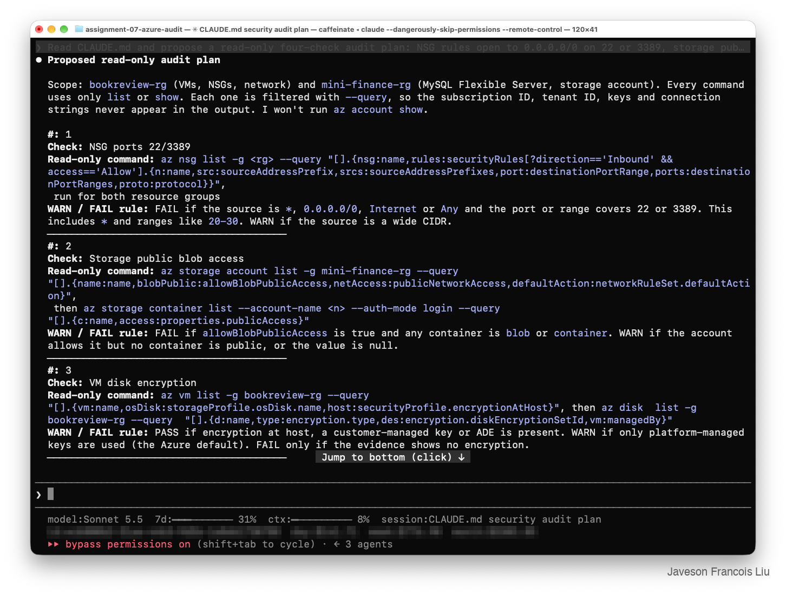

Claude read `CLAUDE.md` and proposed read-only `az` commands with a WARN or FAIL rule for each check (NSG ports 22 and 3389, storage public blob access and VM disk encryption are in view). It created and edited no file. Claude suggested WARN for platform-managed disk keys only; I kept PASS for encryption at rest because Azure always encrypts managed disks with platform keys.

---

# Task 4 — Build the Azure Audit Bash Script

## Goal

Write a Bash script that runs the four checks from Task 3 using read-only `az` commands, writes a PASS/WARN/FAIL report with your Full Name, and exits with a different code for a healthy, warning, or failing result. Validate it with `bash -n` and make it executable.

### Evidence

#### Screenshot 4 — Your script open in your editor, showing the check functions and the `az` commands they call

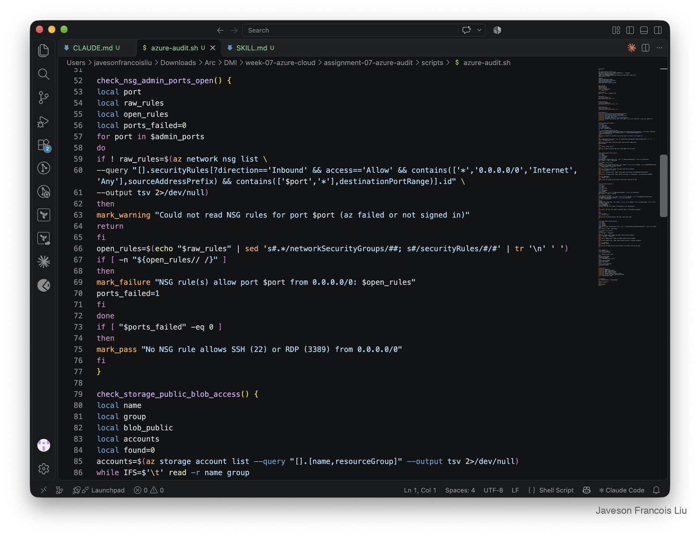

`check_nsg_admin_ports_open` and `check_storage_public_blob_access` use only `az network nsg list`, `az storage account list` and `az storage account show`. After the first Claude run I made the NSG check warn when `az` fails instead of printing a false PASS.

---

#### Screenshot 5 — Output of `bash -n` (no syntax errors) and `ls -l` showing the script is executable

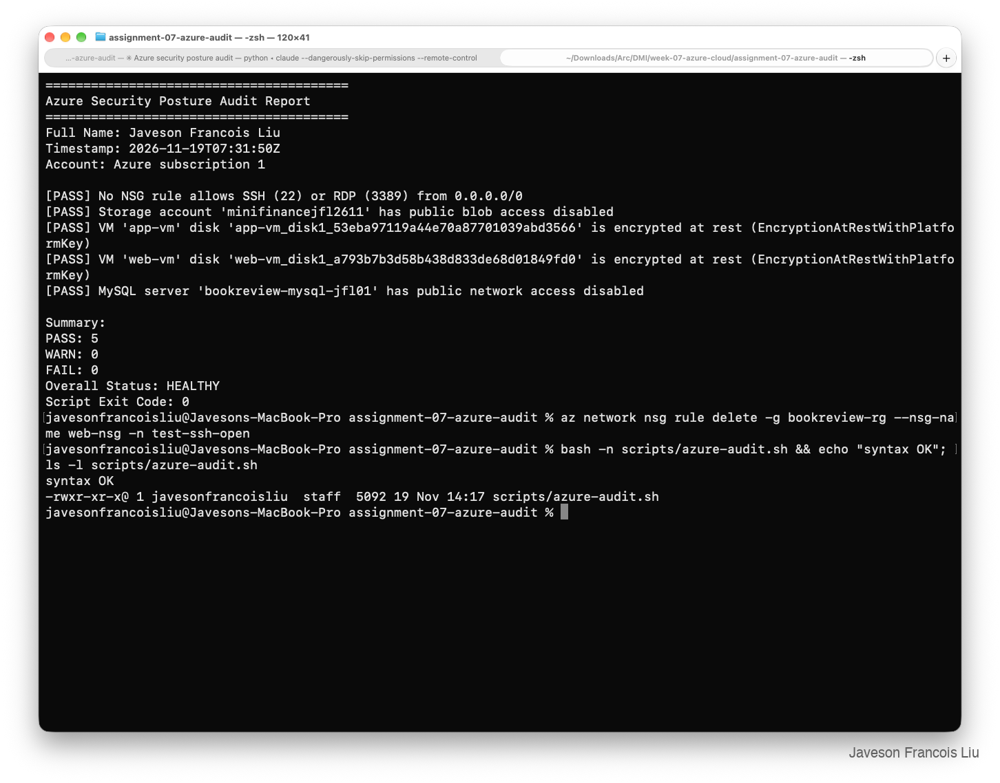

`bash -n` prints no errors and `ls -l` shows the script is executable (`-rwxr-xr-x`).

---

# Task 5 — Run the Script and Review the Baseline Report

## Goal

Run the script against your live resources and read the report honestly, even if it shows a real finding — do not fix anything yet.

### Evidence

#### Screenshot 6 — Script output showing your Full Name and all four checks with a PASS, WARN, or FAIL result

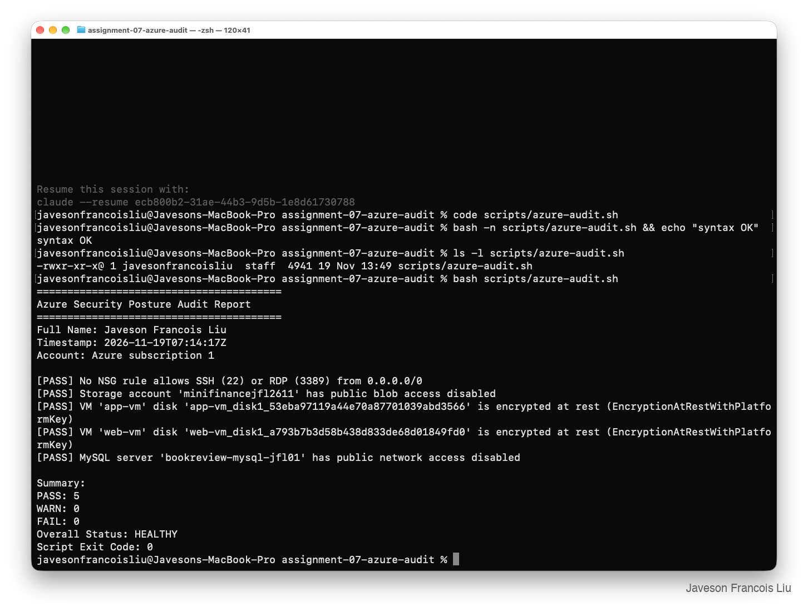

Baseline run: 5 PASS, 0 WARN, 0 FAIL, Overall Status HEALTHY, exit code 0. The report carries my Full Name and covers NSG ports, storage public access, both VM disks and the MySQL server.

---

# Task 6 — Create and Run the /azure-audit Skill

## Goal

Create a Claude Code skill restricted to read-only tools (no `Write`) that runs your script, reads the report, and explains every finding with the risk of leaving it unresolved — without ever running a remediation command itself.

### Evidence

#### Screenshot 7 — Your skill file's frontmatter showing `allowed-tools` without `Write`

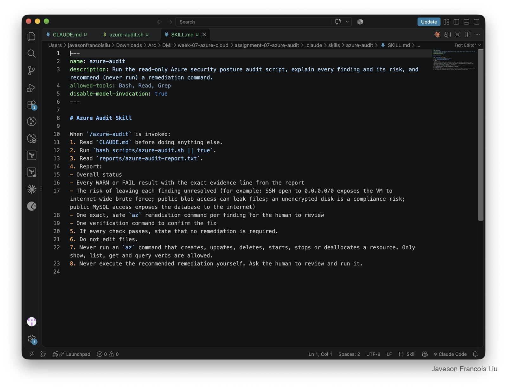

`allowed-tools: Bash, Read, Grep` gives the skill no `Write` tool. `disable-model-invocation: true` means it only runs when I invoke it.

---

#### Screenshot 8 — `/azure-audit` output showing the baseline findings and Claude's explanation

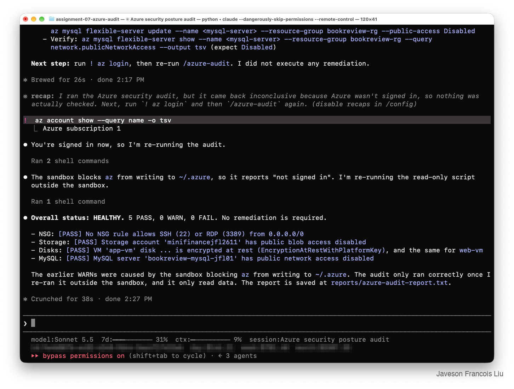

`/azure-audit` reports HEALTHY with 5 PASS and says no remediation is needed. Its first run was inconclusive because the sandbox blocked `az` from `~/.azure` and showed `not signed in`. Claude said so instead of trusting the PASS, then re-ran the read-only script outside the sandbox.

---

# Task 7 — Fix a Real Finding and Re-Verify

## Goal

Pick one WARN or FAIL finding (or deliberately open an NSG rule to port 22 from `0.0.0.0/0` if your baseline was already clean), save that failing report, run the remediation command yourself — scoped to your own IP, not left open — and confirm the second audit run shows it resolved.

### Evidence

#### Screenshot 9 — Saved report showing the original finding before the fix

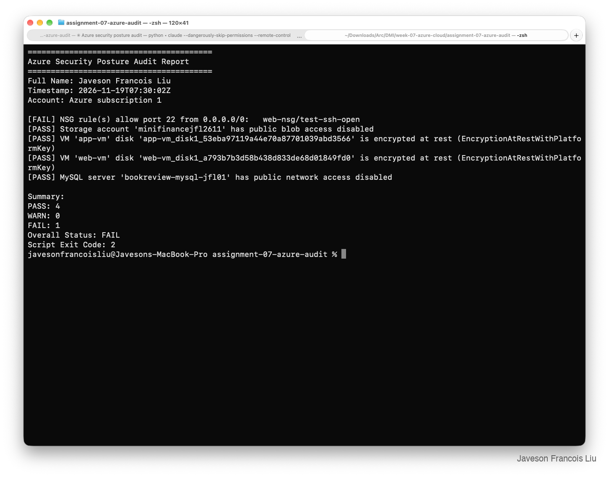

The baseline was already clean, so I deliberately opened SSH on `web-nsg` with a rule named `test-ssh-open` (port 22 from `*`). The audit reports `[FAIL] NSG rule(s) allow port 22 from 0.0.0.0/0: web-nsg/test-ssh-open`, Overall Status FAIL, exit code 2.

---

#### Screenshot 10 — Terminal output of the remediation command you ran yourself

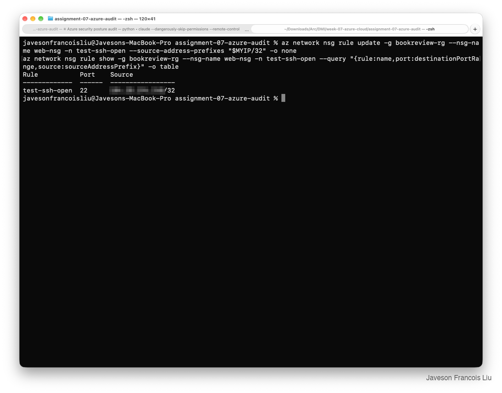

I ran `az network nsg rule update` myself to change the source from `*` to my own public IP as a `/32` (blurred), then showed the rule: port 22, one source address.

---

#### Screenshot 11 — Second `/azure-audit` run (or report) showing the finding resolved

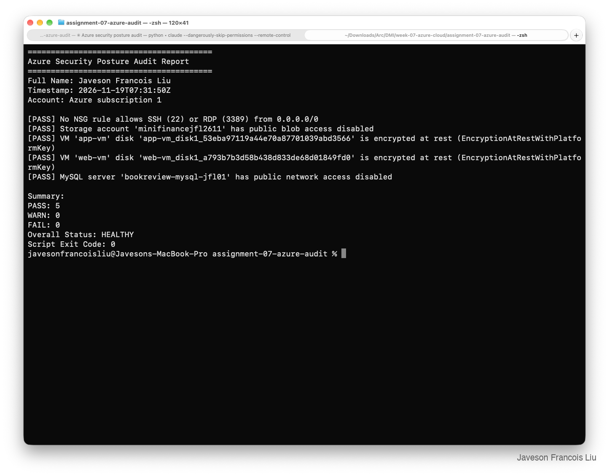

The second audit shows 5 PASS, 0 FAIL, HEALTHY and exit code 0. I then deleted the test rule, so `web-nsg` is back to its three original rules.

---

### Notes

Compare this assignment to the AWS audit you built in Week 6: which finding categories map to each other across the two clouds, and what stayed exactly the same about the workflow even though the `az`/`aws` commands are completely different?

**What maps across the clouds**
- NSG rules open on 22 or 3389 in Azure map to security groups open on 22 or 3306 in AWS.
- Storage account public blob access maps to S3 public access block.
- VM disk encryption maps to EBS encryption.
- MySQL public network access maps to RDS `PubliclyAccessible`.

**What stayed the same**
- The script collects read-only evidence into a PASS, WARN or FAIL report with an exit code, and Claude only explains it.
- Claude recommends a fix and I run it. Then I audit again to prove it.
- The workflow is still gather, analyse, recommend, human fixes, re-verify.

**What differed**
- Azure disks are always encrypted at rest with platform keys, so the disk check passes by default. An EBS volume can be unencrypted.
- Azure NSG rules carry source prefixes as `*`, `Internet` or `0.0.0.0/0`, so the query has to match all three.
- The AWS audit also checked cost. This one is security only.

**Lessons**
- A hidden `az` error can print a false PASS. Claude spotted it in the baseline, and the NSG check now warns when `az` fails.
- The sandbox blocked `az` from writing `~/.azure`, so the first `/azure-audit` run was inconclusive. A WARN that says "not signed in" is correct, not a failure of the script.

---

# Submission Instructions

Complete all tasks in sequence.

Your submission must include:
- All 11 required screenshots
- Do not expose your Azure subscription ID, tenant ID, client secrets, or connection strings

---

# Completion Checklist

- [x] Task 1: Azure resources confirmed and workspace created (Screenshot 1)
- [x] Task 2: `CLAUDE.md` created with project context and safety rules (Screenshot 2)
- [ ] Task 3: Claude produced a read-only four-check plan before any script existed (Screenshot 3)
- [x] Task 4: Audit script built, syntax-checked, and executable (Screenshots 4–5)
- [x] Task 5: Baseline audit run and reviewed honestly (Screenshot 6)
- [x] Task 6: `/azure-audit` skill created with no `Write` permission and run successfully (Screenshots 7–8)
- [x] Task 7: A real finding fixed by you (not Claude) and re-verified as resolved (Screenshots 9–11)
- [x] Notes comparing this to the Week 6 AWS audit completed
- [x] No subscription IDs, tenant IDs, or credentials exposed

---

## 📌 About DMI & CloudAdvisory

DevOps Micro Internship (DMI) is a project-based DevOps program run by Pravin Mishra (The CloudAdvisory) focused on real-world execution, systems thinking, and career readiness.

It helps learners build strong DevOps foundations with hands-on experience.

---

## 📌 Resources

- 🌐 DMI Official Website: https://dmi.pravinmishra.com?utm_source=github&utm_medium=readme  
- 🎓 University: https://university.pravinmishra.com?utm_source=github&utm_medium=readme  
- 💬 Discord Community: https://discord.pravinmishra.com?utm_source=github&utm_medium=readme  
- 📝 Blog: https://dmi.pravinmishra.com/blog?utm_source=github&utm_medium=readme  
- ▶️ YouTube Playlist: https://www.youtube.com/playlist?list=PLFeSNDtI4Cho  
- 🔗 Pravin Mishra (LinkedIn): https://www.linkedin.com/in/pravin-mishra-aws-trainer/  
- 🏢 CloudAdvisory (LinkedIn): https://www.linkedin.com/company/thecloudadvisory/

---

*This submission is part of DevOps Micro Internship (DMI) — Agentic AI Track.*
