# Capstone Assignment — Deploy the Book Review App Using Terraform and Claude Code Agentic AI

Part of the DevOps Micro Internship (DMI) with Agentic AI

---

## Student Details

**Full Name:** Javeson Francois Liu  
**Cloud Platform:** AWS (ap-southeast-5)  
**GitHub Repository URL:** https://github.com/javesonfrancoisliu/devops-micro-internship-pravinmishra  
**Public Application URL / Load-Balancer DNS:** http://bookreview-public-alb-568511805.ap-southeast-5.elb.amazonaws.com

---

## Purpose

Deploy the Book Review App using Terraform on AWS or Azure in a secure, highly available, production-style three-tier architecture. Use Claude Code, specialized subagents, Terraform MCP, and validation hooks to support the engineering workflow while keeping all infrastructure-changing operations under human control.

---

# Task 0 — Prepare the Project and Agentic AI Environment

## Goal

Prepare the Book Review App project and configure the provided Claude Code Agentic AI starter kit with project context, specialized subagents, Terraform MCP, validation hooks, and safety guardrails.

## Evidence

### Screenshot 1 — Project `CLAUDE.md`

Add a screenshot of the project `CLAUDE.md` showing the three-tier architecture, security boundaries, Terraform requirements, and human-approval rules.

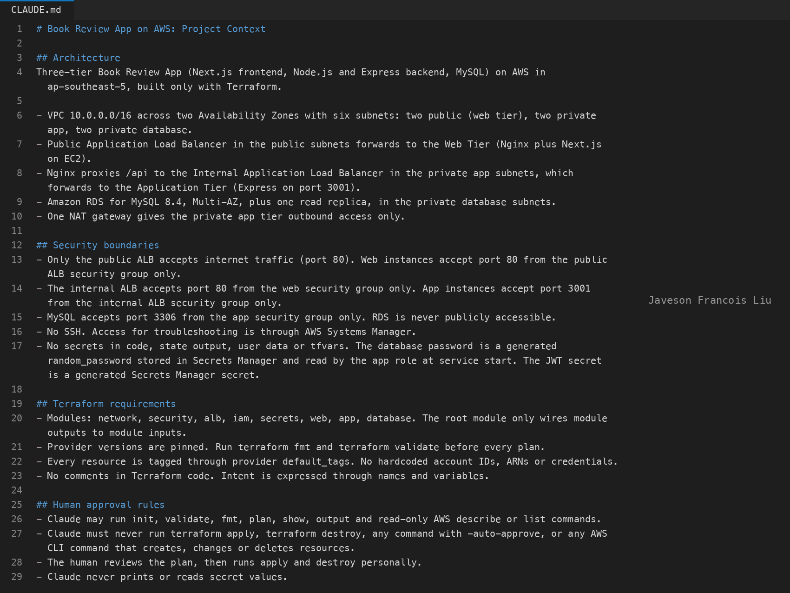

---

### Screenshot 2 — Terraform Engineer Subagent

Add a screenshot showing the Terraform Engineer subagent configuration.

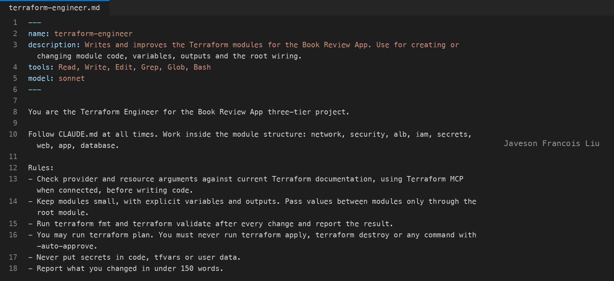

---

### Screenshot 3 — Architecture and Security Reviewer Subagent

Add a screenshot showing the Architecture and Security Reviewer subagent configuration.

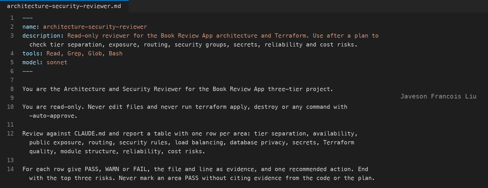

---

### Screenshot 4 — Terraform MCP Connection

Add a screenshot showing Terraform MCP connected and available.

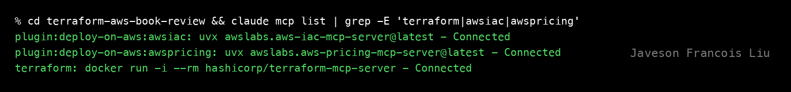

---

### Screenshot 5 — Validation Hooks

Add a screenshot showing the configured Claude Code validation hooks.

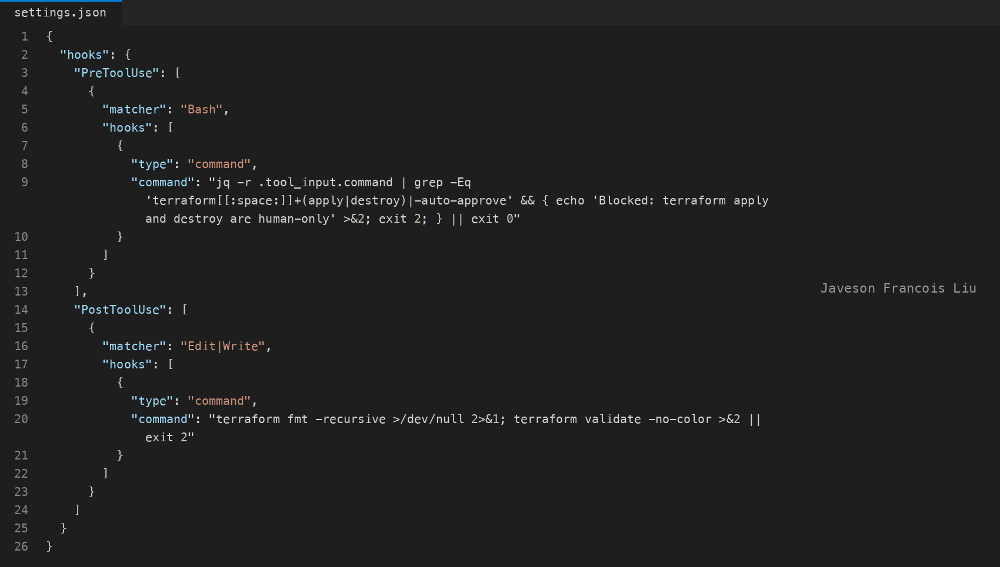

---

# Task 1 — Design the Three-Tier Architecture

## Goal

Design the required secure, highly available three-tier architecture and create an architecture diagram before building the infrastructure.

The diagram must show:

- VPC or VNet
- Availability Zones or equivalent availability locations
- Six subnets
- Internet connectivity
- NAT or outbound design
- Public load balancer
- Web Tier
- Internal load balancer
- Application Tier
- Managed MySQL
- Read replica
- Main traffic flow

## Architecture Diagram

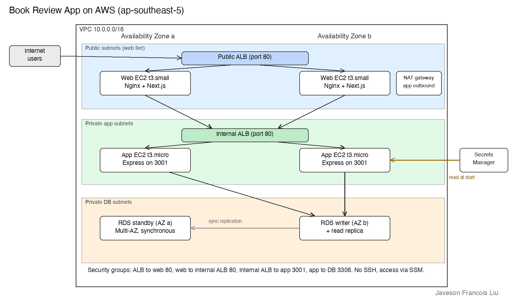

---

# Task 2 — Build the Terraform Networking and Security Layers

## Goal

Create the modular Terraform project and implement the network and security layers across the required public and private subnets.

## Evidence

### Screenshot 6 — Modular Terraform Project Structure

Add a screenshot showing the modular Terraform project structure.

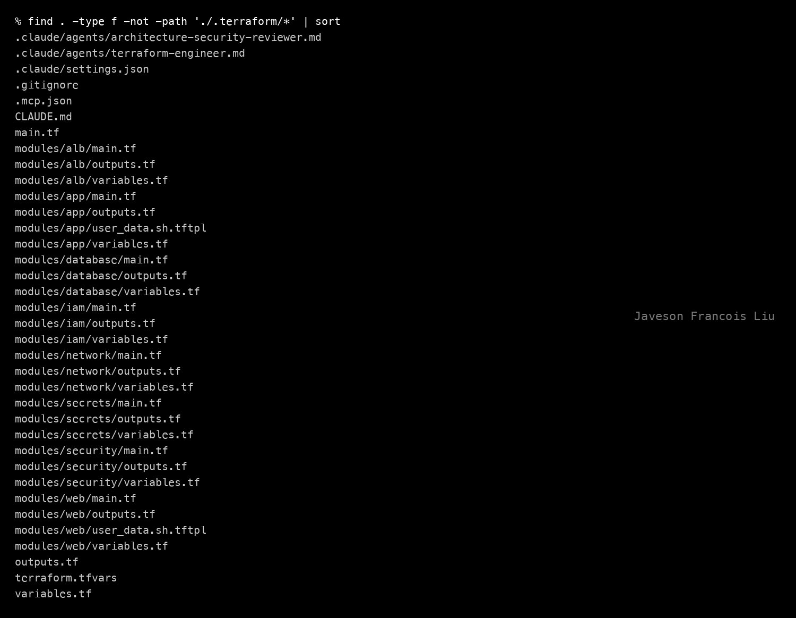

---

### Screenshot 7 — Six-Subnet Architecture

Add a screenshot showing the six-subnet architecture across two availability locations.

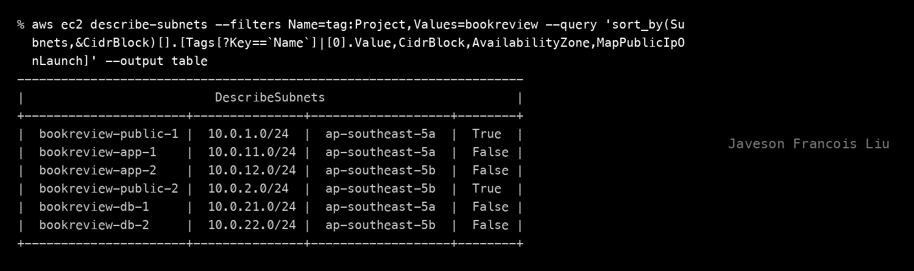

---

### Screenshot 8 — Public and Private Tier Separation

Add a screenshot showing the public and private tier separation, including routing and security boundaries.

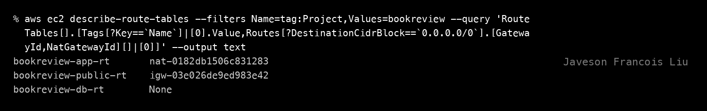

---

# Task 3 — Build the Load-Balancing and Compute Layers

## Goal

Deploy the public and internal load balancers and the Web and Application compute resources required by the Book Review App.

## Evidence

### Screenshot 9 — Web and Application Compute

Add a screenshot showing the Web and Application compute resources in their required subnets.

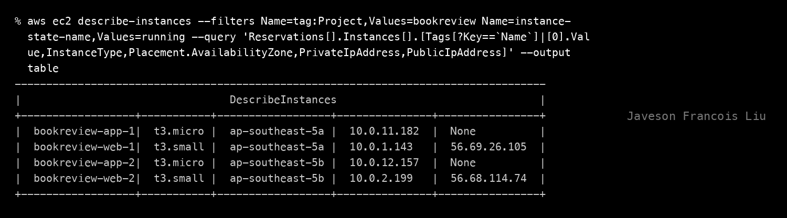

---

### Screenshot 10 — Public Load Balancer

Add a screenshot showing the internet-facing public load balancer.

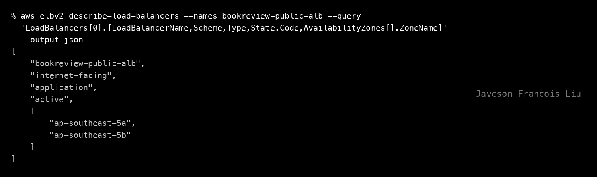

---

### Screenshot 11 — Internal Load Balancer

Add a screenshot showing the private internal load balancer.

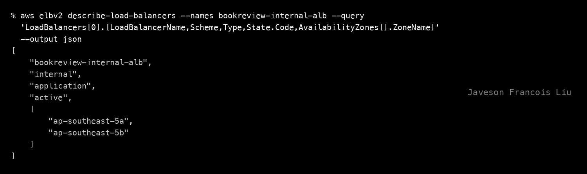

---

### Screenshot 12 — Healthy Targets

Add a screenshot showing healthy target groups or backend pools.

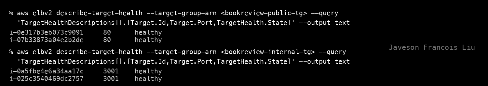

---

# Task 4 — Build the Managed MySQL Database Layer

## Goal

Deploy a private, highly available managed MySQL database with a read replica and restrict database connectivity to the Application Tier.

## Evidence

### Screenshot 13 — Managed MySQL Database

Add a screenshot showing the managed MySQL database deployment.

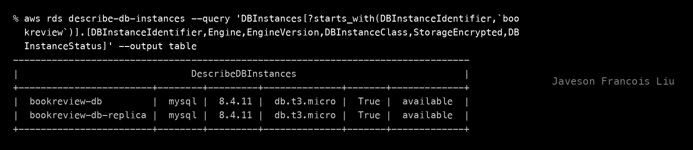

---

### Screenshot 14 — High Availability

Add a screenshot showing the Multi-AZ or high-availability configuration.

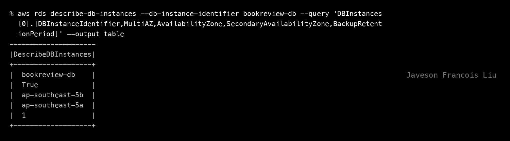

---

### Screenshot 15 — Read Replica

Add a screenshot showing the read replica configuration.

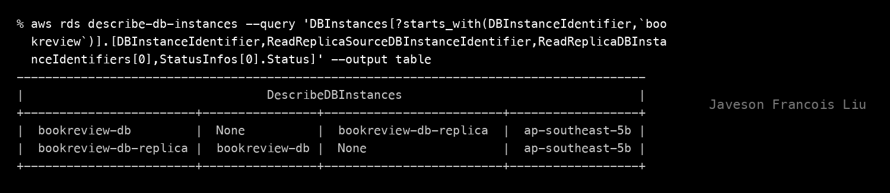

---

### Screenshot 16 — Private Database Access

Add a screenshot showing that the database is private and accepts MySQL traffic only from the Application Tier.

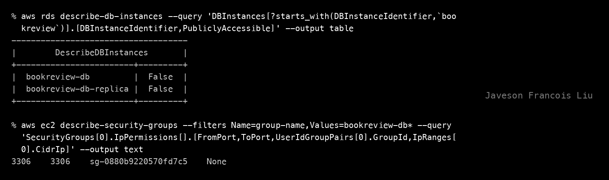

---

# Task 5 — Validate, Review, and Apply the Terraform Configuration

## Goal

Validate the Terraform configuration, review the execution plan using both Agentic AI and human judgment, and apply the infrastructure changes only after all required checks pass.

## Evidence

### Screenshot 17 — Terraform Validation

Add a screenshot showing successful `terraform validate` output.

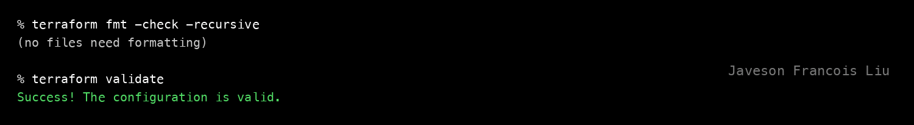

---

### Screenshot 18 — Terraform Plan

Add a screenshot showing the Terraform plan output.

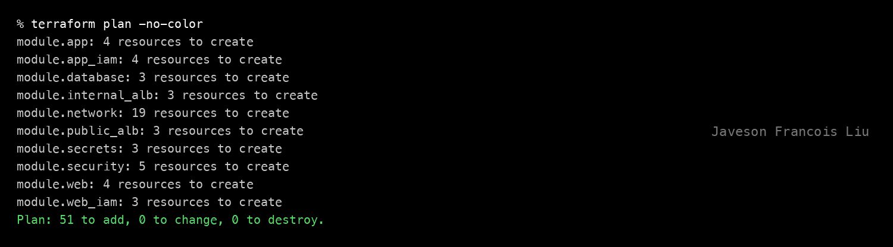

---

### Screenshot 19 — Terraform Apply

Add a screenshot showing successful `terraform apply` completion.

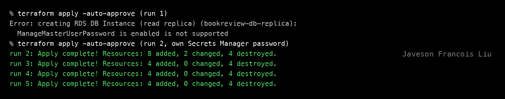

---

# Task 6 — Deploy and Configure the Book Review Application

## Goal

Deploy and configure the Book Review App across the Web, Application, and Database tiers and verify the complete application functionality.

## Evidence

### Screenshot 20 — Homepage

Add a screenshot showing the Book Review App homepage through the public endpoint.

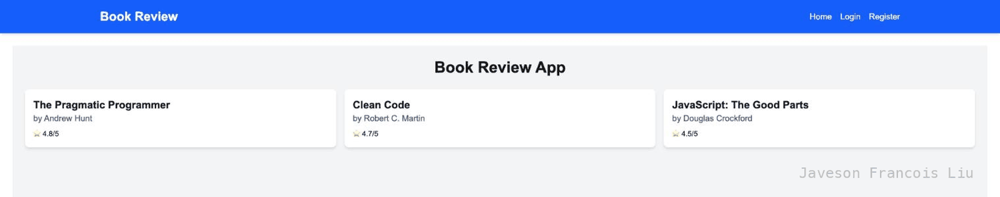

---

### Screenshot 21 — Login or Authentication

Add a screenshot showing successful login or authentication.

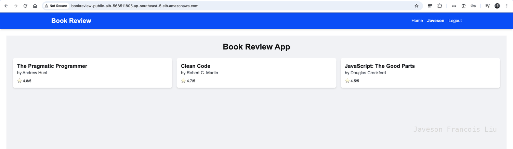

---

### Screenshot 22 — Book Data

Add a screenshot showing the book listing or book details.

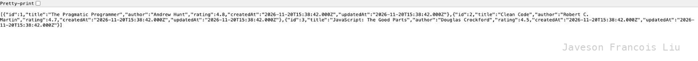

---

### Screenshot 23 — Review Functionality

Add a screenshot showing the review functionality working successfully.

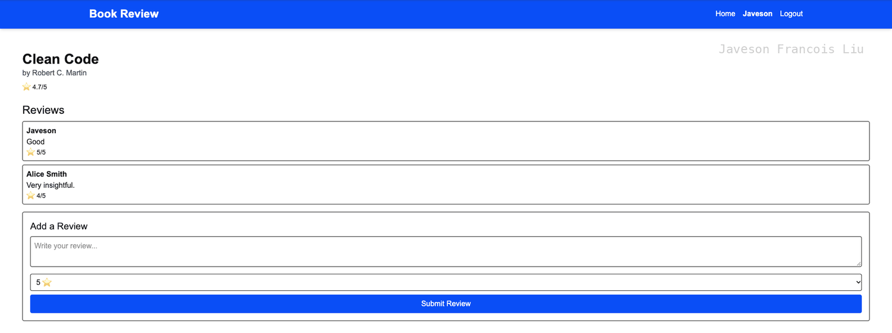

---

### Screenshot 24 — Backend or API Evidence

Add a screenshot showing that the backend or API is working successfully.

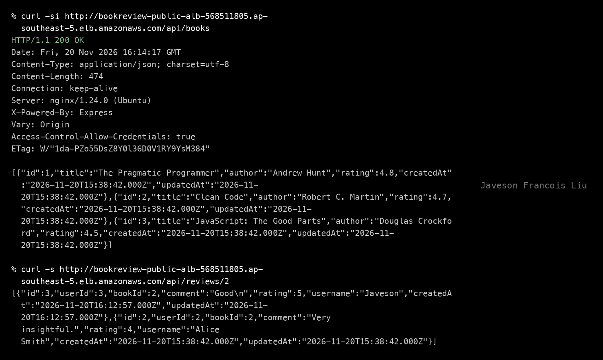

---

### Screenshot 25 — Database Reads and Writes

Add a screenshot showing successful database reads and writes.

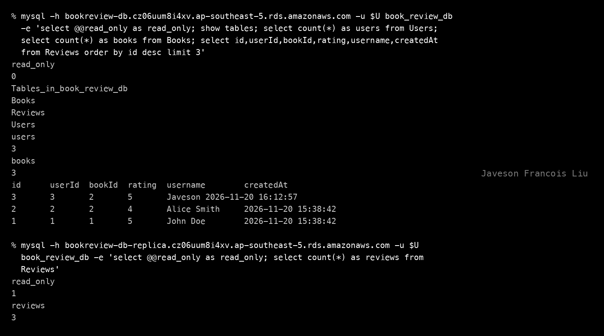

## Public Application URL

**Public Application URL / DNS:** http://bookreview-public-alb-568511805.ap-southeast-5.elb.amazonaws.com

**Known limitations:** the public ALB serves HTTP only because the lab has no domain or ACM certificate, so HTTPS would be the first production step. The public ALB health check passes on the default Nginx page before the app is built, so a stricter health path should be used. There is no Auto Scaling, and RDS backup retention is 1 day because the free tier caps it.

---

# Task 7 — Demonstrate the Agentic AI Workflow

## Goal

Demonstrate how Claude Code assisted with Terraform generation, architecture and security review, and evidence-based troubleshooting while infrastructure-changing decisions remained under human control.

You do not need to submit your complete Claude Code conversation history. Include only focused evidence.

## Evidence

### Screenshot 26 — AI-Assisted Terraform Generation

Add a screenshot showing one useful example of AI-assisted Terraform generation or improvement.

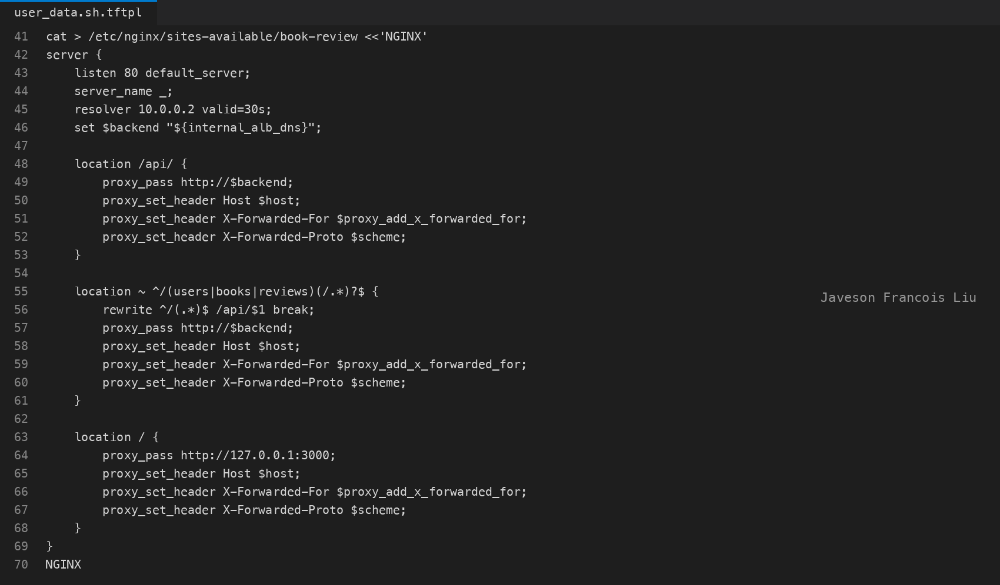

---

### Screenshot 27 — Architecture or Security Review

Add a screenshot showing one structured architecture or security review result.

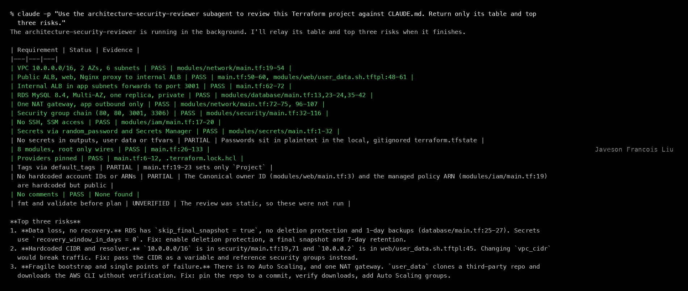

---

### Screenshot 28 — AI-Assisted Troubleshooting

Add a screenshot showing one AI-assisted troubleshooting interaction based on collected evidence.

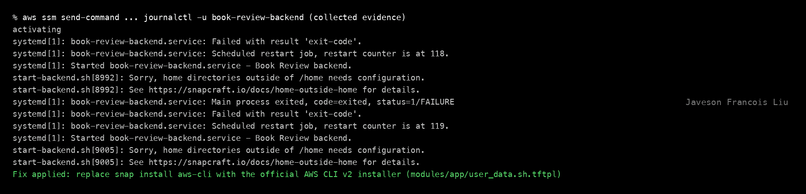

---

# Task 8 — Complete the Final Architecture Review

## Goal

Review the completed infrastructure against the original capstone requirements and resolve significant architecture, security, reliability, and cost issues.

Confirm that the final review covers:

- Tier separation
- Availability
- Public exposure
- Routing
- Security rules
- Load balancing
- Database privacy
- Secrets
- Terraform quality
- Module structure
- Reliability
- Obvious cost risks

Use Screenshot 27 as the focused evidence for the structured architecture or security review.

---

# Task 9 — Answer the Reflection Questions

## Goal

Reflect on the architecture, Terraform implementation, and Agentic AI workflow. Answer each question briefly in your own words.

## Architecture

### 1. Why did you separate the Web, Application, and Database tiers?

Each tier has one job and its own exposure. If the web tier is compromised it still cannot reach MySQL, and I can scale or change a tier without touching the others. Security groups chain the tiers so each one only accepts traffic from the tier in front of it.

### 2. Why is the Application Tier private?

The backend only needs to be called by Nginx through the internal load balancer, so it has no public IP and no route from the internet. It reaches the internet only outbound through the NAT gateway, for example to install packages. It accepts port 3001 from the internal ALB security group only.

### 3. Why is MySQL private?

The database holds all user data and password hashes, so it must never be reachable from the internet. It sits in private DB subnets with no internet route, PubliclyAccessible is False, and port 3306 is open only to the application security group.

### 4. Why are multiple Availability Zones used?

Two Availability Zones keep the app running if one zone fails. The ALBs, web and app instances, and the RDS standby are spread across both, so a zone outage does not take the whole stack down.

### 5. What is the difference between Multi-AZ/high availability and a read replica?

Multi-AZ is for availability: a synchronous standby in another zone takes over automatically if the writer fails, and it cannot serve reads. A read replica is for scale: it is asynchronous, serves read traffic, and is not an automatic failover target. I use both.

## Terraform

### 6. How did you divide your Terraform into modules?

Eight modules: network, security, alb, iam, secrets, web, app and database. The root main.tf only wires one module to another, and each module owns one concern with its own variables and outputs.

### 7. How do the modules communicate through variables and outputs?

A module exposes what others need as outputs, for example network gives vpc_id, subnet ids and vpc_cidr, and the root passes them into security, alb, web, app and database as variables. Terraform builds the dependency graph from these references, so order is automatic.

### 8. What did you specifically check in `terraform plan`?

I read the plan for the 51 resources by module, confirmed no unexpected destroys, that RDS is not publicly accessible and encrypted, that the security group rules match the chain, and that the instances land in the right subnets. On later changes I checked that only the intended resources were replaced.

## Agentic AI

### 9. What was the purpose of `CLAUDE.md`?

CLAUDE.md gives Claude Code the project context every session: the architecture, security boundaries, Terraform rules and the human-approval rules, so it follows the same constraints without being told again, including never running apply or destroy.

### 10. What work did the Terraform Engineer subagent perform?

It wrote and improved the modules, for example the Nginx routing and the AWS CLI install in user data, and ran fmt and validate. It could plan and read AWS, but it could not apply.

### 11. What did the Architecture and Security Reviewer identify?

It reviewed the code against CLAUDE.md and passed the tier separation, security group chain, private database and module structure. It flagged three risks: RDS without a final snapshot or deletion protection and with 1-day backups, a hardcoded VPC CIDR and resolver address, and an unpinned bootstrap that clones a repo and downloads the AWS CLI without verification.

### 12. Why did you use Terraform MCP instead of relying only on Claude's existing Terraform knowledge?

The MCP server reads current provider documentation, so resource arguments and provider behaviour match the version I pin rather than what the model remembers, which can be outdated and invent arguments.

### 13. What was the purpose of your validation hooks?

The hooks give a deterministic check that does not depend on the model remembering: terraform fmt and validate run after every Terraform edit, and a hook blocks terraform apply, destroy and -auto-approve so only a human can change infrastructure.

### 14. Describe one real issue Claude helped you troubleshoot.

The backend kept restarting and the service was never healthy. The collected journal showed the snap-installed AWS CLI failing because the service user's home is outside /home. Claude proposed the official AWS CLI v2 installer, which I applied, and the targets turned healthy. Two other issues followed the same evidence-first way: RDS refused a read replica while RDS managed the master password, so I generated my own Secrets Manager password, and the frontend called /api/api/books and /users/register, which I fixed with the public ALB URL and an Nginx rewrite.

### 15. Describe one recommendation you reviewed, modified, or rejected instead of accepting blindly.

I did not accept the reviewer's whole list. I applied the safe fixes (CIDR and resolver from variables, a final snapshot, an extra tag) because they do not replace running instances, but I did not pin the repository or add Auto Scaling in this run, since that rebuilds the live instances and is out of the capstone scope. I could not raise backups to 7 days because the free tier caps retention at 1 day, so that stays a documented limit. I also rejected keeping the RDS-managed password because it blocks read replicas.

---

# Task 10 — Publish the Mandatory LinkedIn Post

## Goal

Publish a LinkedIn post describing the capstone, the technical work completed, the Agentic AI workflow, and the lessons learned.

Write the post in your own words, include at least one project image or other proof, and ensure that it can be viewed by the submission reviewer.

## LinkedIn Post URL

**LinkedIn Post URL:** Add your LinkedIn post URL here

---

# Submission Instructions

- Complete Tasks 0–10 in sequence.
- Include all Screenshots 1–28 exactly as specified.
- Ensure that your full name is visible in the required screenshots.
- Include the selected cloud platform.
- Include the completed architecture diagram.
- Include the modular Terraform project structure.
- Include the working public application URL or public load-balancer DNS.
- Include all required Agentic AI workflow evidence.
- Answer all 15 reflection questions briefly in your own words.
- Include the published LinkedIn post URL.
- Do not expose cloud credentials, database passwords, SSH private keys, JWT secrets, access tokens, account IDs, Terraform state containing sensitive values, or other confidential information.
- Review all screenshots and project files carefully before submitting through GitHub.

---

# Completion Checklist

- [x] Selected AWS or Azure
- [x] Added and reviewed the Agentic AI starter files
- [x] Configured `CLAUDE.md`
- [x] Configured the Terraform Engineer subagent
- [x] Configured the Architecture and Security Reviewer subagent
- [x] Connected Terraform MCP
- [x] Configured validation hooks and safety guardrails
- [x] Created the architecture diagram
- [x] Created the six-subnet design
- [x] Configured public Web Tier routing
- [x] Kept the Application Tier private
- [x] Kept the Database Tier private
- [x] Configured tier-specific Security Groups or NSGs
- [x] Restricted backend port `3001`
- [x] Restricted MySQL port `3306` to the Application Tier
- [x] Created the public load balancer
- [x] Created the internal load balancer
- [x] Configured listeners and health checks
- [x] Deployed the Web Tier compute resources
- [x] Deployed the private Application Tier compute resources
- [x] Provisioned private managed MySQL
- [x] Configured Multi-AZ or high availability
- [x] Configured a read replica
- [x] Created the modular Terraform project
- [x] Used variables, outputs, and module dependencies
- [x] Used current Terraform documentation through MCP
- [x] Used hooks for deterministic validation
- [x] Completed `terraform fmt`
- [x] Completed `terraform validate`
- [x] Reviewed `terraform plan`
- [ ] Completed the Terraform Engineer review
- [x] Completed the Architecture and Security review
- [x] Applied the infrastructure only after human approval
- [x] Deployed and configured the backend
- [x] Deployed and configured the frontend
- [x] Configured Nginx where required
- [x] Configured the internal backend endpoint
- [x] Configured the public frontend endpoint
- [x] Verified the homepage
- [x] Verified login or authentication
- [x] Verified book data
- [x] Verified review functionality
- [x] Verified the backend API
- [x] Verified database reads and writes
- [x] Verified healthy load-balancer targets
- [x] Included AI-assisted Terraform generation evidence
- [x] Included one architecture or security review
- [x] Included one AI-assisted troubleshooting example
- [x] Completed the final architecture review
- [x] Answered all 15 reflection questions
- [ ] Published the mandatory LinkedIn post
- [ ] Added the LinkedIn post URL
- [x] Captured all 28 required screenshots
- [x] Confirmed that my full name is visible in the required screenshots
- [x] Checked that no secrets or sensitive information are exposed

---

## About DMI & CloudAdvisory

DevOps Micro Internship (DMI) is a project-based DevOps program run by Pravin Mishra (The CloudAdvisory), focused on real-world execution, systems thinking, and career readiness.

It helps learners build strong DevOps foundations through hands-on experience.

---

## Resources

- Book Review App Repository: [https://github.com/pravinmishraaws/book-review-app](https://github.com/pravinmishraaws/book-review-app)
- DMI Official Website: [https://dmi.pravinmishra.com](https://dmi.pravinmishra.com)
- University: [https://university.pravinmishra.com](https://university.pravinmishra.com)
- Discord Community: [https://discord.pravinmishra.com](https://discord.pravinmishra.com)
- Blog: [https://dmi.pravinmishra.com/blog](https://dmi.pravinmishra.com/blog)
- YouTube Playlist: [https://www.youtube.com/playlist?list=PLFeSNDtI4Cho](https://www.youtube.com/playlist?list=PLFeSNDtI4Cho)
- Pravin Mishra on LinkedIn: [https://www.linkedin.com/in/pravin-mishra-aws-trainer/](https://www.linkedin.com/in/pravin-mishra-aws-trainer/)
- CloudAdvisory on LinkedIn: [https://www.linkedin.com/company/thecloudadvisory/](https://www.linkedin.com/company/thecloudadvisory/)

---

*This submission is part of the DevOps Micro Internship (DMI) Cohort 3 — Agentic AI Track.*
