# Assignment 6 — AI-Assisted Terraform Drift and Policy Review

Part of the DevOps Micro Internship (DMI) with Agentic AI

---

## Student Details

**Full Name:** Javeson Francois Liu  
**GitHub Repository/Folder URL:** https://github.com/javesonfrancoisliu/devops-micro-internship-pravinmishra/tree/main/week-08-terraform/terraform-aws-book-review

---

## Purpose

Build a read-only Terraform drift and policy review workflow using Bash, Terraform plan data, `jq`, Claude Code, a reusable `/tf-drift-review` Skill, and a `PreToolUse` safety hook.

The workflow must follow this pattern:

```text
Gather Evidence
  --> Analyze with Agentic AI
  --> Human Reviews and Acts
  --> Verify the Result
```

The `/tf-drift-review` Skill and `tf-drift-check.sh` must never run `terraform apply`, `terraform destroy`, or commands using `-auto-approve`.

---

# Task 1 — Confirm the Clean Baseline and Create the Workspace

## Goal

Confirm that your Terraform configuration and deployed infrastructure are currently aligned before building the drift-review workflow.

## Evidence

### Screenshot 1 — Clean Terraform Plan

Add a screenshot of `terraform plan` showing no pending changes.

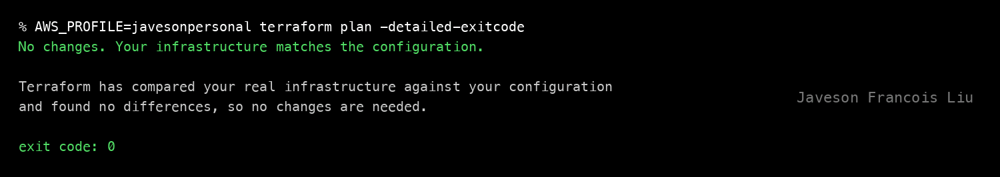

---

### Screenshot 2 — Assignment Workspace

Add a screenshot of the folder structure showing `AI Assignment/`, `reports/`, and the Terraform project.

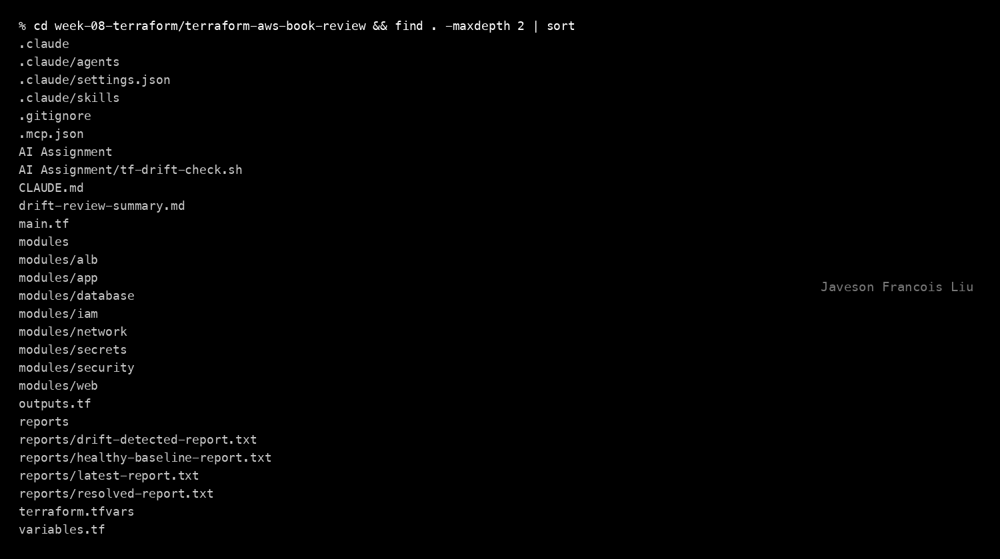

## Questions

### 1. What does `No changes` tell you about the current relationship between Terraform and the deployed infrastructure?

Terraform state, the code and the live resources agree. Nothing is pending, so a plan would change nothing.

### 2. Why is a clean baseline important before introducing a test change?

If the baseline is not clean, a later difference could come from earlier unfinished changes, and I could not tell whether my test change caused it.

---

# Task 2 — Create Project Context and Safety Rules in `CLAUDE.md`

## Goal

Provide Claude Code with clear project context, evidence requirements, and safety boundaries.

## Evidence

### Screenshot 3 — Project Context and Safety Rules

Add a screenshot of `CLAUDE.md` open in VS Code showing the Project Overview, Review Workflow, Safety Rules, and Output Rules.

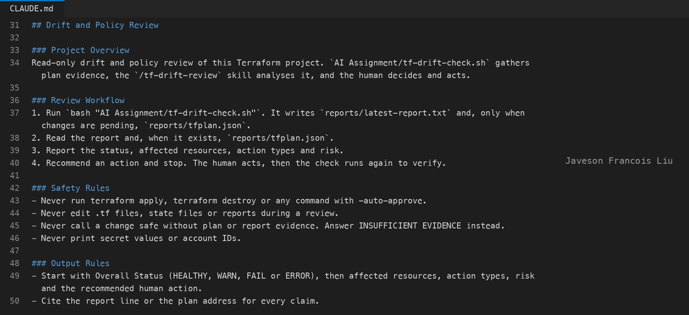

## Questions

### 1. Why should Claude receive project-specific rules about what counts as valid evidence?

Claude cannot see my intentions. The rules define what counts as proof, a report line or a plan address, so it cites evidence instead of guessing.

### 2. Why must the human remain responsible for running `terraform apply`?

Apply changes real infrastructure, can cost money and may not be reversible. The human knows the business context and is accountable, so the human reads the plan and runs it.

### 3. Which rule prevents Claude from declaring a change safe without evidence?

"Never call a change safe without plan or report evidence. Answer INSUFFICIENT EVIDENCE instead."

---

# Task 3 — Build the Terraform Drift and Policy Check Script

## Goal

Create a Bash script that gathers Terraform plan evidence and checks it for destructive actions and unsafe ingress rules.

## Evidence

### Screenshot 4 — Script Variables and Checks Array

Add a screenshot of the top section of `tf-drift-check.sh` showing the variables and `checks` array.

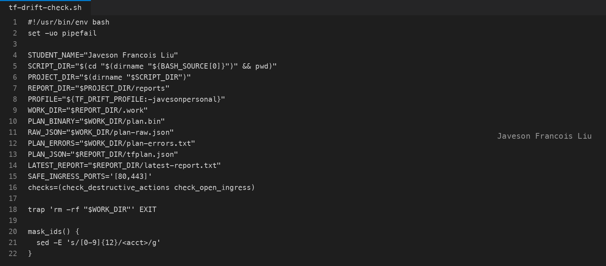

---

### Screenshot 5 — Destructive-Action and Open-Ingress Checks

Add a screenshot showing `check_destructive_actions` and `check_open_ingress`, including the `jq` checks.

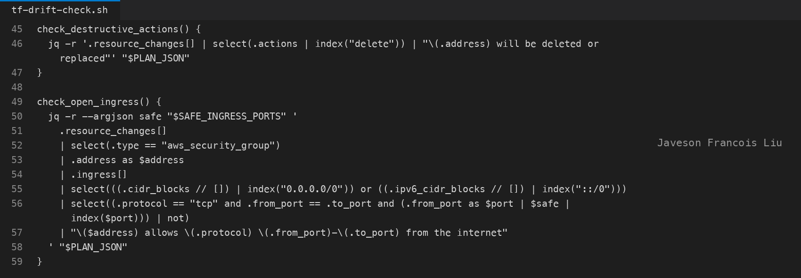

---

### Screenshot 6 — Script Validation and Permissions

Add a screenshot showing successful `bash -n` and `ls -l` output.

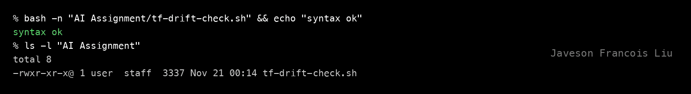

## Questions

### 1. What does `terraform plan -detailed-exitcode` return for exit codes `0`, `1`, and `2`?

0 means success with no changes, 1 means an error, and 2 means success with pending changes.

### 2. Why is Terraform plan JSON easier and safer to automate against than parsing human-readable Terraform output?

The JSON has stable named fields such as address and actions, so jq reads them exactly. Human-readable output changes between versions and is hard to parse, so scripts misread it or break.

### 3. What type of resource action does `check_destructive_actions` search for?

Resource changes whose actions contain delete, meaning a resource will be deleted or replaced.

### 4. Why does finding a `delete` action also help detect replacements?

A replacement is planned as delete plus create, so searching for delete catches both deletions and replacements.

### 5. Why must this script never run `terraform apply`?

The script runs often and automatically. If it applied changes, an unreviewed change could reach real infrastructure, so evidence gathering must stay read-only.

---

# Task 4 — Run the Script Against the Clean Baseline

## Goal

Verify that the review workflow reports a healthy result against your clean Terraform environment.

## Evidence

### Screenshot 7 — Healthy Baseline Report

Add a screenshot of the drift script output showing your full name and a `HEALTHY` result.

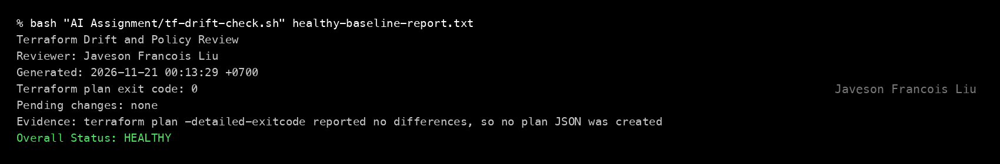

---

### Screenshot 8 — Baseline Script Exit Code

Add a screenshot showing the captured script exit code `0`.

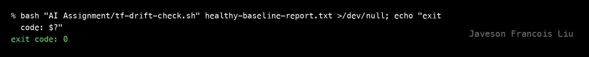

## Questions

### 1. What is the Overall Status of your baseline?

HEALTHY.

### 2. Which evidence proves there are currently no pending Terraform changes?

Plan exit code 0, the line Pending changes: none, and Terraform's No changes message.

### 3. Was `reports/tfplan.json` created? Explain why or why not.

No. Exit code 0 means no differences, so the script skips the JSON step. The file is created only when changes are pending, with exit code 2.

---

# Task 5 — Create and Run the `/tf-drift-review` Claude Code Skill

## Goal

Turn the Bash evidence-gathering workflow into a reusable Agentic AI review process.

## Evidence

### Screenshot 9 — `/tf-drift-review` Skill Configuration

Add a screenshot of `SKILL.md` showing the frontmatter, allowed tools, and safety rules.

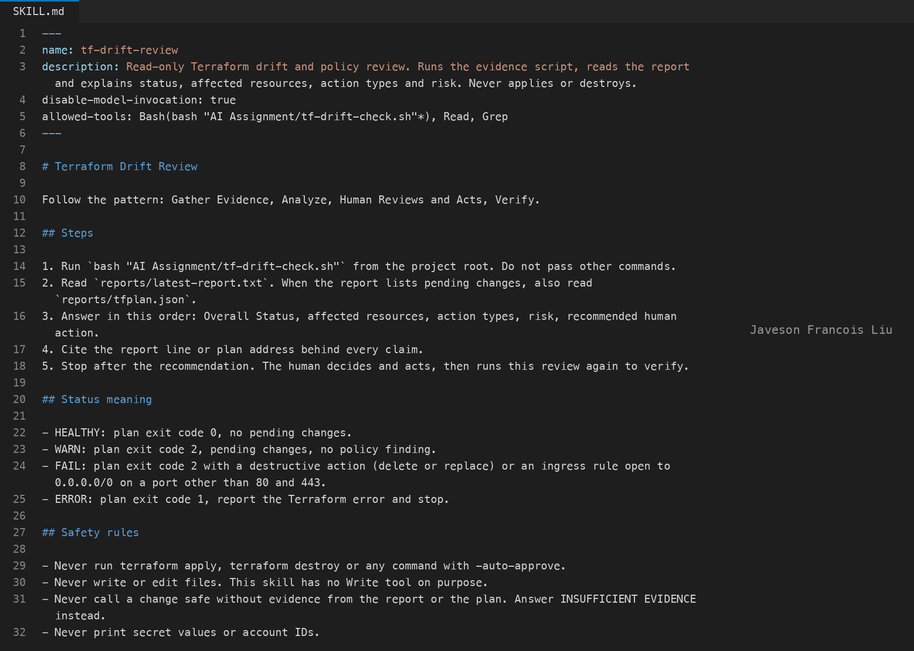

---

### Screenshot 10 — Clean Agentic AI Review

Add a screenshot of `/tf-drift-review` showing the clean `HEALTHY` result.

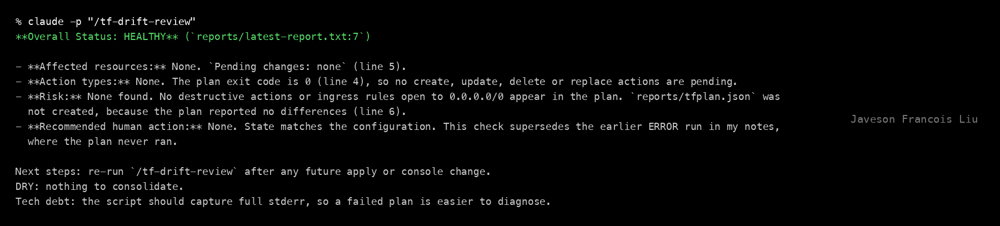

## Questions

### 1. Why does this Skill have `Bash`, `Read`, and `Grep`, but not `Write`?

It must run the script (Bash), read the report and plan (Read) and search them (Grep). Without Write it cannot edit code, state or reports, so the review stays read-only.

### 2. Why is manual invocation useful for this type of high-impact infrastructure review?

Claude never starts an infrastructure review on its own. I choose when to run it, so the result matches the moment I mean.

### 3. Which part of the workflow is deterministic Bash automation?

The script tf-drift-check.sh: the plan, the JSON, the jq checks and the status.

### 4. Which part requires Claude's reasoning?

Reading the report, explaining the status and risk against the project rules, and recommending an action.

### 5. Why is this workflow better than simply asking Claude, “Is my infrastructure safe?”

It uses real plan evidence, fixed checks and cited lines, instead of a guess from memory that cannot see my infrastructure.

---

# Task 6 — Introduce a Controlled Difference and Detect It

## Goal

Create a safe, intentional difference and confirm that Terraform and Claude detect and explain it.

## Evidence

### Screenshot 11 — Controlled Difference

Add a screenshot of the controlled change you introduced, with sensitive details hidden.

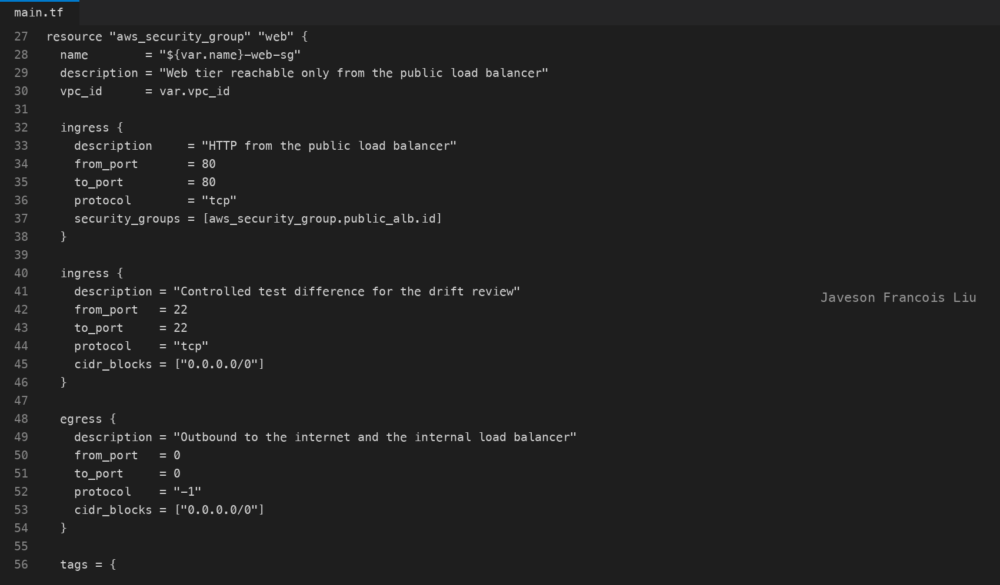

---

### Screenshot 12 — Detected Difference and Risk Assessment

Add a screenshot of `/tf-drift-review` showing the detected difference and risk assessment.

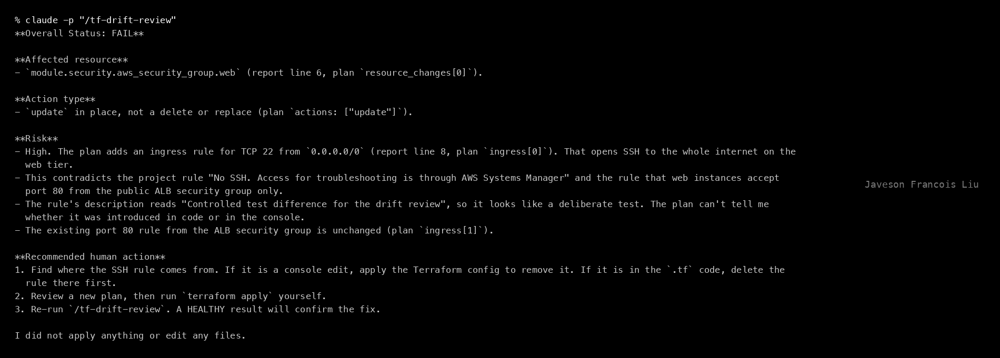

---

### Screenshot 13 — Detected Drift Report

Add a screenshot of `drift-detected-report.txt` showing your full name and the `WARN` or `FAIL` result.

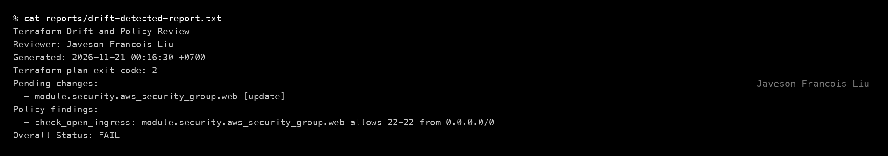

## Questions

### 1. What change did you introduce?

I added an ingress rule for TCP 22 from 0.0.0.0/0 to the web security group in the Terraform code.

### 2. Was it true infrastructure drift or a Terraform configuration change?

A Terraform configuration change, because I edited the code. The live infrastructure was not touched.

### 3. What Terraform plan evidence proves that a change is pending?

Plan exit code 2, and tfplan.json showed module.security.aws_security_group.web with the action update and the port 22 rule.

### 4. Was the action an update, deletion, replacement, or security-rule change?

An in-place update that is also a security-rule change (open ingress). It was not a deletion or a replacement.

### 5. What did Claude recommend?

Claude reported FAIL and high risk, because SSH open to the internet breaks the no-SSH rule. It recommended finding where the rule came from, fixing the code, reviewing a new plan, applying it myself, and running the review again.

### 6. Why should you review the recommendation before taking action?

The recommendation can miss context or be wrong, and I am accountable for the environment. Claude also said it could not tell whether the rule came from code or the console, so I had to confirm.

---

# Task 7 — Add a `PreToolUse` Hook to Block Unsafe Apply Attempts

## Goal

Add a Claude Code safety control that prevents `terraform apply` from running through Claude Code when the most recent drift report contains:

```text
Overall Status: FAIL
```

## Evidence

### Screenshot 14 — `PreToolUse` Safety Hook

Add a screenshot of `.claude/settings.json` showing the `PreToolUse` safety hook.

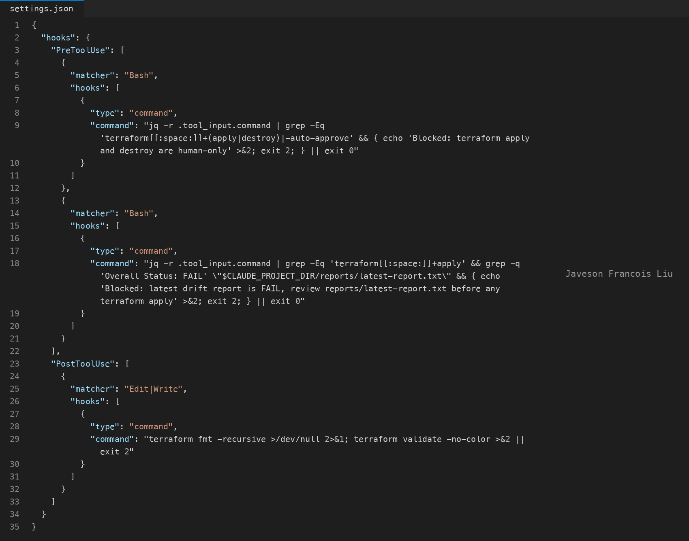

---

### Screenshot 15 — Blocked Apply Attempt

Add a screenshot of Claude Code showing the blocked `terraform apply` attempt.

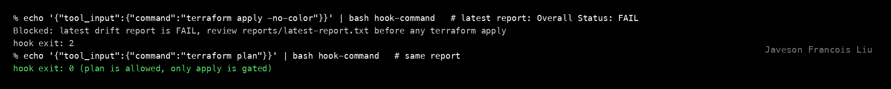

## Questions

### 1. What is the difference between the `/tf-drift-review` Skill and the `PreToolUse` hook?

The skill analyses evidence when I ask. The hook is an automatic rule that runs on every Bash tool call and can block apply.

### 2. Which component performs analysis?

The /tf-drift-review skill, using Claude's reasoning.

### 3. Which component enforces the safety gate?

The PreToolUse hook.

### 4. Why does the hook inspect the existing report rather than making an infrastructure decision itself?

The hook should be simple and deterministic. It trusts the report that the script produced, and a plain text check cannot be talked out of its decision.

### 5. Why is a deterministic guard useful for high-impact commands?

It does not depend on Claude's judgment or memory. The same input always gives the same block, so one mistake or prompt trick cannot trigger a high-impact command.

---

# Task 8 — Resolve the Difference and Verify the Final State

## Goal

Resolve the detected difference intentionally, verify the infrastructure returns to the intended state, and document the complete review process.

## Evidence

### Screenshot 16 — Human-Reviewed Resolution

Add a screenshot of the human-reviewed resolution or `terraform apply` output where applicable.

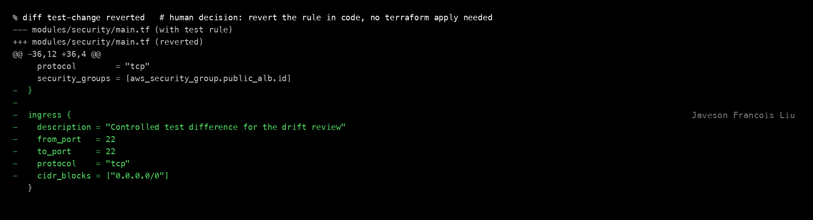

---

### Screenshot 17 — Final Healthy Review

Add a screenshot of the final `/tf-drift-review` showing `HEALTHY`.

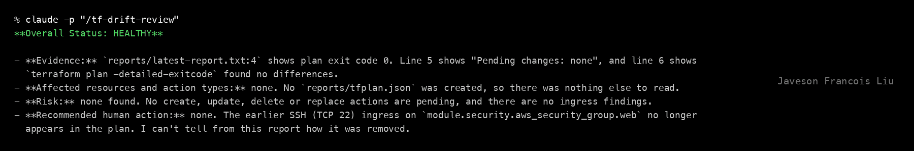

---

### Screenshot 18 — Saved Reports

Add a screenshot of `ls -lah reports` showing both:

- `drift-detected-report.txt`
- `resolved-report.txt`

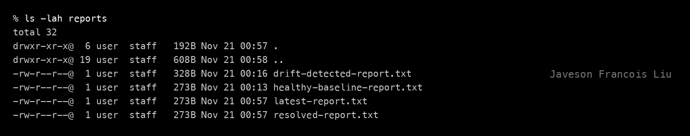

---

### Screenshot 19 — Drift Review Summary

Add a screenshot of `drift-review-summary.md` showing all required sections and your full name.

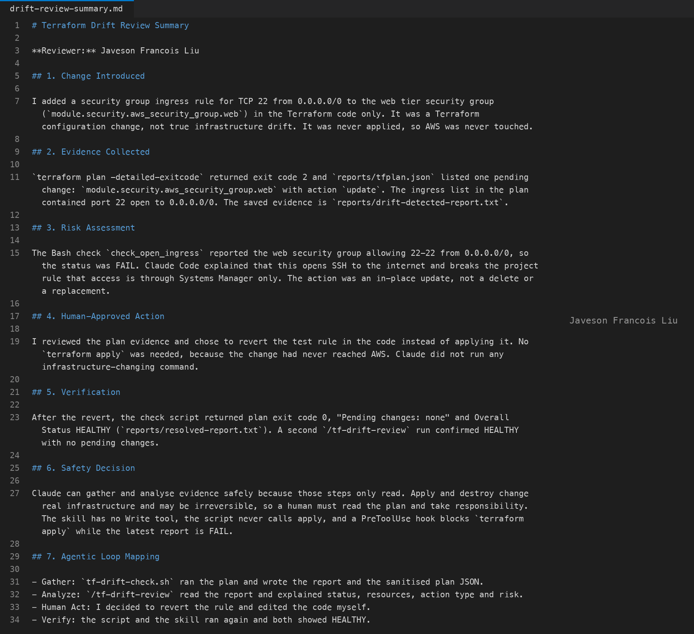

## Terraform Drift Review Summary

### 1. Change Introduced

Explain the controlled change you introduced.

State whether it was:

- True infrastructure drift, or
- A Terraform configuration change

I added a security group ingress rule for TCP 22 from 0.0.0.0/0 to the web tier security group (`module.security.aws_security_group.web`) in the Terraform code only. It was a Terraform configuration change, not true infrastructure drift. It was never applied, so AWS was never touched.


### 2. Evidence Collected

Describe the Terraform plan evidence and affected resource.

`terraform plan -detailed-exitcode` returned exit code 2 and `reports/tfplan.json` listed one pending change: `module.security.aws_security_group.web` with action `update`. The ingress list in the plan contained port 22 open to 0.0.0.0/0. The saved evidence is `reports/drift-detected-report.txt`.


### 3. Risk Assessment

Explain the risk identified by the Bash check and Claude Code.

The Bash check `check_open_ingress` reported the web security group allowing 22-22 from 0.0.0.0/0, so the status was FAIL. Claude Code explained that this opens SSH to the internet and breaks the project rule that access is through Systems Manager only. The action was an in-place update, not a delete or a replacement.


### 4. Human-Approved Action

Explain the action you reviewed and executed manually.

I reviewed the plan evidence and chose to revert the test rule in the code instead of applying it. No `terraform apply` was needed, because the change had never reached AWS. Claude did not run any infrastructure-changing command.


### 5. Verification

Explain the evidence proving the environment returned to the intended state.

After the revert, the check script returned plan exit code 0, "Pending changes: none" and Overall Status HEALTHY (`reports/resolved-report.txt`). A second `/tf-drift-review` run confirmed HEALTHY with no pending changes.


### 6. Safety Decision

Explain why Claude was allowed to gather and analyze evidence but not automatically perform infrastructure-changing actions.

Claude can gather and analyse evidence safely because those steps only read. Apply and destroy change real infrastructure and may be irreversible, so a human must read the plan and take responsibility. The skill has no Write tool, the script never calls apply, and a PreToolUse hook blocks `terraform apply` while the latest report is FAIL.


### 7. Agentic Loop Mapping

Explain how your workflow followed:

```text
Gather --> Analyze --> Human Act --> Verify
```

- Gather: `tf-drift-check.sh` ran the plan and wrote the report and the sanitised plan JSON.
- Analyze: `/tf-drift-review` read the report and explained status, resources, action type and risk.
- Human Act: I decided to revert the rule and edited the code myself.
- Verify: the script and the skill ran again and both showed HEALTHY.


## Questions

### 1. What action did you execute to resolve the difference?

I reverted the test ingress rule in the Terraform code. No terraform apply was needed, because the rule was never applied to AWS.

### 2. Did you review `terraform plan` before taking action?

Yes. I read the drift report and the plan JSON before deciding.

### 3. What evidence proves the environment is now aligned?

The second script run: plan exit code 0, Pending changes: none and Overall Status HEALTHY in resolved-report.txt, plus a second skill review that also said HEALTHY.

### 4. Why is a second drift review required after the fix?

The first review only shows the problem. The second proves the fix worked and nothing else changed, and it replaces the FAIL report so the hook gate opens.

### 5. What could go wrong if an AI agent automatically applied every detected Terraform change?

A wrong or manipulated recommendation could delete databases, open ports or replace servers without anyone noticing, causing an outage or data loss.

### 6. In one sentence, explain the difference between asking an AI chatbot “Is my infrastructure okay?” and using this evidence-based Agentic AI workflow.

A chatbot guesses from memory, while this workflow collects real plan evidence, checks it with fixed rules and shows a human what to review before anything changes.

---

# LinkedIn Post — Mandatory

## Goal

Publish a LinkedIn post in your own words describing:

- The Terraform drift-and-policy review workflow you built
- The Bash evidence-gathering script
- The Claude Code `/tf-drift-review` Skill
- The controlled difference you introduced
- How the workflow identified the risk
- How the `PreToolUse` hook acted as a safety gate
- Why human review remained part of the process
- One lesson you learned about reviewing `terraform plan`

Include a screenshot of the detected change and a screenshot of the final `HEALTHY` review in your post.

Suggested tags:

```text
#DMIByPravinMishra #Terraform #AgenticAI #ClaudeCode #DevOps
```

## LinkedIn Evidence

### LinkedIn Post URL

https://www.linkedin.com/posts/javeson-francois-liu-999135437_dmibypravinmishra-terraform-agenticai-ugcPost-7529761661025484800-SNqw/

### Published LinkedIn Post Screenshot — Mandatory

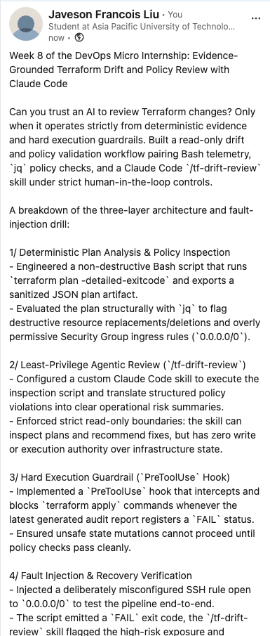

---

# Required Assignment Files

Confirm that the following files are included in your GitHub repository:

- `CLAUDE.md`
- `AI Assignment/tf-drift-check.sh`
- `.claude/skills/tf-drift-review/SKILL.md`
- `.claude/settings.json` containing the safety hook
- `reports/drift-detected-report.txt`
- `reports/resolved-report.txt`
- `drift-review-summary.md`

---

# Submission Instructions

- Complete Tasks 1–8 in sequence.
- Include Screenshots 1–19 exactly as specified.
- Answer every question under Tasks 1–8 in your own words.
- Complete all seven sections of the Terraform Drift Review Summary.
- Include the GitHub repository/folder URL containing the assignment files.
- Include your full name in the required reports and screenshots.
- Include the LinkedIn post URL and a screenshot of the published LinkedIn post.
- Do not expose access keys, passwords, tokens, account IDs, private keys, Terraform secrets, or other sensitive information.
- Review all screenshots carefully and hide or redact sensitive details where necessary.

---

# Completion Checklist

- [x] Confirmed a clean Terraform baseline
- [x] Created the required assignment workspace
- [x] Created or updated `CLAUDE.md`
- [x] Added project context and safety rules
- [x] Created `tf-drift-check.sh`
- [x] Added my full name to the report
- [x] Validated the Bash script
- [x] Made the script executable
- [x] Used `terraform plan -detailed-exitcode`
- [x] Used Terraform plan JSON
- [x] Used `jq` to inspect destructive actions
- [x] Used `jq` to inspect unsafe ingress
- [x] Confirmed the baseline returns `HEALTHY`
- [x] Created `/tf-drift-review`
- [x] Restricted the Skill to appropriate tools
- [x] Confirmed the Skill remains read-only
- [x] Confirmed the Skill never runs `terraform apply`
- [x] Confirmed the Skill never runs `terraform destroy`
- [x] Introduced a controlled detectable difference
- [x] Correctly identified whether it was true drift or a configuration change
- [x] Saved `drift-detected-report.txt`
- [x] Added the `PreToolUse` safety hook
- [x] Verified the hook blocks `terraform apply` when the report is `FAIL`
- [x] Reviewed the Terraform evidence before resolving the change
- [x] Performed any infrastructure-changing action manually
- [x] Ran the drift review again after resolution
- [x] Confirmed the final status is `HEALTHY`
- [x] Saved `resolved-report.txt`
- [x] Completed `drift-review-summary.md`
- [x] Mapped the workflow to `Gather --> Analyze --> Human Act --> Verify`
- [x] Included all 19 numbered screenshots
- [x] Answered all required questions
- [x] Published the required LinkedIn post
- [x] Added the LinkedIn post URL and screenshot
- [x] Included the GitHub repository/folder URL
- [x] Confirmed that no sensitive information is exposed

---

*This submission is part of the DevOps Micro Internship (DMI) Cohort 3 — Agentic AI Track.*
