# Assignment 02 — Provision Linux VMs with Terraform and Run Ansible Ad-Hoc Commands

Part of the DevOps Micro Internship (DMI) with Agentic AI

---

## Purpose

In this assignment, you will use Terraform to provision three or four Ubuntu Linux Virtual Machines on either Microsoft Azure or Amazon Web Services.

You will configure SSH key-based authentication, organize the servers using a custom Ansible inventory, and run Ansible ad-hoc commands across individual hosts and inventory groups.

---

# Task 1 — Create the Multi-Host Lab Structure

## Goal

Create a separate project directory for the multi-host lab and prepare the Terraform, Ansible, and documentation files.

This project will use the Git repository and Ansible controller prepared in Assignment 01.

### Evidence

#### Screenshot 1 — Terminal showing the complete `ansible-adhoc-lab` project structure

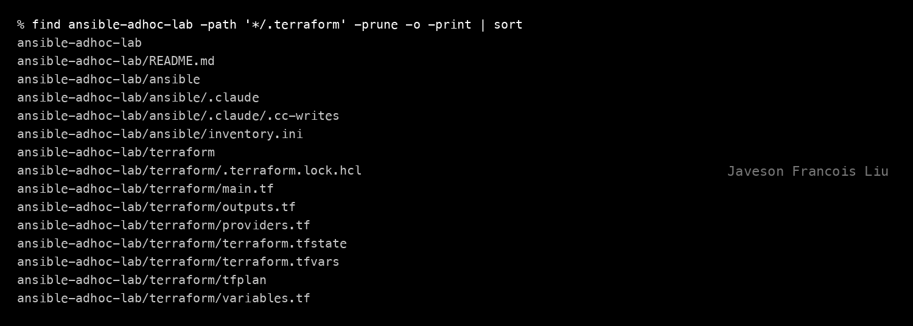

---

#### Screenshot 2 — Terminal showing `git status --short` with the new project files and updated `.gitignore`

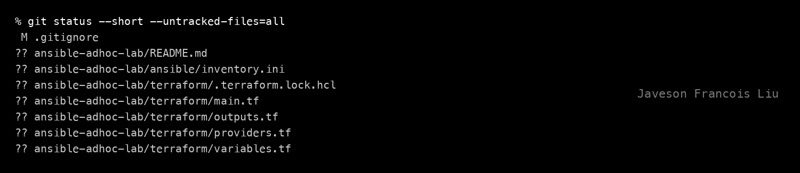

---

### Notes

I created `ansible-adhoc-lab/` inside the Assignment 01 repository, with `terraform/` and `ansible/` folders and a README. `.gitignore` now excludes Terraform state, `.terraform/`, plan files and `*.tfvars`, so state, keys and my public IP never reach Git. `git status --short` lists source files only.

---

# Task 2 — Create the Terraform Configuration

## Goal

Create the Terraform configuration required to provision three or four Ubuntu Linux VMs on your selected cloud platform.

Complete only one option:

- Option A — Microsoft Azure
- Option B — Amazon Web Services

Do not configure both providers for this assignment.

### Evidence

#### Screenshot 3 — Terraform configuration showing the three or four server roles and the `for_each` or `count` implementation

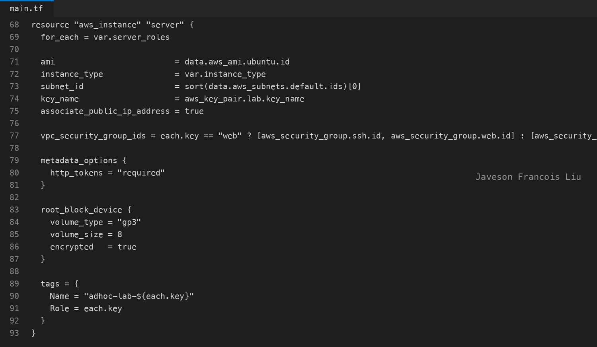

---

#### Screenshot 4 — Terraform configuration showing SSH restricted to the controller IP and HTTP allowed only for web hosts

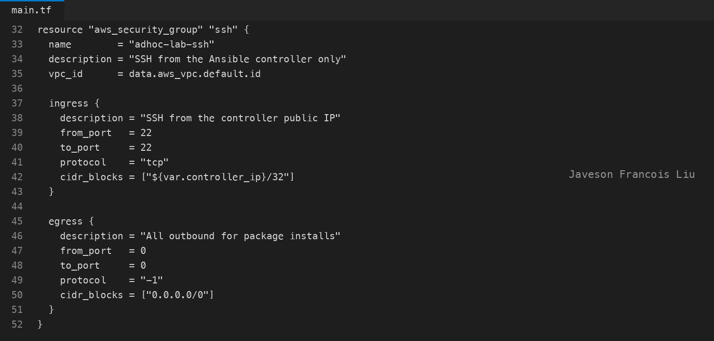

---

#### Screenshot 5 — Terraform output configuration showing how public IP addresses are associated with the server roles

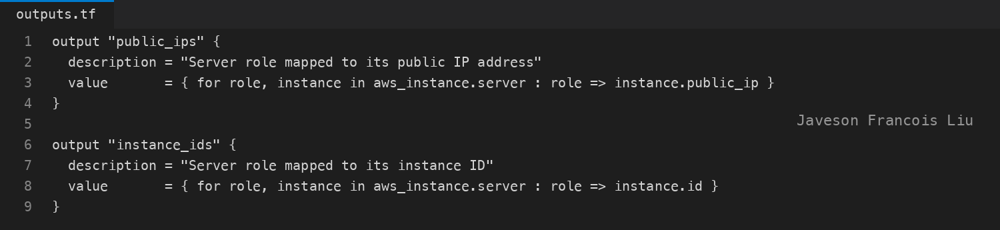

---

### Notes

Cloud: AWS (ap-southeast-5). Option: three VMs (web, app, db). One `aws_instance` resource uses `for_each` over a `server_roles` set, so a new role is a one-line change. The AMI is the latest Ubuntu 24.04 found by a data source, with t3.micro, an encrypted gp3 root disk and IMDSv2 required. The SSH security group allows port 22 from `controller_ip/32` only, and the value sits in a gitignored `terraform.tfvars`. A second group opens port 80 and is attached to the web host only. The `public_ips` output maps each role to its public IP.

---

# Task 3 — Provision the Infrastructure with Terraform

## Goal

Initialize and validate the Terraform configuration, review the execution plan, provision the selected three or four VMs, and retrieve their public IP addresses.

### Evidence

#### Screenshot 6 — Final `terraform apply` output showing `Apply complete`

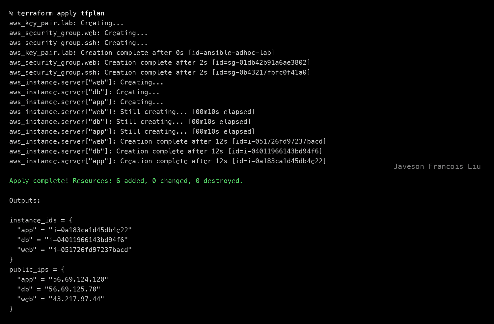

---

#### Screenshot 7 — `terraform output public_ips` showing the role-to-IP mapping for all three or four VMs

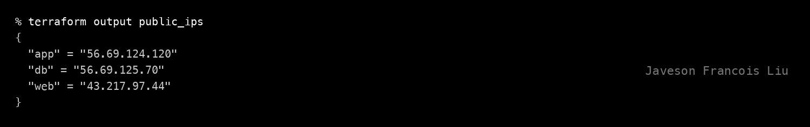

---

#### Screenshot 8 — Azure Portal or AWS Management Console showing all three or four VMs in the `Running` state, with their role-based names visible

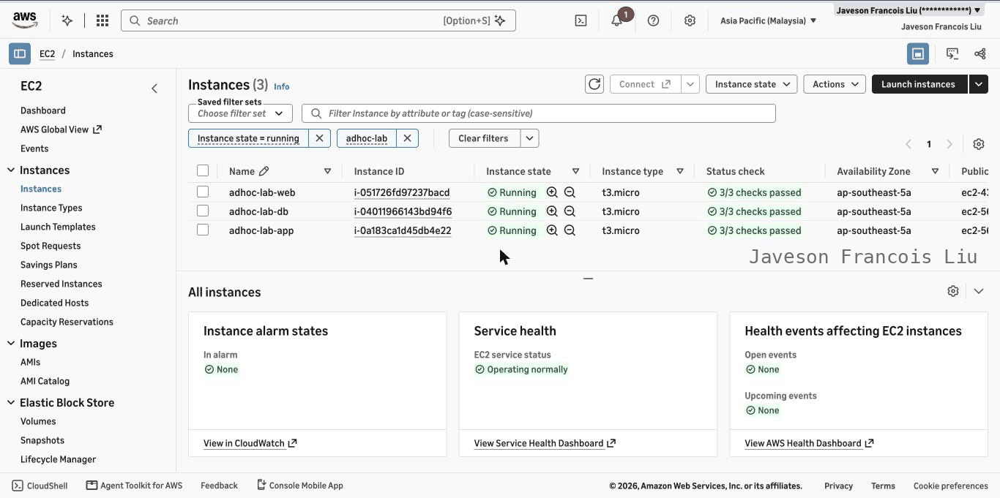

---

### Notes

`terraform init`, `validate` and `fmt -check` passed. The plan showed 6 to add, 0 to change, 0 to destroy, and apply built the key pair, two security groups and three instances in about 12 seconds. Public IPs (lab only, destroyed after submission): web 43.217.97.44, app 56.69.124.120, db 56.69.125.70. The AWS Console shot (Screenshot 8) shows all three instances Running with their role names.

---

# Task 4 — Verify SSH Key-Based Access

## Goal

Verify that each managed VM can be accessed from the Ansible controller using SSH key-based authentication.

### Evidence

#### Screenshot 9 — Terminal showing successful SSH hostname output from all VMs

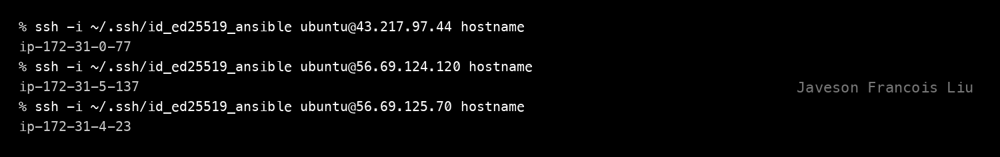

---

### Notes

Login uses the dedicated `id_ed25519_ansible` key from Assignment 01, loaded in `ssh-agent`. Running `ssh ... hostname` against each public IP printed the private hostname of that VM with no password prompt, so key-based access works on all three.

---

# Task 5 — Create the Custom Ansible Inventory

## Goal

Create an Ansible inventory file that groups the managed VMs by role.

The inventory allows Ansible to run commands against all servers, or only specific groups such as `web`, `app`, or `db`.

### Evidence

#### Screenshot 10 — `inventory.ini` showing the `web`, `app`, and `db` groups

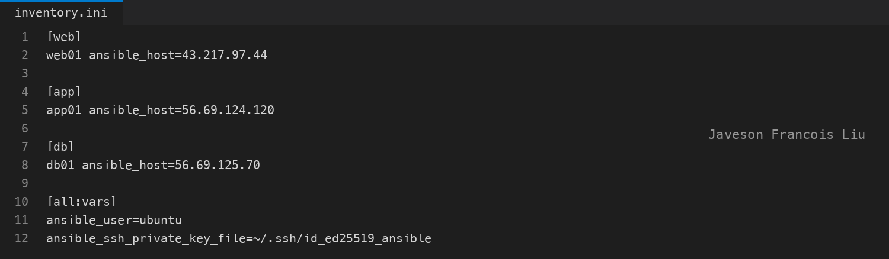

---

#### Screenshot 11 — Output of `ansible-inventory -i inventory.ini --graph`

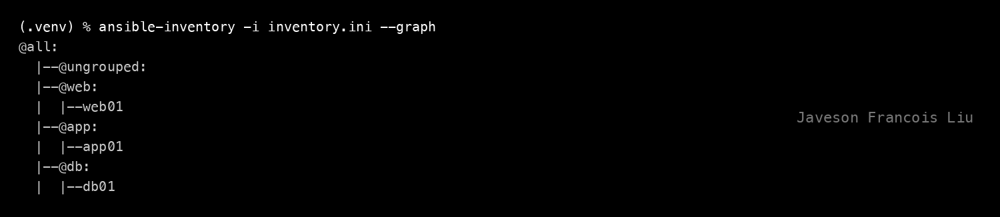

---

### Notes

The inventory has `[web]` with web01, `[app]` with app01 and `[db]` with db01, plus `[all:vars]` holding the user, the key file and `StrictHostKeyChecking=accept-new`. The commands run from `ansible/`, where the project `ansible.cfg` is not loaded, so the connection settings live in the inventory. `ansible-inventory --graph` shows the three groups with one host each.

---

# Task 6 — Run Ansible Ad-Hoc Commands

## Goal

Run Ansible ad-hoc commands from the controller to verify connectivity, check server information, and manage packages and services across inventory groups.

This task proves that the inventory is working and that Ansible can control multiple managed VMs without writing a playbook.

### Evidence

#### Screenshot 12 — Output of `ansible all -i inventory.ini -m ping`

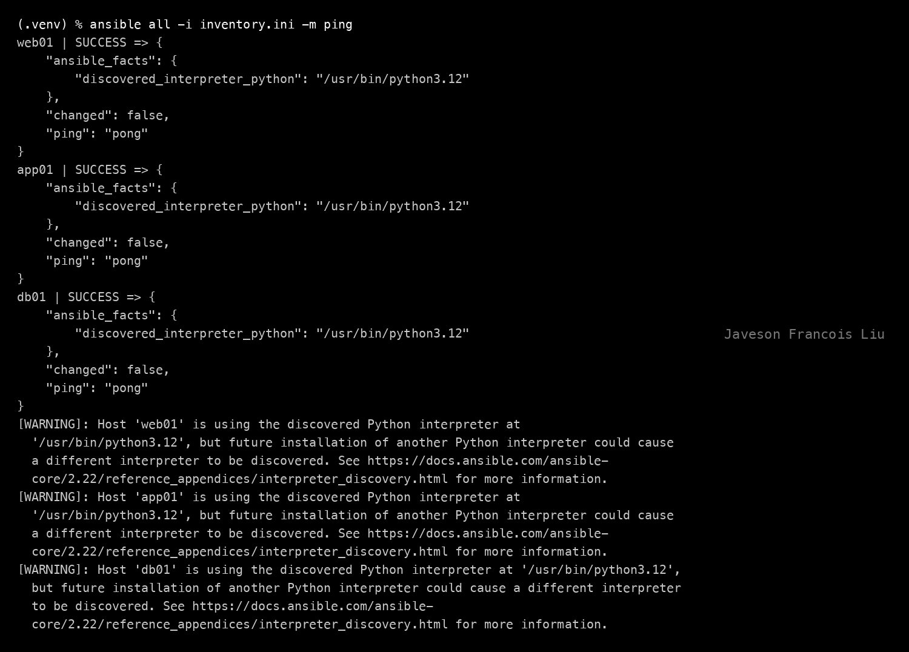

---

#### Screenshot 13 — Output of `ansible all -i inventory.ini -m command -a "uptime"`

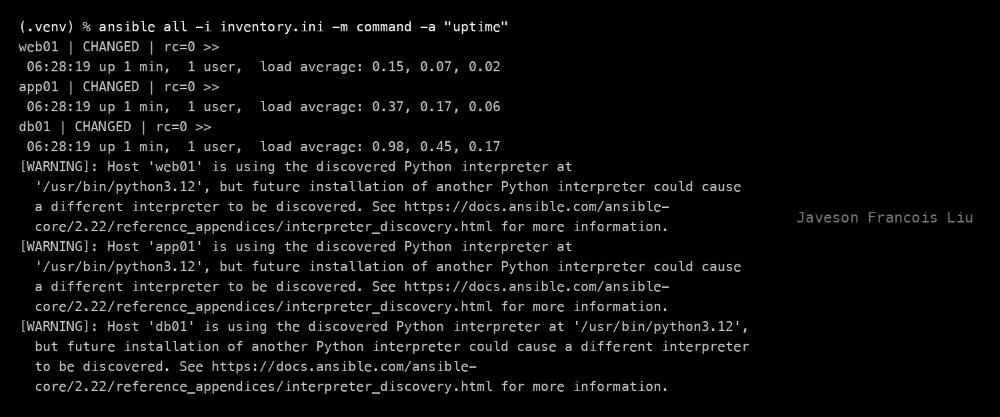

---

#### Screenshot 14 — Output of `ansible web -i inventory.ini -m apt -a "name=nginx state=present update_cache=yes" --become`

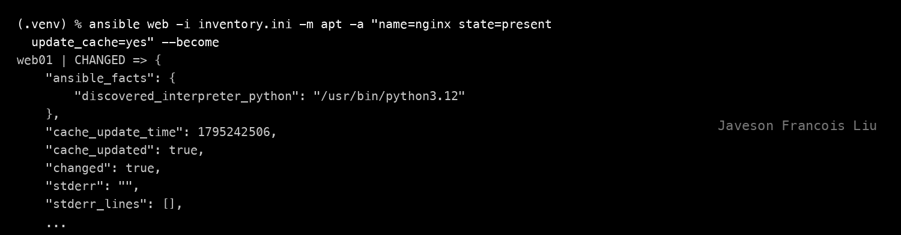

---

#### Screenshot 15 — Output of `ansible web -i inventory.ini -m service -a "name=nginx state=started enabled=yes" --become`

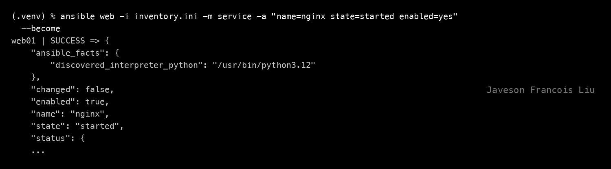

---

#### Screenshot 16 — Output of `ansible all -i inventory.ini -m apt -a "name=htop state=present update_cache=yes" --become`

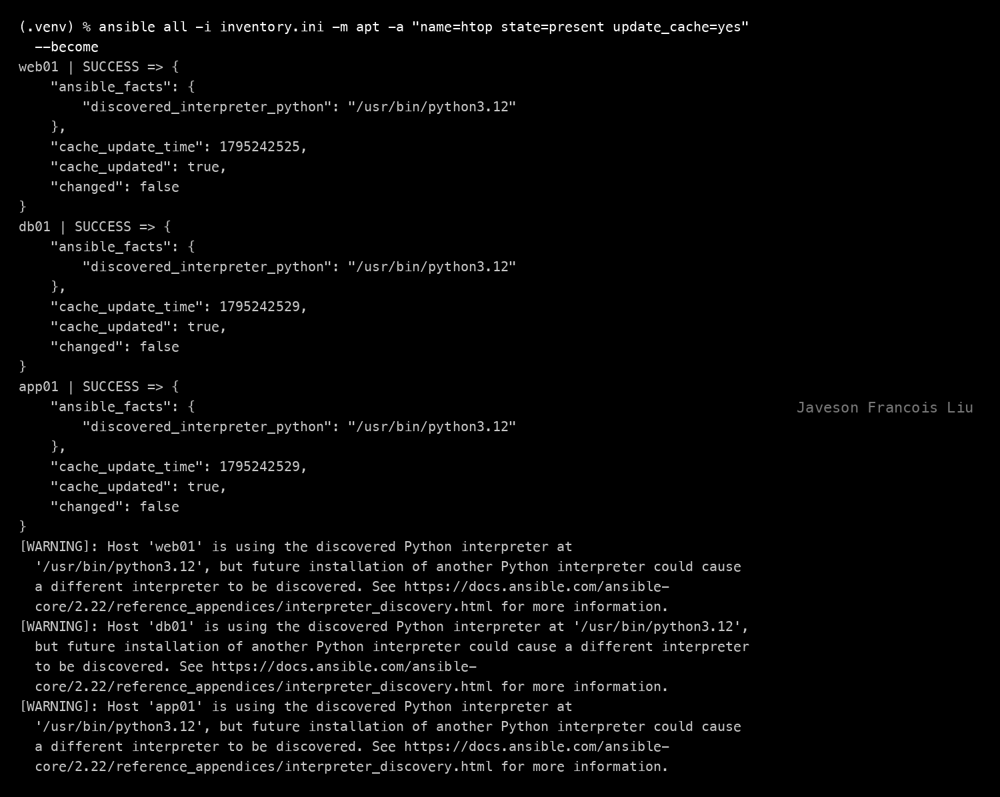

---

#### Screenshot 17 — Output of `ansible web -i inventory.ini -m command -a "systemctl is-active nginx"`

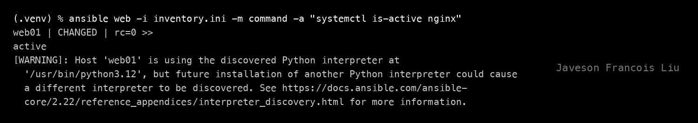

---

### Notes

`ping` and `uptime` answered from all three hosts. The nginx install ran on `web` only and reported CHANGED. The service module then reported SUCCESS with `changed` false, because the package install had already started and enabled nginx. `htop` on all hosts also reported `changed` false, because the Ubuntu image already includes it. `systemctl is-active nginx` printed `active`; the `command` module always reports CHANGED, which is expected. The apt and service outputs are long JSON, so Screenshots 14 and 15 show the top of the output only.

---

# LinkedIn Post Required

## Evidence

#### LinkedIn Post URL

Paste your LinkedIn post URL here:

https://www.linkedin.com/posts/javeson-francois-liu-999135437_dmibypravinmishra-devops-ansible-share-7529797603266441216-I169/

---

#### Screenshot — Published LinkedIn post

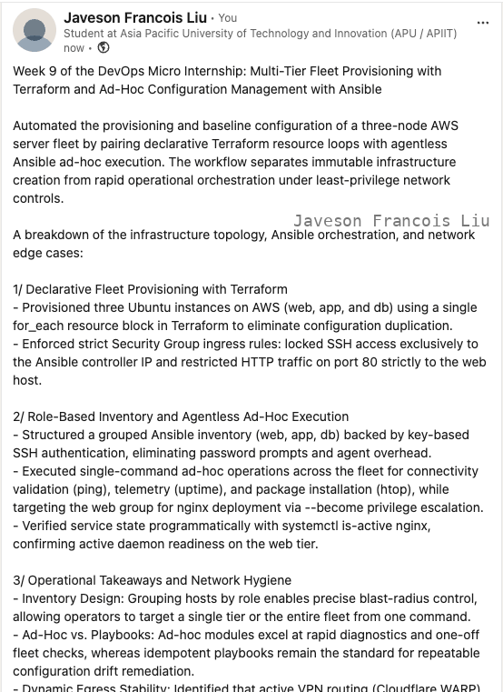

---

# Assignment Questions

Answer the following in your own words:

**1. What is the purpose of an Ansible inventory file?**

The inventory tells Ansible which machines exist, how to reach them and how they are grouped. With it, one command can target every server or only one group, and shared connection settings live in one place instead of in each command.

---

**2. What is the difference between the `web`, `app`, and `db` groups in your inventory?**

They are role groups. `web` holds the web server that runs nginx and is the only host open to HTTP. `app` holds the application server and `db` holds the database server, and both are reachable by SSH from the controller only. Grouping lets me run a command on one tier without touching the others.

---

**3. What does the Ansible `ping` module verify?**

It checks that Ansible can log in over SSH with the configured key and that a usable Python interpreter runs on the target. It does not send an ICMP ping, and it returns `pong` when the whole chain works.

---

**4. Why do package installation commands require `--become`?**

Installing packages and managing services needs root. `--become` makes Ansible switch from the `ubuntu` user to root through sudo for that task. Without it, apt fails with a permission error.

---

**5. When would you use an ad-hoc command instead of a playbook?**

An ad-hoc command suits a quick one-off job: a connectivity check, reading uptime, restarting a service or installing a package on a few hosts. A playbook suits work that must be repeatable, reviewed, stored in Git and run in a set order.

---

**6. What is one challenge you faced while setting up SSH or inventory, and how did you fix it?**

My laptop runs Cloudflare WARP, so my public IP changed between checks (104.28.194.x, then .245 and .247 at 104.28.226.x depending on the service). A `/32` SSH rule on that address would have locked the controller out. I disconnected WARP, confirmed a stable IP across several services, used it for `controller_ip`, and SSH worked on the first try.

---

# Required Files

Confirm that the following files are included in your assignment workspace:

- [x] `ansible-adhoc-lab/README.md`
- [x] `ansible-adhoc-lab/terraform/providers.tf`
- [x] `ansible-adhoc-lab/terraform/main.tf`
- [x] `ansible-adhoc-lab/terraform/variables.tf`
- [x] `ansible-adhoc-lab/terraform/outputs.tf`
- [x] `ansible-adhoc-lab/ansible/inventory.ini`
- [x] Updated `.gitignore`

---

# Submission Instructions

- Add all required screenshots from the tasks.
- Full Name must be visible in required screenshots.
- Mention whether you used Azure or AWS.
- Mention whether you used the three-VM option or four-VM option.
- Add the public IP addresses of the VMs, redacted if preferred.
- Add your `inventory.ini` proof.
- Add a short explanation of what you learned.
- Answer all assignment questions clearly in your own words.
- Add your LinkedIn post URL.
- Do not expose SSH private keys, Terraform state files, cloud credentials, passwords, access keys, secret keys, account IDs, or subscription IDs.

---

# Completion Checklist

- [x] Task 1: `ansible-adhoc-lab` project structure created
- [x] Task 1: `.gitignore` updated for Terraform files
- [x] Task 2: Terraform configuration created
- [x] Task 2: Server roles defined for either three or four VMs
- [x] Task 2: `count` or `for_each` used
- [x] Task 2: SSH restricted to the controller public IP
- [x] Task 2: HTTP allowed only for web hosts
- [x] Task 2: Terraform output maps roles to public IPs
- [x] Task 3: Terraform initialized successfully
- [x] Task 3: Terraform configuration validated
- [x] Task 3: Terraform apply completed successfully
- [x] Task 3: All selected VMs are running
- [x] Task 4: SSH key-based access works for every VM
- [x] Task 5: `inventory.ini` contains `web`, `app`, and `db` groups
- [x] Task 5: `ansible-inventory -i inventory.ini --graph` shows the correct groups
- [x] Task 6: `ansible all -i inventory.ini -m ping` returns `SUCCESS`
- [x] Task 6: Ad-hoc commands run successfully
- [x] Task 6: `--become` was used for package and service tasks
- [x] Task 6: Nginx is active on the `web` group
- [x] Screenshots 1–17 are included
- [x] Assignment questions are answered
- [x] LinkedIn post published
- [x] LinkedIn post URL added
- [x] No sensitive information is exposed

---

## About DMI & CloudAdvisory

DevOps Micro Internship (DMI) is a project-based DevOps program run by Pravin Mishra and The CloudAdvisory, focused on real-world execution, systems thinking, and career readiness.

It helps learners build strong DevOps foundations with hands-on experience.

---

## Resources

- DMI Official Website: [https://dmi.pravinmishra.com?utm_source=github&utm_medium=readme](https://dmi.pravinmishra.com?utm_source=github&utm_medium=readme)
- University: [https://university.pravinmishra.com?utm_source=github&utm_medium=readme](https://university.pravinmishra.com?utm_source=github&utm_medium=readme)
- Discord Community: [https://discord.pravinmishra.com?utm_source=github&utm_medium=readme](https://discord.pravinmishra.com?utm_source=github&utm_medium=readme)
- Blog: [https://dmi.pravinmishra.com/blog?utm_source=github&utm_medium=readme](https://dmi.pravinmishra.com/blog?utm_source=github&utm_medium=readme)
- YouTube Playlist: [https://www.youtube.com/playlist?list=PLFeSNDtI4Cho](https://www.youtube.com/playlist?list=PLFeSNDtI4Cho)
- Pravin Mishra LinkedIn: [https://www.linkedin.com/in/pravin-mishra-aws-trainer/](https://www.linkedin.com/in/pravin-mishra-aws-trainer/)
- CloudAdvisory LinkedIn: [https://www.linkedin.com/company/thecloudadvisory/](https://www.linkedin.com/company/thecloudadvisory/)

---

*This submission is part of DevOps Micro Internship (DMI) — Agentic AI Track.*