# Assignment 03 — Deploy a Static Website to Multiple Servers Using a Multi-Play Ansible Playbook

Part of the DevOps Micro Internship (DMI) with Agentic AI

---

## Student Details

**Full Name:** Javeson Francois Liu  
**Cloud Platform Used:** AWS (ap-southeast-5)  
**Server 1 URL:** `http://43.216.249.128`  
**Server 2 URL:** `http://43.217.158.225`

---

## Purpose

In this assignment, you will create a multi-play Ansible playbook to install Nginx, deploy a static website to two Ubuntu servers, and verify that the website is accessible from both servers.

You may use either AWS EC2 instances or Azure Virtual Machines as your managed servers.

---

# Task 1 — Create the Project Structure

## Goal

Create the required folders and files for the Ansible project.

## Evidence

### Screenshot 1 — Terminal or VS Code showing the complete `static-web` project structure

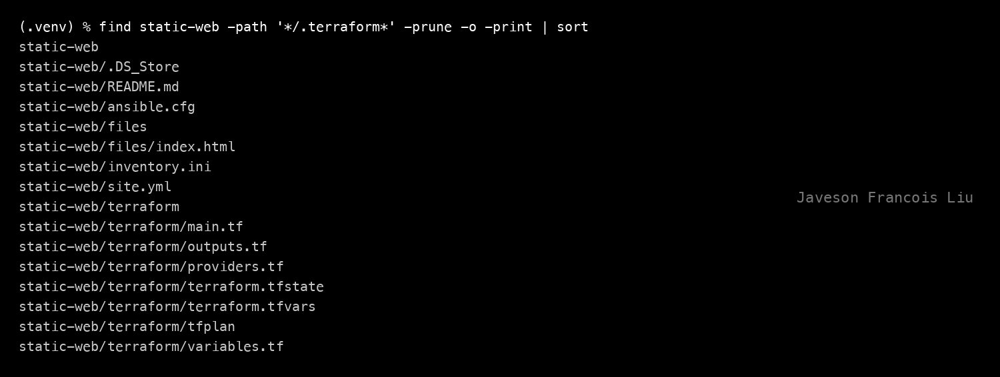

---

# Task 2 — Configure the Ansible Inventory

## Goal

Add both Ubuntu servers to the Ansible inventory.

## Evidence

### Screenshot 2 — Output of `ansible-inventory -i inventory.ini --graph` showing `web1` and `web2`

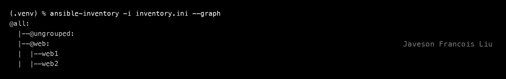

---

## Configuration File

Copy and paste the complete contents of your `inventory.ini` file below:

```ini
[web]
web1 ansible_host=43.216.249.128
web2 ansible_host=43.217.158.225

[web:vars]
ansible_user=ubuntu
ansible_ssh_private_key_file=~/.ssh/id_ed25519_ansible
ansible_ssh_common_args='-o StrictHostKeyChecking=accept-new'
```

---

# Task 3 — Verify Ansible Connectivity

## Goal

Confirm that the Ansible controller can connect to both servers.

## Evidence

### Screenshot 3 — Ansible ping output showing `SUCCESS` and `pong` for both servers

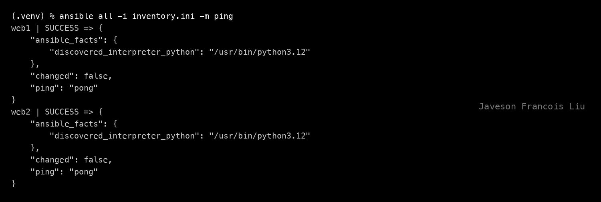

---

# Task 4 — Download and Personalize the Static Website

## Goal

Download `index.html` to the Ansible controller and personalize the website with your full name.

## Evidence

### Screenshot 4 — Edited `files/index.html` showing the footer line with your full name

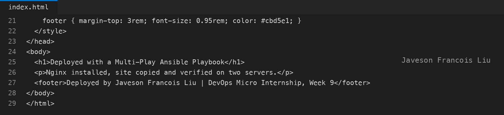

---

# Task 5 — Create the Multi-Play Ansible Playbook

## Goal

Create a single Ansible playbook containing separate plays for installation, deployment, and verification.

## Configuration File

Copy and paste the complete contents of your `site.yml` file below:

```yaml
---
- name: Play 1 - Install and start Nginx
  hosts: web
  become: true
  tasks:
    - name: Install Nginx
      ansible.builtin.apt:
        name: nginx
        state: present
        update_cache: true
        cache_valid_time: 3600

    - name: Start and enable Nginx
      ansible.builtin.service:
        name: nginx
        state: started
        enabled: true

- name: Play 2 - Deploy the static website
  hosts: web
  become: true
  tasks:
    - name: Copy index.html to the web root
      ansible.builtin.copy:
        src: files/index.html
        dest: /var/www/html/index.html
        owner: root
        group: root
        mode: "0644"
      notify: Reload Nginx

  handlers:
    - name: Reload Nginx
      ansible.builtin.service:
        name: nginx
        state: reloaded

- name: Play 3 - Verify both web servers from the controller
  hosts: localhost
  connection: local
  gather_facts: false
  tasks:
    - name: Check that each web server returns HTTP 200
      ansible.builtin.uri:
        url: "http://{{ hostvars[item].ansible_host }}"
        status_code: 200
        return_content: false
      loop: "{{ groups['web'] }}"
      register: web_check

    - name: Show the verified status codes
      ansible.builtin.debug:
        msg: "{{ item.item }} returned HTTP {{ item.status }}"
      loop: "{{ web_check.results }}"
      loop_control:
        label: "{{ item.item }}"
```

---

# Task 6 — Validate the Playbook Syntax

## Goal

Check the playbook for YAML or Ansible syntax errors before running it.

## Evidence

### Screenshot 5 — Successful syntax-check output showing `playbook: site.yml`

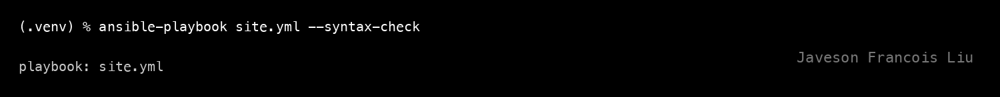

---

# Task 7 — Run the Multi-Play Playbook

## Goal

Install Nginx, deploy the website, and verify both servers in one playbook run.

## Evidence

### Screenshot 6 — Play 3 verification showing HTTP `200` for both servers

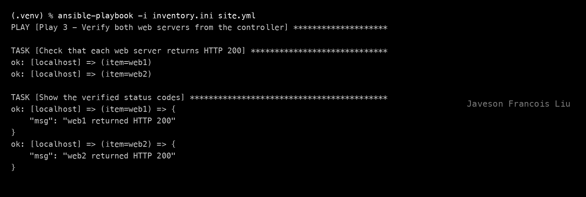

---

### Screenshot 7 — Final play recap showing `unreachable=0` and `failed=0` for `web1`, `web2`, and `localhost`


---

# Task 8 — Verify Idempotency

## Goal

Run the playbook again and confirm that it does not make unnecessary changes.

## Evidence

### Screenshot 8 — Second playbook run showing the play recap with `changed=0`, `unreachable=0`, and `failed=0` for both web servers

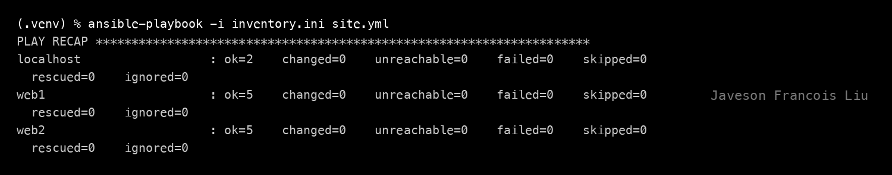

---

# Task 9 — Test Both Websites Manually

## Goal

Confirm that the static website is accessible from both public IP addresses.

## Evidence

### Screenshot 9 — `curl -I` output showing HTTP `200 OK` from both servers

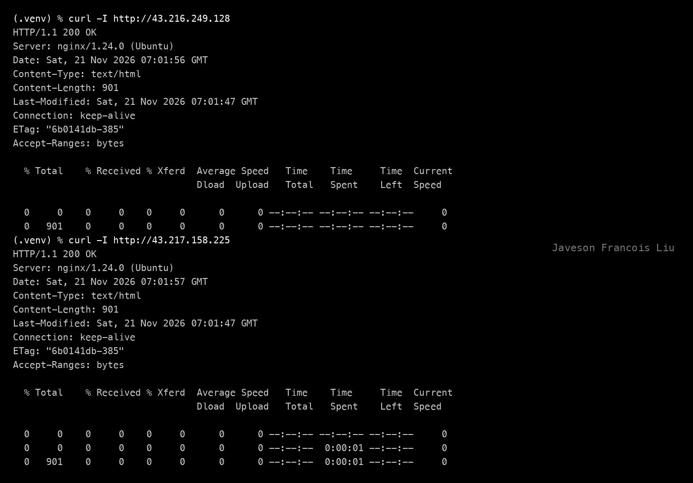

---

### Screenshot 10 — Browser showing the website from Server 1 with the public IP and your full name visible

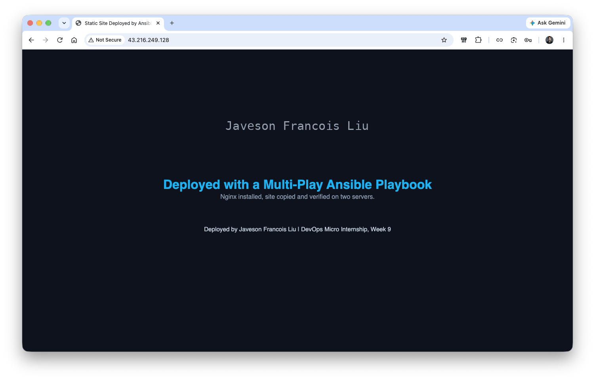

---

### Screenshot 11 — Browser showing the website from Server 2 with the public IP and your full name visible

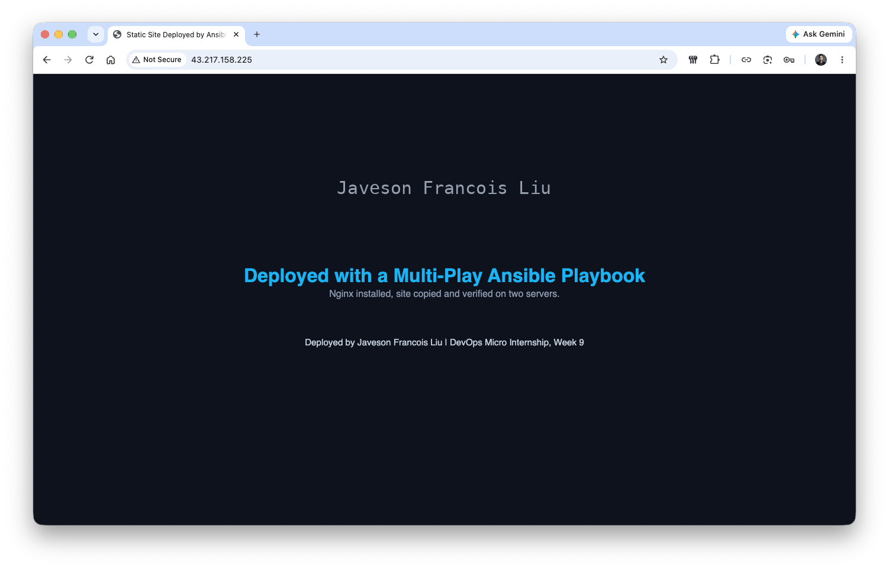

---

## Website URLs

Add both deployed website URLs below:

```text
Server 1: http://43.216.249.128
Server 2: http://43.217.158.225
```

---

# Task 10 — Complete the Project README

## Goal

Document how the project works and record what you learned.

## README Content

Copy and paste the complete contents of your `README.md` file below:

```markdown
# static-web

A multi-play Ansible playbook that installs Nginx on two Ubuntu servers, deploys a static website, and checks that both servers answer with HTTP 200. Built by **Javeson Francois Liu** for the DevOps Micro Internship (DMI), Week 9, Assignment 03.

## What it does

| Play | Hosts | Job |
|---|---|---|
| 1 - Install and start Nginx | `web` | Installs Nginx with `apt`, then starts and enables it |
| 2 - Deploy the static website | `web` | Copies `files/index.html` to `/var/www/html` and reloads Nginx only when the file changed |
| 3 - Verify both web servers | `localhost` | Calls each server with the `uri` module and requires HTTP 200 |

## Files

| Path | Purpose |
|---|---|
| `inventory.ini` | The two servers, `web1` and `web2`, in the `web` group |
| `site.yml` | The three-play playbook |
| `files/index.html` | The website, with my full name in the footer |
| `ansible.cfg` | Points Ansible at `inventory.ini` |
| `terraform/` | Builds the two AWS servers (optional, for a repeatable lab) |

## How to run

1. Put the two public IPs into `inventory.ini`.
2. Check the connection: `ansible web -m ping`.
3. Check the syntax: `ansible-playbook site.yml --syntax-check`.
4. Deploy: `ansible-playbook site.yml`.
5. Run it again. A second run must show `changed=0` for both web servers.
6. Test by hand: `curl -I http://<server-ip>`.

## What I learned

- One playbook can hold several plays, so install, deploy and verify stay separate and easy to read.
- The `copy` module only reports a change when the file differs, so a re-run is safe. This is idempotency.
- A handler runs only when a task notifies it. The Nginx reload happens on the first run and not on the second.
- The `uri` module turns "the site looks fine" into a check that fails the run if a server does not return 200.
- Verifying from the controller tests the same path a visitor uses.
```

---

# LinkedIn Post Required

## Evidence

### LinkedIn Post URL

Paste your LinkedIn post URL here:

https://www.linkedin.com/posts/javeson-francois-liu-999135437_dmibypravinmishra-devops-ansible-share-7530279157751128064-cOjl/

---

### Screenshot — Published LinkedIn post

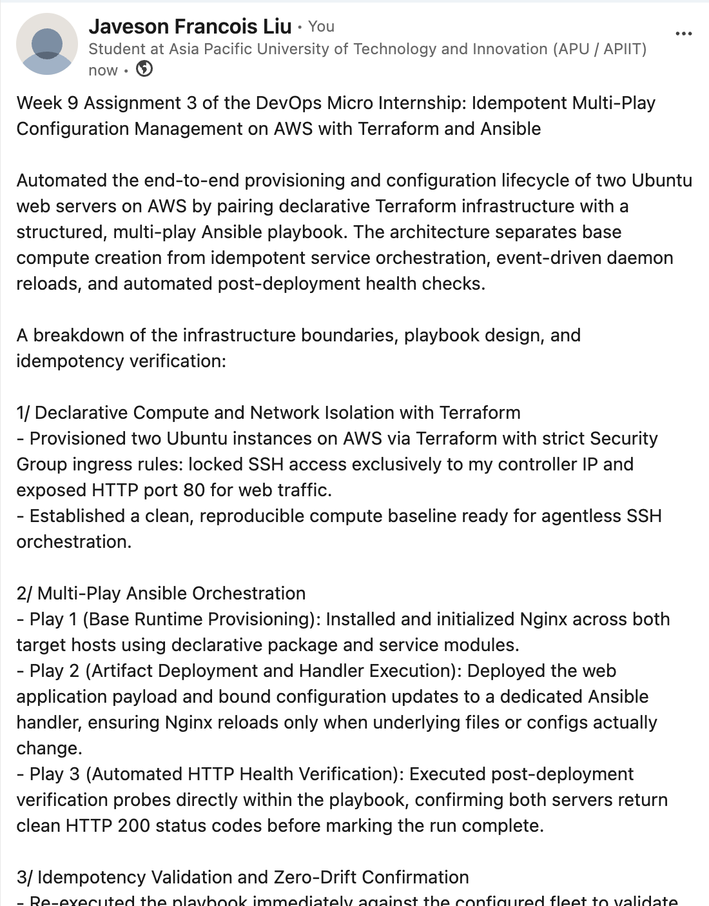

---

# Assignment Questions

Answer the following in your own words:

**1. What issue did you face while completing this assignment, and how did you fix it?**

My SSH rule only allows my own public IP, and Cloudflare WARP had been changing that IP in Assignment 02. I kept WARP off, checked that the IP was the same across several services, and then applied. SSH and the playbook worked on the first run.

---

**2. What did you learn from this assignment?**

I learned how to split one playbook into install, deploy and verify plays, how a handler reloads Nginx only when the website file changed, and how a second run proves idempotency with `changed=0`. I also learned that the `uri` module lets the controller check the result the way a visitor would.

---

**3. Why is it useful to split installation, deployment, and verification into separate plays?**

Each play has one job, so the playbook reads like a pipeline and a failure points to the exact stage. I can re-run or limit one play without touching the others. Verification also stays separate from the change, so it can run from the controller and test the public address.

---

**4. What is one benefit of using the Ansible `copy` module instead of cloning the website directly from Git on every managed server?**

The `copy` module sends the file from the controller, so the controller is the single source of truth and every server gets the identical file. The servers need no Git, no repository access and no outbound internet for the site, and Ansible compares checksums, so nothing changes when the file is the same.

---

**5. What does idempotency mean in this assignment?**

It means I can run the playbook again and the servers stay as they are. On the second run Nginx was already installed, running and enabled, and `index.html` was identical, so both web servers showed `changed=0` and the reload handler did not run.

---

**6. What does the Ansible `uri` module verify in Play 3?**

It sends an HTTP request from the controller to each web server's public address and checks that the status code is 200, otherwise the play fails. That proves Nginx is serving, the security group allows port 80 and the site is reachable from outside the server.

---

# Required Files

Confirm that the following files are included in your assignment folder:

- [x] `inventory.ini`
- [x] `site.yml`
- [x] `files/index.html`
- [x] `README.md`

---

# Submission Instructions

- Add all required screenshots in the correct order.
- Full Name must be visible in required screenshots.
- Include both deployed website URLs.
- Paste `inventory.ini`, `site.yml`, and `README.md` as editable text.
- Answer all assignment questions clearly in your own words.
- Add your LinkedIn post URL.
- Do not expose SSH private keys, passwords, cloud account IDs, or other sensitive information.

---

# Completion Checklist

- [x] Task 1: `static-web` folder structure is complete
- [x] Task 2: Both servers are listed under the `[web]` group in `inventory.ini`
- [x] Task 2: Inventory graph shows `web1` and `web2`
- [x] Task 3: Ansible ping returns `SUCCESS` and `pong` for both servers
- [x] Task 4: `files/index.html` contains your full name
- [x] Task 5: `site.yml` contains three separate plays
- [x] Task 5: Play 1 installs, starts, and enables Nginx
- [x] Task 5: Play 2 deploys `index.html` using the `copy` module
- [x] Task 5: Nginx reload handler is included
- [x] Task 5: Play 3 verifies both web servers from the controller
- [x] Task 6: Playbook syntax check passes
- [x] Task 7: First playbook run completes with `unreachable=0` and `failed=0`
- [x] Task 7: URI verification returns HTTP `200` for both servers
- [x] Task 8: Second playbook run demonstrates idempotency
- [x] Task 8: Second run shows `changed=0` for both web servers
- [x] Task 9: Both `curl -I` commands return HTTP `200 OK`
- [x] Task 9: Website loads from Server 1
- [x] Task 9: Website loads from Server 2
- [x] Task 9: Full name is visible on both deployed websites
- [x] Task 10: `README.md` contains all required explanations
- [x] Screenshots 1–11 are included
- [x] `inventory.ini`, `site.yml`, and `README.md` are pasted as editable text
- [x] Both website URLs are included
- [x] Assignment questions are answered
- [x] LinkedIn post published
- [x] LinkedIn post URL added
- [x] No sensitive information is exposed

---

## About DMI & CloudAdvisory

DevOps Micro Internship (DMI) is a project-based DevOps program run by Pravin Mishra and The CloudAdvisory, focused on real-world execution, systems thinking, and career readiness.

It helps learners build strong DevOps foundations with hands-on experience.

---

## Resources

- DMI Official Website: [https://dmi.pravinmishra.com?utm_source=github&utm_medium=readme](https://dmi.pravinmishra.com?utm_source=github&utm_medium=readme)
- University: [https://university.pravinmishra.com?utm_source=github&utm_medium=readme](https://university.pravinmishra.com?utm_source=github&utm_medium=readme)
- Discord Community: [https://discord.pravinmishra.com?utm_source=github&utm_medium=readme](https://discord.pravinmishra.com?utm_source=github&utm_medium=readme)
- Blog: [https://dmi.pravinmishra.com/blog?utm_source=github&utm_medium=readme](https://dmi.pravinmishra.com/blog?utm_source=github&utm_medium=readme)
- YouTube Playlist: [https://www.youtube.com/playlist?list=PLFeSNDtI4Cho](https://www.youtube.com/playlist?list=PLFeSNDtI4Cho)
- Pravin Mishra LinkedIn: [https://www.linkedin.com/in/pravin-mishra-aws-trainer/](https://www.linkedin.com/in/pravin-mishra-aws-trainer/)
- CloudAdvisory LinkedIn: [https://www.linkedin.com/company/thecloudadvisory/](https://www.linkedin.com/company/thecloudadvisory/)

---

*This submission is part of DevOps Micro Internship (DMI) — Agentic AI Track.*