# Assignment 04 — Deploy Mini Finance on Azure Using Terraform and Ansible

Part of the DevOps Micro Internship (DMI) with Agentic AI

---

## Purpose

In this assignment, you will provision Azure infrastructure using Terraform and deploy the Mini Finance website using an Ansible multi-play playbook.

Terraform will create the Azure Virtual Machine and networking resources. Ansible will install Nginx, clone the Mini Finance repository, deploy the website, and verify the deployment.

---

# Task 1 — Create the Project Structure

## Goal

Create separate directories and files for the Terraform infrastructure and Ansible configuration.

### Evidence

#### Screenshot 1 — Terminal or VS Code showing the complete `mini-finance` project structure

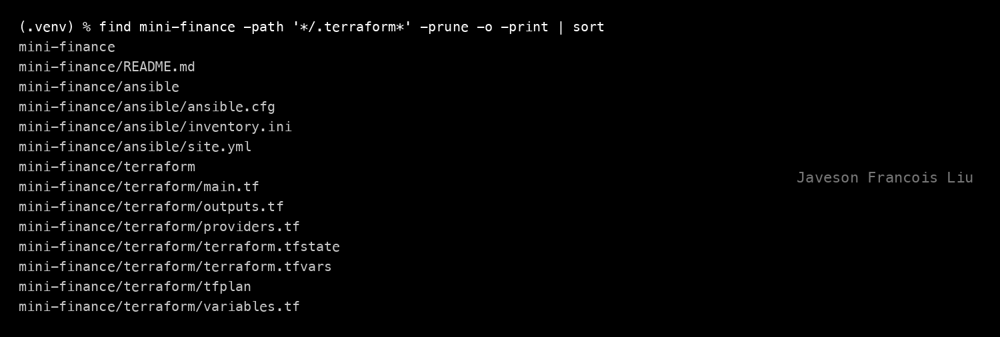

---

### Notes

I created `mini-finance/` with `terraform/` and `ansible/` folders, a README and a `.gitignore` that excludes Terraform state, `.terraform/`, plan files and `*.tfvars`, so state, keys and my public IP stay out of Git.

---

# Task 2 — Create the Azure Infrastructure Using Terraform

## Goal

Use Terraform to provision an Ubuntu Virtual Machine with the required Azure networking and security resources.

### Evidence

#### Screenshot 2 — Terraform code showing the `Allow-SSH` rule for port `22` and the `Allow-HTTP` rule for port `80`

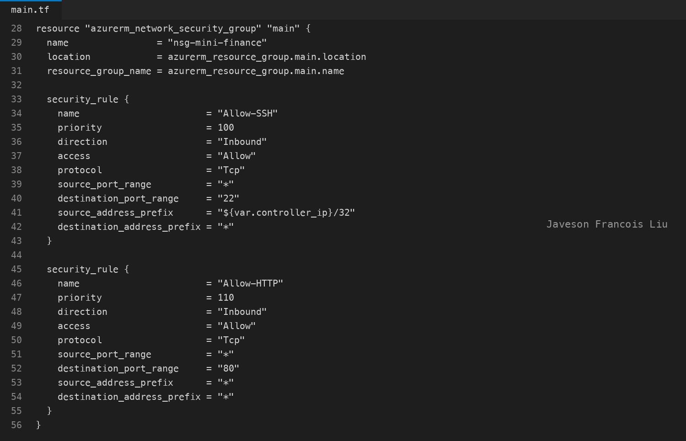

---

#### Screenshot 3 — Terraform code showing the association between `nsg-mini-finance` and `nic-mini-finance`

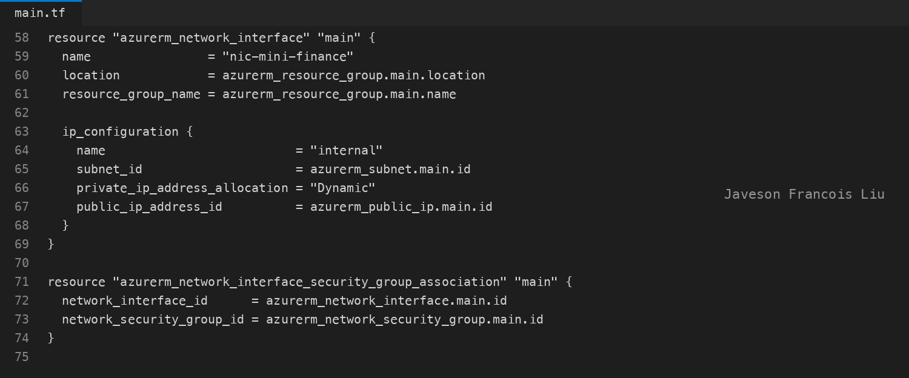

---

### Notes

Terraform builds a resource group, virtual network, subnet, static public IP, the `nsg-mini-finance` security group, `nic-mini-finance` and the `mini-finance` Ubuntu 24.04 VM. `Allow-SSH` opens port 22 to my controller IP only and `Allow-HTTP` opens port 80 to everyone. An association resource attaches the NSG to the NIC, so the rules actually apply to the VM. The VM size is `Standard_B2ls_v2` in East Asia, because that size is not offered in Southeast Asia.

---

# Task 3 — Initialize and Apply the Terraform Configuration

## Goal

Format and validate the Terraform configuration, review the execution plan, and provision the Azure infrastructure.

### Evidence

#### Screenshot 4 — End of the `terraform apply` output showing `Apply complete!` with no errors

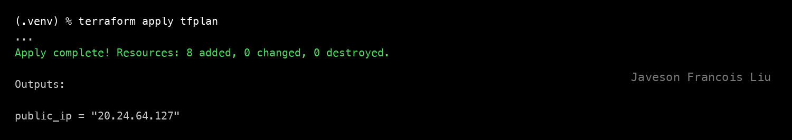

---

#### Screenshot 5 — Output of `terraform output public_ip` showing the VM’s public IP address

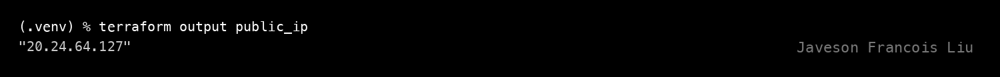

---

### Notes

`terraform fmt`, `init` and `validate` passed. The plan showed 8 to add, 0 to change, 0 to destroy, and apply created all 8 resources. `terraform output public_ip` returned the VM address. Screenshot 4 shows only the end of the apply output because the earlier lines contain the subscription ID.

---

# Task 4 — Verify Passwordless SSH Access

## Goal

Confirm that the Ansible controller can connect to the Terraform-provisioned Azure VM using SSH key authentication.

### Evidence

#### Screenshot 6 — Passwordless SSH command and the returned `mini-finance` hostname

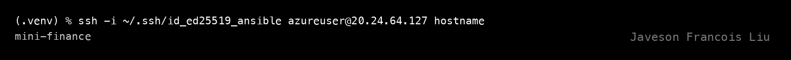

---

### Notes

The dedicated key `id_ed25519_ansible` from Assignment 01 is installed on the VM through Terraform's `admin_ssh_key`. `ssh azureuser@<ip> hostname` returned `mini-finance` with no password prompt.

---

# Task 5 — Create the Ansible Inventory and Verify Connectivity

## Goal

Add the Terraform-provisioned Azure VM to the Ansible inventory and confirm that Ansible can connect to it.

### Evidence

#### Screenshot 7 — Ansible ping output showing `SUCCESS` and `pong` from the Azure VM

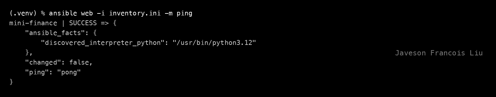

---

### Configuration File

Copy and paste the complete contents of your `ansible/inventory.ini` file below:

```ini
[web]
mini-finance ansible_host=20.24.64.127

[web:vars]
ansible_user=azureuser
ansible_ssh_private_key_file=~/.ssh/id_ed25519_ansible
ansible_ssh_common_args='-o StrictHostKeyChecking=accept-new'
```

---

# Task 6 — Create the Multi-Play Ansible Playbook

## Goal

Create one Ansible playbook containing separate plays to install Nginx, deploy the Mini Finance website, and verify the deployment.

### Evidence

#### Screenshot 8 — `site.yml` showing Play 1 and the beginning of Play 2

Screenshot must show:

- Play 1 targeting the `web` group
- Installation of `nginx`, `git`, and `rsync`
- Nginx service configured as started and enabled
- Beginning of Play 2 with the Git repository URL and synchronization task

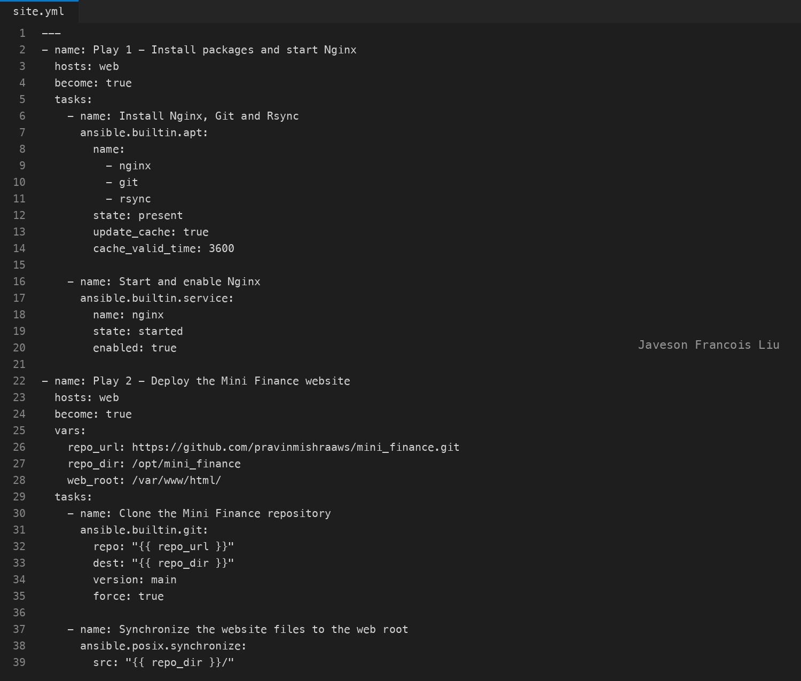

---

#### Screenshot 9 — `site.yml` showing the deployment destination, handler, and Play 3 verification

Screenshot must show:

- Website destination `/var/www/html/`
- Ownership set to `www-data:www-data`
- Nginx reload handler
- Play 3 targeting `localhost`
- The `uri` verification and `assert` condition

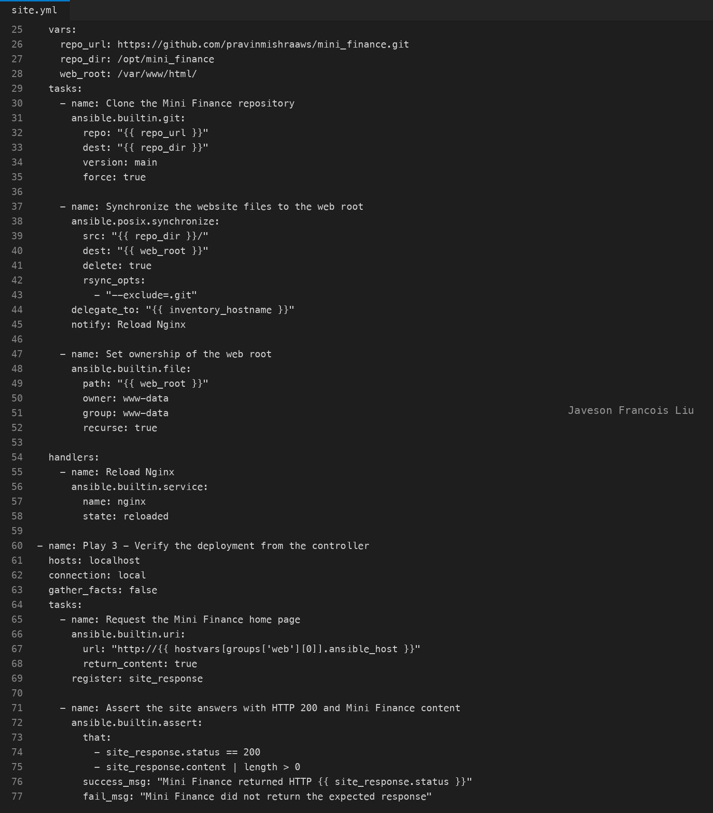

---

### Configuration File

Copy and paste the complete contents of your `ansible/site.yml` file below:

```yaml
---
- name: Play 1 - Install packages and start Nginx
  hosts: web
  become: true
  tasks:
    - name: Install Nginx, Git and Rsync
      ansible.builtin.apt:
        name:
          - nginx
          - git
          - rsync
        state: present
        update_cache: true
        cache_valid_time: 3600

    - name: Start and enable Nginx
      ansible.builtin.service:
        name: nginx
        state: started
        enabled: true

- name: Play 2 - Deploy the Mini Finance website
  hosts: web
  become: true
  vars:
    repo_url: https://github.com/pravinmishraaws/mini_finance.git
    repo_dir: /opt/mini_finance
    web_root: /var/www/html/
  tasks:
    - name: Clone the Mini Finance repository
      ansible.builtin.git:
        repo: "{{ repo_url }}"
        dest: "{{ repo_dir }}"
        version: main
        force: true

    - name: Synchronize the website files to the web root
      ansible.posix.synchronize:
        src: "{{ repo_dir }}/"
        dest: "{{ web_root }}"
        delete: true
        rsync_opts:
          - "--exclude=.git"
      delegate_to: "{{ inventory_hostname }}"
      notify: Reload Nginx

    - name: Set ownership of the web root
      ansible.builtin.file:
        path: "{{ web_root }}"
        owner: www-data
        group: www-data
        recurse: true

  handlers:
    - name: Reload Nginx
      ansible.builtin.service:
        name: nginx
        state: reloaded

- name: Play 3 - Verify the deployment from the controller
  hosts: localhost
  connection: local
  gather_facts: false
  tasks:
    - name: Request the Mini Finance home page
      ansible.builtin.uri:
        url: "http://{{ hostvars[groups['web'][0]].ansible_host }}"
        return_content: true
      register: site_response

    - name: Assert the site answers with HTTP 200 and Mini Finance content
      ansible.builtin.assert:
        that:
          - site_response.status == 200
          - site_response.content | length > 0
        success_msg: "Mini Finance returned HTTP {{ site_response.status }}"
        fail_msg: "Mini Finance did not return the expected response"
```

---

# Task 7 — Validate and Run the Ansible Playbook

## Goal

Validate the syntax of the multi-play Ansible playbook and run it to install Nginx, deploy the Mini Finance website, and verify the deployment.

### Evidence

#### Screenshot 10 — Successful playbook syntax check showing `playbook: site.yml`

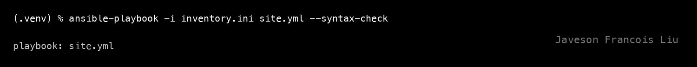

---

#### Screenshot 11 — Play 3 output showing the successful HTTP verification and assertion

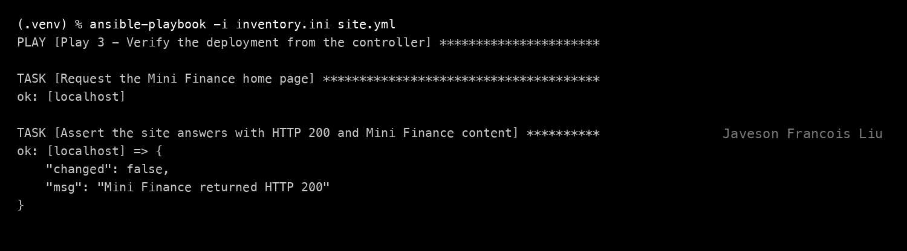

---

#### Screenshot 12 — Final `PLAY RECAP` showing `failed=0` and `unreachable=0`

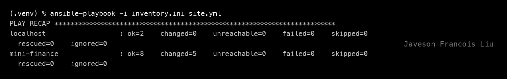

---

### Notes

The playbook ran with `failed=0` and `unreachable=0`. Play 1 installed Nginx, Git and Rsync, Play 2 cloned the repository and synchronized it to `/var/www/html/` with `www-data` ownership and an Nginx reload handler, and Play 3 requested the page from the controller and asserted HTTP 200 with non-empty content.

---

# Task 8 — Test the Mini Finance Website in a Browser

## Goal

Confirm that the Mini Finance website is publicly accessible through the Azure VM’s public IP address.

### Evidence

#### Screenshot 13 — Mini Finance website successfully loading in the browser, with the Azure VM’s public IP address visible in the address bar

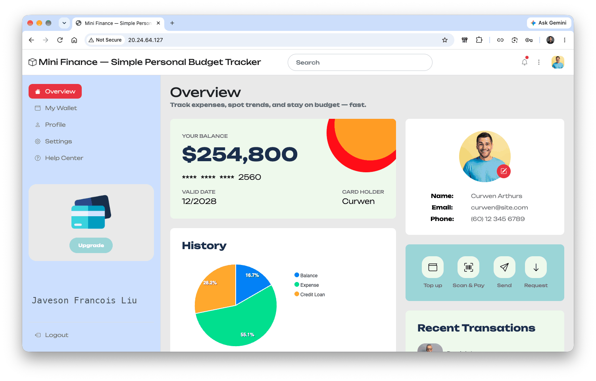

---

### Website URL

Add your deployed website URL below:

```text
http://20.24.64.127
```

---

# Task 9 — Create the Project README

## Goal

Create a `README.md` file to document the Mini Finance infrastructure and deployment project.

### Evidence

#### Screenshot 14 — Completed `README.md` displayed in the VS Code Markdown preview or terminal

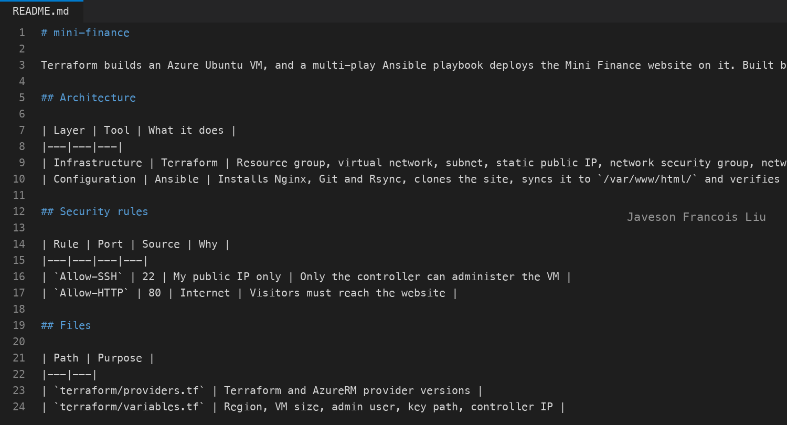

---

### README Content

Copy and paste the complete contents of your `README.md` file below:

```markdown
# mini-finance

Terraform builds an Azure Ubuntu VM, and a multi-play Ansible playbook deploys the Mini Finance website on it. Built by **Javeson Francois Liu** for the DevOps Micro Internship (DMI), Week 9, Assignment 04.

## Architecture

| Layer | Tool | What it does |
|---|---|---|
| Infrastructure | Terraform | Resource group, virtual network, subnet, static public IP, network security group, network interface and the `mini-finance` Ubuntu 24.04 VM |
| Configuration | Ansible | Installs Nginx, Git and Rsync, clones the site, syncs it to `/var/www/html/` and verifies it |

## Security rules

| Rule | Port | Source | Why |
|---|---|---|---|
| `Allow-SSH` | 22 | My public IP only | Only the controller can administer the VM |
| `Allow-HTTP` | 80 | Internet | Visitors must reach the website |

## Files

| Path | Purpose |
|---|---|
| `terraform/providers.tf` | Terraform and AzureRM provider versions |
| `terraform/variables.tf` | Region, VM size, admin user, key path, controller IP |
| `terraform/main.tf` | All Azure resources |
| `terraform/outputs.tf` | `public_ip` output |
| `ansible/inventory.ini` | The VM in the `web` group |
| `ansible/site.yml` | Three plays: install, deploy, verify |

## How to run

1. Set `controller_ip` in `terraform/terraform.tfvars` (ignored by Git).
2. Provision: `cd terraform && terraform init && terraform apply`.
3. Read the address: `terraform output public_ip`.
4. Put the address into `ansible/inventory.ini`.
5. Check access: `ssh azureuser@<public-ip> hostname` returns `mini-finance`.
6. Check Ansible: `cd ../ansible && ansible web -i inventory.ini -m ping`.
7. Validate: `ansible-playbook -i inventory.ini site.yml --syntax-check`.
8. Deploy: `ansible-playbook -i inventory.ini site.yml`.
9. Open `http://<public-ip>` in a browser.
10. Clean up: `terraform destroy`.

## What I learned

- Terraform creates the machine and Ansible configures it, so each tool does the job it is best at.
- The public IP from `terraform output` feeds straight into the Ansible inventory.
- Restricting SSH to one IP and opening only port 80 keeps the exposed surface small.
- `rsync` copies only changed files, so a re-run is fast and safe.
- The `uri` module with `assert` turns "it looks fine" into a check that fails the run.
```

---

# LinkedIn Post Required

## Evidence

#### Screenshot 15 — Published LinkedIn post showing the text and at least one deployment screenshot

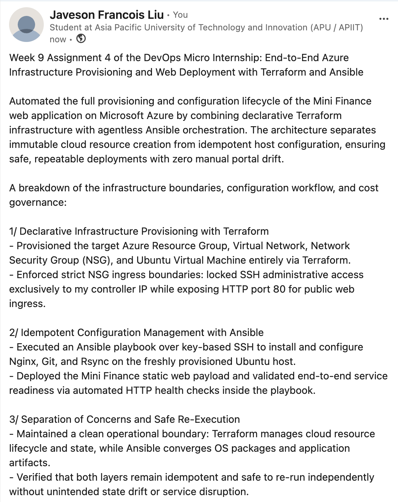

---

#### LinkedIn Post URL

Paste your LinkedIn post URL here:

https://www.linkedin.com/posts/javeson-francois-liu-999135437_dmibypravinmishra-devops-ansible-share-7530279943574953984-KqLd/

---

### LinkedIn Submission Notes

**One challenge you faced and how you fixed it:**

At first my SSH rule risked locking me out, because Cloudflare WARP had been changing my public IP. I kept WARP off, confirmed the same IP across several services, and used that address for `Allow-SSH`. The first SSH and Ansible connection worked.

---

**One real-world example where you can use this learning:**

A small team can use this to launch a new internal web service. Terraform builds the same network and VM every time, and Ansible configures and deploys it, so a rebuilt environment is identical and nobody configures servers by hand.

---

# Assignment Questions

Answer the following in your own words:

**1. What did you provision using Terraform in this assignment?**

Terraform provisioned the resource group, virtual network, subnet, static public IP, the network security group with its `Allow-SSH` and `Allow-HTTP` rules, the network interface, the NSG-to-NIC association, and the `mini-finance` Ubuntu VM with my SSH key.

---

**2. What did Ansible configure and deploy in this assignment?**

Ansible installed Nginx, Git and Rsync, cloned the Mini Finance repository, synchronized the site files to `/var/www/html/`, set `www-data` ownership, reloaded Nginx, and verified from the controller that the site returns HTTP 200.

---

**3. Why is SSH access on port `22` restricted to your public IP address?**

Port 22 gives full administrative access, so only my controller IP should reach it. Limiting it to one address blocks internet-wide scanning and brute-force attempts against the VM.

---

**4. Why is HTTP port `80` open to the internet?**

It is a public website, so visitors from anywhere must reach port 80. Opening only 80, and nothing else, keeps the exposed surface as small as possible.

---

**5. What is the purpose of the Ansible inventory file?**

The inventory tells Ansible which hosts exist, how to connect to them and which group each belongs to, so the playbook can target `web` instead of a hard-coded address.

---

**6. Why does the playbook use separate plays for install, deploy, and verify?**

Each play has one job, so the playbook reads like a pipeline, a failure points to the exact stage, and verification stays separate from the change it checks.

---

**7. Why is `rsync` useful when deploying website files?**

`rsync` copies only files that changed and can delete files removed from the source, so a re-deploy is fast and leaves the web root matching the repository exactly.

---

**8. What does the Ansible `uri` module verify in this assignment?**

It sends an HTTP request from the controller to the VM's public address and returns the response, which the `assert` then checks for status 200 and non-empty content. That proves Nginx, the NSG rule and the deployed files all work together.

---

**9. What issue did you face during this assignment, and how did you fix it?**

The same SSH rule problem as before: a firewall rule tied to my public IP is only safe when that IP is stable. I fixed it by keeping WARP off and verifying the IP before applying.

---

**10. What did you learn from using Terraform and Ansible together?**

Terraform and Ansible fit together cleanly: Terraform's output becomes Ansible's inventory. Keeping infrastructure and configuration in separate tools makes each easier to review, repeat and destroy.

---

# Required Files

Confirm that the following files are included in your assignment folder:

- [x] `.gitignore`
- [x] `README.md`
- [x] `terraform/providers.tf`
- [x] `terraform/main.tf`
- [x] `terraform/variables.tf`
- [x] `terraform/outputs.tf`
- [x] `ansible/inventory.ini`
- [x] `ansible/site.yml`

---

# Submission Instructions

- Add all required screenshots in the correct order.
- Full Name must be visible in required screenshots.
- Add the Azure VM public IP address.
- Add the final Mini Finance website URL.
- Paste `inventory.ini`, `site.yml`, and `README.md` as editable text.
- Answer all assignment questions clearly in your own words.
- Add your LinkedIn post URL.
- Do not expose SSH private keys, passwords, Azure credentials, subscription IDs, Terraform state contents, or other sensitive information.

---

# Completion Checklist

- [x] Task 1: `mini-finance` project structure created
- [x] Task 1: `.gitignore` created
- [x] Task 2: Terraform Azure infrastructure code created
- [x] Task 2: `Allow-SSH` rule configured for port `22`
- [x] Task 2: `Allow-HTTP` rule configured for port `80`
- [x] Task 2: NSG associated with the Network Interface
- [x] Task 3: `terraform fmt` completed
- [x] Task 3: `terraform init` completed
- [x] Task 3: `terraform validate` completed successfully
- [x] Task 3: `terraform apply` completed successfully
- [x] Task 3: `terraform output public_ip` displayed the VM public IP
- [x] Task 4: Passwordless SSH works from the Ansible controller
- [x] Task 5: `inventory.ini` created
- [x] Task 5: Ansible ping returns `SUCCESS` and `pong`
- [x] Task 6: `site.yml` contains three separate plays
- [x] Task 6: Play 1 installs Nginx, Git, and rsync
- [x] Task 6: Play 2 clones and deploys the Mini Finance website
- [x] Task 6: Play 3 verifies HTTP status code `200`
- [x] Task 7: Playbook syntax check passes
- [x] Task 7: Ansible playbook completes successfully
- [x] Task 7: Final recap shows `failed=0` and `unreachable=0`
- [x] Task 8: Mini Finance website loads in the browser
- [x] Task 8: Azure VM public IP is visible in the browser screenshot
- [x] Task 9: `README.md` completed
- [x] Screenshots 1–15 are included
- [x] `inventory.ini`, `site.yml`, and `README.md` are pasted as editable text
- [x] Assignment questions are answered
- [x] LinkedIn post published with Anyone visibility
- [x] LinkedIn post URL added
- [x] No sensitive information is exposed

---

## About DMI & CloudAdvisory

DevOps Micro Internship (DMI) is a project-based DevOps program run by Pravin Mishra and The CloudAdvisory, focused on real-world execution, systems thinking, and career readiness.

It helps learners build strong DevOps foundations with hands-on experience.

---

## Resources

- DMI Official Website: [https://dmi.pravinmishra.com?utm_source=github&utm_medium=readme](https://dmi.pravinmishra.com?utm_source=github&utm_medium=readme)
- University: [https://university.pravinmishra.com?utm_source=github&utm_medium=readme](https://university.pravinmishra.com?utm_source=github&utm_medium=readme)
- Discord Community: [https://discord.pravinmishra.com?utm_source=github&utm_medium=readme](https://discord.pravinmishra.com?utm_source=github&utm_medium=readme)
- Blog: [https://dmi.pravinmishra.com/blog?utm_source=github&utm_medium=readme](https://dmi.pravinmishra.com/blog?utm_source=github&utm_medium=readme)
- YouTube Playlist: [https://www.youtube.com/playlist?list=PLFeSNDtI4Cho](https://www.youtube.com/playlist?list=PLFeSNDtI4Cho)
- Pravin Mishra LinkedIn: [https://www.linkedin.com/in/pravin-mishra-aws-trainer/](https://www.linkedin.com/in/pravin-mishra-aws-trainer/)
- CloudAdvisory LinkedIn: [https://www.linkedin.com/company/thecloudadvisory/](https://www.linkedin.com/company/thecloudadvisory/)

---

*This submission is part of DevOps Micro Internship (DMI) — Agentic AI Track.*