# Assignment — Deploy EpicBook with Terraform and Ansible Roles

Part of the DevOps Micro Internship (DMI) with Agentic AI

---

## Purpose

In this assignment, you will deploy the EpicBook web application using Terraform and Ansible roles.

Terraform provisions the cloud infrastructure, including one Ubuntu VM and one managed MySQL database. Ansible roles configure the VM, install required software, deploy the EpicBook application, configure Nginx, connect the app to the managed MySQL database, and verify the deployment.

---

# Task 1 — Set Up the Project Folder Layout

## Goal

Create the project folder structure for Terraform and Ansible roles.

Terraform will be used to provision the cloud infrastructure. Ansible roles will be used to configure the VM and deploy the EpicBook application.

### Evidence

#### Screenshot 1 — Terminal showing the completed `epicbook-prod` project structure

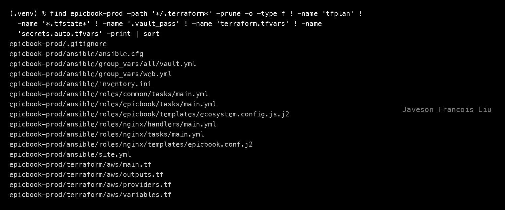

---

### Notes

Answer the following in your own words:

**1. Which cloud provider did you choose for this assignment?**

I chose AWS. EC2 runs the Ubuntu VM and RDS runs the managed MySQL database, both in `ap-southeast-5`. My earlier labs and credits are on the same AWS account.

---

**2. Why is it useful to keep Terraform files and Ansible files in separate folders?**

Terraform builds machines and Ansible configures them, and the two change at different speeds. Separate folders let me plan, lint, run and destroy each tool alone, and keep state files and secrets out of the Ansible code.

---

**3. What is the purpose of the `roles` directory in Ansible?**

The `roles` directory holds reusable units of work. Each role has its own tasks, handlers and templates and one clear job, so `site.yml` only lists the roles to apply.

---

# Task 2 — Provision the Infrastructure with Terraform

## Goal

Run Terraform to provision the cloud infrastructure for the EpicBook deployment.

Terraform will create the VM, managed MySQL database, networking, security rules, and required outputs.

### Evidence

#### Screenshot 2 — `terraform apply` completed successfully

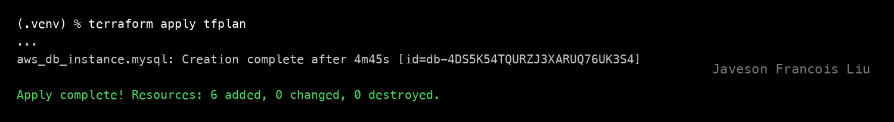

---

#### Screenshot 3 — Output of `terraform output`

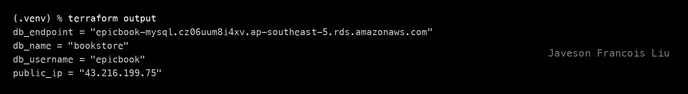

---

#### Screenshot 4 — Azure Portal or AWS Console showing the VM running

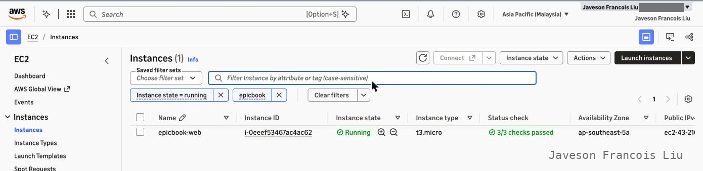

---

#### Screenshot 5 — Azure Portal or AWS Console showing the managed MySQL database created

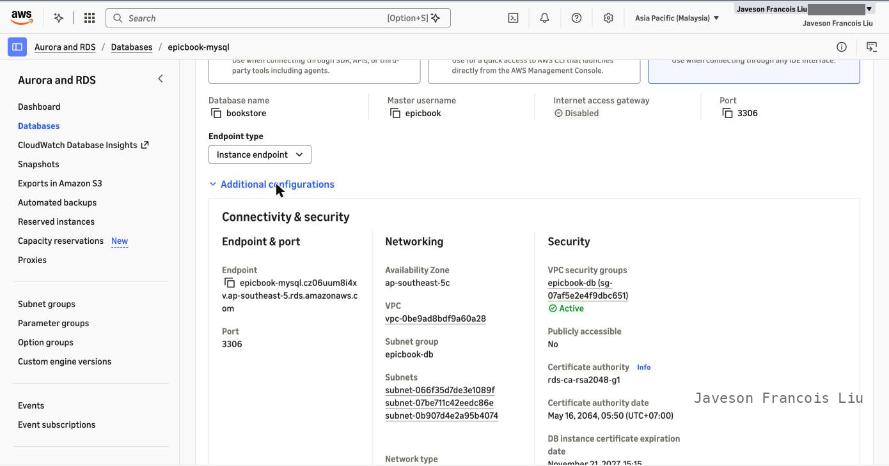

---

### Notes

Answer the following in your own words:

**1. What resources did Terraform create for this assignment?**

Terraform created 6 resources: a key pair, a web security group, a database security group, the `epicbook-web` EC2 instance, a DB subnet group and the private `epicbook-mysql` RDS MySQL 8.4 instance (`db.t3.micro`, encrypted).

---

**2. Why should you review `terraform plan` before running `terraform apply`?**

`terraform plan` shows exactly what will be created, changed or destroyed before any cost or damage happens. It catches a wrong region, an open port or an unexpected replacement while I can still stop.

---

**3. Why should database passwords not be shown in Terraform output?**

Outputs print in the terminal, in logs and in CI, so a password there leaks easily. My password lives only in an ignored `secrets.auto.tfvars` and an encrypted Ansible Vault file. The outputs show only the endpoint, database name and user.

---

# Task 3 — Verify SSH Key-Based Access

## Goal

Verify that the cloud VM can be accessed from the Ansible controller using SSH key-based authentication.

### Evidence

#### Screenshot 6 — Successful SSH hostname check from the Ansible controller

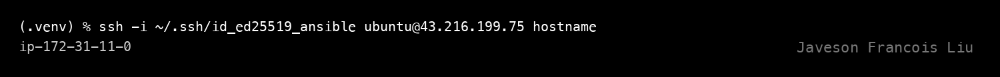

---

### Notes

Answer the following in your own words:

**1. What command did you use to verify SSH access?**

`ssh -i ~/.ssh/id_ed25519_ansible ubuntu@43.216.199.75 hostname`.

---

**2. What proves that SSH key-based access worked successfully?**

The command printed the VM host name (`ip-172-31-11-0`) without asking for a password, so the server accepted my private key.

---

**3. What would you check if SSH returned `Permission denied (publickey)`?**

I would check the key path and permissions (`chmod 600`), the user name (`ubuntu` on Ubuntu images), that the key pair was attached to the instance, that the security group allows my current public IP on port 22 (WARP had changed mine once), and run `ssh -v` for the reason.

---

# Task 4 — Create the Ansible Inventory and Configuration

## Goal

Create the Ansible inventory file and local Ansible configuration for the EpicBook VM.

The inventory tells Ansible which VM to manage and which SSH user to use.

### Evidence

#### Screenshot 7 — `inventory.ini` showing the VM under the `web` group

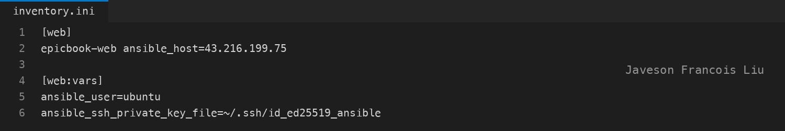

---

#### Screenshot 8 — Output of `ansible-inventory -i inventory.ini --graph`

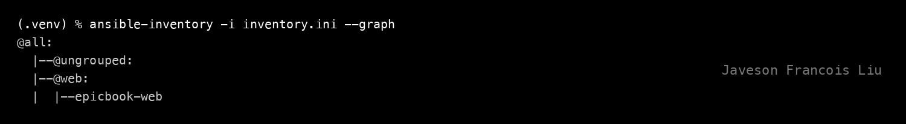

---

#### Screenshot 9 — Output of `ansible web -i inventory.ini -m ping`

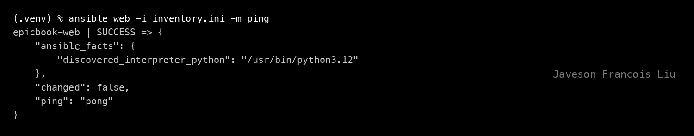

---

### Notes

Answer the following in your own words:

**1. What is the purpose of `inventory.ini`?**

`inventory.ini` lists the hosts Ansible manages, groups them (here `web`) and holds the connection variables.

---

**2. What does `ansible_host` store?**

`ansible_host` stores the real address Ansible connects to, here the VM public IP, while the inventory name `epicbook-web` is only a label.

---

**3. What does `ansible_ssh_private_key_file` tell Ansible?**

`ansible_ssh_private_key_file` tells Ansible which private key to use for SSH, so no password is needed.

---

**4. Why is `host_key_checking = False` used only for this temporary lab?**

The lab VM is rebuilt often and gets a new host key every time, so the check would keep failing. In production I would keep host key checking on and trust keys through `known_hosts`, to stop a man in the middle.

---

# Task 5 — Create the Main Ansible Playbook

## Goal

Create the main Ansible playbook that runs the required roles in the correct order.

The `site.yml` file will call the `common`, `nginx`, and `epicbook` roles.

### Evidence

#### Screenshot 10 — `site.yml` showing the roles in the correct order

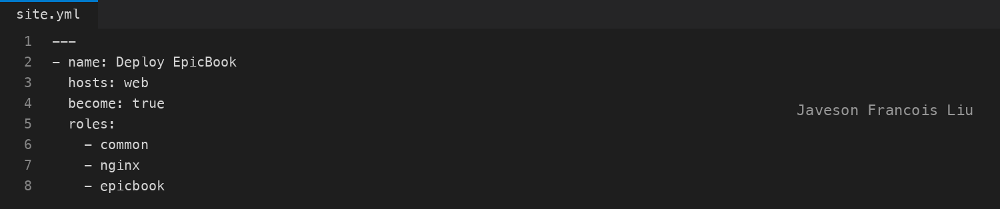

---

#### Screenshot 11 — Output of `ansible-playbook -i inventory.ini site.yml --syntax-check`

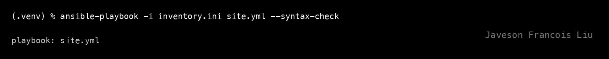

---

### Notes

Answer the following in your own words:

**1. What is the purpose of `site.yml`?**

`site.yml` is the entry point playbook. It applies the three roles, in order, to the `web` group.

---

**2. Why should the roles run in the order `common`, `nginx`, and `epicbook`?**

`common` installs what everything else needs (Node.js, PM2, the MySQL client). `nginx` comes next and proxies to the app port. `epicbook` runs last, because it depends on the common packages and is the service Nginx forwards to.

---

**3. What does `become: true` allow Ansible to do?**

`become: true` lets tasks run as root through sudo, which is needed for `apt`, services and files under `/etc` and `/opt`.

---

# Task 6 — Create the `common` Role

## Goal

Create the `common` role to prepare the Ubuntu VM with the basic packages required for the EpicBook deployment.

This role handles the common server setup before Nginx and the application are configured.

### Evidence

#### Screenshot 12 — `roles/common/tasks/main.yml` showing the common setup tasks

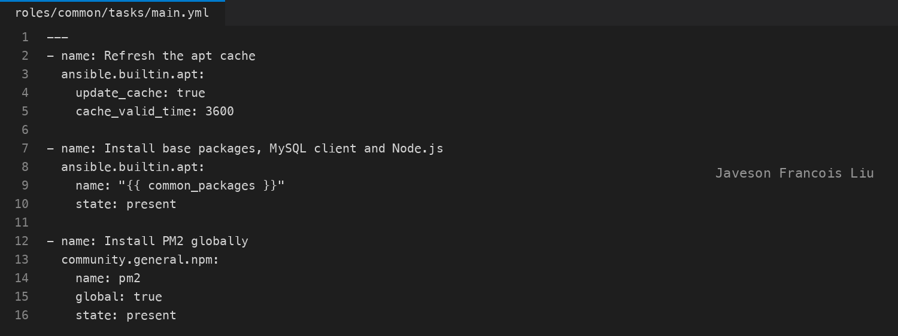

---

### Notes

Answer the following in your own words:

**1. What is the responsibility of the `common` role?**

`common` does the base setup every server needs: refresh the apt cache, install Git, curl, rsync, build tools, the MySQL client, Node.js and npm, then install PM2 globally.

---

**2. Why should Nginx installation not be placed inside the `common` role?**

Not every server needs a web server, and one job per role keeps roles reusable and easy to test. A change to Nginx should never touch the base setup.

---

**3. Why is `mysql-client` useful in this deployment?**

With `mysql-client` the VM can reach the private RDS database from the command line. The `epicbook` role uses it to count authors and to load the seed data once.

---

# Task 7 — Create the `nginx` Role

## Goal

Create the `nginx` role to install Nginx and configure it as a reverse proxy for the EpicBook application.

Nginx will receive browser traffic on port `80` and forward it to the EpicBook Node.js application running on the VM.

### Evidence

#### Screenshot 13 — `roles/nginx/tasks/main.yml` showing Nginx installation and site configuration tasks

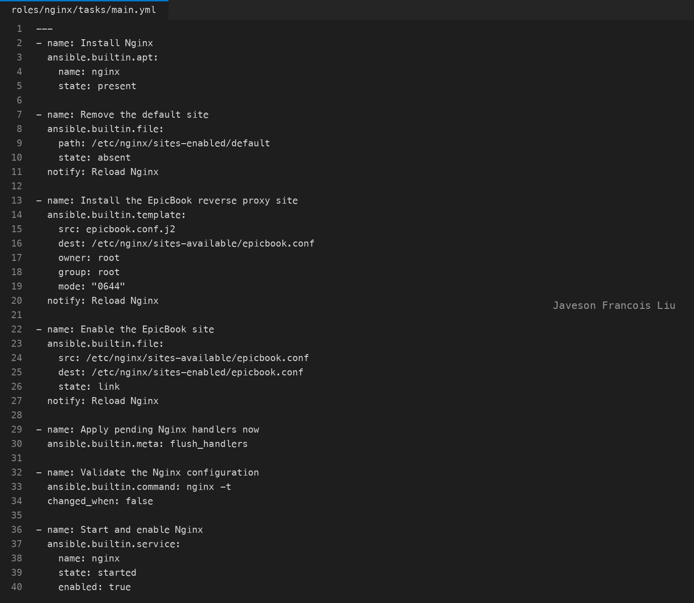

---

#### Screenshot 14 — `roles/nginx/templates/epicbook.conf.j2` showing the reverse proxy configuration

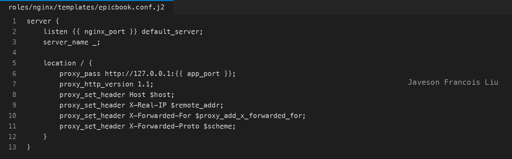

---

### Notes

Answer the following in your own words:

**1. What is the responsibility of the `nginx` role?**

The `nginx` role installs Nginx, removes the default site, renders the EpicBook site from a template, enables it, validates it with `nginx -t`, keeps the service running and reloads it through a handler.

---

**2. Why is Nginx configured as a reverse proxy in this deployment?**

The Node.js app stays on port 8080 and is not exposed. Nginx is the one public entry on port 80, and it is the place to add HTTPS, caching and limits later.

---

**3. Why should the application port come from `group_vars/web.yml` instead of being hard-coded?**

One variable (`app_port`) feeds both the PM2 `PORT` and the Nginx `proxy_pass`, so the two can never disagree, and changing the port means editing one line.

---

# Task 8 — Create the `epicbook` Role

## Goal

Create the `epicbook` role to deploy the EpicBook application, connect it to the managed MySQL database, and run the application on port `8080` using PM2.

### Evidence

#### Screenshot 15 — `roles/epicbook/tasks/main.yml` showing application deployment tasks

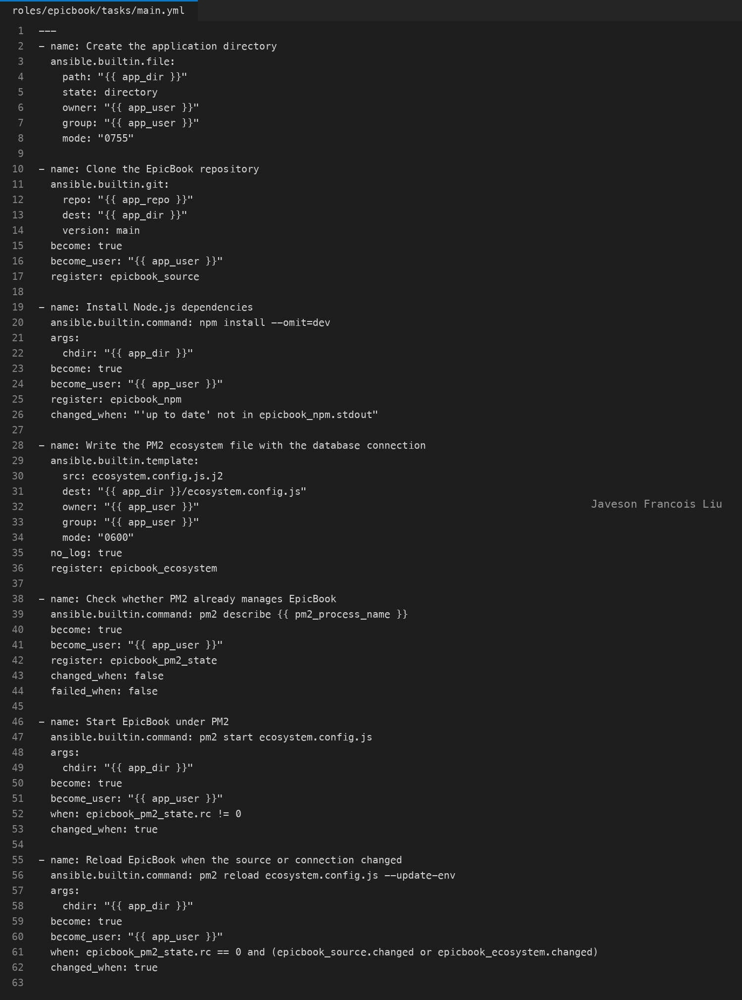

---

#### Screenshot 16 — Task or file showing how the database connection is configured, with secrets hidden

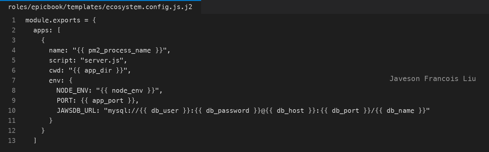

---

#### Screenshot 17 — Task or output showing the EpicBook application managed by PM2

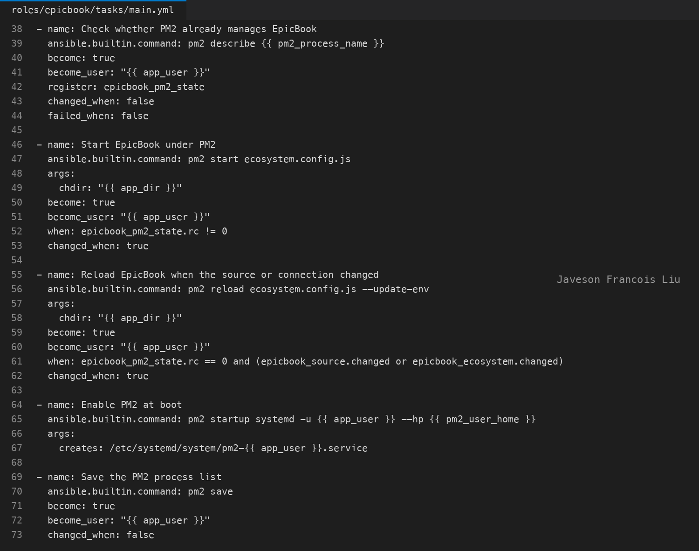

---

### Notes

Answer the following in your own words:

**1. What is the responsibility of the `epicbook` role?**

The `epicbook` role creates the app directory, clones the repository, runs `npm install`, writes the PM2 ecosystem file with the database connection, starts the app under PM2, enables PM2 at boot, waits for port 8080 and loads the seed data once.

---

**2. Why is PM2 used for the EpicBook Node.js application?**

PM2 keeps the Node.js process running, restarts it if it crashes, starts it at boot through systemd and gives simple status and logs.

---

**3. Why should database passwords not be hard-coded in public files?**

The GitHub history is public and permanent, bots scan it for keys, and a leaked password cannot be taken back. I keep it in an encrypted vault file instead.

---

**4. What does it mean for the application to run on port `8080` while Nginx listens on port `80`?**

The app listens on port 8080 inside the VM, and the security group does not open that port. Nginx listens on port 80 and forwards each request to 8080, so visitors only ever use port 80.

---

# Task 9 — Create Group Variables

## Goal

Create reusable variables for the EpicBook deployment.

The `group_vars/web.yml` file stores values that can be reused across the Ansible roles.

### Evidence

#### Screenshot 18 — `group_vars/web.yml` showing the application, PM2, and database variables, with passwords hidden or masked

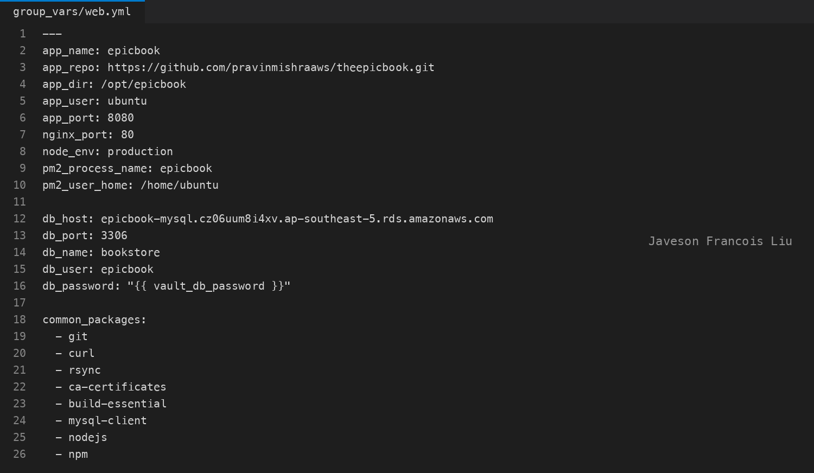

---

### Notes

Answer the following in your own words:

**1. What is the purpose of `group_vars/web.yml`?**

`group_vars/web.yml` is one place for the variables shared by every host in the `web` group, so roles contain no hard-coded values.

---

**2. Which values did you store in `group_vars/web.yml`?**

The app name, repository, directory and user, `app_port` (8080), `nginx_port` (80), `node_env`, the PM2 process name and home, the database host, port, name and user, the package list, and `db_password`, which only points to the vault variable.

---

**3. How did you handle the database password securely?**

I generated a random 32-character password, stored it only in the encrypted `group_vars/all/vault.yml` (Ansible Vault, AES256) and in an ignored Terraform file, and kept the vault password in an ignored `.vault_pass`. Tasks that use it have `no_log`, and the rendered file is mode 0600.

---

# Task 10 — Run the Ansible Playbook

## Goal

Run the Ansible playbook to configure the VM and deploy the EpicBook application.

The playbook should run the roles in this order:

1. `common`
2. `nginx`
3. `epicbook`

### Evidence

#### Screenshot 19 — Ansible playbook output showing the roles running

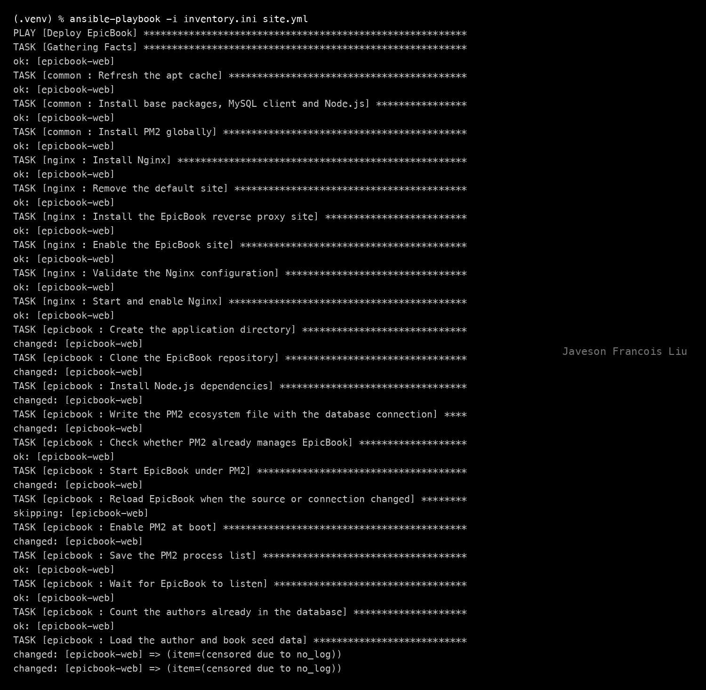

---

#### Screenshot 20 — Final Ansible recap showing `failed=0`

---

#### Screenshot 21 — Output of `ansible web -i inventory.ini -m command -a "systemctl is-active nginx" --become`

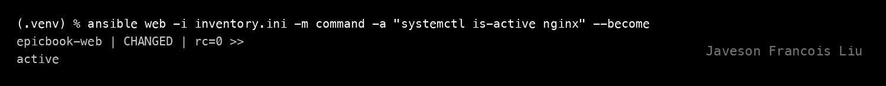

---

#### Screenshot 22 — Output of `ansible web -i inventory.ini -m command -a "pm2 status"`

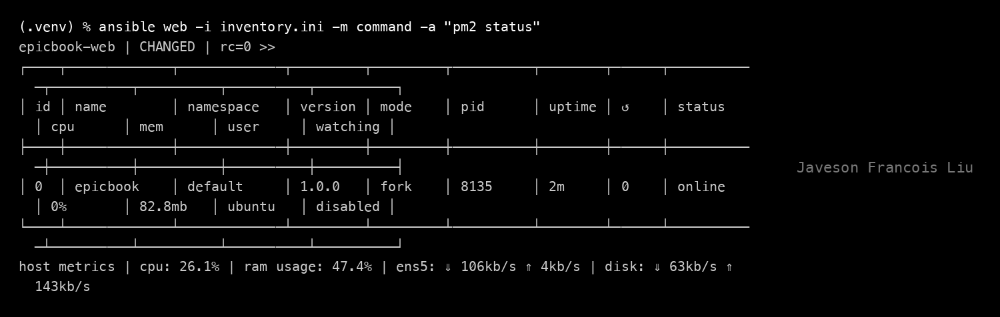

---

#### Screenshot 23 — Output of `ansible web -i inventory.ini -m command -a "curl -I http://localhost:8080"`

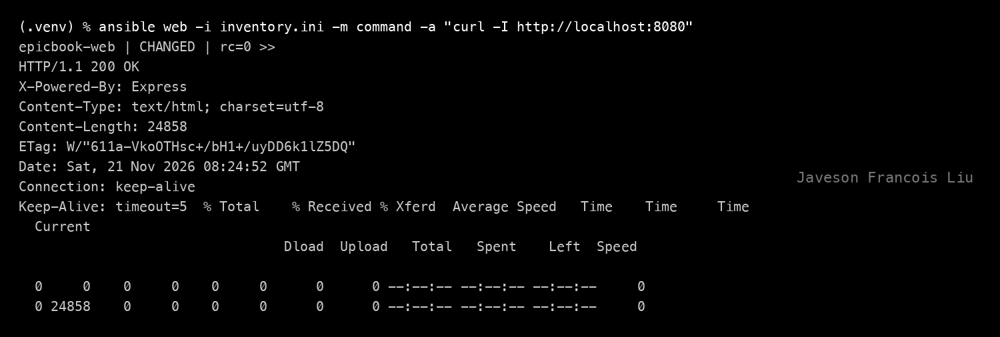

---

### Notes

Answer the following in your own words:

**1. What command did you run to execute the Ansible playbook?**

`ansible-playbook -i inventory.ini site.yml`, run from `epicbook-prod/ansible`.

---

**2. How do you know all roles completed successfully?**

The recap shows `failed=0` and `unreachable=0`, and each task of the three roles is listed as `ok` or `changed`. A repeat run shows `changed=0`.

---

**3. What proves that Nginx is active?**

`systemctl is-active nginx` returned `active`.

---

**4. What proves that PM2 is managing the EpicBook application?**

`pm2 status` lists `epicbook` as `online` under the `ubuntu` user with no restarts.

---

**5. What proves that the EpicBook application responds on port `8080`?**

`curl -I http://localhost:8080` returned `HTTP/1.1 200 OK` with `X-Powered-By: Express`, so the Node.js app answers on its own port.

---

# Task 11 — Verify the EpicBook Deployment

## Goal

Verify that the EpicBook application is running, accessible in the browser, and connected to the managed MySQL database.

### Evidence

#### Screenshot 24 — Output of `curl -I http://<public_ip>`

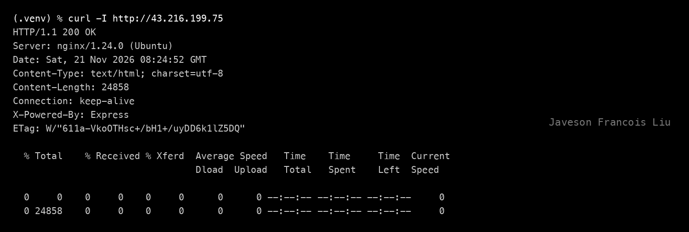

---

#### Screenshot 25 — Output of the cart API test command

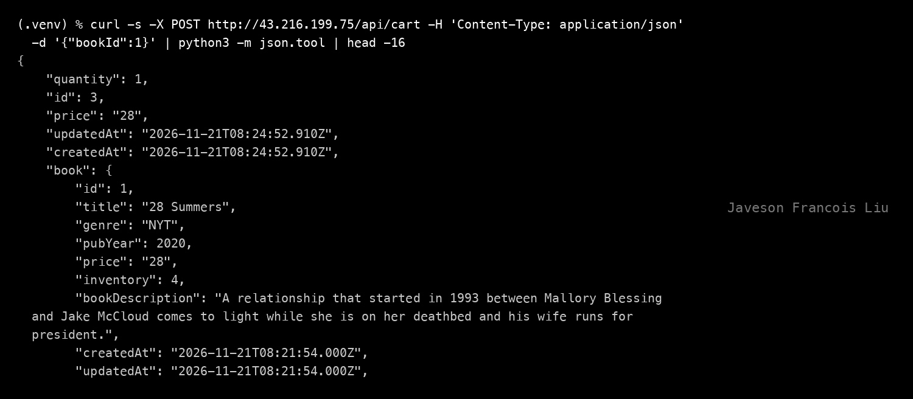

---

#### Screenshot 26 — Output of the `/cart` HTTP status check

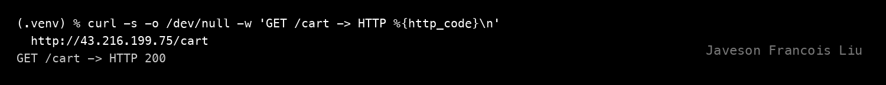

---

#### Screenshot 27 — Browser showing the EpicBook application loaded from `http://<public_ip>`

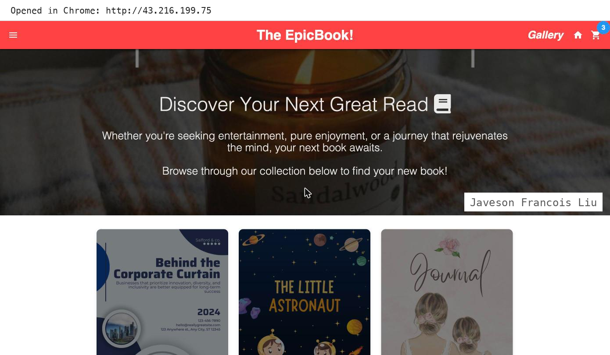

---

### Notes

Answer the following in your own words:

**1. What HTTP response did you receive from the public application URL?**

`HTTP/1.1 200 OK` from `nginx/1.24.0`, with `Content-Type: text/html`.

---

**2. What did the cart API test prove?**

The `POST /api/cart` call returned a new cart row with the book `28 Summers`, and `GET /api/cart` listed the carts (screenshot 25 is trimmed to the first 16 lines of the JSON). That proves the app reads books from the RDS database and writes carts to it, so the seed data and the database connection both work.

---

**3. What did the `/cart` status check return?**

The `/cart` page returned HTTP `200`.

---

**4. What issue did you face during verification, and how did you fix it?**

The first run stopped at the `epicbook` role with `could not create work tree dir '/opt/epicbook': Permission denied`, so I added a task that creates the directory owned by `ubuntu`. After the rerun, the public URL still showed the Nginx welcome page and `/cart` gave 404, because the reload handler never ran (the first run failed before handlers, the second saw no change). I reloaded Nginx and added `meta: flush_handlers`, and `npm install` reporting `changed` on every run was fixed with a proper `changed_when`.

---

# LinkedIn Post Required

## Evidence

#### LinkedIn Post URL

Paste your LinkedIn post URL here:

`Add your URL here`

---

#### Screenshot — Published LinkedIn post

Add your screenshot here.

---

# Assignment Questions

Answer the following in your own words:

**1. Why is Terraform used for infrastructure provisioning?**

Terraform describes the infrastructure as code, so it is repeatable, reviewable with `plan`, kept in Git and easy to destroy, which also controls cost.

---

**2. Why are Ansible roles useful for production-style deployments?**

Roles split the deployment into small single-purpose units that are reusable, easy to read from `site.yml`, and easy to change or test on their own.

---

**3. What is the purpose of `group_vars/web.yml`?**

It holds the variables shared by the `web` group in one place, so the roles stay free of hard-coded values.

---

**4. Why should database passwords not be committed to GitHub?**

Git history is permanent and public, and scanners find leaked credentials within minutes. Secrets belong in a vault or a secret manager and in ignored files.

---

**5. What is the purpose of Nginx in this deployment?**

Nginx is the public front door on port 80. It hides the app port, forwards requests to Node.js, and is where HTTPS and caching would go.

---

**6. Why should the managed MySQL database not be publicly accessible?**

Nothing on the internet needs to talk to the database. Closing it removes password guessing and scanning, and only the web security group can reach port 3306.

---

**7. Why is PM2 used for the EpicBook Node.js application?**

PM2 keeps the Node.js app alive, restarts it on a crash, starts it at boot and provides status and logs.

---

**8. What does idempotency mean in Ansible?**

Idempotency means running the playbook again leaves a system that is already correct unchanged. My repeat run ended with `changed=0`:

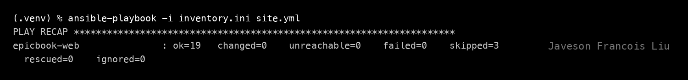

---

**9. What issue did you face during the deployment, and how did you fix it?**

The `/opt/epicbook` permission error, then Nginx still serving the default page because the reload handler was skipped. I created the directory with the right owner, reloaded Nginx and added `meta: flush_handlers`.

---

**10. What security improvement would you make before using this setup in production?**

I would add HTTPS with a certificate on Nginx, move the database password to AWS Secrets Manager, use private subnets with SSM or a bastion instead of public SSH, turn on Multi-AZ RDS with backups and deletion protection, keep SSH host key checking on, and add monitoring and alerts.

---

# Submission Details

| Item | Value |
|---|---|
| Cloud provider | AWS (`ap-southeast-5`) |
| VM public IP | `43.216.199.75` |
| Application URL | `http://43.216.199.75` |
| Database | RDS MySQL 8.4, private (port 3306 open to the web security group only) |
| Repository folder | `week-09-ansible/ansible-onboarding/epicbook-prod/` |

The stack is destroyed after submission, so the address will not respond later.

---

# Required Files

Confirm that the following files are included in your GitHub repository or assignment folder:

- [x] `README.md`
- [x] Terraform files under either `terraform/azure/` or `terraform/aws/`
- [x] `ansible/ansible.cfg`
- [x] `ansible/inventory.ini`
- [x] `ansible/site.yml`
- [x] `ansible/group_vars/web.yml`
- [x] `ansible/roles/common/tasks/main.yml`
- [x] `ansible/roles/nginx/tasks/main.yml`
- [x] `ansible/roles/nginx/templates/epicbook.conf.j2`
- [x] `ansible/roles/epicbook/tasks/main.yml`

---

# Submission Instructions

- Add all required screenshots in your submission.
- Full Name must be visible in required screenshots.
- Mention the cloud provider used: Azure or AWS.
- Add the VM public IP address.
- Add the final application URL.
- Add Terraform output proof.
- Add Ansible role tree proof.
- Add all required notes and assignment question answers.
- Add your LinkedIn post URL.
- Do not expose SSH private keys, passwords, cloud credentials, database credentials, Terraform state files, subscription IDs, or account IDs.

---

# Completion Checklist

- [x] Task 1: Project folder layout created
- [x] Task 2: Terraform infrastructure provisioned
- [x] Task 3: SSH key-based access verified
- [x] Task 4: Ansible inventory and configuration created
- [x] Task 5: Main Ansible playbook created
- [x] Task 6: `common` role created
- [x] Task 7: `nginx` role created
- [x] Task 8: `epicbook` role created
- [x] Task 9: Group variables created
- [x] Task 10: Ansible playbook run completed
- [x] Task 11: EpicBook deployment verified
- [x] Terraform files created under only one cloud provider folder
- [x] One Ubuntu VM was created
- [x] One managed MySQL database was created
- [x] SSH port `22` is restricted to the controller public IP
- [x] HTTP port `80` is accessible
- [x] MySQL port `3306` is not publicly open
- [x] `ansible web -i inventory.ini -m ping` returns `SUCCESS`
- [x] `site.yml` calls the roles in the correct order
- [x] Database secrets are hidden or handled securely
- [x] Nginx is active
- [x] PM2 shows the EpicBook application running
- [x] EpicBook responds on port `8080`
- [x] Public URL loads in the browser
- [x] Cart API verification works
- [x] Playbook completes with `failed=0`
- [x] Screenshots 1–27 are included
- [x] Assignment questions are answered
- [ ] LinkedIn post published
- [ ] LinkedIn post URL added
- [x] No sensitive information is exposed

---

## About DMI & CloudAdvisory

DevOps Micro Internship (DMI) is a project-based DevOps program run by Pravin Mishra and The CloudAdvisory, focused on real-world execution, systems thinking, and career readiness.

It helps learners build strong DevOps foundations with hands-on experience.

---

## Resources

- DMI Official Website: [https://dmi.pravinmishra.com?utm_source=github&utm_medium=readme](https://dmi.pravinmishra.com?utm_source=github&utm_medium=readme)
- University: [https://university.pravinmishra.com?utm_source=github&utm_medium=readme](https://university.pravinmishra.com?utm_source=github&utm_medium=readme)
- Discord Community: [https://discord.pravinmishra.com?utm_source=github&utm_medium=readme](https://discord.pravinmishra.com?utm_source=github&utm_medium=readme)
- Blog: [https://dmi.pravinmishra.com/blog?utm_source=github&utm_medium=readme](https://dmi.pravinmishra.com/blog?utm_source=github&utm_medium=readme)
- YouTube Playlist: [https://www.youtube.com/playlist?list=PLFeSNDtI4Cho](https://www.youtube.com/playlist?list=PLFeSNDtI4Cho)
- Pravin Mishra LinkedIn: [https://www.linkedin.com/in/pravin-mishra-aws-trainer/](https://www.linkedin.com/in/pravin-mishra-aws-trainer/)
- CloudAdvisory LinkedIn: [https://www.linkedin.com/company/thecloudadvisory/](https://www.linkedin.com/company/thecloudadvisory/)

---

*This submission is part of DevOps Micro Internship (DMI) — Agentic AI Track.*