# Assignment 6 — AI-Assisted Ansible Change Risk Review

Part of the DevOps Micro Internship (DMI) with Agentic AI

---

## Purpose

In this assignment, you will build an AI-assisted Ansible risk-review workflow using `ansible-playbook --check --diff`, Bash scripting, and Claude Code.

You will review possible server changes before applying them, classify risky tasks, and keep the final apply decision under human control.

---

# Task 1 — Confirm EpicBook Connectivity and Create the Workspace

## Goal

Confirm that your previous EpicBook Ansible project is working before creating the risk-review automation.

### Evidence

#### Screenshot 1 — Output of `ansible web -i inventory.ini -m ping`

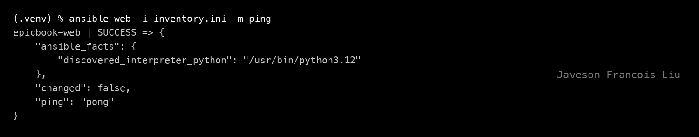

---

#### Screenshot 2 — Output of `ansible-playbook -i inventory.ini site.yml --syntax-check`

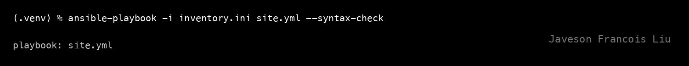

---

#### Screenshot 3 — Output of `pwd` and `find . -maxdepth 4 -type d | sort`

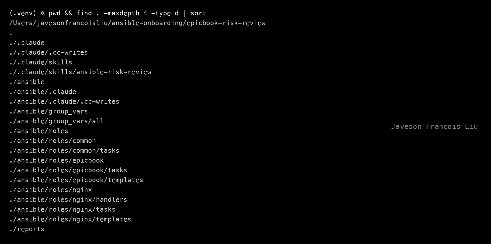

---

### Notes

Answer the following in your own words:

**1. What proves that Ansible can reach your EpicBook VM?**

`ansible web -i inventory.ini -m ping` returned `SUCCESS` with `"ping": "pong"` from `epicbook-web`, so SSH, the key and Python on the VM all work.

---

**2. Why should you confirm playbook syntax before building a risk-review script?**

A broken playbook makes every dry run fail, and the review would blame the change instead of the syntax. `--syntax-check` proves the YAML and roles load before I build automation on top.

---

# Task 2 — Create Project Context and Safety Rules in CLAUDE.md

## Goal

Create a `CLAUDE.md` file that tells Claude Code how this project must behave.

### Evidence

#### Screenshot 4 — `CLAUDE.md` open in VS Code or terminal showing the safety rules

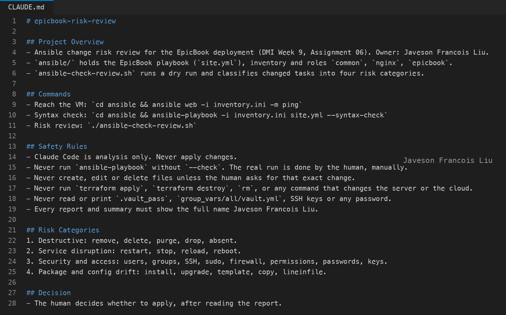

---

### Notes

Answer the following in your own words:

**1. Why should Claude Code have project-specific safety rules?**

Rules in `CLAUDE.md` set the limits every session (analysis only, dry run only, no secrets), so safety does not depend on how I word each prompt.

---

**2. Why should the human run the real Ansible playbook manually?**

Applying changes the real server. The human has read the evidence, owns the decision and the outage risk, and can stop at the right moment. An AI can misjudge.

---

**3. Which rule prevents Claude Code from applying changes automatically?**

`Claude Code is analysis only. Never apply changes.` together with `Never run ansible-playbook without --check.`

---

# Task 3 — Ask Claude Code to Plan the Risk Review

## Goal

Use Claude Code to produce a read-only plan before writing the Bash script.

### Evidence

#### Screenshot 5 — Claude Code showing the four-category risk-classification plan

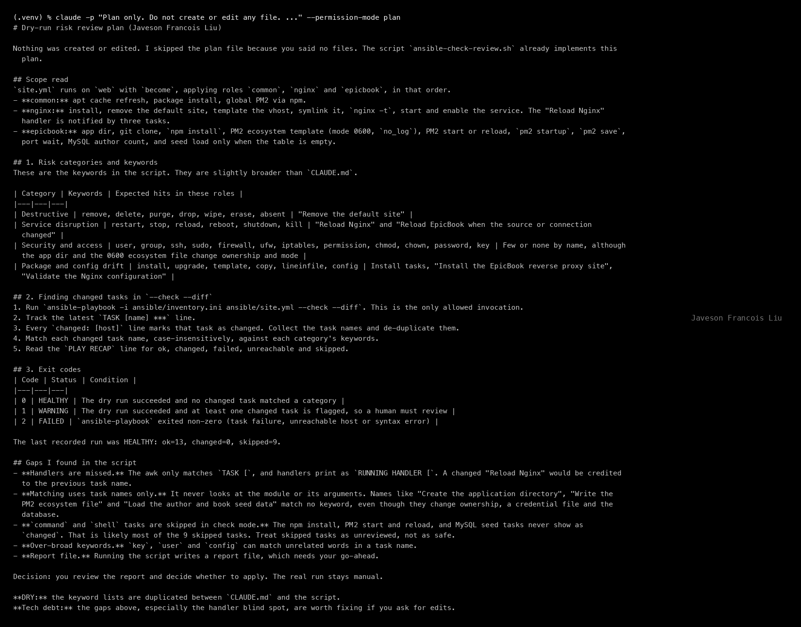

Note: I drafted the first version of the script before this plan run. Claude Code reviewed it in plan mode, found that handler tasks were missed, and I fixed that. Screenshots 5, 13, 16 and 20 are the real text output of `claude -p` runs in the project folder, rendered as terminal screenshots.

---

### Notes

Answer the following in your own words:

**1. Which part of this task represents the Gather phase?**

Gather is Claude Code reading `CLAUDE.md`, `site.yml` and the three roles, and later the script collecting evidence with the `--check --diff` run.

---

**2. Which part represents the Analyze phase?**

Analyze is sorting the changed tasks into the four risk categories and explaining what each would do, including the gaps Claude Code found (handler tasks, skipped tasks).

---

**3. How did you verify Claude Code did not create or edit files?**

I listed every project file with its modification time before and after the plan run and compared them. There was no difference. Plan mode with only Read and Grep allowed also prevents edits, and Claude Code said it skipped the plan file. A log folder from a background tool was ignored because it is not part of the project.

---

# Task 4 — Build the Ansible Risk Review Script

## Goal

Create a Bash script that runs an Ansible dry run and classifies risky changes.

### Evidence

#### Screenshot 6 — Top section of `ansible-check-review.sh` showing `full_name`, `playbook_path`, `inventory_path`, and the `checks` array

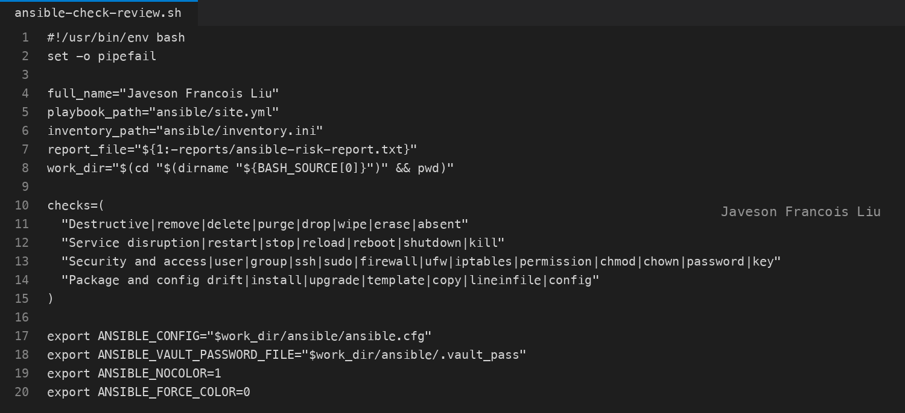

---

#### Screenshot 7 — Middle section showing `extract_changed_tasks` and `check_tasks_matching_pattern`

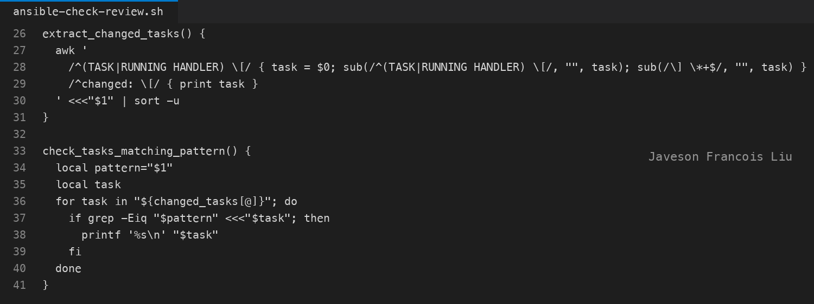

---

#### Screenshot 8 — Bottom section showing the loop, summary, and exit behavior

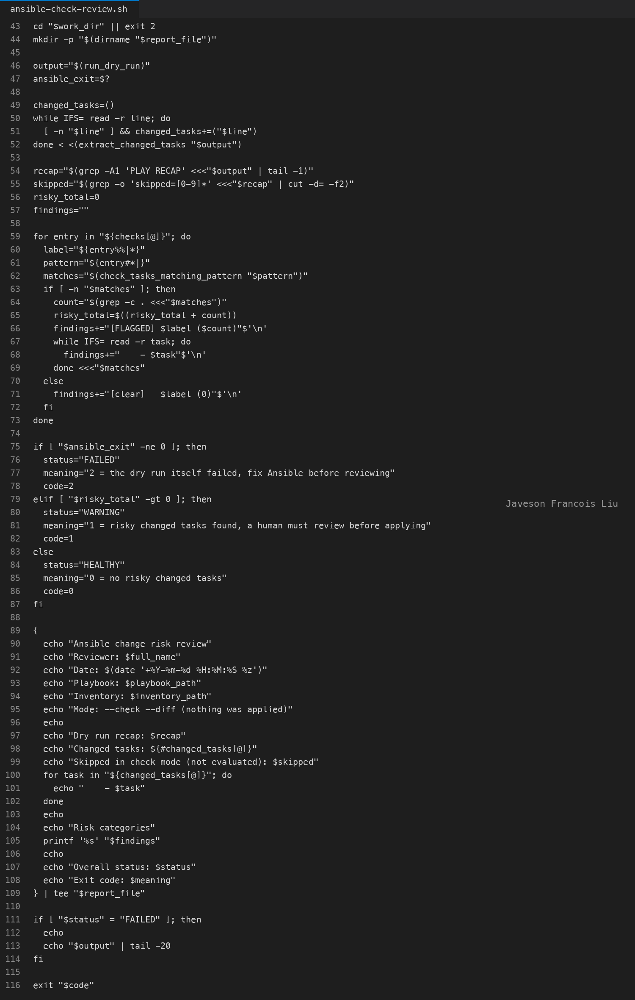

---

#### Screenshot 9 — Output of `bash -n ansible-check-review.sh` and `ls -l ansible-check-review.sh`

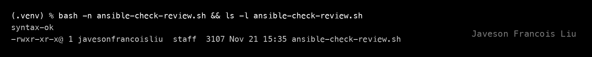

---

### Notes

Answer the following in your own words:

**1. What is stored in the `changed_tasks` array?**

`changed_tasks` holds the names of the tasks that reported `changed` in the dry run, with no duplicates, for example `nginx : Restart Nginx to apply tuning`.

---

**2. Which function finds changed tasks from the Ansible output?**

`extract_changed_tasks`. It reads the dry-run output with awk, remembers the latest `TASK` or `RUNNING HANDLER` line and prints it when a `changed:` line follows.

---

**3. Why does the script use `--check --diff`?**

`--check` makes Ansible predict changes without making them, and `--diff` shows what would change in files. Together they give evidence with no risk to the server.

---

**4. Why does the script use different exit codes for healthy, warning, and failed results?**

Different codes let a person, a CI job or the skill react correctly: 0 is healthy, 1 means a human must review, 2 means the review itself failed. A failed run must never look healthy.

---

# Task 5 — Run the Baseline Dry-Run Review

## Goal

Run the script against your current EpicBook playbook and confirm the baseline risk status.

### Evidence

#### Screenshot 10 — Output of `./ansible-check-review.sh`

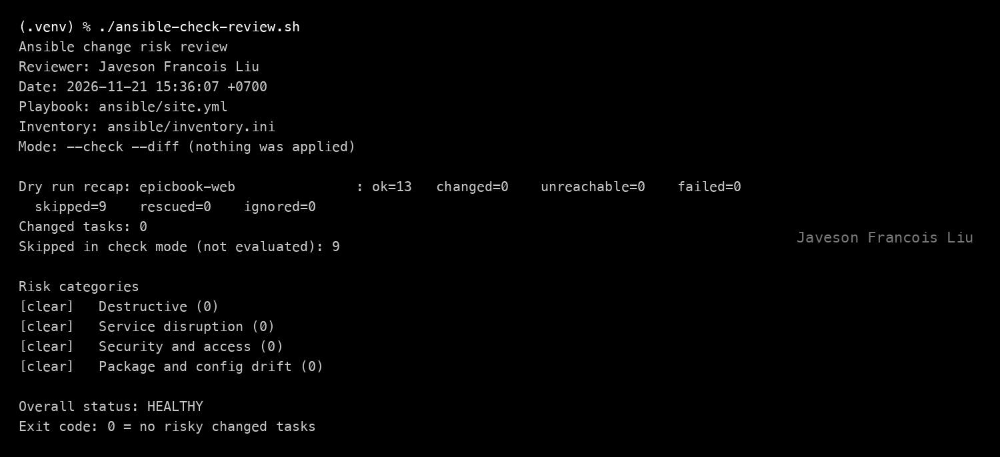

---

#### Screenshot 11 — Output of `echo "Captured Exit Code: $script_exit_code"` and `cat reports/ansible-risk-report.txt`

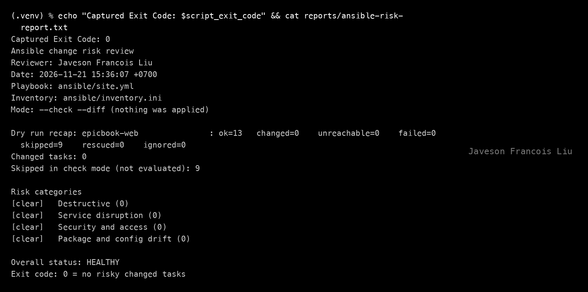

---

### Notes

Answer the following in your own words:

**1. What was the overall status of your baseline run?**

The baseline was `HEALTHY` with exit code 0.

---

**2. Did any tasks report `changed`?**

No. The recap shows `changed=0` (ok=13, skipped=9).

---

**3. Were any changed tasks flagged as risky?**

No. Nothing changed, so nothing was flagged and all four categories were clear.

---

**4. What does the script exit code mean?**

The exit code is the result for machines: 0 means the dry run worked and no risky task would change, 1 means risky changes were found, and 2 means the dry run failed.

---

# Task 6 — Create and Run the Claude Code Skill

## Goal

Turn the Bash script into a reusable Claude Code skill called `/ansible-risk-review`.

### Evidence

#### Screenshot 12 — `SKILL.md` showing the frontmatter, allowed tools, and safety rules

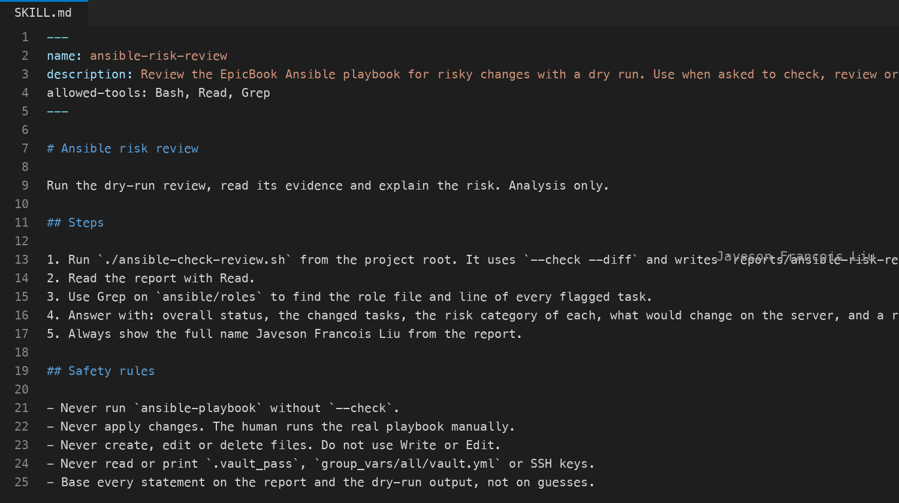

---

#### Screenshot 13 — Claude Code output after running `/ansible-risk-review`

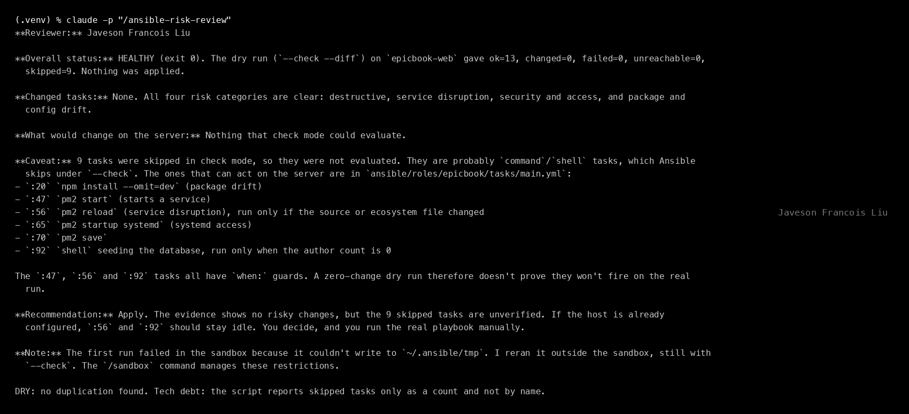

---

### Notes

Answer the following in your own words:

**1. Why does this skill allow `Bash`, `Read`, and `Grep`?**

Bash runs the review script, Read opens the report and Grep finds the role file and line of a flagged task. That is exactly the evidence work and nothing more.

---

**2. Why does this skill not allow file editing?**

A reviewer must not change what it reviews. Without Write and Edit, even a wrong or injected instruction cannot modify the playbook.

---

**3. What part is handled by Bash?**

Bash runs `./ansible-check-review.sh`: the dry run, the classification, the report file and the exit code.

---

**4. What part is handled by Claude Code?**

Claude Code reads the report and the role files, explains the risk in plain words and gives a recommendation. The human decides.

---

**5. Why is this better than asking Claude Code if the playbook is safe without giving it evidence?**

The skill works from real, repeatable dry-run output and cites the task and file line. A bare "is it safe?" question gets a confident guess with no proof.

---

# Task 7 — Introduce a Controlled Risky Change and Let the Skill Catch It

## Goal

Add a small controlled risky change in your lab playbook and confirm the script and Claude Code catch it before applying.

### Evidence

#### Screenshot 14 — The added risky task inside the role file

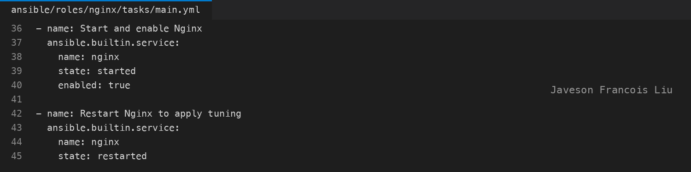

---

#### Screenshot 15 — Output of `./ansible-check-review.sh`

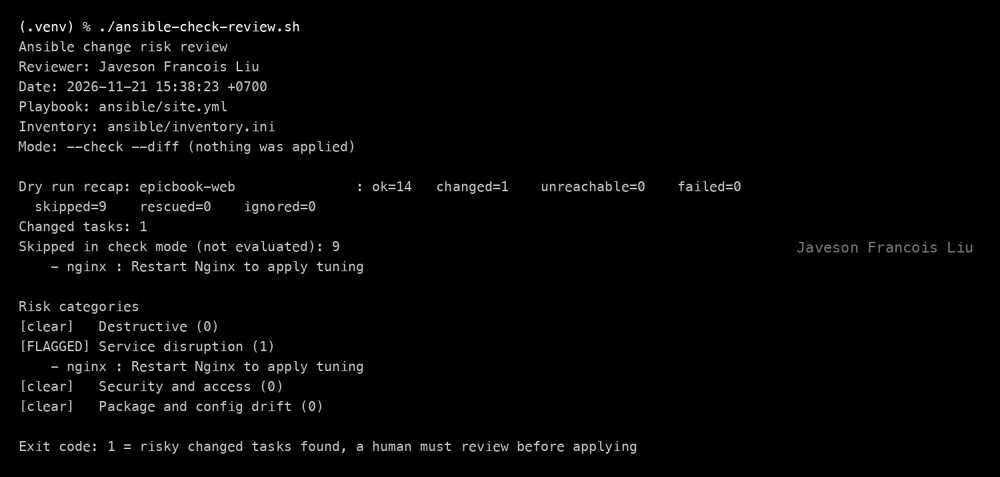

---

#### Screenshot 16 — Claude Code `/ansible-risk-review` output showing the risky finding

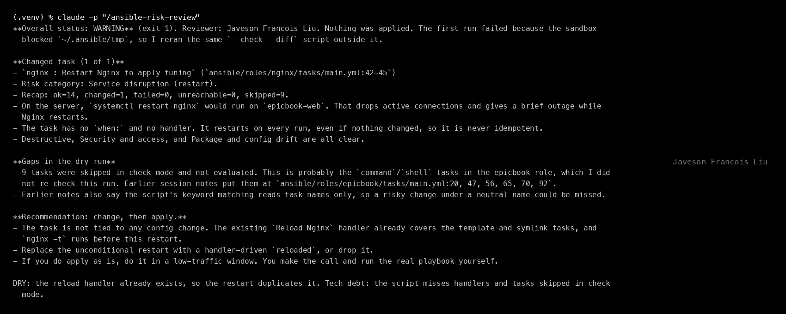

---

#### Screenshot 17 — Output of `cat reports/risky-change-report.txt`

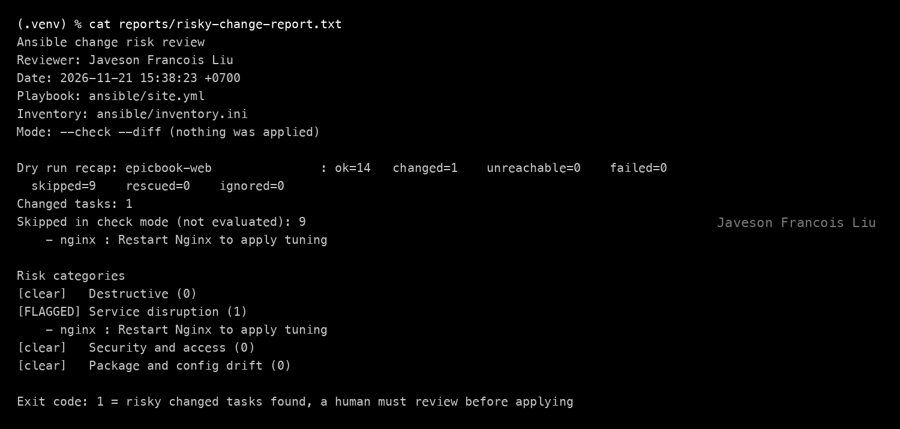

---

### Notes

Answer the following in your own words:

**1. Which risk category did the added task fall into?**

Service disruption, because the task restarts Nginx.

---

**2. What evidence proves the task would change something?**

The dry run recap showed `changed=1` and listed `nginx : Restart Nginx to apply tuning` as changed. A service restart always reports `changed`, so it would act on the server.

---

**3. Did Claude Code apply the playbook?**

No. Claude Code only ran the dry-run script. I ran the real playbook myself afterwards.

---

**4. Why is it important that Claude Code only analyzed the risk?**

AI analysis is fast but can be wrong. Keeping it analysis only keeps the final judgement and the responsibility with me, and a mistaken restart in production could cause an outage.

---

**5. Which phase of the Agentic Loop is represented by the Bash report?**

Gather, because the report is the evidence collected before any analysis or decision.

---

# Task 8 — Apply as the Human, Verify, and Write the Change Summary

## Goal

Review the risky-change report, apply the playbook manually as the human operator, and verify the result.

### Evidence

#### Screenshot 18 — Output of the real playbook run showing the final recap with `failed=0`

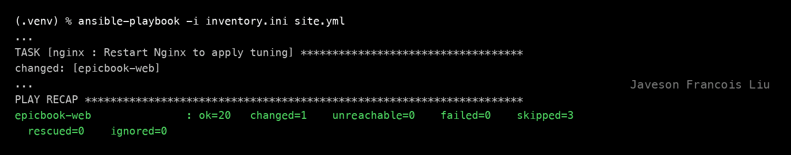

---

#### Screenshot 19 — Output of `ansible web -i inventory.ini -m ping`

---

#### Screenshot 20 — Second `/ansible-risk-review` output after applying the change

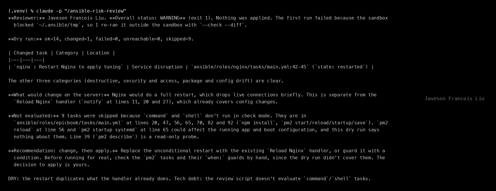

---

#### Screenshot 21 — Output of `ls -lah reports`

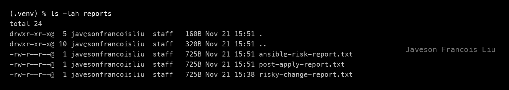

---

#### Screenshot 22 — `change-summary.md` showing all required sections and your Full Name

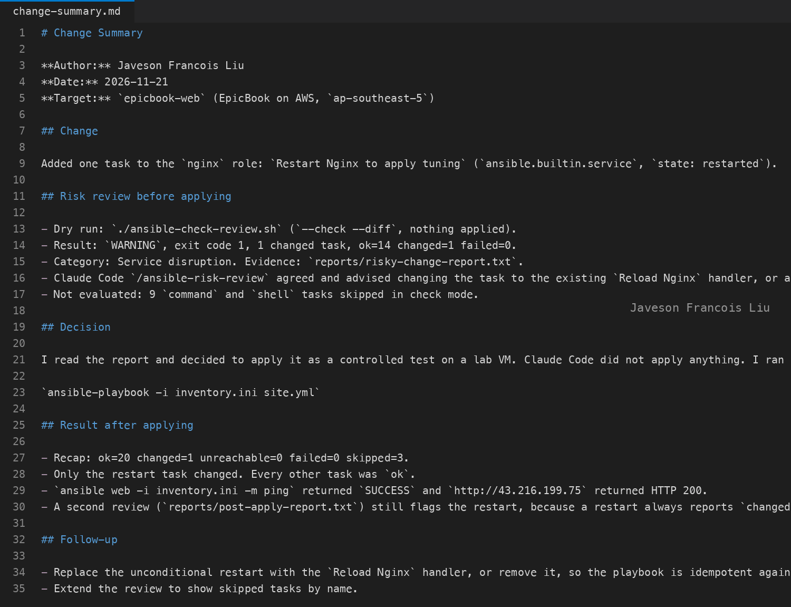

---

### Notes

Answer the following in your own words:

**1. What command did you run to apply the change for real?**

`ansible-playbook -i inventory.ini site.yml`, run by me from `epicbook-risk-review/ansible`.

---

**2. Who made the final decision to apply the playbook?**

I did. I read the risky-change report and the Claude Code finding, then ran the playbook manually. Claude Code never applied anything.

---

**3. What evidence proves the VM is still reachable?**

`ansible web -i inventory.ini -m ping` returned `SUCCESS`, and the public site still answered HTTP 200 after the restart.

---

**4. Why should the risk review be run again after applying?**

The state after applying can differ from the prediction. The second review confirms the result and shows the restart task still flags, because it is not idempotent, so it needs a follow-up fix.

---

**5. What could go wrong if an AI agent applied Ansible changes automatically?**

A wrong judgement would be applied at machine speed: an unwanted restart, delete or security change on production with nobody to stop it, no rollback plan and no accountability. A malicious instruction hidden in a file could also be executed.

---

# LinkedIn Post Required

## Evidence

#### LinkedIn Post URL

Paste your LinkedIn post URL here:

https://www.linkedin.com/posts/javeson-francois-liu-999135437_dmibypravinmishra-devops-ansible-share-7530281610592628737-vBEI/

---

#### Screenshot — Published LinkedIn post

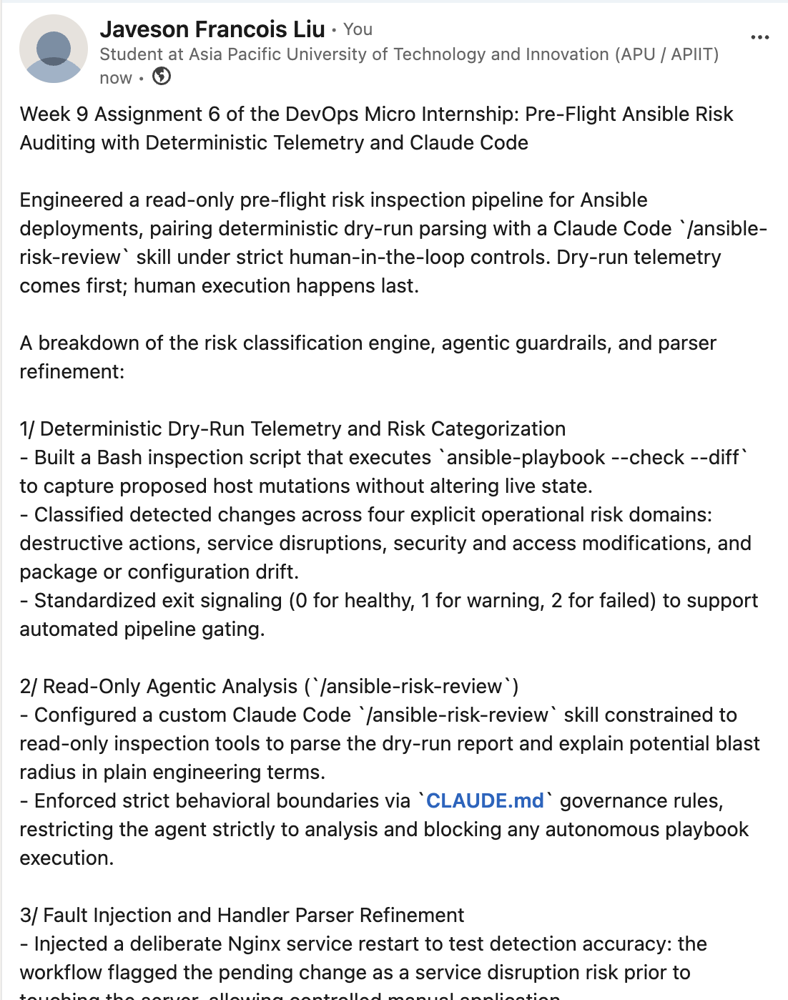

---

# Submission Details

| Item | Value |
|---|---|
| Repository folder | https://github.com/javesonfrancoisliu/devops-micro-internship-pravinmishra/tree/main/week-09-ansible/ansible-onboarding/epicbook-risk-review |
| Target | `epicbook-web` on AWS (`ap-southeast-5`) |

---

# Required Files

Confirm that the following files are included in your GitHub repository or assignment folder:

- [x] `CLAUDE.md`
- [x] `ansible-check-review.sh`
- [x] `.claude/skills/ansible-risk-review/SKILL.md`
- [x] `reports/risky-change-report.txt`
- [x] `reports/post-apply-report.txt`
- [x] `change-summary.md`

---

# Submission Instructions

- Add all required screenshots in your submission.
- Full Name must be visible in required screenshots and reports.
- All required notes must be answered clearly.
- Do not expose SSH private keys, passwords, cloud credentials, database credentials, or secret environment variables.
- Add your GitHub repository or folder URL inside this document.

---

# Completion Checklist

- [x] Task 1: EpicBook connectivity confirmed and workspace created
- [x] Task 2: `CLAUDE.md` created with safety rules
- [x] Task 3: Claude Code produced a read-only risk-review plan
- [x] Task 4: `ansible-check-review.sh` created and syntax checked
- [x] Task 5: Baseline dry-run review completed
- [x] Task 6: Claude Code `/ansible-risk-review` skill created and tested
- [x] Task 7: Controlled risky change introduced and detected
- [x] Task 8: Human applied the change and verified the result
- [x] Risky-change report saved
- [x] Post-apply report saved
- [x] Change summary completed
- [x] All screenshots added
- [x] All notes answered
- [x] LinkedIn post published
- [x] LinkedIn post URL added
- [x] No sensitive information exposed

---

## About DMI & CloudAdvisory

DevOps Micro Internship (DMI) is a project-based DevOps program run by Pravin Mishra and The CloudAdvisory, focused on real-world execution, systems thinking, and career readiness.

It helps learners build strong DevOps foundations with hands-on experience.

---

## Resources

- DMI Official Website: [https://dmi.pravinmishra.com?utm_source=github&utm_medium=readme](https://dmi.pravinmishra.com?utm_source=github&utm_medium=readme)
- University: [https://university.pravinmishra.com?utm_source=github&utm_medium=readme](https://university.pravinmishra.com?utm_source=github&utm_medium=readme)
- Discord Community: [https://discord.pravinmishra.com?utm_source=github&utm_medium=readme](https://discord.pravinmishra.com?utm_source=github&utm_medium=readme)
- Blog: [https://dmi.pravinmishra.com/blog?utm_source=github&utm_medium=readme](https://dmi.pravinmishra.com/blog?utm_source=github&utm_medium=readme)
- YouTube Playlist: [https://www.youtube.com/playlist?list=PLFeSNDtI4Cho](https://www.youtube.com/playlist?list=PLFeSNDtI4Cho)
- Pravin Mishra LinkedIn: [https://www.linkedin.com/in/pravin-mishra-aws-trainer/](https://www.linkedin.com/in/pravin-mishra-aws-trainer/)
- CloudAdvisory LinkedIn: [https://www.linkedin.com/company/thecloudadvisory/](https://www.linkedin.com/company/thecloudadvisory/)

---

*This submission is part of DevOps Micro Internship (DMI) — Agentic AI Track.*