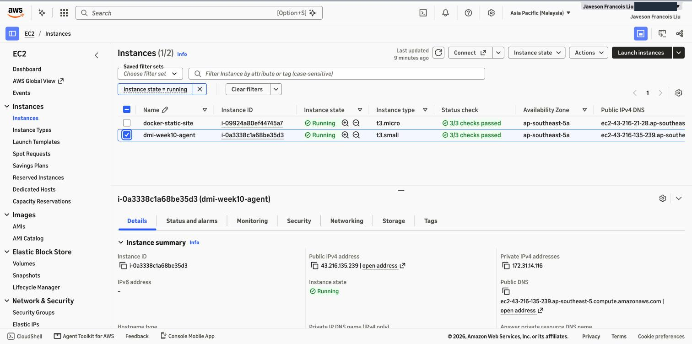
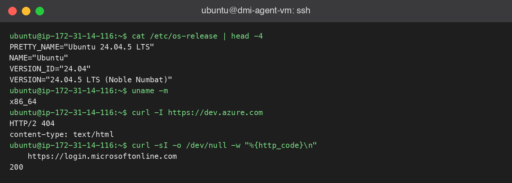
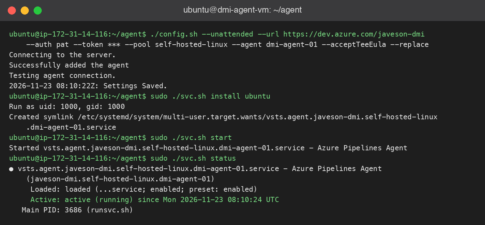
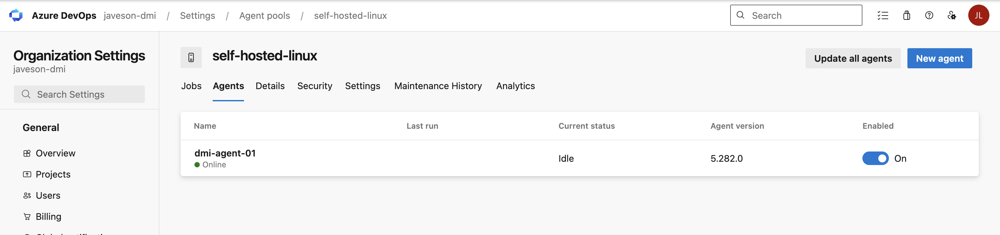
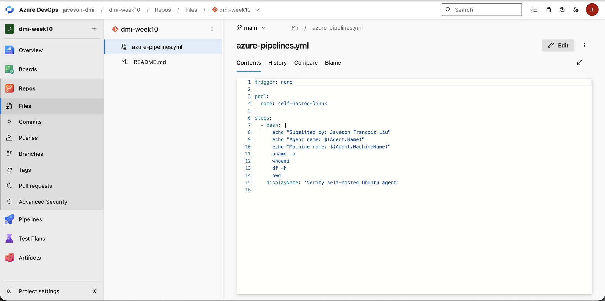
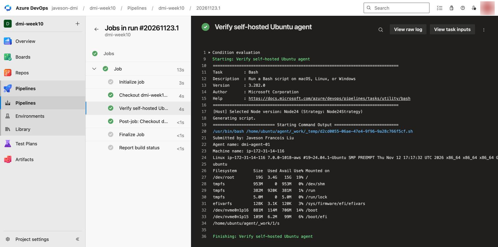

# Assignment 1 — Configure a Self-Hosted Azure DevOps Agent on Ubuntu

Part of the DevOps Micro Internship (DMI) with Agentic AI

---

## Purpose

In this assignment, you will provision an Ubuntu VM in AWS or Azure and configure it as a self-hosted Azure Pipelines agent. You will create an agent pool, register the agent using a Personal Access Token (PAT), run it as a Linux system service, and verify it by executing a test pipeline on the VM.

---

# Task 0 — Create or Access Azure DevOps

## Goal

Sign in to Azure DevOps and create or access an organization and project for the assignment.

No submission screenshot is required for this task.

---

# Task 1 — Create a Personal Access Token (PAT)

## Goal

Create and securely store the PAT required to register the self-hosted agent.

No submission screenshot is required for this task.

> Do not include the PAT in this document or in any screenshot.

---

# Task 2 — Create a Self-Hosted Agent Pool

## Goal

Create the Azure DevOps agent pool that will contain the Linux agent.

No submission screenshot is required for this task.

---

# Task 3 — Provision and Connect to the Ubuntu VM

## Goal

Provision an Ubuntu VM in AWS or Azure and verify its operating system, architecture, and outbound connection to Azure DevOps.

## Evidence

### Screenshot 1 — Ubuntu VM Running

Add a screenshot from AWS or Azure showing:

* Ubuntu VM name
* VM status as **Running**
* Public IP address



---

### Screenshot 2 — Ubuntu, Architecture, and HTTPS Verification

Add an SSH terminal screenshot showing the output of:

* `cat /etc/os-release`
* `uname -m`
* `curl -I https://dev.azure.com`

The screenshot must confirm a supported Ubuntu version, `x86_64` architecture, and a successful HTTP response from Azure DevOps.



Note: `curl -I https://dev.azure.com` answers `HTTP/2 404` because the site root has no page; the 404 comes from Azure DevOps itself, so outbound HTTPS works. A second check against `https://login.microsoftonline.com` returned `200`.

---

# Task 4 — Install and Configure the Azure Pipelines Agent

## Goal

Download, configure, and register the Linux Azure Pipelines agent, and run it as a system service.

## Evidence

### Screenshot 3 — Agent Configuration and Service Status

Add a terminal screenshot showing:

* Successful agent configuration
* Agent service installation
* Agent service start
* `sudo ./svc.sh status` reporting that the service is running



Note: condensed from the configuration run on the VM, with the PAT shown as `***`.

> Ensure that the PAT is not visible.

---

# Task 5 — Verify That the Agent Is Online

## Goal

Confirm that the agent service is running and the agent appears online in Azure DevOps.

## Evidence

### Screenshot 4 — Agent Online in Azure DevOps

Add a screenshot of the Azure DevOps Agent Pool **Agents** page showing:

* Selected agent pool
* Selected agent name
* Agent status as **Online**
* Agent enabled and available



---

# Task 6 — Create and Run a Test Pipeline

## Goal

Create an Azure DevOps YAML pipeline and verify that its commands execute on the self-hosted Ubuntu VM.

## Evidence

### Screenshot 5 — Azure Pipelines YAML

Add a screenshot of `azure-pipelines.yml` open in the Azure Repos editor showing:

* `trigger: none`
* Selected self-hosted agent pool
* Bash verification step
* Your Full Name
* Linux verification commands



---

### Screenshot 6 — Successful Test Pipeline

Add a screenshot of the successful Azure DevOps pipeline run showing:

* Overall status as **Succeeded**
* Expanded **Verify self-hosted Ubuntu agent** step
* `Submitted by: <your-full-name>`
* Agent name
* Machine name
* Output from `uname -a`
* Output from `whoami`
* Output from `df -h`
* Output from `pwd`



---

## Completed azure-pipelines.yml

Paste the contents of your completed `azure-pipelines.yml` file below.

```yaml
trigger: none

pool:
  name: self-hosted-linux

steps:
  - bash: |
      echo "Submitted by: Javeson Francois Liu"
      echo "Agent name: $(Agent.Name)"
      echo "Machine name: $(Agent.MachineName)"
      uname -a
      whoami
      df -h
      pwd
    displayName: 'Verify self-hosted Ubuntu agent'
```

> Do not include your PAT, SSH private key, password, or cloud credentials in the YAML file.

---

# Assignment Summary

Write a short summary of what you configured.

I created the Azure DevOps organization `javeson-dmi` with the private project `dmi-week10`, a PAT limited to Agent Pools (Read and manage), and the self-hosted pool `self-hosted-linux`. With Terraform I provisioned an Ubuntu 24.04 `t3.small` EC2 instance in `ap-southeast-5` (SSH limited to my public IP), registered the Azure Pipelines agent `dmi-agent-01` as a systemd service, and confirmed it Online. A YAML pipeline with `trigger: none` and `pool: name: self-hosted-linux` then ran `uname -a`, `whoami`, `df -h` and `pwd` on that VM and succeeded. First run needed a one-time permit for the pipeline to use the pool.

Run notes: the first registration attempt failed with `VS30063: You are not authorized` because the wrong text was passed as the token; I regenerated the PAT and registered again. The Microsoft account that owns the organization is a separate one, so its name is blurred or absent in the evidence.

---

# LinkedIn Requirement (If Applicable)

## Screenshot 7 — LinkedIn Post

Add a screenshot of your LinkedIn post showing:

* What you configured
* Why organizations use self-hosted agents
* Three to five lines explaining your experience
* A screenshot of the successful pipeline run with no secrets visible

Add your screenshot here.

**LinkedIn Post URL:** [Paste your LinkedIn post URL here]

---

# Submission Instructions

* Include the short assignment summary.
* Include Screenshots 1–6.
* Include the contents of your completed `azure-pipelines.yml` file.
* Include Screenshot 7 and the LinkedIn post URL if the LinkedIn requirement applies.
* Do not expose a PAT, SSH private key, password, account details, or another secret.

---

# Completion Checklist

- [x] Azure DevOps organization and project are ready
- [x] A supported Ubuntu LTS VM is running and accessible through SSH
- [x] SSH access is restricted to your public IP address
- [x] Outbound HTTPS connectivity is working
- [x] PAT was created with the required scopes and stored securely
- [x] A self-hosted agent pool was created
- [x] The same pool name was used during registration and in the pipeline YAML
- [x] The agent service is running
- [x] The agent appears **Online** in Azure DevOps
- [x] The pipeline targets the selected agent pool
- [x] The pipeline run completed with **Succeeded** status
- [x] The pipeline output displays your Full Name
- [x] Screenshots 1–6 are included and readable
- [ ] Screenshot 7 and the LinkedIn post URL are included if applicable (pending: post goes live after publishing)
- [x] The completed `azure-pipelines.yml` content is included
- [x] No PAT, SSH private key, password, or other secret is visible

---

*This submission is part of the DevOps Micro Internship (DMI) — Agentic AI Track.*
