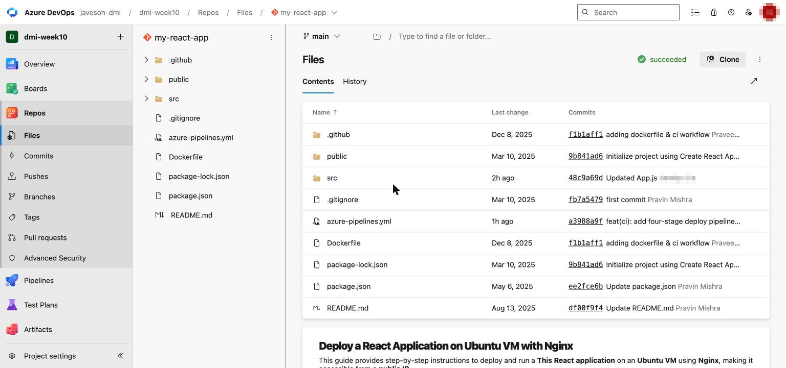
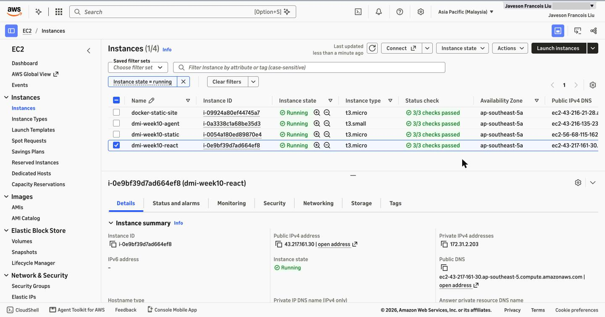
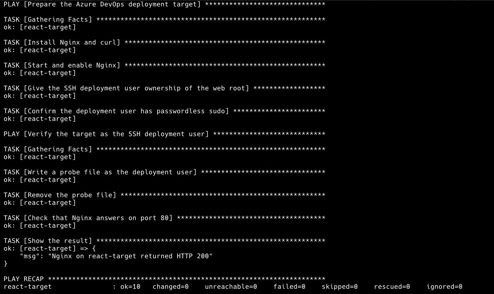
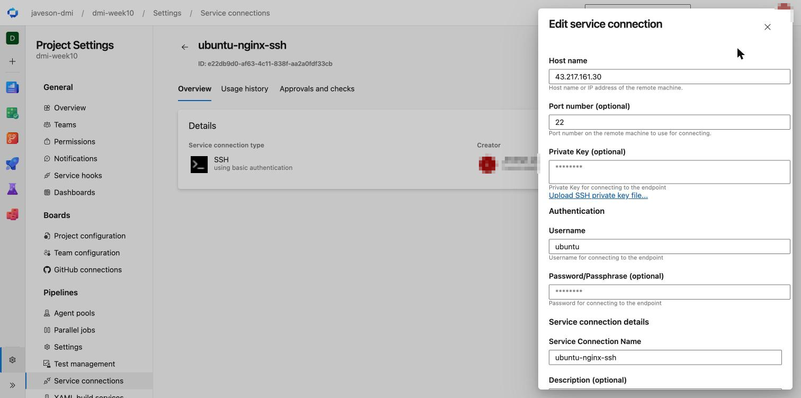
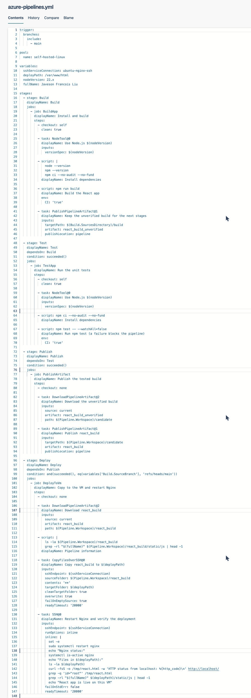
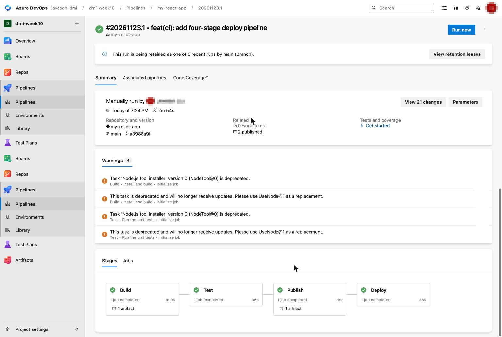
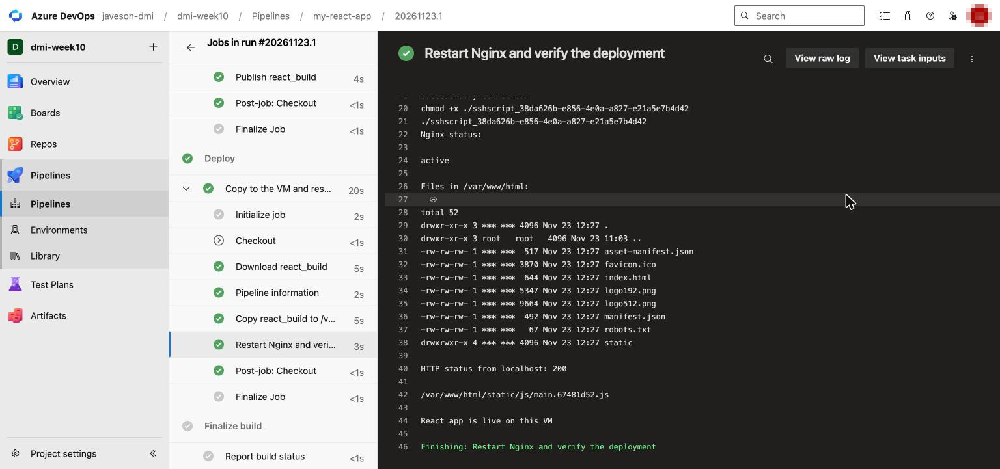
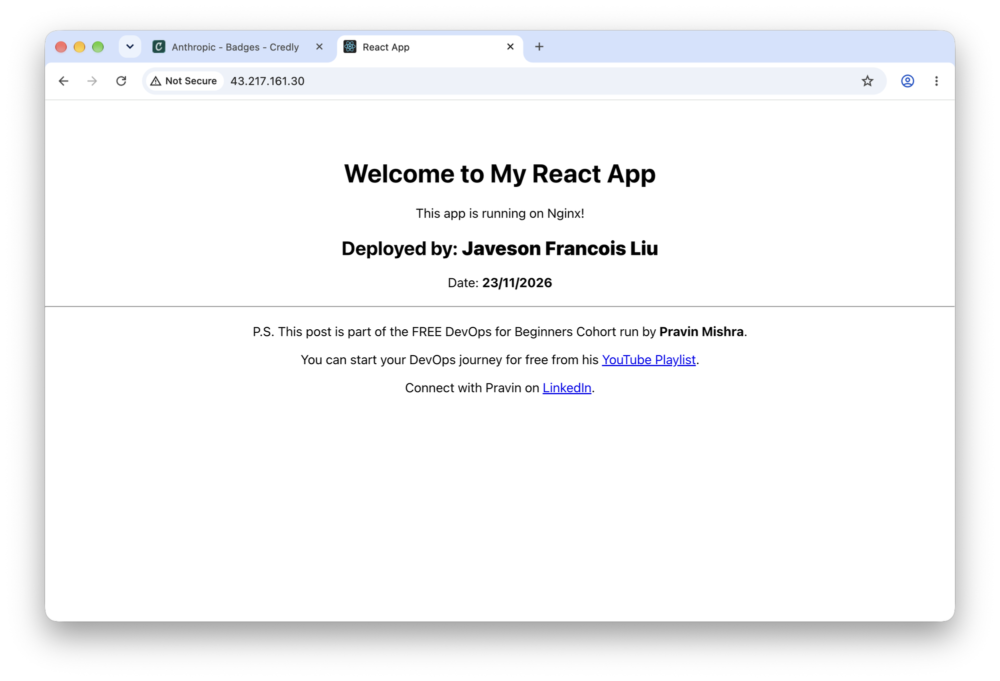

# Assignment 3 — Deploy React Application with Azure DevOps Pipeline

Part of the DevOps Micro Internship (DMI) with Agentic AI

---

## Purpose

In this assignment, you will build and deploy the `my-react-app` React application to an Ubuntu VM using a multi-stage Azure Pipeline (Build → Test → Publish → Deploy) over SSH, with automatic triggering on commits to `main`.

---

# Task 1 — Import the React App

## Goal

Import `https://github.com/pravinmishraaws/my-react-app` into Azure Repos and confirm `package.json` and `src/` are visible.

### Evidence

#### Screenshot 1 — Azure Repos showing the imported React project with `package.json` and `src/` visible

---

# Task 2 — Prepare the Target VM

## Goal

Provision a new Ubuntu VM with Terraform (ports 22/80 open) and prepare Nginx/`/var/www/html` with Ansible.

Terraform (`terraform/`) creates a separate `t3.micro` Ubuntu 24.04 EC2 instance named `dmi-week10-react` in `ap-southeast-5`. Its security group opens TCP 22 only to my controller IP and the agent public IP, and TCP 80 to the internet. Ansible (`ansible/site.yml`) installs Nginx and gives the SSH user `ubuntu` ownership of `/var/www/html`, which is what lets the pipeline copy the build without root.

### Evidence

#### Screenshot 2 — Terraform output or cloud console showing the new VM and public IP

---

#### Screenshot 3 — Terminal showing Ansible completed successfully and Nginx is active

---

# Task 3 — Create or Update the SSH Service Connection

## Goal

Point the `ubuntu-nginx-ssh` Service Connection to the new VM and validate it.

The connection keeps the name `ubuntu-nginx-ssh` so the YAML does not change. Only the host changes to the new public IP. Authentication stays private key based and the key is never shown.

### Evidence

#### Screenshot 4 — SSH Service Connection page showing the new VM connection and successful validation, with the password hidden

---

# Task 4 — Author a Multi-Stage Pipeline (YAML)

## Goal

Create the Build (npm install/build), Test (`npm test -- --watchAll=false`, blocking on failure), Publish (publish `build/` as `react_build`), and Deploy (copy artifact to `/var/www/html`, restart Nginx via SSH) stages, triggered on `main`.

Pipeline design:

| Stage | What it does | Why |
|---|---|---|
| Build | `NodeTool@0` installs Node.js 22, `npm ci`, `npm run build`, keeps `build/` as the temporary artifact `react_build_unverified` | Proves the app compiles |
| Test | `npm ci`, then `npm test -- --watchAll=false` with `CI=true` | A failing test stops the pipeline before anything is published |
| Publish | Downloads the unverified build and publishes it as `react_build` | `react_build` exists only for a build that passed its tests |
| Deploy | Downloads `react_build`, `CopyFilesOverSSH@0` to `/var/www/html` with the target cleaned first, then `SSH@0` runs `sudo systemctl restart nginx` and checks the page | Ships only the tested artifact, only from `main` |

The trigger is a push to `main`. Every stage runs on the self-hosted pool `self-hosted-linux`, and each stage checks out and installs its own dependencies so no stage relies on files left by another.

### Evidence

#### Screenshot 5 — Azure Pipeline YAML definition with the Build, Test, Publish, and Deploy sections visible

---

# Task 5 — Run and Verify

## Goal

Confirm a commit to `main` triggers the pipeline, all four stages succeed, the build artifact is on the VM, and the React app is live.

### Evidence

#### Screenshot 6 — Pipeline run summary showing Build, Test, Publish, and Deploy succeeded

---

#### Screenshot 7 — Terminal or pipeline output showing `/var/www/html` after deployment

---

#### Screenshot 8 — Browser showing the running React application with the public IP visible

---

# LinkedIn Post (Required)

## Goal

Publish a LinkedIn post about the completed assignment, mentioning the Build/Test/Publish/Deploy flow and that commits to `main` trigger automatic deployment, with public/"Anyone" visibility and at least one link or image.

## Evidence

#### LinkedIn Post URL

Paste your LinkedIn post URL here:

`Add your URL here`

---

#### Screenshot — Published LinkedIn post showing the text and at least one link or image

Add your screenshot here.

---

# Submission Instructions

- Add all required screenshots in your submission
- Do not reveal VM passwords, tokens, private keys, or service-connection secrets

---

# Completion Checklist

- [x] Task 1: React app imported into Azure Repos (Screenshot 1)
- [x] Task 2: New VM provisioned and Nginx configured (Screenshots 2–3)
- [x] Task 3: SSH Service Connection updated and validated (Screenshot 4)
- [x] Task 4: Multi-stage YAML pipeline authored (Screenshot 5)
- [x] Task 5: All four stages succeeded and app verified (Screenshots 6–8)
- [ ] LinkedIn post published and URL submitted
- [x] No sensitive data exposed

---

## 📌 About DMI & CloudAdvisory

DevOps Micro Internship (DMI) is a project-based DevOps program run by Pravin Mishra (The CloudAdvisory) focused on real-world execution, systems thinking, and career readiness.

It helps learners build strong DevOps foundations with hands-on experience.

---

## 📌 Resources

- 🌐 DMI Official Website: https://dmi.pravinmishra.com?utm_source=github&utm_medium=readme  
- 🎓 University: https://university.pravinmishra.com?utm_source=github&utm_medium=readme  
- 💬 Discord Community: https://discord.pravinmishra.com?utm_source=github&utm_medium=readme  
- 📝 Blog: https://dmi.pravinmishra.com/blog?utm_source=github&utm_medium=readme  
- ▶️ YouTube Playlist: https://www.youtube.com/playlist?list=PLFeSNDtI4Cho  
- 🔗 Pravin Mishra (LinkedIn): https://www.linkedin.com/in/pravin-mishra-aws-trainer/  
- 🏢 CloudAdvisory (LinkedIn): https://www.linkedin.com/company/thecloudadvisory/

---

*This submission is part of DevOps Micro Internship (DMI) — Agentic AI Track.*
