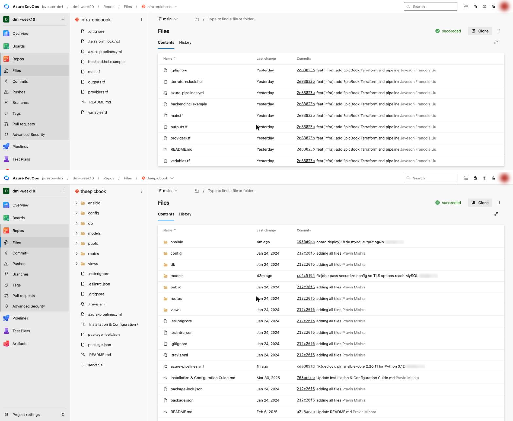
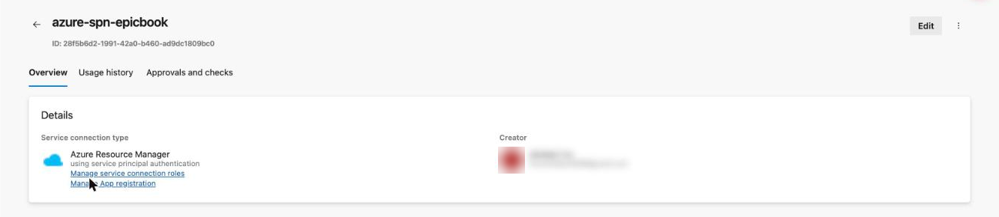
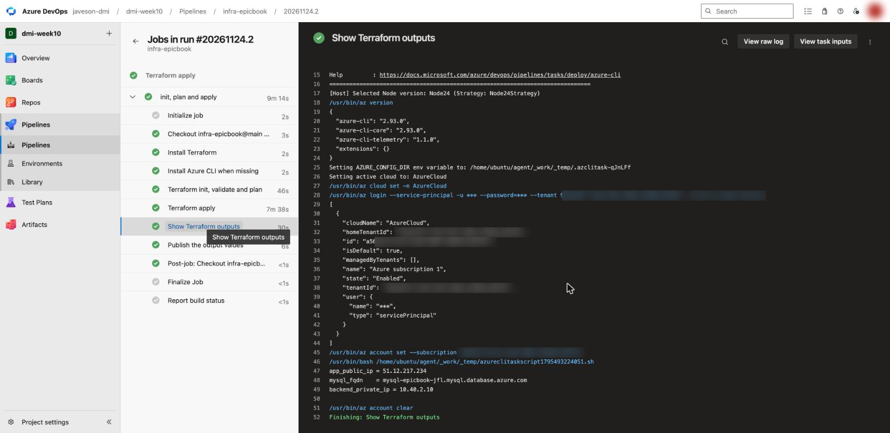
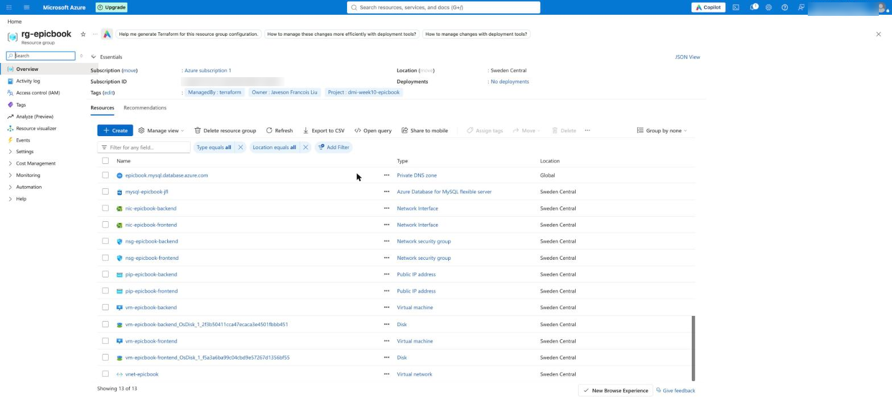
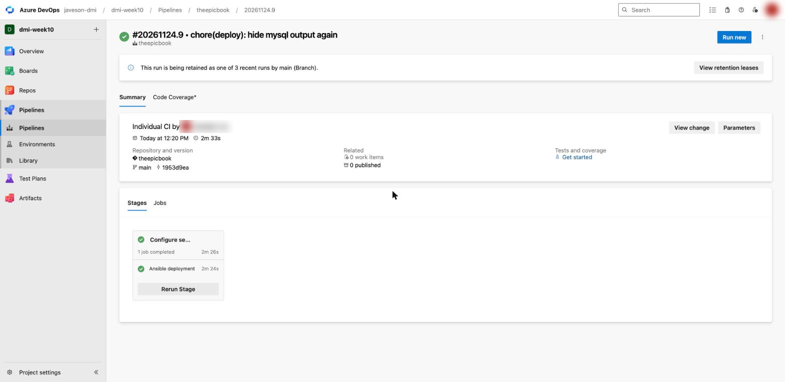
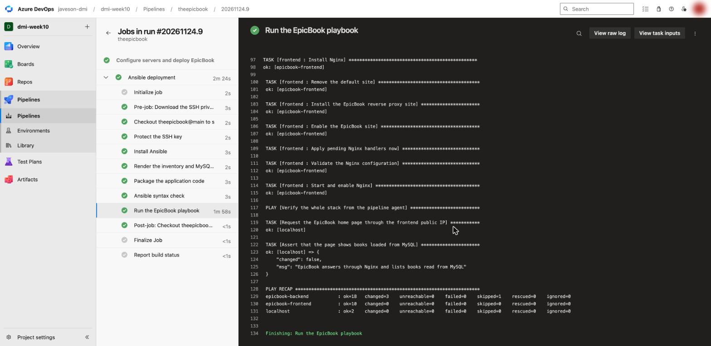
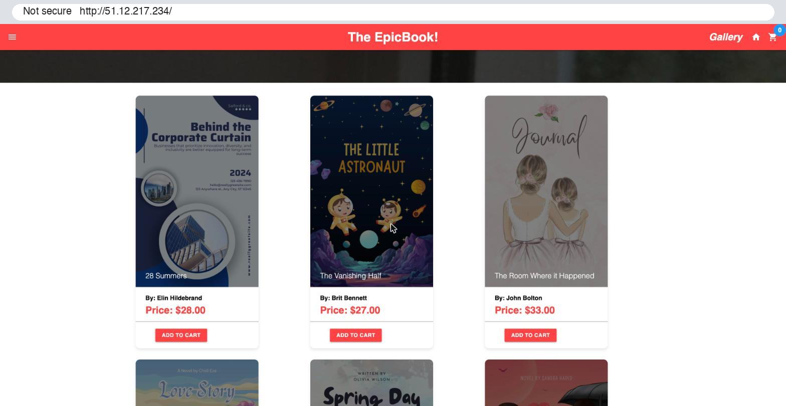

# Assignment 4 — Capstone: Automate the EpicBook Application with Dual Pipelines

Part of the DevOps Micro Internship (DMI) with Agentic AI

---

## Purpose

In this capstone assignment, you will design a complete DevOps automation workflow for EpicBook across two repositories and two Azure DevOps pipelines: an Infra Pipeline (`infra-epicbook`, Terraform) that provisions the network, frontend/backend VMs, and MySQL database, and an App Pipeline (`theepicbook`, Ansible) that consumes the Terraform outputs, configures the servers, and deploys EpicBook end to end.

---

# Task 1 — Prepare Repositories

## Goal

Prepare `infra-epicbook` (Terraform for network, frontend/backend VMs, MySQL, with `app_public_ip` and `mysql_fqdn` outputs) and `theepicbook` (application code, Ansible roles/playbooks, inventory template, MySQL variable files), keeping infrastructure and application responsibilities separated.

Separation of responsibilities:

| Repository | Owns | Tool | Never contains |
|---|---|---|---|
| `infra-epicbook` | Virtual network, three subnets, two network security groups, frontend and backend VMs, MySQL flexible server, private DNS zone, outputs `app_public_ip` and `mysql_fqdn` | Terraform | Application code, Ansible, application secrets |
| `theepicbook` | EpicBook code, Ansible roles `common`, `backend`, `frontend`, inventory and MySQL variable templates | Ansible | Terraform, the SSH key, the database password |

The two repositories meet only at the two Terraform outputs, which I copy into the pipeline variables `APP_PUBLIC_IP` and `MYSQL_FQDN` of the App Pipeline.

### Evidence

#### Screenshot 1 — Both repositories showing their required files and separation of responsibilities

---

# Task 2 — Create Azure Service Connection

## Goal

Create and validate an Azure Resource Manager SPN service connection (Tenant ID, Subscription ID, Client ID, Client Secret) for the Infra Pipeline.

### Evidence

#### Screenshot 2 — Azure Resource Manager service connection showing successful configuration with secrets hidden

---

# Task 3 — Create Infra Pipeline

## Goal

Create a YAML pipeline for `infra-epicbook` that authenticates via the SPN connection and runs `terraform init`/`plan`/`apply`, producing `app_public_ip` and `mysql_fqdn`.

Design: the pipeline installs Terraform and the Azure CLI on the self-hosted agent when missing, then runs `AzureCLI@2` with the service principal exposed to the shell. Terraform state lives in an Azure Storage container so every run sees the same state. The MySQL admin password comes from the variable group `epicbook-secrets` and reaches Terraform as `TF_VAR_mysql_admin_password`. A run parameter chooses `apply` or `destroy`, so the same pipeline also cleans up the lab. The database sits in a delegated subnet with a private DNS zone and has no public endpoint. The backend VM has no inbound access from the internet: only the frontend subnet can reach it on ports 22 and 8080.

### Evidence

#### Screenshot 3 — Infra Pipeline run showing `terraform apply` completion and the `app_public_ip` and `mysql_fqdn` outputs

---

#### Screenshot 4 — Azure Portal confirming the provisioned resources

---

# Task 4 — Create App Pipeline

## Goal

Upload the SSH private key to Azure DevOps Secure Files, create a YAML pipeline for `theepicbook` that installs Ansible, downloads the key, manually incorporates the Infra Pipeline's `app_public_ip`/`mysql_fqdn` outputs into the inventory/variables, and runs the playbook to configure the frontend/backend and deploy EpicBook behind Nginx.

Design: the SSH private key is a Secure File, never in Git. The pipeline installs `ansible-core` in a virtual environment on the agent, renders `inventory.ini` and `vars/mysql.yml` from the two templates using `APP_PUBLIC_IP` and `MYSQL_FQDN`, packages the code from Azure Repos, and runs `site.yml`. Ansible reaches the backend through the frontend as a jump host. The backend role unpacks the code, writes the database connection to a root-owned environment file, runs EpicBook as a systemd service and loads the seed data once. The frontend role proxies Nginx port 80 to the backend private IP. The last play requests the home page from the pipeline agent and asserts it lists books that were read from MySQL.

### Evidence

#### Screenshot 5 — App Pipeline run summary showing successful completion

---

#### Screenshot 6 — Ansible playbook output showing successful configuration with `failed=0`

---

# Task 5 — Verify End-to-End Workflow

## Goal

Confirm both pipelines succeeded, the EpicBook application loads through the frontend public IP via Nginx, and a backend feature confirms successful MySQL connectivity.

### Evidence

#### Screenshot 7 — Browser displaying the running EpicBook application with the frontend public IP visible

The address strip above the page in Screenshot 7 is drawn onto the image, because a page capture cannot include the real browser address bar. The page itself is a live capture of `http://51.12.217.234/`.

---

### Notes

Record the frontend public application URL and a short issue-and-resolution note, if applicable.

**Frontend URL:** http://51.12.217.234/ (Nginx on the frontend VM, proxying to the Node.js app on the backend VM).

**Architecture:** `infra-epicbook` creates resource group `rg-epicbook` in `swedencentral` with one virtual network (10.40.0.0/16) and three subnets: frontend (10.40.1.0/24), backend (10.40.2.0/24) and database (10.40.3.0/24, delegated to `Microsoft.DBforMySQL/flexibleServers`). The frontend VM (10.40.1.10) has the only public IP and runs Nginx. The backend VM (10.40.2.10) runs the Node.js app on port 8080 under systemd. The database is a MySQL Flexible Server with no public endpoint, reached through a private DNS zone, with `require_secure_transport` ON. Both VMs accept SSH keys only.

**Network security:** the frontend NSG allows SSH only from the build agent and HTTP from the internet. The backend NSG allows ports 22 and 8080 only from the frontend subnet.

**Secrets:** Terraform state is in an Azure Storage container. The MySQL admin password and SSH public key come from the variable group `epicbook-secrets`. The SSH private key is an Azure DevOps Secure File. The service principal secret exists only in the service connection. None are in Git.

**App pipeline:** installs `ansible-core` 2.20.11 in a virtual environment on the self-hosted agent, renders `inventory.ini` and `vars/mysql.yml` from `APP_PUBLIC_IP` and `MYSQL_FQDN`, packages the code and runs `site.yml`. Ansible reaches the backend through the frontend VM as an SSH jump host. systemd (not pm2) keeps the app running. The last play asserts that the home page lists a seeded book, which proves the data came from MySQL.

**Issues and resolutions (run history of `theepicbook`):**

1. `ansible-core` 2.22.0 needs Python 3.13 or newer, and the agent has Python 3.12. Resolution: pinned `ansibleCoreVersion` to 2.20.11 in `azure-pipelines.yml`.
2. The Terraform output `mysql_fqdn` (`mysql-epicbook-jfl.mysql.database.azure.com`) does not resolve inside the virtual network. The private DNS zone name is `epicbook.mysql.database.azure.com`, so the working host is `mysql-epicbook-jfl.epicbook.mysql.database.azure.com`. Resolution: set the variable `MYSQL_FQDN` to that name. Screenshot 3 still shows the original Terraform output value. Follow-up: align the Terraform output with the zone name.
3. The backend rejected the connection with MySQL error 3159 (insecure transport). `models/index.js` created Sequelize without the `config` object, so the TLS options were dropped. Resolution: pass `config` as the second argument to `new Sequelize(...)`.
4. The `mysql` client check failed with "certificate verify failed" under `--ssl-mode=VERIFY_IDENTITY`. Resolution: use `--ssl-mode=VERIFY_CA` with the system CA bundle for the seed-data check. The certificate chain is still verified, but the host name is not. The Node.js app keeps `rejectUnauthorized: true`.

The final run, 20261124.9 (Screenshot 5), succeeded with `failed=0` on every host.

---

# LinkedIn Post (Required)

## Goal

Publish a LinkedIn post about the completed capstone project, mentioning the two-repository/dual-pipeline model, Terraform + Ansible responsibilities, and one end-to-end verification result, with public/"Anyone" visibility and at least one link or image.

## Evidence

#### LinkedIn Post URL

Paste your LinkedIn post URL here:

`Add your URL here`

---

#### Screenshot — Published LinkedIn post showing the text and at least one link or image

Add your screenshot here.

---

# Submission Instructions

- Add all required screenshots in your submission
- Do not commit or expose the Client Secret, SSH private key, database password, or other credentials

---

# Completion Checklist

- [x] Task 1: `infra-epicbook` and `theepicbook` repositories prepared with clean separation (Screenshot 1)
- [x] Task 2: Azure Resource Manager SPN service connection created and validated (Screenshot 2)
- [x] Task 3: Infra Pipeline provisioned resources and produced outputs (Screenshots 3–4)
- [x] Task 4: App Pipeline configured servers and deployed EpicBook (Screenshots 5–6)
- [x] Task 5: End-to-end workflow verified, including MySQL connectivity (Screenshot 7)
- [x] Frontend URL and issue notes written (Notes)
- [ ] LinkedIn post published and URL submitted
- [x] No secrets exposed

---

## 📌 About DMI & CloudAdvisory

DevOps Micro Internship (DMI) is a project-based DevOps program run by Pravin Mishra (The CloudAdvisory) focused on real-world execution, systems thinking, and career readiness.

It helps learners build strong DevOps foundations with hands-on experience.

---

## 📌 Resources

- 🌐 DMI Official Website: https://dmi.pravinmishra.com?utm_source=github&utm_medium=readme  
- 🎓 University: https://university.pravinmishra.com?utm_source=github&utm_medium=readme  
- 💬 Discord Community: https://discord.pravinmishra.com?utm_source=github&utm_medium=readme  
- 📝 Blog: https://dmi.pravinmishra.com/blog?utm_source=github&utm_medium=readme  
- ▶️ YouTube Playlist: https://www.youtube.com/playlist?list=PLFeSNDtI4Cho  
- 🔗 Pravin Mishra (LinkedIn): https://www.linkedin.com/in/pravin-mishra-aws-trainer/  
- 🏢 CloudAdvisory (LinkedIn): https://www.linkedin.com/company/thecloudadvisory/

---

*This submission is part of DevOps Micro Internship (DMI) — Agentic AI Track.*
