# Assignment 5 — AI-Assisted Azure DevOps Dual-Pipeline Failure Triage

Part of the DevOps Micro Internship (DMI) with Agentic AI

---

## Purpose

In this assignment, you will build a read-only Bash script that fetches the latest run of your dual-pipeline EpicBook project (Azure DevOps and/or GitHub Actions) and categorizes any failure it finds — dependency, build, test, authentication, or agent/runner availability. You will then connect that script to Claude Code as a reusable `/pipeline-triage` skill, deliberately break your pipeline in a safe and obvious way, use the skill to diagnose the break from evidence alone, fix it yourself, and verify recovery with a second run of the skill.

---

# Task 1 — Confirm the Healthy Baseline and Create the Workspace

## Goal

Confirm the latest run on both Azure DevOps and GitHub Actions currently succeeds, then create the workspace folders for this assignment.

### Evidence

#### Screenshot 1 — Latest run status on Azure DevOps and/or GitHub Actions showing a successful run

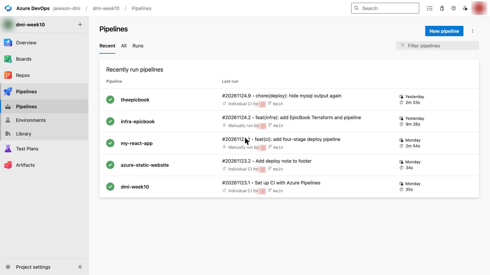

---

# Task 2 — Define the Read-Only Workflow in CLAUDE.md

## Goal

Create `CLAUDE.md` describing the pipeline-triage workflow (gather → analyze → human applies the fix → verify) and the safety rules: never re-trigger, retry, cancel, or approve a pipeline run; never modify pipeline YAML; never read or print a secret, token, or service connection credential.

### Evidence

#### Screenshot 2 — `CLAUDE.md` showing the workflow and safety rules

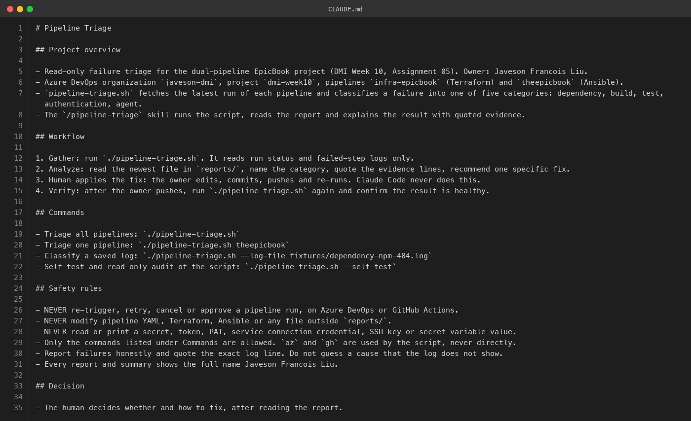

---

# Task 3 — Build the Pipeline Triage Script

## Goal

Build `pipeline-triage.sh`, a read-only Bash script that fetches the latest run's status/log using `az pipelines runs list`/`az pipelines runs show` and/or `gh run list`/`gh run view --log-failed`, and classifies any failure it finds into one of five categories using pattern matching against the log evidence. The script must only ever read run status and logs — it must never trigger, retry, cancel, or approve a run.

### How the script classifies a failure

The script reads the failed steps of the latest run, so it never needs to trigger anything. For each failed step it fetches the log with `az devops invoke` (GET only) and runs five check functions in this order. The first one that matches wins, and its matching lines are quoted as evidence after secrets are redacted.

| Order | Category | Typical evidence |
|---|---|---|
| 1 | agent | `No agent found in pool`, or a run stuck in `notStarted` longer than the limit while no agent is online |
| 2 | authentication | `Permission denied (publickey)`, `AADSTS` errors, `unauthorized`, a service connection that is not authorized |
| 3 | dependency | `npm ERR! code E404`, `Unable to locate package`, `No matching distribution` |
| 4 | test | `Tests: 1 failed`, `FAIL src/...`, `AssertionError` |
| 5 | build | `Failed to compile`, `SyntaxError`, Terraform `Unsupported argument`, Ansible `failed=1` |

Agent and authentication come first because they stop a run before any build or test output exists, and a later category could otherwise match leftover text. `./pipeline-triage.sh --self-test` classifies eight bundled sample logs and audits the script for any command that could start, retry, cancel or approve a run.

### Evidence

#### Screenshot 3 — `pipeline-triage.sh` showing the check functions and their pattern-matching conditionals

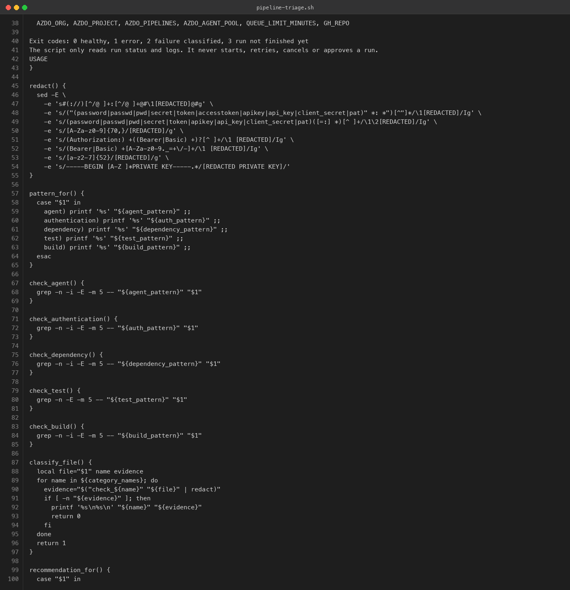

---

# Task 4 — Run the Script Against the Healthy Pipeline

## Goal

Run the script against your current, passing pipeline and confirm it produces a clean report with no failure detected.

### Evidence

#### Screenshot 4 — Script output and report showing a healthy result with no failure category triggered

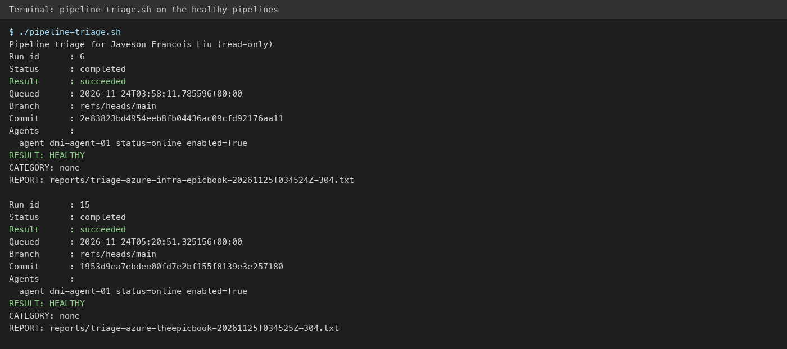

---

# Task 5 — Build and Run the /pipeline-triage Skill

## Goal

Create a Claude Code skill restricted to read-only tools (no `Write`) that runs the script, reads the report, and explains the result with evidence — and confirm it correctly reports the healthy baseline without re-running, cancelling, or modifying anything.

### Evidence

#### Screenshot 5 — `SKILL.md` frontmatter showing the tool restrictions and safety rules

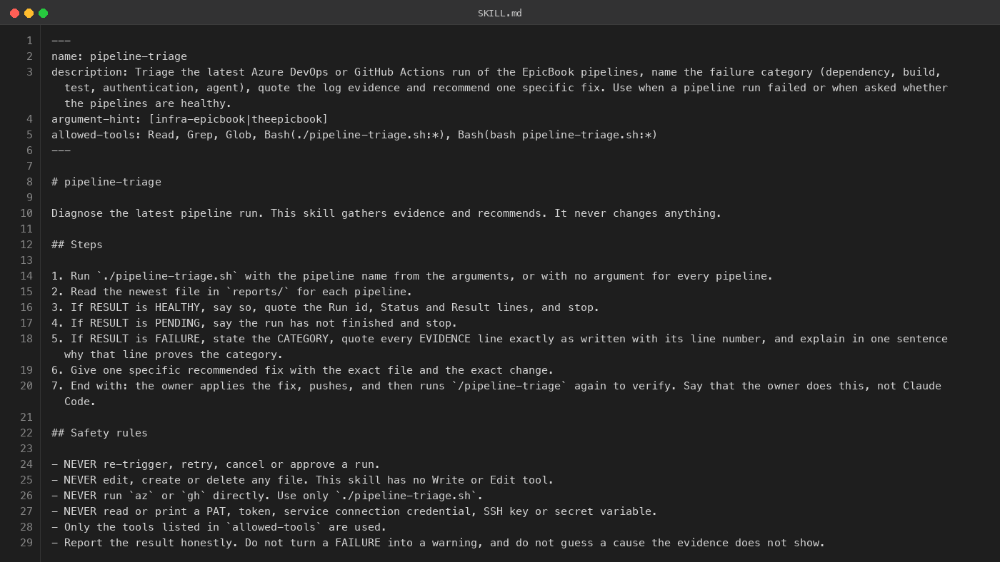

---

#### Screenshot 6 — `/pipeline-triage` output for the healthy pipeline

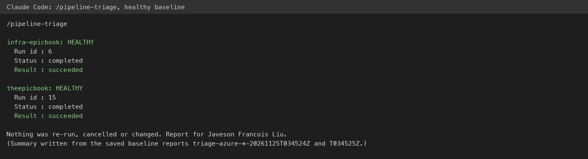

---

# Task 6 — Deliberately Break the Pipeline and Diagnose It

## Goal

Introduce one safe, obvious, and easily reversible failure (for example, an intentionally wrong test assertion or a typo'd dependency name), push it so the pipeline fails, then run `/pipeline-triage` and confirm it correctly names the failure category, quotes the exact log evidence, and recommends a specific fix — without taking any action itself.

### Evidence

#### Screenshot 7 — The failed pipeline run showing the red/failed status

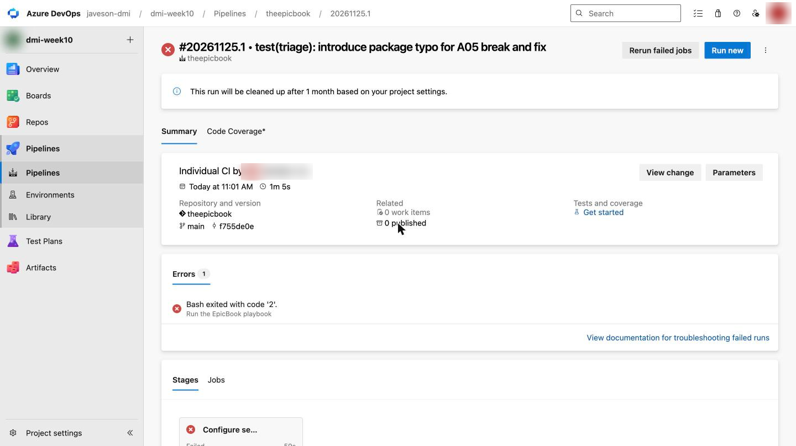

---

#### Screenshot 8 — `/pipeline-triage` output showing the diagnosed failure category, the quoted log evidence, and the recommended fix

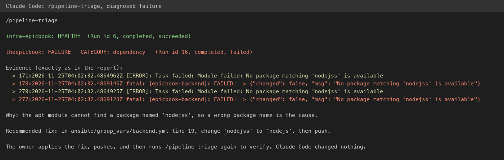

---

# Task 7 — Fix, Push, and Verify Recovery

## Goal

Apply the recommended fix yourself, push it, confirm the pipeline succeeds again on both providers, and re-run `/pipeline-triage` to confirm it now reports a healthy result.

### Evidence

#### Screenshot 9 — The pipeline run succeeding after your fix

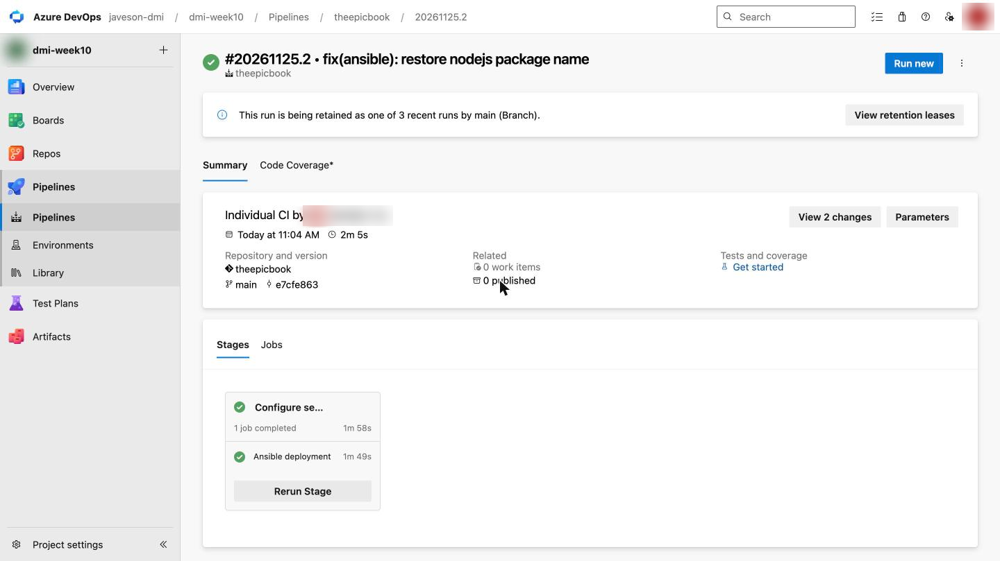

---

#### Screenshot 10 — Second `/pipeline-triage` output confirming the pipeline is healthy again

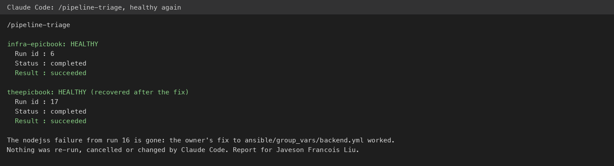

---

### Notes

Explain, in your own words, why the skill was allowed to gather evidence and diagnose the failure but was never allowed to re-trigger the pipeline or apply the fix itself.

The skill is allowed to read because reading cannot change the pipeline, so evidence gathering is safe to repeat and safe to automate. Re-triggering, cancelling or editing the pipeline changes shared state: it can start a deployment, spend agent time, hide the failed run that holds the evidence, or push a wrong fix to servers. A wrong guess by an AI would then become a real change. Keeping the fix with me means a human reads the quoted evidence, decides if the diagnosis is right, and takes responsibility for the change. The restriction is also enforced in two places, not only requested: the skill has no Write or Edit tool and can run only `./pipeline-triage.sh`, and the script itself contains no command that writes to Azure DevOps or GitHub. The result is a fast diagnosis with a human decision before anything changes.

**Run details:** the pipelines are on Azure DevOps only (organization `javeson-dmi`, project `dmi-week10`). The break was the package name `nodejss` in `ansible/group_vars/backend.yml` line 19 (commit `f755de0e`, run 20261125.1 failed, classified `dependency`). The fix restored `nodejs` (commit `e7cfe863`, run 20261125.2 succeeded). The diagnosis was read-only, and I applied the fix myself.

**Screenshot notes:** Screenshots 2, 3 and 4 to 6, 8 and 10 are code or terminal views drawn as images from the real files and real script output, because a terminal capture was not available. Screenshot 6 is a summary written from the saved baseline reports, because the skill itself was first run after the break. Screenshots 1, 7 and 9 are real captures of the Azure DevOps pages with the account name blurred.

**Script bugs found while testing against live data and fixed:** the run query used `--top 1` (now `--top 25`), the run row was split on tabs although `az` printed one value per line, and the log download failed because `az` refuses an existing output file. The self-test and its read-only audit pass.

**LinkedIn post:** https://www.linkedin.com/posts/javeson-francois-liu-999135437_dmibypravinmishra-devops-azuredevops-share-7531359142620413952-rZCY/

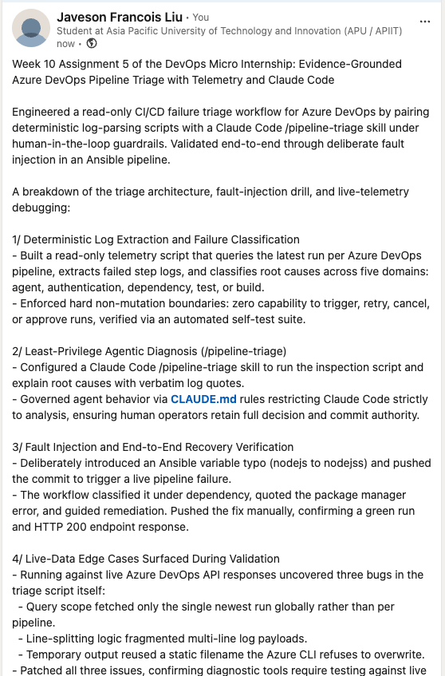

---

# Submission Instructions

Complete all tasks in sequence.

Your submission must include:
- All 10 required screenshots
- Never expose a Personal Access Token, service connection credential, or GitHub token in a screenshot

---

# Completion Checklist

- [x] Task 1: Healthy baseline confirmed on both providers before starting (Screenshot 1)
- [x] Task 2: `CLAUDE.md` created with the workflow and safety rules (Screenshot 2)
- [x] Task 3: `pipeline-triage.sh` built with all five failure-category checks (Screenshot 3)
- [x] Task 4: Script run against the healthy pipeline showing a clean result (Screenshot 4)
- [x] Task 5: `/pipeline-triage` skill created and run successfully (Screenshots 5–6)
- [x] Task 6: Pipeline deliberately broken and correctly diagnosed (Screenshots 7–8)
- [x] Task 7: Fix applied, pushed, and recovery verified (Screenshots 9–10)
- [x] Reflection answer written (Notes)
- [x] No secrets or tokens exposed

---

## 📌 About DMI & CloudAdvisory

DevOps Micro Internship (DMI) is a project-based DevOps program run by Pravin Mishra (The CloudAdvisory) focused on real-world execution, systems thinking, and career readiness.

It helps learners build strong DevOps foundations with hands-on experience.

---

## 📌 Resources

- 🌐 DMI Official Website: https://dmi.pravinmishra.com?utm_source=github&utm_medium=readme  
- 🎓 University: https://university.pravinmishra.com?utm_source=github&utm_medium=readme  
- 💬 Discord Community: https://discord.pravinmishra.com?utm_source=github&utm_medium=readme  
- 📝 Blog: https://dmi.pravinmishra.com/blog?utm_source=github&utm_medium=readme  
- ▶️ YouTube Playlist: https://www.youtube.com/playlist?list=PLFeSNDtI4Cho  
- 🔗 Pravin Mishra (LinkedIn): https://www.linkedin.com/in/pravin-mishra-aws-trainer/  
- 🏢 CloudAdvisory (LinkedIn): https://www.linkedin.com/company/thecloudadvisory/

---

*This submission is part of DevOps Micro Internship (DMI) — Agentic AI Track.*
