# Assignment 2 — Multi-Stage Docker Build for a React Application

Part of the DevOps Micro Internship (DMI) with Agentic AI

---

## Purpose

In this assignment, you will build both a single-stage and an optimized multi-stage Docker image for a React application, compare the resulting image sizes, and deploy the optimized version using a production-ready Nginx runtime container.

---

# Task 1 — Prepare the Project

## Goal

Clone `https://github.com/pravinmishraaws/my-react-app.git` and create a `.dockerignore` excluding `node_modules`, `build`, and `.env`.

### Evidence

#### Screenshot 1 — Contents of the `.dockerignore` file

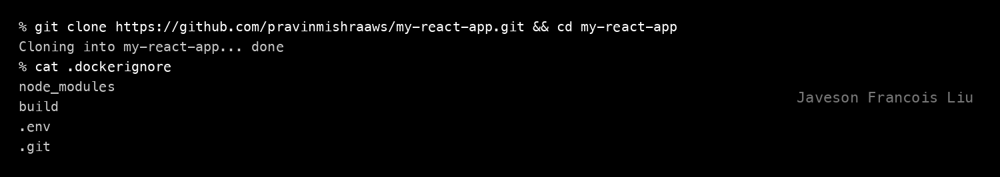

---

# Task 2 — Create a Single-Stage Docker Image

## Goal

Create `Dockerfile.single`, build `react-single`, and run it on port 3000.

### Evidence

#### Screenshot 2 — Contents of `Dockerfile.single`

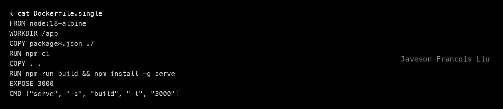

---

#### Screenshot 3 — Browser displaying the application running from the single-stage container

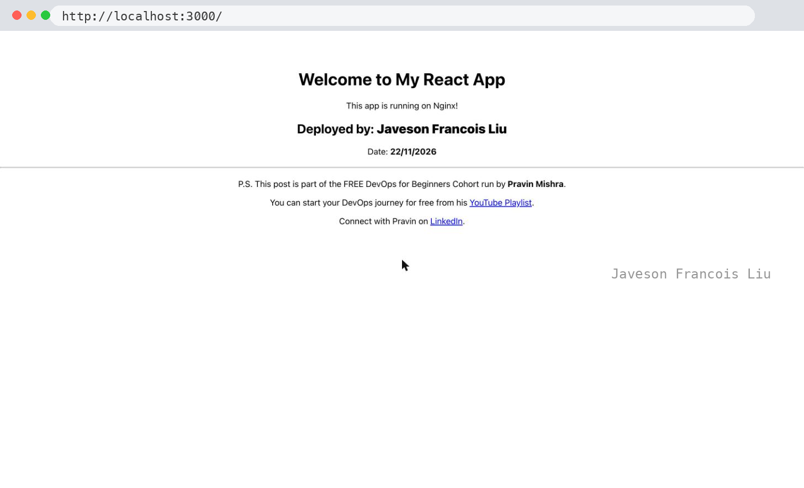

---

# Task 3 — Create a Multi-Stage Docker Build

## Goal

Create a multi-stage Dockerfile with separate build and Nginx runtime stages, build `react-multistage`, and run it on port 80.

### Evidence

#### Screenshot 4 — Contents of the multi-stage Dockerfile

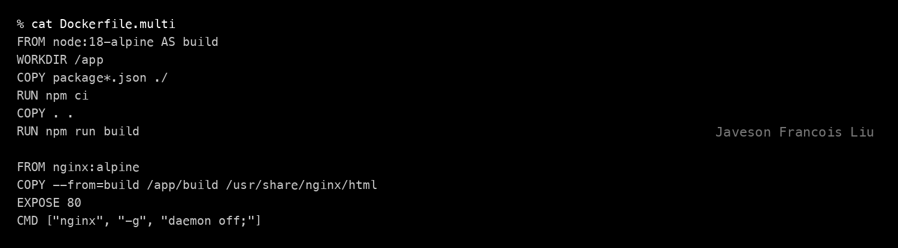

---

#### Screenshot 5 — Browser displaying the application running from the multi-stage container

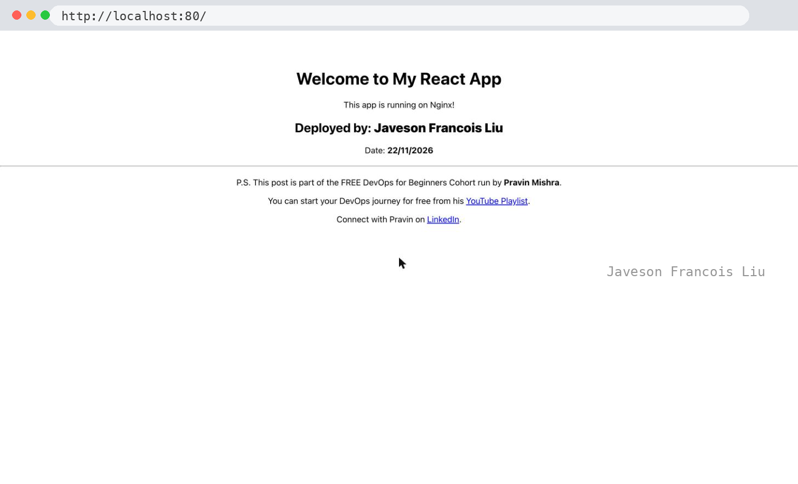

---

# Task 4 — Compare Docker Image Sizes

## Goal

Compare the single-stage and multi-stage image sizes and calculate the percentage reduction.

### Evidence

#### Screenshot 6 — Docker image list showing both image sizes

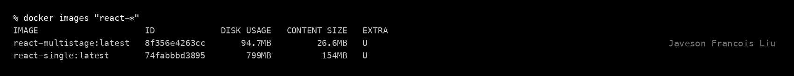

---

# Task 5 — Analyze the Optimization Results

## Goal

Write a 5–8 line analysis covering the percentage reduction, security benefits, reduced attack surface, faster distribution, and one build-caching optimization used.

### Evidence

#### Screenshot 7 — Analysis included in your submission document

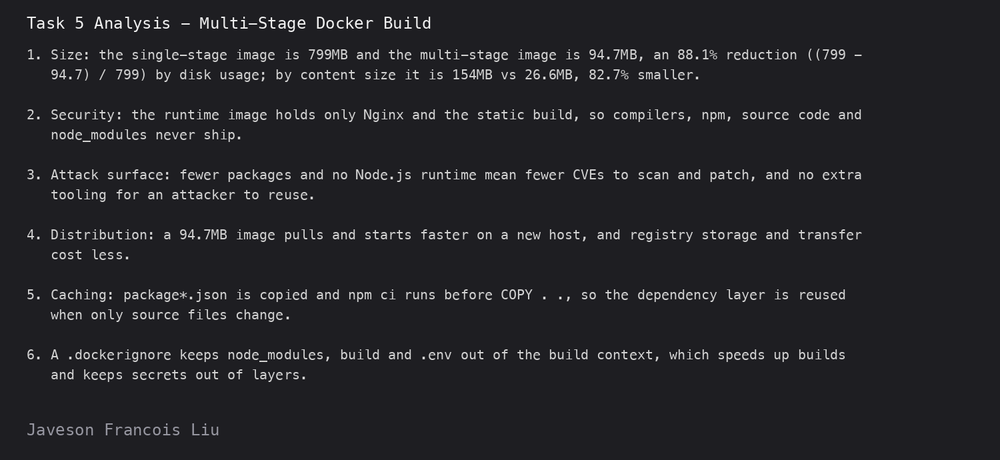

---

### Notes

1. Size: the single-stage image is 799MB and the multi-stage image is 94.7MB, an 88.1% reduction ((799 - 94.7) / 799) by disk usage; by content size it is 154MB vs 26.6MB, 82.7% smaller.
2. Security: the runtime image holds only Nginx and the static build, so compilers, npm, source code and node_modules never ship.
3. Attack surface: fewer packages and no Node.js runtime mean fewer CVEs to scan and patch, and no extra tooling for an attacker to reuse.
4. Distribution: a 94.7MB image pulls and starts faster on a new host, and registry storage and transfer cost less.
5. Caching: package*.json is copied and npm ci runs before COPY . ., so the dependency layer is reused when only source files change.
6. A .dockerignore keeps node_modules, build and .env out of the build context, which speeds up builds and keeps secrets out of layers.

---

# Task 6 — Explore Additional Production Optimizations (Optional)

## Goal

Optionally configure an Nginx health check, cache headers, parameterized ports via environment variables, or a lighter runtime image, and compare results.

### Evidence

Screenshots are rendered from real command output (Docker Desktop, run locally). The optimized variant is `react-optimized`; the baseline is the plain multi-stage build rebuilt as `react-multistage-base`.

#### Screenshot 8 - Optimized Dockerfile and nginx.conf template

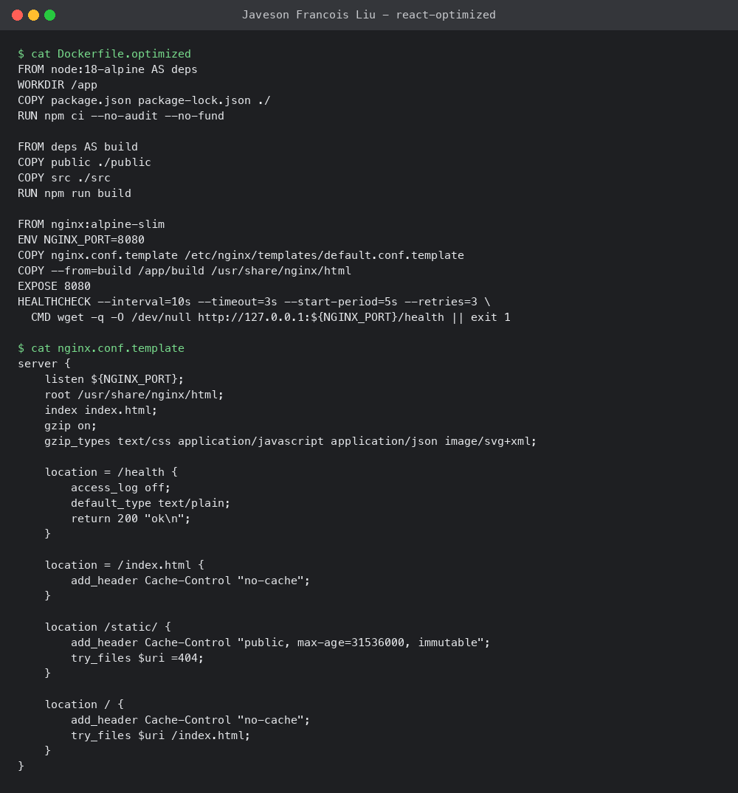

---

#### Screenshot 9 - Image size comparison, health status and NGINX_PORT check

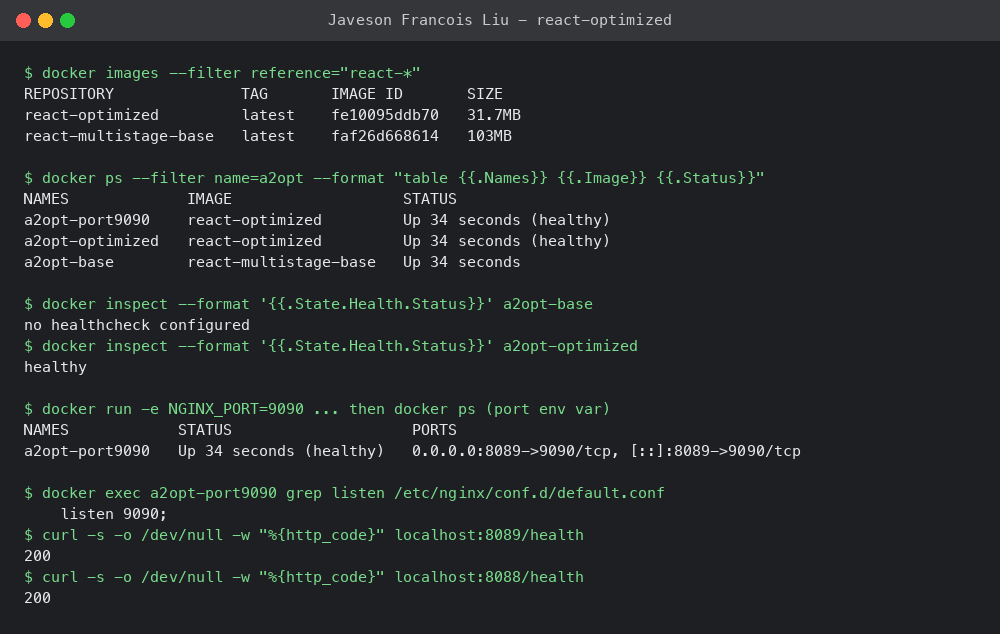

---

#### Screenshot 10 - Cache headers and /health endpoint (curl)

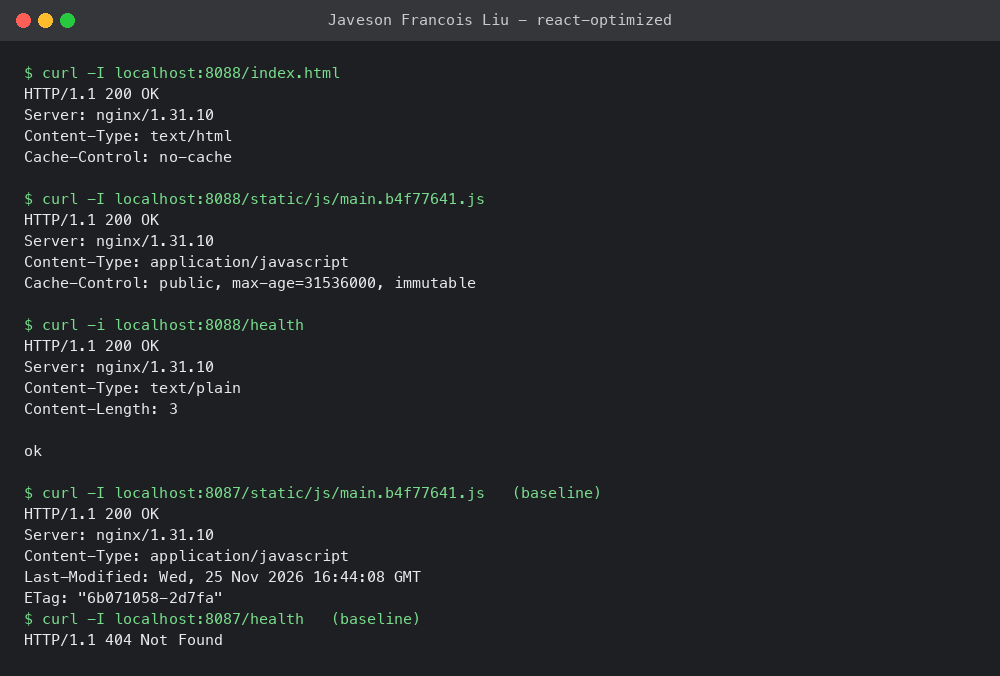

| Item | Baseline (`react-multistage-base`) | Optimized (`react-optimized`) |
| --- | --- | --- |
| Image size | 103MB | 31.7MB |
| Runtime image | `nginx:alpine` | `nginx:alpine-slim` |
| Health check | None (`docker inspect`: no healthcheck configured) | `HEALTHCHECK` on `/health`, status `healthy` |
| Cache headers | None; only `ETag` and `Last-Modified` | `index.html`: `no-cache`; hashed assets: `public, max-age=31536000, immutable` |
| Port | Fixed at 80 | `NGINX_PORT` env var (8080 default), tested with 8080 and 9090 |
| `/health` | 404 | 200 `ok` |

### Findings

- Size dropped from 103MB to 31.7MB (69.2% smaller) by switching the runtime to `nginx:alpine-slim`.
- The container reports `healthy` through `docker inspect` and `docker ps`, so an orchestrator can restart it if `/health` stops returning 200.
- Hashed files under `/static/` are served with `max-age=31536000, immutable`, while `index.html` is `no-cache`, so browsers keep assets and still pick up new releases.
- Setting `-e NGINX_PORT=9090` changed the generated `default.conf` to `listen 9090;` and `/health` answered 200 on the mapped port, with no image rebuild.
- `npm ci` runs in a separate `deps` stage that copies only `package.json` and `package-lock.json`, so the dependency layer is reused when only `src` changes.

---

# LinkedIn Post (Optional)

## Goal

Create a LinkedIn post describing what you built, what a multi-stage Docker build is, the image size reduction achieved, and key learnings.

## Evidence

#### LinkedIn Post URL

No separate post was published for this assignment. The Week 11 LinkedIn post covers the Docker work and is linked here:

https://www.linkedin.com/posts/javeson-francois-liu-999135437_dmibypravinmishra-devops-docker-share-7531361148256956416-zOE3/

---

#### Screenshot — Published LinkedIn post

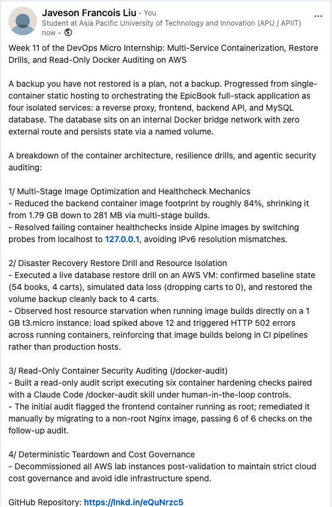

---

# Submission Instructions

- Add all required screenshots in your submission
- Full name must be visible in required screenshots
- Do not expose sensitive information

---

# Completion Checklist

- [x] Task 1: `.dockerignore` created (Screenshot 1)
- [x] Task 2: Single-stage image built and verified (Screenshots 2–3)
- [x] Task 3: Multi-stage image built and verified (Screenshots 4–5)
- [x] Task 4: Image sizes compared (Screenshot 6)
- [x] Task 5: Analysis written (Screenshot 7 & Notes)
- [x] Task 6: Optional production optimizations explored
- [x] No sensitive information exposed

---

## 📌 About DMI & CloudAdvisory

DevOps Micro Internship (DMI) is a project-based DevOps program run by Pravin Mishra (The CloudAdvisory) focused on real-world execution, systems thinking, and career readiness.

It helps learners build strong DevOps foundations with hands-on experience.

---

## 📌 Resources

- 🌐 DMI Official Website: https://dmi.pravinmishra.com?utm_source=github&utm_medium=readme  
- 🎓 University: https://university.pravinmishra.com?utm_source=github&utm_medium=readme  
- 💬 Discord Community: https://discord.pravinmishra.com?utm_source=github&utm_medium=readme  
- 📝 Blog: https://dmi.pravinmishra.com/blog?utm_source=github&utm_medium=readme  
- ▶️ YouTube Playlist: https://www.youtube.com/playlist?list=PLFeSNDtI4Cho  
- 🔗 Pravin Mishra (LinkedIn): https://www.linkedin.com/in/pravin-mishra-aws-trainer/  
- 🏢 CloudAdvisory (LinkedIn): https://www.linkedin.com/company/thecloudadvisory/

---

*This submission is part of DevOps Micro Internship (DMI) — Agentic AI Track.*
