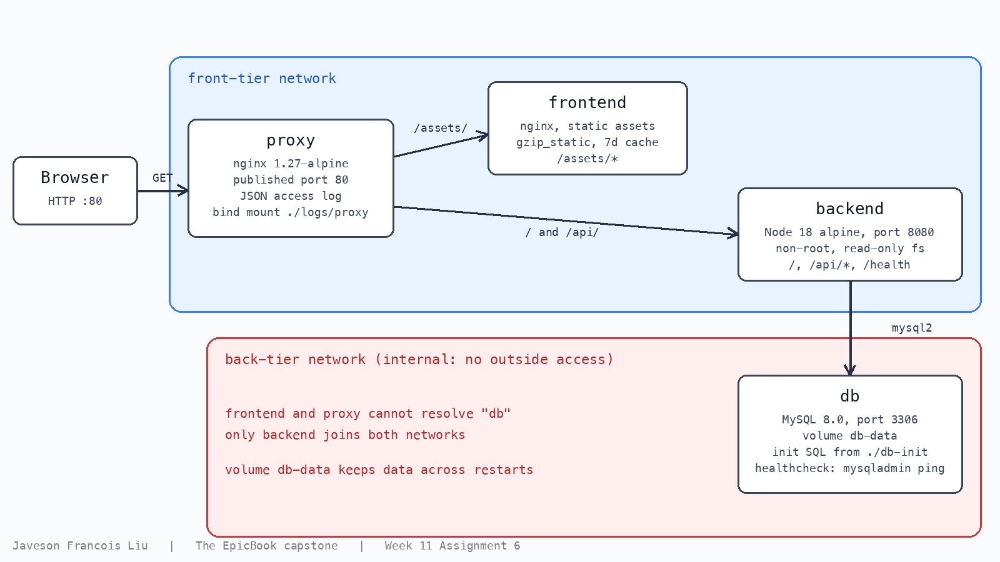
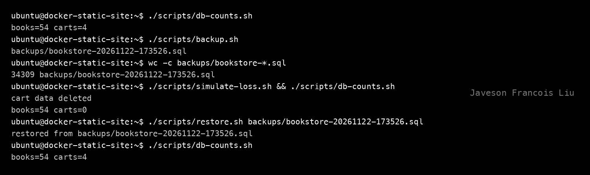
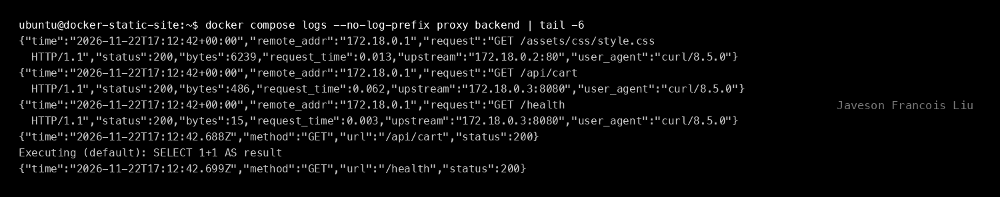
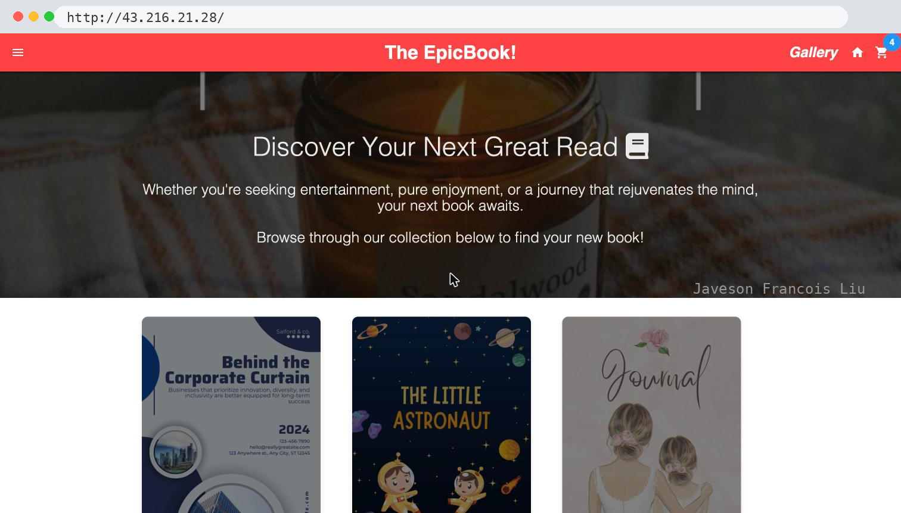
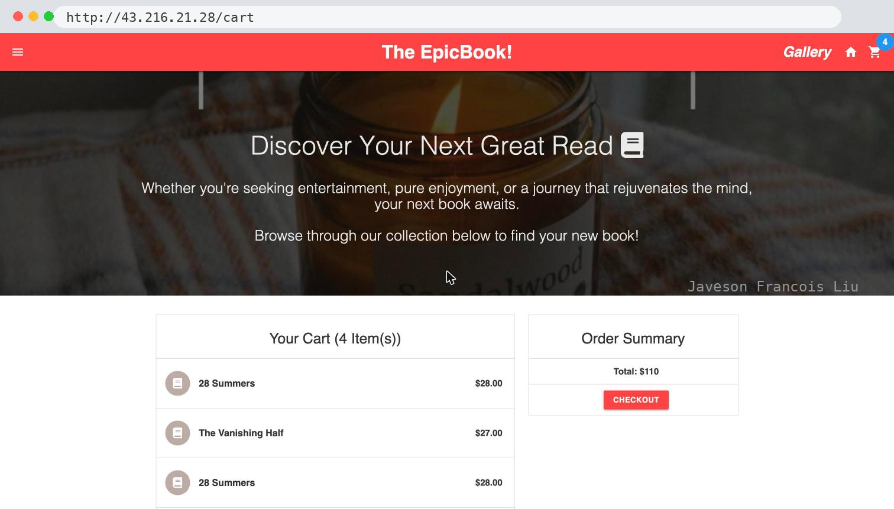
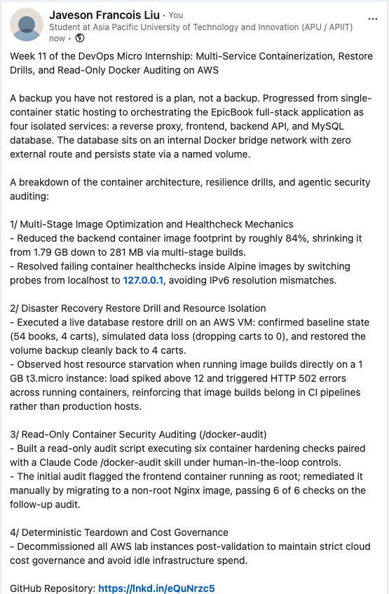

# Assignment 6 — Capstone: Deploy a Production-Grade Stack for The EpicBook

Part of the DevOps Micro Internship (DMI) with Agentic AI

---

## Purpose

In this capstone assignment, you will take the EpicBook application from source code to a fully hardened, production-ready Docker Compose deployment on a cloud VM: multi-stage Dockerfiles, network isolation, healthchecks, persistent volumes with a backup plan, structured logging, a secure reverse proxy, and an operations runbook — with an optional CI/CD pipeline.

---

# Task 0 — App Discovery & Architecture

## Goal

Explore the `theepicbook` repository, identify its components (UI, API, DB, workers), document required environment variables/ports/persistence paths, and draw a component architecture diagram.

### Evidence

#### Deliverable — `docs/01-architecture-diagram.png`



---

#### Deliverable — `docs/02-env-and-ports.md`

Source of truth: [`epicbook-capstone/docs/02-env-and-ports.md`](epicbook-capstone/docs/02-env-and-ports.md).

Components: Express app with server-side Handlebars UI, `/api/cart` API, MySQL `bookstore`. Required variables: `NODE_ENV`, `PORT`, `JAWSDB_URL`, `ALLOWED_ORIGINS`, `MYSQL_*`. Ports: 80 public (proxy), 8080 backend and 3306 db internal only. Persistence: volume `db-data`, bind mount `logs/proxy`, `backups/`.

---

# Task 1 — Multi-Stage Dockerfiles

## Goal

Create minimal multi-stage Dockerfiles for the frontend and backend services, with `.dockerignore` files to keep the build context lightweight.

### Evidence

#### Deliverable — `frontend/Dockerfile`, `backend/Dockerfile`, and `.dockerignore` files, with a note on layer optimizations and security benefits

Files: [`backend/Dockerfile`](epicbook-capstone/backend/Dockerfile), [`frontend/Dockerfile`](epicbook-capstone/frontend/Dockerfile), `backend/.dockerignore`, `frontend/.dockerignore`.

**`epicbook-capstone/backend/Dockerfile`**

```dockerfile
FROM node:18-alpine AS deps
WORKDIR /app
COPY app/package*.json ./
RUN npm ci --omit=dev

FROM node:18-alpine
ENV NODE_ENV=production \
    PORT=8080
WORKDIR /app
COPY --from=deps /app/node_modules ./node_modules
COPY --chown=node:node app/ ./
USER node
EXPOSE 8080
CMD ["node", "server.js"]
```

**`epicbook-capstone/frontend/Dockerfile`**

```dockerfile
FROM alpine:3.20 AS assets
WORKDIR /site
COPY site/ ./
RUN find . -type f \( -name '*.css' -o -name '*.js' -o -name '*.svg' \) -exec gzip -9 -k {} \;

FROM nginxinc/nginx-unprivileged:1.27-alpine
COPY nginx.conf /etc/nginx/conf.d/default.conf
COPY --from=assets /site /usr/share/nginx/html
EXPOSE 8080
USER 101
```

**Layer optimizations**

- Backend is multi-stage: `deps` runs `npm ci --omit=dev`, the runtime stage copies only `node_modules` and the app. No dev dependencies.
- `package.json` is copied before the source, so the dependency layer stays cached until dependencies change.
- Frontend: a build stage pre-compresses css, js and svg with `gzip -9 -k`, and nginx serves them with `gzip_static`.
- `.dockerignore` keeps `.git`, `node_modules`, logs and `.env` out of the build context.

**Security benefits**

- Alpine base images (`node:18-alpine`, `nginx:1.27-alpine`) give a small attack surface.
- The backend runs as the non-root `node` user, with a read-only root filesystem, `cap_drop: ALL` and `no-new-privileges`.
- No secret is baked into an image, values come from `.env` at runtime.

**Image sizes**

| Image | Size |
|---|---|
| Naive single-stage backend (`node:18`, `npm install`, copy everything) | 1.79 GB |
| `epicbook-backend:1.0` (multi-stage, alpine, production dependencies) | 281 MB |
| `epicbook-frontend:1.0` (nginx alpine plus static assets) | 141 MB |

Backend reduction: 1.79 GB to 281 MB, about 84% smaller (measured on my Mac; the amd64 build on the VM is 283 MB).

---

# Task 2 — Compose Stack & Networks

## Goal

Author `docker-compose.yml` defining the reverse-proxy, frontend, backend, and database services, isolated front-tier/back-tier networks, and named volumes.

### Evidence

#### Deliverable — `docker-compose.yml`

File: [`epicbook-capstone/docker-compose.yml`](epicbook-capstone/docker-compose.yml)

```yaml
name: epicbook

x-logging: &default-logging
  driver: json-file
  options:
    max-size: "10m"
    max-file: "3"

services:
  proxy:
    image: nginx:1.27-alpine
    ports:
      - "${HTTP_PORT:-80}:80"
    volumes:
      - ./proxy/nginx.conf:/etc/nginx/conf.d/default.conf:ro
      - ./logs/proxy:/var/log/nginx
    networks:
      - front-tier
    depends_on:
      frontend:
        condition: service_healthy
      backend:
        condition: service_healthy
    healthcheck:
      test: ["CMD", "wget", "-qO-", "http://127.0.0.1/healthz"]
      interval: 10s
      timeout: 3s
      retries: 5
    logging: *default-logging
    restart: unless-stopped

  frontend:
    build:
      context: ./frontend
    image: epicbook-frontend:1.0
    networks:
      - front-tier
    healthcheck:
      test: ["CMD", "wget", "-qO-", "http://127.0.0.1:8080/healthz"]
      interval: 10s
      timeout: 3s
      retries: 5
    logging: *default-logging
    restart: unless-stopped

  backend:
    build:
      context: ./backend
    image: epicbook-backend:1.0
    environment:
      NODE_ENV: production
      PORT: "8080"
      JAWSDB_URL: mysql://epicbook:${DB_PASSWORD}@db:3306/bookstore
      ALLOWED_ORIGINS: ${ALLOWED_ORIGINS:-http://localhost}
    networks:
      - front-tier
      - back-tier
    depends_on:
      db:
        condition: service_healthy
    healthcheck:
      test: ["CMD", "wget", "-qO-", "http://127.0.0.1:8080/health"]
      interval: 10s
      timeout: 3s
      retries: 5
      start_period: 15s
    read_only: true
    tmpfs:
      - /tmp
    cap_drop:
      - ALL
    security_opt:
      - no-new-privileges:true
    logging: *default-logging
    restart: unless-stopped

  db:
    image: mysql:8.0
    command: --default-authentication-plugin=mysql_native_password
    environment:
      MYSQL_ROOT_PASSWORD: ${MYSQL_ROOT_PASSWORD}
      MYSQL_DATABASE: bookstore
      MYSQL_USER: epicbook
      MYSQL_PASSWORD: ${DB_PASSWORD}
    volumes:
      - db-data:/var/lib/mysql
      - ./db-init:/docker-entrypoint-initdb.d:ro
    networks:
      - back-tier
    healthcheck:
      test: ["CMD-SHELL", "mysqladmin ping -h 127.0.0.1 -uroot -p\"$$MYSQL_ROOT_PASSWORD\" --silent"]
      interval: 10s
      timeout: 5s
      retries: 10
      start_period: 30s
    logging: *default-logging
    restart: unless-stopped

networks:
  front-tier:
  back-tier:
    internal: true

volumes:
  db-data:
```

The frontend Dockerfile shown is the final version after the Assignment 7 audit (non-root, port 8080); the live VM run for the screenshots was the earlier nginx:1.27-alpine frontend on port 80.

Networks: `front-tier` (proxy, frontend, backend) and `back-tier` (`internal: true`, backend and db). Volume: `db-data`.

---

# Task 3 — Healthchecks & Startup Order

## Goal

Add a database healthcheck, a `/health` endpoint check on the backend, and `depends_on` conditions checking `service_healthy`.

### Evidence

#### Deliverable — `docs/03-healthchecks-and-depends-on.md`

[`epicbook-capstone/docs/03-healthchecks-and-depends-on.md`](epicbook-capstone/docs/03-healthchecks-and-depends-on.md): db `mysqladmin ping`, backend `GET /health` (503 when the database is down), `depends_on` with `service_healthy` (db, then backend and frontend, then proxy).

---

# Task 4 — Reverse Proxy & CORS Config

## Goal

Configure Nginx or Traefik to route `/api` to the backend and `/` to the frontend, with an appropriate CORS allowlist on the backend.

### Evidence

#### Deliverable — `docs/04-proxy-routing-and-cors.md`

[`epicbook-capstone/docs/04-proxy-routing-and-cors.md`](epicbook-capstone/docs/04-proxy-routing-and-cors.md): `/api/` and `/` to the backend, `/assets/` to the frontend, runtime DNS resolution, CORS allowlist from `ALLOWED_ORIGINS`.

---

# Task 5 — Persistence & Backups

## Goal

Mount the database data directory to a named volume, document a snapshot/backup plan, and run a live snapshot restore drill.

### Evidence

#### Deliverable — `docs/05-persistence-and-backup.md`

[`epicbook-capstone/docs/05-persistence-and-backup.md`](epicbook-capstone/docs/05-persistence-and-backup.md): named volume `db-data`, `mysqldump` backup and restore scripts, live restore drill (carts 4, then 0, then 4).

---

#### Screenshot — System state before and after a manual snapshot restore cycle



---

# Task 6 — Logging & Observability

## Goal

Bind-mount the reverse proxy log directory to the host, redirect application logs to stdout or named volumes, and enable structured JSON logging where supported.

### Evidence

#### Deliverable — `docs/06-logging-layout.md`

[`epicbook-capstone/docs/06-logging-layout.md`](epicbook-capstone/docs/06-logging-layout.md): proxy JSON log bind-mounted to `logs/proxy`, backend JSON request log on stdout, json-file rotation 10m x 3.

---

#### Screenshot — Live running JSON container log entries



---

# Task 7 — Cloud Deployment (AWS or Azure)

## Goal

Provision a VM per the security requirements (SSH restricted to your IP; HTTP/HTTPS open), install Docker, and bring the full stack up with a working public URL.

### Evidence

#### Deliverable — `docs/07-cloud-deployment-notes.md` (ports, firewall rules, deployment link)

[`epicbook-capstone/docs/07-cloud-deployment-notes.md`](epicbook-capstone/docs/07-cloud-deployment-notes.md): AWS EC2 t3.micro at `43.216.21.28`, SSH from my IP only, HTTP 80 open, deploy commands.

---

#### Screenshot — Browser showing successful web UI retrieval via the cloud public IP



---

#### Screenshot — Active page interaction confirming backend API data fetches succeed



---

# Task 8 — CI/CD Pipeline (Optional)

## Goal

Build a pipeline (Azure Pipelines or GitHub Actions) that builds and tags multi-stage images and automates deployment via SSH restart steps.

### Evidence

#### Deliverable — `docs/08-ci-cd-pipeline.md`

[`epicbook-capstone/docs/08-ci-cd-pipeline.md`](epicbook-capstone/docs/08-ci-cd-pipeline.md): optional task, not built. The file records the planned GitHub Actions design.

---

#### Screenshot (optional) — Completed automated pipeline run

Not applicable, the optional pipeline was not built.

---

# Task 9 — Reliability Tests & Ops Runbook

## Goal

Inject faults (drop backend/database dependencies) and evaluate frontend error handling, then write an operations runbook covering startup, shutdown, secret rotation, and disaster recovery.

### Evidence

#### Deliverable — `docs/09-runbook.md`

[`epicbook-capstone/docs/09-runbook.md`](epicbook-capstone/docs/09-runbook.md): start, stop, restart, secret rotation, disaster recovery, where to look.

---

#### Deliverable — `docs/10-reliability-tests.md`

[`epicbook-capstone/docs/10-reliability-tests.md`](epicbook-capstone/docs/10-reliability-tests.md): backend stop (502, assets 200), database stop (503 health, backend stays up), network isolation, restore, memory exhaustion.

---

# LinkedIn Post (Required)

## Goal

Publish a 6–10 line LinkedIn post covering the architectural decision that most improved reliability, the biggest image size reduction achieved (with numbers), and your key production-hardening takeaways.

## Evidence

#### LinkedIn Post URL

Paste your LinkedIn post URL here:

https://www.linkedin.com/posts/javeson-francois-liu-999135437_dmibypravinmishra-devops-docker-share-7531361148256956416-zOE3/

---

#### Screenshot — Published LinkedIn post showing the text body and a deployment verification image



---

# Submission Instructions

- Add all required deliverables, screenshots, and links in your submission
- Full name must be visible in required screenshots
- Do not expose passwords, API tokens, cloud account IDs, or private keys

---

# Completion Checklist

- [x] Task 0: Architecture diagram and env/ports doc completed
- [x] Task 1: Multi-stage Dockerfiles and `.dockerignore` files created
- [x] Task 2: `docker-compose.yml` with isolated networks and volumes authored
- [x] Task 3: Healthchecks and `depends_on` conditions configured
- [x] Task 4: Reverse proxy routing and CORS configured
- [x] Task 5: Persistence and backup plan tested (Screenshot)
- [x] Task 6: Logging and observability configured (Screenshot)
- [x] Task 7: Cloud deployment live and verified (Screenshots)
- [ ] Task 8: CI/CD pipeline built (optional)
- [x] Task 9: Reliability tests and runbook completed
- [ ] LinkedIn post published and URL submitted
- [x] No sensitive information exposed
- [x] VM torn down after grading to avoid unexpected charges

---

## 📌 About DMI & CloudAdvisory

DevOps Micro Internship (DMI) is a project-based DevOps program run by Pravin Mishra (The CloudAdvisory) focused on real-world execution, systems thinking, and career readiness.

It helps learners build strong DevOps foundations with hands-on experience.

---

## 📌 Resources

- 🌐 DMI Official Website: https://dmi.pravinmishra.com?utm_source=github&utm_medium=readme  
- 🎓 University: https://university.pravinmishra.com?utm_source=github&utm_medium=readme  
- 💬 Discord Community: https://discord.pravinmishra.com?utm_source=github&utm_medium=readme  
- 📝 Blog: https://dmi.pravinmishra.com/blog?utm_source=github&utm_medium=readme  
- ▶️ YouTube Playlist: https://www.youtube.com/playlist?list=PLFeSNDtI4Cho  
- 🔗 Pravin Mishra (LinkedIn): https://www.linkedin.com/in/pravin-mishra-aws-trainer/  
- 🏢 CloudAdvisory (LinkedIn): https://www.linkedin.com/company/thecloudadvisory/

---

*This submission is part of DevOps Micro Internship (DMI) — Agentic AI Track.*
