# Assignment 6 — Deploy the Book Review App with Docker Compose

Part of the DevOps Micro Internship (DMI) with Agentic AI

---

## Purpose

In this assignment, you will deploy the Book Review Application with Docker Compose using MySQL, a backend API, and a frontend user interface. You will configure health-gated startup, browser-facing API access, CORS, and persistent MySQL storage.

---

# Task 1 — Prepare the Project

## Goal

Prepare your fork of the Book Review App repository for Docker Compose deployment.

### Evidence

#### Screenshot 1 — Project Structure

Add a screenshot showing the project structure containing:

```text
frontend/
backend/
.env.example
.gitignore
docker-compose.yml
```

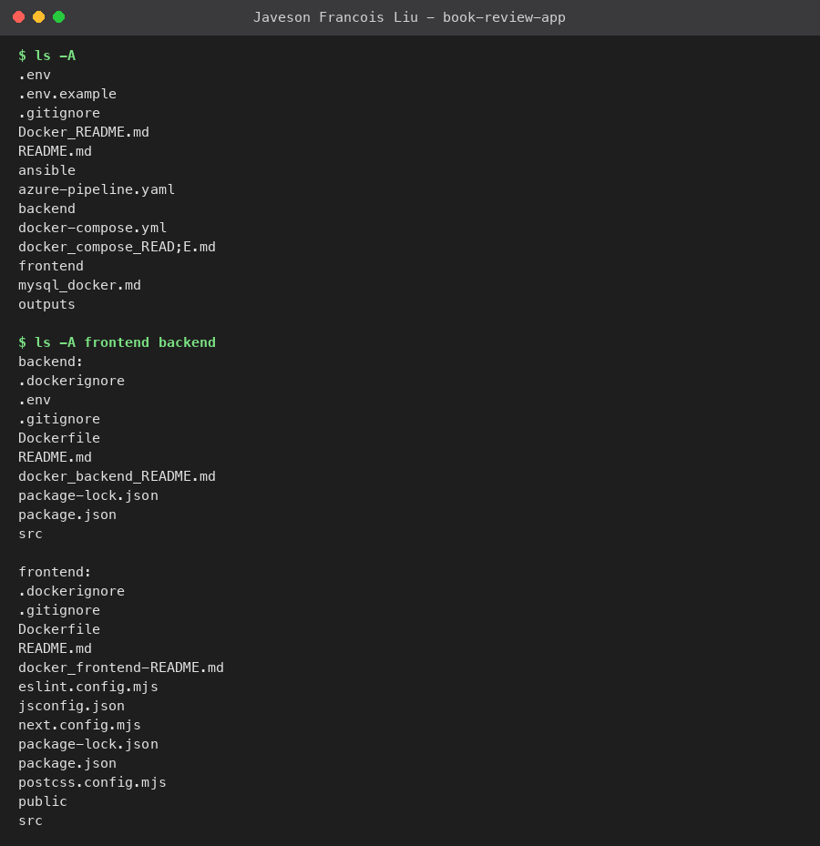

*Project tree from the repository root and the frontend and backend folders (rendered from real `ls` output).*

---

#### Screenshot 2 — Environment and Docker Ignore Files

Add a screenshot showing the contents of:

```text
.env.example
.gitignore
frontend/.dockerignore
backend/.dockerignore
```

Ensure that no real passwords, tokens, or secrets are visible.

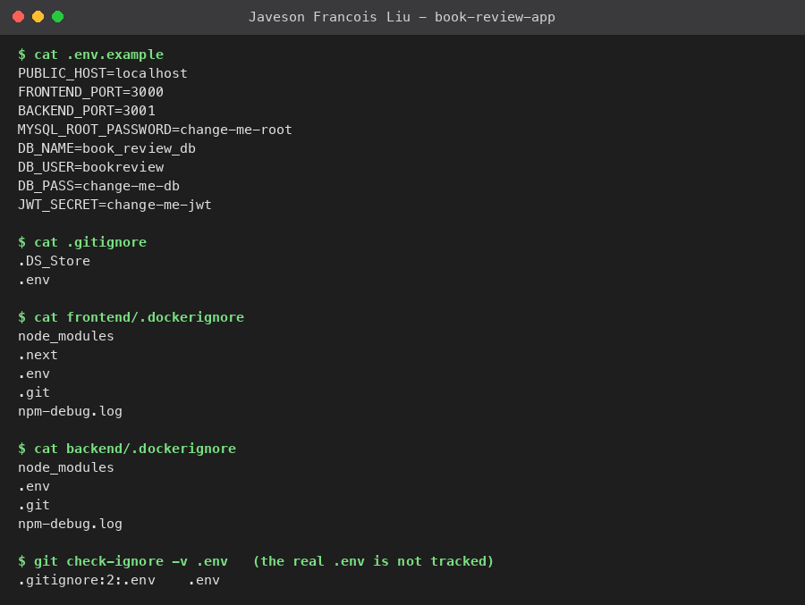

*The real `.env` is gitignored; only `.env.example` with `change-me` placeholders is tracked.*

---

# Task 2 — Create or Confirm Application Dockerfiles

## Goal

Prepare Dockerfiles for the frontend and backend services and build both services through Docker Compose.

### Evidence

#### Screenshot 3 — Frontend Dockerfile

Add a screenshot showing the completed `frontend/Dockerfile`.

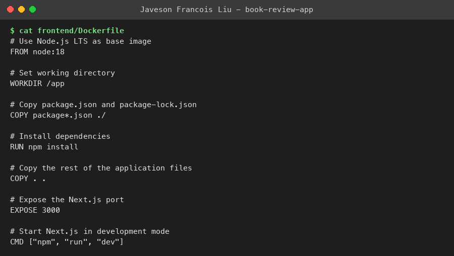

*`node:18` image, `npm install`, dev server on port 3000.*

---

#### Screenshot 4 — Backend Dockerfile

Add a screenshot showing the completed `backend/Dockerfile`.

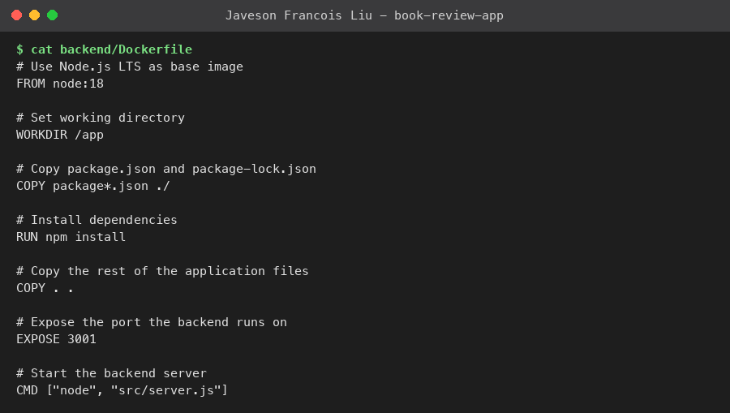

*`node:18` image, `npm install`, `node src/server.js`.*

---

#### Screenshot 5 — Docker Compose Build

Add a screenshot of the terminal showing successful completion of:

```bash
docker compose build
```

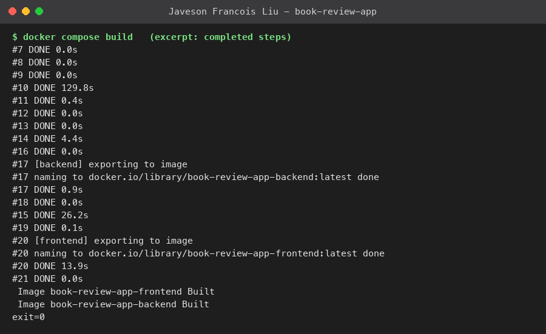

*Both images built with exit code 0 (excerpt of the real build output).*

---

# Task 3 — Create the Docker Compose Stack

## Goal

Create one `docker-compose.yml` file that builds and runs MySQL, backend, and frontend services.

### Evidence

#### Screenshot 6 — MySQL Service, Health Check, and Volume Mount

Add a screenshot showing the MySQL service in `docker-compose.yml`, including:

- MySQL image
- Environment variables
- MySQL health check
- `mysql_data` volume mount
- No published MySQL port

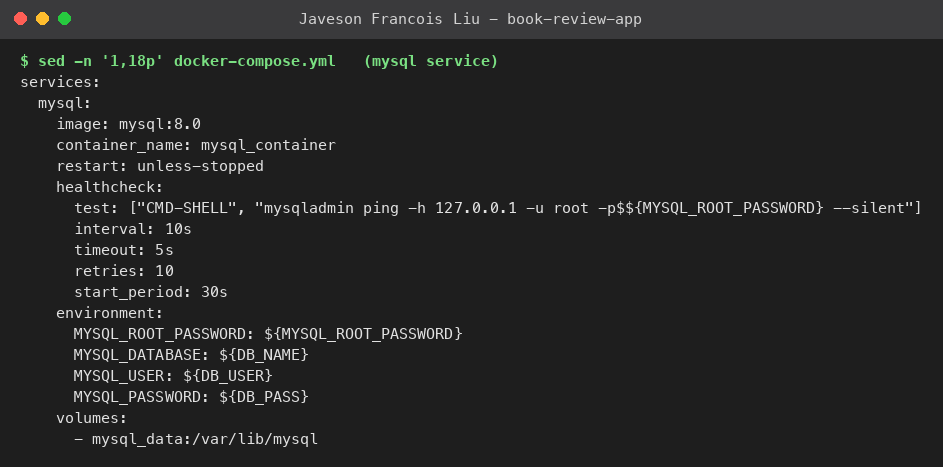

*`mysql:8.0`, health check with `mysqladmin ping`, `mysql_data` volume, no `ports` entry so 3306 is not published.*

---

#### Screenshot 7 — Backend Configuration

Add a screenshot showing the backend service configuration, including:

- `depends_on` with `condition: service_healthy`
- Database host set to `mysql`
- Browser frontend origin configured for CORS
- Published backend port

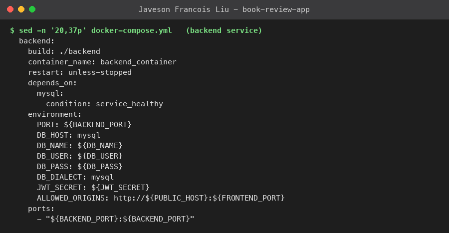

*`depends_on` with `service_healthy`, `DB_HOST: mysql`, `ALLOWED_ORIGINS` built from the frontend origin, backend published on 3001.*

---

#### Screenshot 8 — Frontend Configuration

Add a screenshot showing the frontend service configuration, including:

- Published frontend port
- `depends_on` for the backend service
- Browser-facing `NEXT_PUBLIC_API_URL`

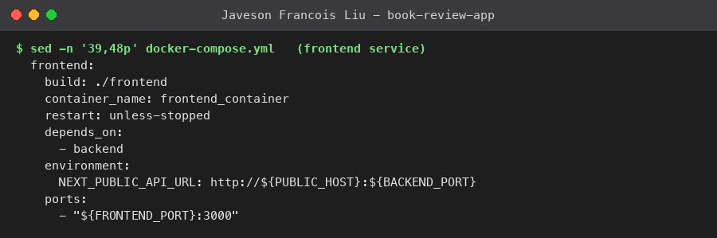

*`NEXT_PUBLIC_API_URL` points at the browser-facing backend address, frontend published on 3000.*

---

#### Screenshot 9 — Named Volume Definition

Add a screenshot showing the `mysql_data` volume definition in `docker-compose.yml`.

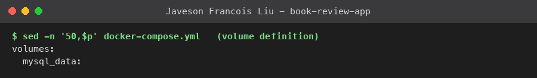

*Top-level `volumes:` block declaring `mysql_data`.*

---

# Task 4 — Start and Verify the Stack

## Goal

Build and start all services through one Docker Compose workflow.

### Evidence

#### Screenshot 10 — Docker Compose Service Status

Add a screenshot of the terminal showing:

```bash
docker compose ps
```

The output must show the MySQL, backend, and frontend services running. MySQL must show as healthy.

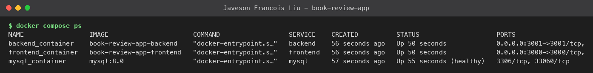

*All three services up, `mysql_container` shown as healthy.*

---

#### Screenshot 11 — MySQL and Backend Logs

Add a screenshot of the terminal showing:

```bash
docker compose logs mysql backend --tail=50
```

The logs must show MySQL readiness and successful backend database connection.

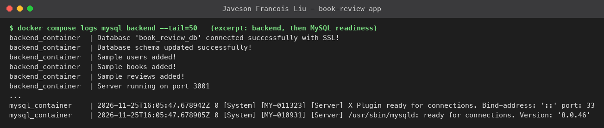

*MySQL ready for connections, then the backend log line `connected successfully with SSL!` (emoji characters removed in the render).*

---

# Task 5 — Test End-to-End Application Functionality

## Goal

Verify that the Book Review App works through the browser.

### Evidence

#### Screenshot 12 — Successful Registration or Login

Add a browser screenshot showing successful user registration or login.

Add your full name as a clear caption directly below the screenshot.

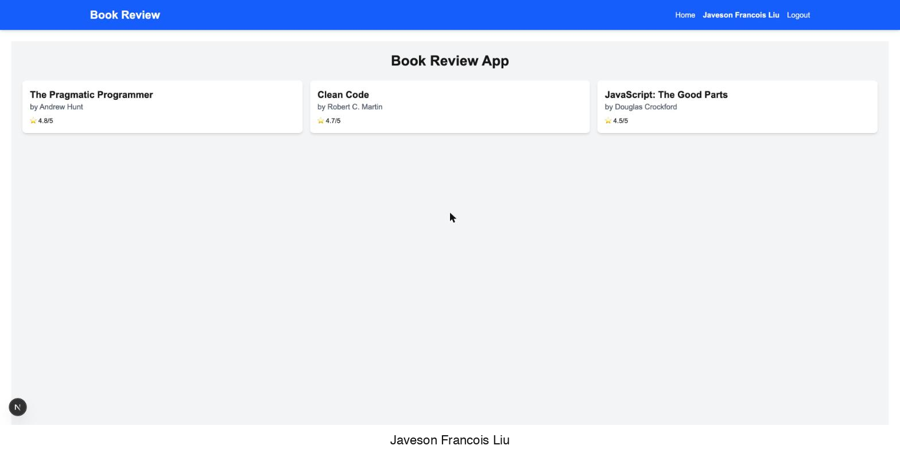

**Javeson Francois Liu**

*Logged in as the registered user; the header shows the name and a Logout button.*

---

#### Screenshot 13 — Created Book Review

Add a browser screenshot showing a created book review visible in the application.

Add your full name as a clear caption directly below the screenshot.


**Javeson Francois Liu**

*The new review on the book page, created through the browser.*

---

#### Screenshot 14 — CORS Verification

Add a browser developer-tools screenshot with:

- The Network tab showing a successful API request
- The Console drawer showing no CORS error after the API interaction

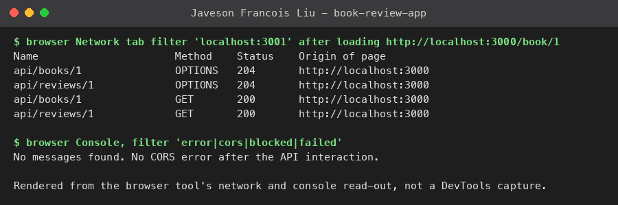

*Rendered from the browser tool's network and console read-out, not a DevTools capture: preflight OPTIONS 204 and GET 200 from origin `http://localhost:3000`, and no CORS error in the console.*

---

# Task 6 — Prove MySQL Data Persistence

## Goal

Verify that MySQL data remains after a non-destructive Docker Compose down/up cycle.

### Evidence

#### Screenshot 15 — Data Before Restart

Add a browser screenshot showing the registered user or created review before the down/up cycle.

Add your full name as a clear caption directly below the screenshot.


**Javeson Francois Liu**

*Same review before the restart.*

---

#### Screenshot 16 — Non-Destructive Stack Restart

Add a screenshot of the terminal showing the non-destructive shutdown and restart:

```bash
docker compose down
docker compose up -d
docker compose ps
```

Do not use `docker compose down -v`.

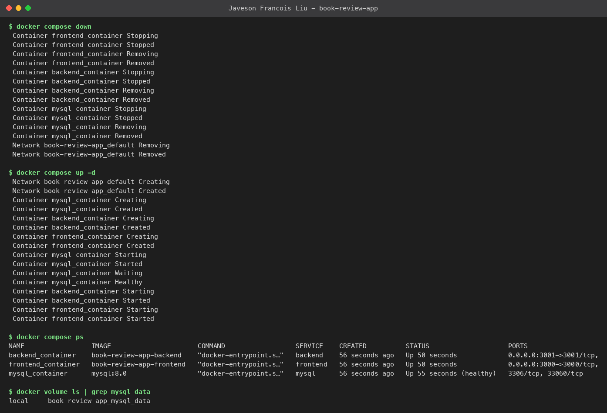

*`docker compose down` (no `-v`), `up -d`, `ps`, and `docker volume ls` showing `mysql_data` kept.*

---

#### Screenshot 17 — Data After Restart

Add a browser screenshot showing the same registered user or review after the stack restarts.

Add your full name as a clear caption directly below the screenshot.

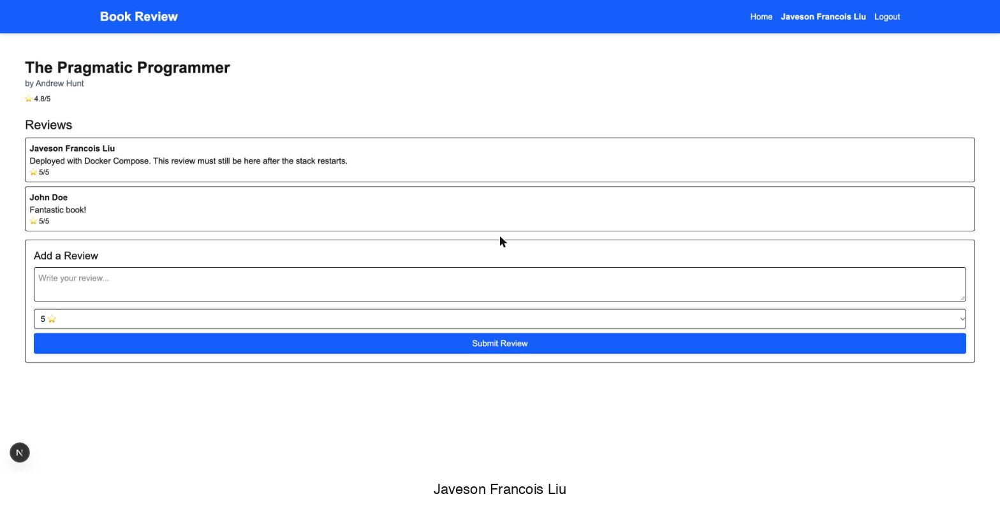

**Javeson Francois Liu**

*The same review is still present after the restart.*

---

# Task 7 — Explain Docker Compose Teardown Modes

## Goal

Explain the difference between preserving data and fully resetting a Docker Compose environment.

### Notes

Write a short explanation of 5–8 lines covering:

- What `docker compose down` removes and preserves
- Why named volumes should be kept when preserving MySQL data
- What happens when named volumes are removed
- When a full reset is useful
- Why a full reset must not be used before persistence evidence is captured

`docker compose down` stops and removes the containers and the default network, but it keeps named volumes and images, so the MySQL files in `mysql_data` survive. Keeping the named volume is what lets a new MySQL container start with the same users and reviews. `docker compose down -v` also deletes the named volumes, so the database starts empty on the next `up`. A full reset is useful when the schema or seed data is broken, or to prove a clean first-run from scratch. It must not be run before the persistence evidence is captured, because it would destroy the very data the test needs to show survives. The restart evidence in this submission used `down` and `up -d` only, never `-v`.

---

# Findings

- The upstream `frontend/src/services/api.js` built `API_URL` without the `/api` prefix, so registration returned 404. One-line fix: `const API_URL = \`${process.env.NEXT_PUBLIC_API_URL || "http://localhost:3001"}/api\`;`
- The backend requires SSL to MySQL with `rejectUnauthorized: false`, which the MySQL 8 self-signed certificate satisfies.
- The frontend runs in `npm run dev` mode, as in the supplied Dockerfile.
- Screenshots 1 to 11 and 16 are rendered from real command output and project files; browser screenshots 12, 13, 15 and 17 are real captures with a name caption added.

---

# Final Public Frontend URL

**Frontend URL:** `http://localhost:3000`

This stack ran locally in Docker Desktop (no cloud VM), so the public host is `localhost` (`PUBLIC_HOST=localhost`). The backend is on `http://localhost:3001`. Frontend and backend use the same host variable, so on a VM only `PUBLIC_HOST` in `.env` changes.

---

# GitHub Repository URL

**Your Fork or Repository URL:** https://github.com/javesonfrancoisliu/devops-micro-internship-pravinmishra/tree/main/week-11-docker/book-review-app

The Compose project (frontend, backend, `docker-compose.yml`, `.env.example`) is committed in this repository. The real `.env` is not committed.

---

# LinkedIn Requirement

## Goal

Create a LinkedIn post about the Book Review App deployment and what you learned from using Docker Compose.

### Evidence

**LinkedIn Post URL:** https://www.linkedin.com/posts/javeson-francois-liu-999135437_dmibypravinmishra-devops-docker-share-7531544819219750912-_KQH/

#### LinkedIn Post Screenshot

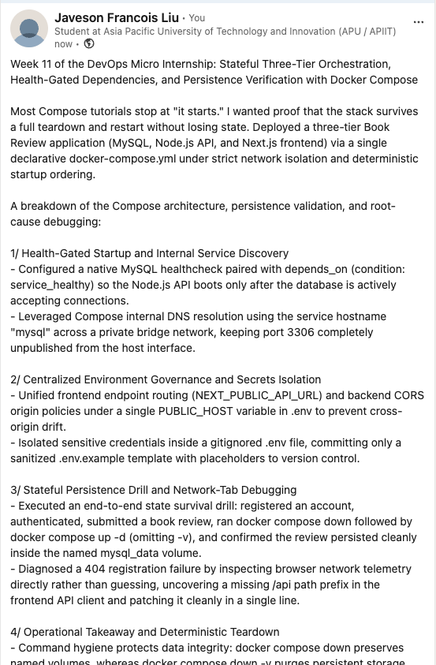

The screenshot shows the author name and the opening of the post (health-gated startup, secrets isolation, persistence drill). The full text continues below the fold on LinkedIn.

---

# Submission Checklist

- [x] Book Review App repository forked and used
- [x] `.env` excluded from Git tracking
- [x] `.env.example` contains only safe placeholder values
- [x] Frontend and backend Dockerfiles created or confirmed
- [x] MySQL health check configured
- [x] Backend waits for healthy MySQL
- [x] Backend uses `mysql` as the database hostname
- [x] Frontend API URL uses the public host and backend port (localhost for this local run)
- [x] Backend CORS origin matches the frontend origin
- [x] MySQL port 3306 is not publicly exposed
- [x] Registration and login work
- [x] Book review creation works
- [x] Data persists after a non-destructive down/up cycle
- [x] Screenshots 1–17 included
- [x] Teardown explanation completed
- [x] Public frontend URL included
- [x] GitHub repository URL included
- [x] LinkedIn post URL and screenshot included
- [x] Full name visible in required terminal screenshots
- [x] Browser screenshots include a full-name caption
- [x] No sensitive information exposed

---

## 📌 About DMI & CloudAdvisory

DevOps Micro Internship (DMI) is a project-based DevOps program run by Pravin Mishra (The CloudAdvisory) focused on real-world execution, systems thinking, and career readiness.

It helps learners build strong DevOps foundations with hands-on experience.

---

## 📌 Resources

- 🌐 DMI Official Website: https://dmi.pravinmishra.com?utm_source=github&utm_medium=readme  
- 🎓 University: https://university.pravinmishra.com?utm_source=github&utm_medium=readme  
- 💬 Discord Community: https://discord.pravinmishra.com?utm_source=github&utm_medium=readme  
- 📝 Blog: https://dmi.pravinmishra.com/blog?utm_source=github&utm_medium=readme  
- ▶️ YouTube Playlist: https://www.youtube.com/playlist?list=PLFeSNDtI4Cho  
- 🔗 Pravin Mishra (LinkedIn): https://www.linkedin.com/in/pravin-mishra-aws-trainer/  
- 🏢 CloudAdvisory (LinkedIn): https://www.linkedin.com/company/thecloudadvisory/

---

*This submission is part of DevOps Micro Internship (DMI) — Agentic AI Track.*
