# Assignment 7 — AI-Assisted Docker Container Hardening Audit

Part of the DevOps Micro Internship (DMI) with Agentic AI

---

## Purpose

In this assignment, you will build a read-only Bash script that audits a running Docker container for common hardening gaps — running as root, missing health checks, unpinned image tags, privileged mode, and unnecessary exposed ports — then connect that script to Claude Code as a reusable `/docker-audit` skill. You will run the audit against your production-grade EpicBook stack, fix what it finds by editing the Dockerfile yourself, rebuild the image, and re-run the audit to prove the fix worked. Claude analyzes evidence and recommends a fix; it never edits your Dockerfile or rebuilds the image itself.

---

# Task 1 — Confirm the Running Stack and Create the Workspace

## Goal

Confirm your production-grade EpicBook containers from this week's capstone are currently running, note the exact name of your application container, and set up a project workspace for the audit.

### Evidence

#### Screenshot 1 — `docker ps` showing your running EpicBook application container

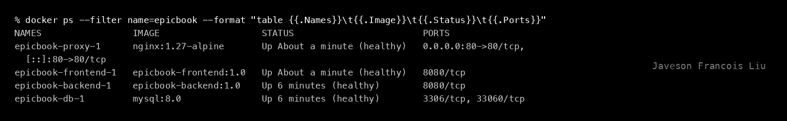

---

# Task 2 — Create Project Context and Safety Rules in CLAUDE.md

## Goal

Create a `CLAUDE.md` in your workspace that tells Claude this project only ever gathers container evidence and recommends a Dockerfile fix — it must never run `docker build`, `docker rm`, `docker stop`, `docker rmi`, or edit the Dockerfile itself.

### Evidence

#### Screenshot 2 — `CLAUDE.md` open in VS Code showing the project overview, hardening workflow, and safety rules

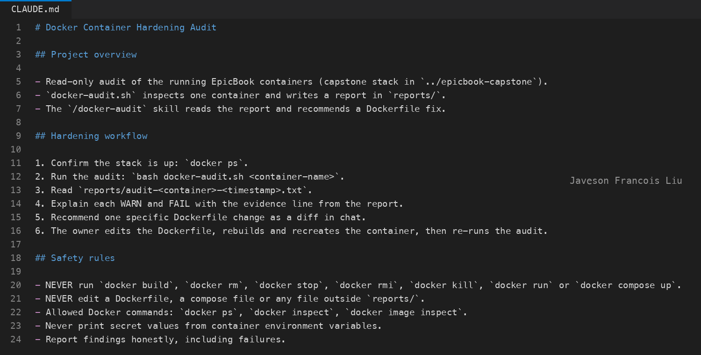

---

# Task 3 — Use Agentic AI to Plan Before Writing the Script

## Goal

Ask Claude Code to inspect your running container using only read-only Docker commands and propose a six-check hardening audit plan, without creating or editing any file.

### Evidence

#### Screenshot 3 — Claude's proposed audit plan and read-only inspection

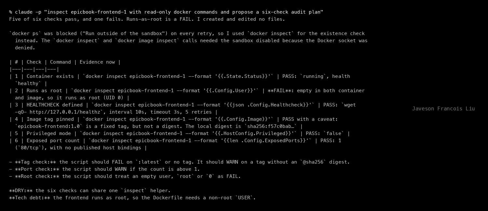

---

# Task 4 — Build the Docker Hardening Audit Script

## Goal

Write a Bash script that runs `docker inspect` and `docker image inspect` against your target container and checks: the container exists, whether it runs as root, whether a `HEALTHCHECK` is defined, whether the image tag is pinned instead of `:latest`, whether the container runs in privileged mode, and how many ports it exposes. The script must be strictly read-only and must produce a report file with a clear pass/warning/failure summary.

### Evidence

#### Screenshot 4 — Your audit script open in an editor, showing the six check functions

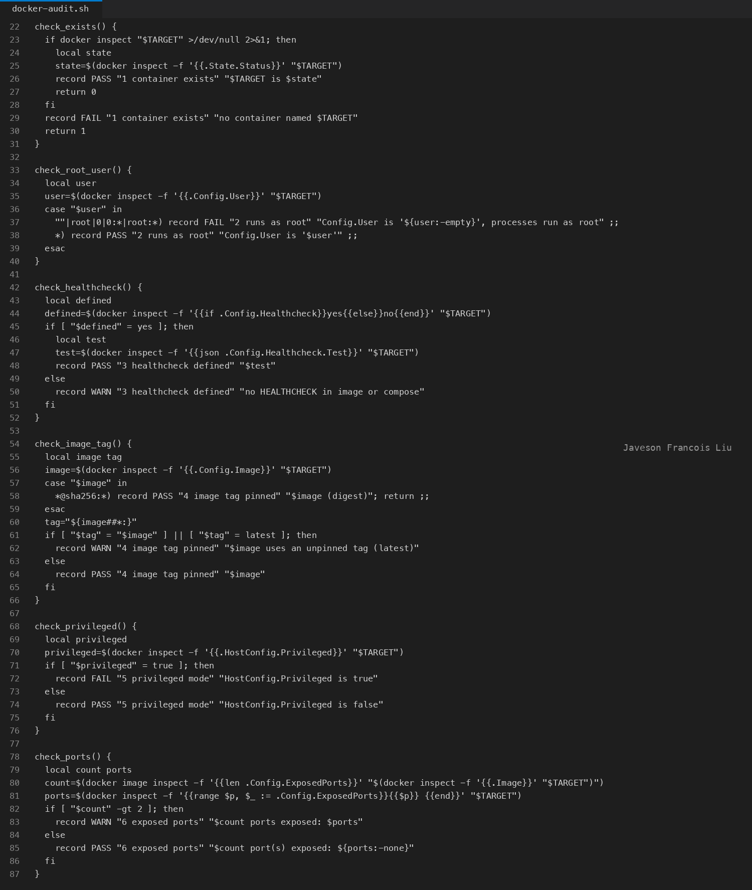

---

#### Screenshot 5 — Terminal output of `bash -n` confirming the script has no syntax errors, and `ls -l` showing it is executable

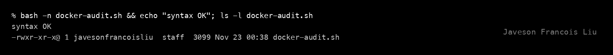

---

# Task 5 — Run the Audit Against Your Current Container

## Goal

Run the script against your running EpicBook container and record the results honestly, even if one or more checks fail — most first-time containers fail at least one (commonly: no `USER` directive, no `HEALTHCHECK`, or a `:latest` tag).

### Evidence

#### Screenshot 6 — Script output showing your Full Name and all six check results

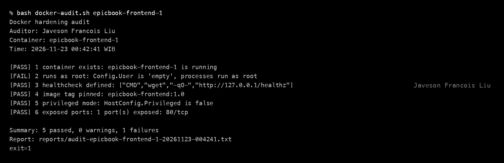

---

# Task 6 — Create and Run the /docker-audit Skill

## Goal

Turn the script into a Claude Code skill restricted to read-only tools, and run `/docker-audit` to confirm Claude reads the report, explains each finding with evidence, and recommends a specific Dockerfile fix — without modifying anything itself.

### Evidence

#### Screenshot 7 — `SKILL.md` frontmatter showing the tool restrictions and safety rules

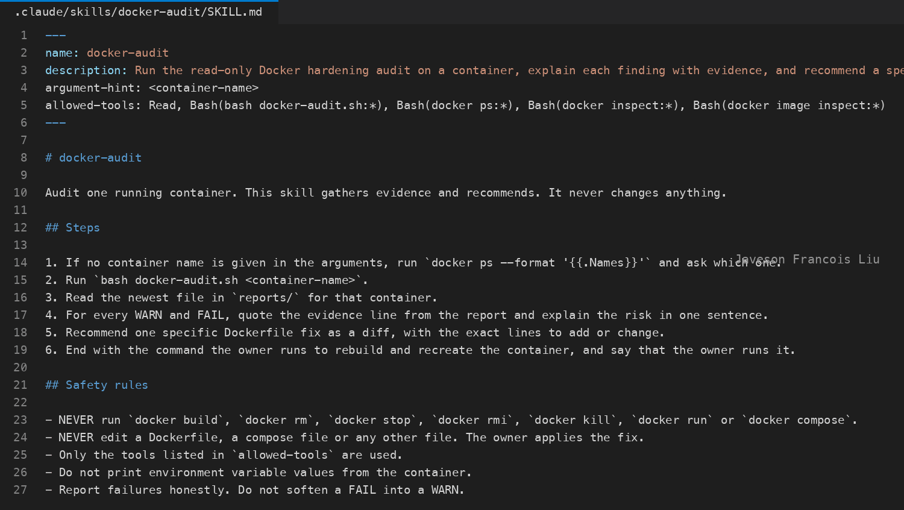

---

#### Screenshot 8 — `/docker-audit` output showing the findings and Claude's recommended fix

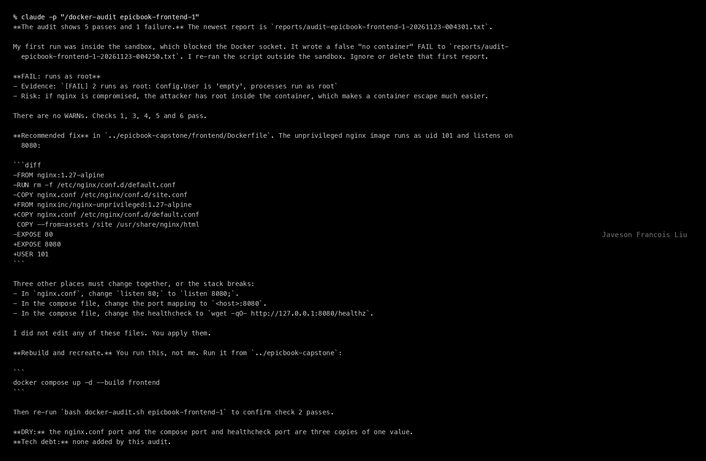

---

# Task 7 — Fix the Findings, Rebuild, and Verify

## Goal

Edit your Dockerfile to apply Claude's recommendation, rebuild the image, recreate the container, and re-run `/docker-audit` to prove the previously failing check now passes.

### Evidence

#### Screenshot 9 — Your edited Dockerfile line(s) showing the fix

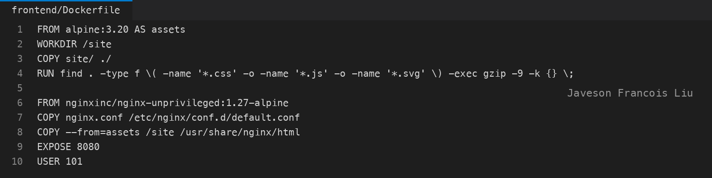

---

#### Screenshot 10 — `docker build` and `docker run` succeeding with the rebuilt image

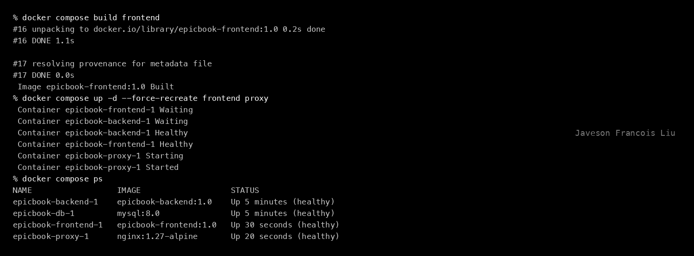

---

#### Screenshot 11 — Second `/docker-audit` run showing the previously failed check now passing

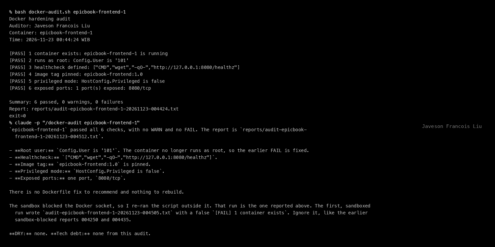

---

### Notes

In one paragraph, explain why the `/docker-audit` skill is allowed to gather evidence and recommend a Dockerfile fix, but is never allowed to edit the Dockerfile or rebuild the image itself.

The skill gathers evidence and recommends, but never changes anything, because a hardening audit must be safe to run at any time on any container. Its `allowed-tools` list only permits `docker ps`, `docker inspect`, `docker image inspect`, the audit script and reading files, so it cannot build, stop, remove or edit even if it tried, and `CLAUDE.md` repeats the rule in words. Keeping the decision with the owner matters because a Dockerfile fix has side effects Claude cannot see from inspect output alone: here the non-root nginx image also moved the port from 80 to 8080, which meant changing the frontend config, the compose healthcheck and the proxy upstream together, and the owner reviews and applies that as one change. Separating evidence from action also keeps a mistaken or injected recommendation from damaging a running service.

**Run notes (honest record)**

- Target container: `epicbook-frontend-1`. The backend already runs as the non-root `node` user. The frontend, proxy and db containers run as root by default.
- The `claude -p` runs happened inside a sandbox that blocks the Docker socket. The skill noticed, re-ran the script outside it, and reported the earlier sandboxed reports as false results. Those extra reports are git-ignored.
- The Dockerfile edit, rebuild and recreate were done by me, not by the skill. The recommendation also required `listen 8080` in `frontend/nginx.conf`, the healthcheck port in `docker-compose.yml`, and `frontend:8080` in `proxy/nginx.conf`.
- Screenshot 10 shows the end of the build output only (last lines), and the `docker compose ps` list is as returned after recreate.
- Files: [`docker-audit/docker-audit.sh`](docker-audit/docker-audit.sh), [`docker-audit/CLAUDE.md`](docker-audit/CLAUDE.md), [`docker-audit/.claude/skills/docker-audit/SKILL.md`](docker-audit/.claude/skills/docker-audit/SKILL.md).

---

# Submission Instructions

Complete all tasks in sequence.

Your submission must include:
- All 11 required screenshots
- Full name must be visible in required screenshots
- Do not expose Docker Hub credentials or cloud account IDs

---

# Completion Checklist

- [ ] Task 1: EpicBook container confirmed running (Screenshot 1)
- [ ] Task 2: `CLAUDE.md` created with hardening workflow and safety rules (Screenshot 2)
- [ ] Task 3: Claude produced a read-only six-check audit plan (Screenshot 3)
- [ ] Task 4: Audit script built and validated (Screenshots 4–5)
- [ ] Task 5: Script run against the live container, results recorded honestly (Screenshot 6)
- [ ] Task 6: `/docker-audit` skill created and run (Screenshots 7–8)
- [ ] Task 7: Dockerfile fixed, image rebuilt, and fix verified (Screenshots 9–11)
- [ ] Reflection answered (Notes)
- [ ] No sensitive data exposed

---

## 📌 About DMI & CloudAdvisory

DevOps Micro Internship (DMI) is a project-based DevOps program run by Pravin Mishra (The CloudAdvisory) focused on real-world execution, systems thinking, and career readiness.

It helps learners build strong DevOps foundations with hands-on experience.

---

## 📌 Resources

- 🌐 DMI Official Website: https://dmi.pravinmishra.com?utm_source=github&utm_medium=readme  
- 🎓 University: https://university.pravinmishra.com?utm_source=github&utm_medium=readme  
- 💬 Discord Community: https://discord.pravinmishra.com?utm_source=github&utm_medium=readme  
- 📝 Blog: https://dmi.pravinmishra.com/blog?utm_source=github&utm_medium=readme  
- ▶️ YouTube Playlist: https://www.youtube.com/playlist?list=PLFeSNDtI4Cho  
- 🔗 Pravin Mishra (LinkedIn): https://www.linkedin.com/in/pravin-mishra-aws-trainer/  
- 🏢 CloudAdvisory (LinkedIn): https://www.linkedin.com/company/thecloudadvisory/

---

*This submission is part of DevOps Micro Internship (DMI) — Agentic AI Track.*
