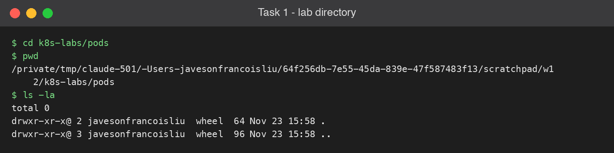
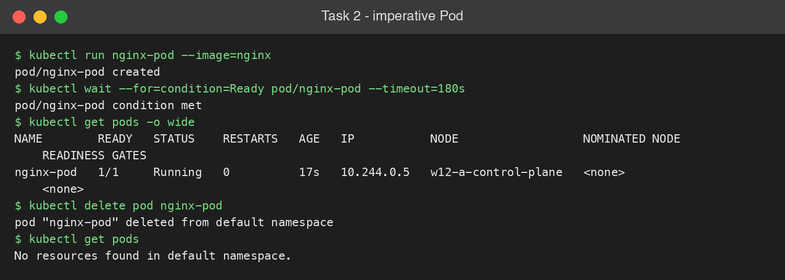
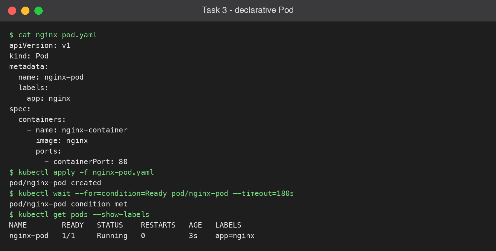
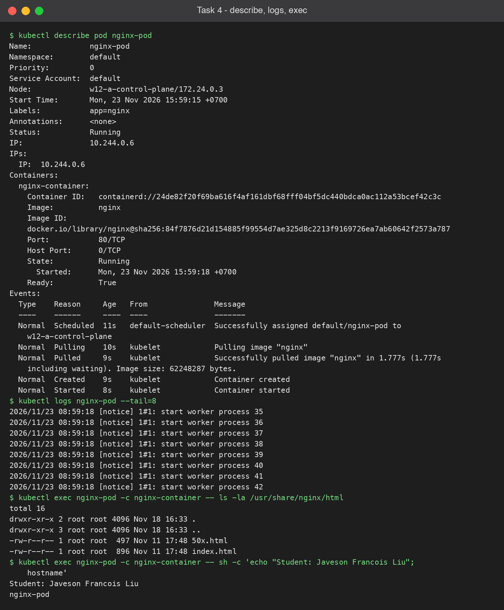

# Assignment 1 — Creating Your First Pod in Kubernetes

Part of the DevOps Micro Internship (DMI) with Agentic AI

---

## Purpose

In this guided lab, you will create an NGINX Pod first imperatively with `kubectl run`, then declaratively with a YAML manifest, and practice inspecting, logging into, and executing commands inside the Pod.

---

# Task 1 — Set Up Your Lab Folder

## Goal

Create the `~/k8s-labs/pods` working directory for all Pod-related files.

### Evidence

#### Screenshot 1 — Terminal showing the `~/k8s-labs/pods` working directory



Commands run:

```bash
mkdir -p k8s-labs/pods
cd k8s-labs/pods
pwd
```

Note: the lab folder was created as `k8s-labs/pods` inside a scratch working directory on my Mac (the path in the screenshot), not under `~`, because this lab was run on a local kind cluster named `w12-a`.

---

# Task 2 — Create a Pod Imperatively

## Goal

Create `nginx-pod` with `kubectl run --image=nginx`, verify it reaches Running, then delete it so the name can be reused by the YAML manifest.

### Evidence

#### Screenshot 2 — Terminal showing `nginx-pod` in Running state before deletion



```bash
kubectl run nginx-pod --image=nginx
kubectl get pods -o wide
kubectl delete pod nginx-pod
```

The Pod reached `1/1 Running` on node `w12-a-control-plane`, then I deleted it so the name could be reused by the YAML manifest.

---

# Task 3 — Create a Pod Declaratively

## Goal

Write `nginx-pod.yaml` (apiVersion `v1`, kind `Pod`, label `app: nginx`, container `nginx-container` using image `nginx`, port 80), apply it, and confirm it reaches Running.

### Evidence

#### Screenshot 3 — `nginx-pod.yaml` and terminal output showing `nginx-pod` in Running state



`nginx-pod.yaml`:

```yaml
apiVersion: v1
kind: Pod
metadata:
  name: nginx-pod
  labels:
    app: nginx
spec:
  containers:
    - name: nginx-container
      image: nginx
      ports:
        - containerPort: 80
```

```bash
kubectl apply -f nginx-pod.yaml
kubectl get pods --show-labels
```

The Pod was created from the manifest and reached `1/1 Running` with the label `app=nginx`.

---

# Task 4 — Inspect and Access the Pod

## Goal

Run `kubectl describe`, `kubectl logs`, and `kubectl exec -it ... -- /bin/bash` to inspect the Pod and browse `/usr/share/nginx/html`.

### Evidence

#### Screenshot 4 — Terminal showing `kubectl describe`, `kubectl logs`, or the `/usr/share/nginx/html` directory



```bash
kubectl describe pod nginx-pod
kubectl logs nginx-pod --tail=8
kubectl exec nginx-pod -c nginx-container -- ls -la /usr/share/nginx/html
kubectl exec nginx-pod -c nginx-container -- sh -c 'echo "Student: Javeson Francois Liu"; hostname'
```

`describe` shows the container, image, IP and the Scheduled, Pulling, Pulled, Created, Started events. The `exec` commands were run non-interactively (no TTY in my capture), and they list `index.html` and `50x.html` in `/usr/share/nginx/html`.

---

# Submission Instructions

- Add all required screenshots in your submission
- Include the completed `nginx-pod.yaml` manifest

---

# Completion Checklist

- [x] Task 1: Lab directory created (Screenshot 1)
- [x] Task 2: Pod created imperatively, verified, and deleted (Screenshot 2)
- [x] Task 3: Pod created declaratively and verified Running (Screenshot 3)
- [x] Task 4: Pod inspected via describe/logs/exec (Screenshot 4)
- [x] Understood the difference between imperative and declarative methods

---

## 📌 About DMI & CloudAdvisory

DevOps Micro Internship (DMI) is a project-based DevOps program run by Pravin Mishra (The CloudAdvisory) focused on real-world execution, systems thinking, and career readiness.

It helps learners build strong DevOps foundations with hands-on experience.

---

## 📌 Resources

- 🌐 DMI Official Website: https://dmi.pravinmishra.com?utm_source=github&utm_medium=readme  
- 🎓 University: https://university.pravinmishra.com?utm_source=github&utm_medium=readme  
- 💬 Discord Community: https://discord.pravinmishra.com?utm_source=github&utm_medium=readme  
- 📝 Blog: https://dmi.pravinmishra.com/blog?utm_source=github&utm_medium=readme  
- ▶️ YouTube Playlist: https://www.youtube.com/playlist?list=PLFeSNDtI4Cho  
- 🔗 Pravin Mishra (LinkedIn): https://www.linkedin.com/in/pravin-mishra-aws-trainer/  
- 🏢 CloudAdvisory (LinkedIn): https://www.linkedin.com/company/thecloudadvisory/

---

*This submission is part of DevOps Micro Internship (DMI) — Agentic AI Track.*
