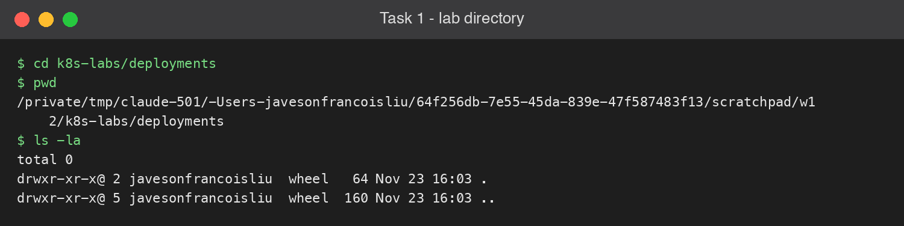
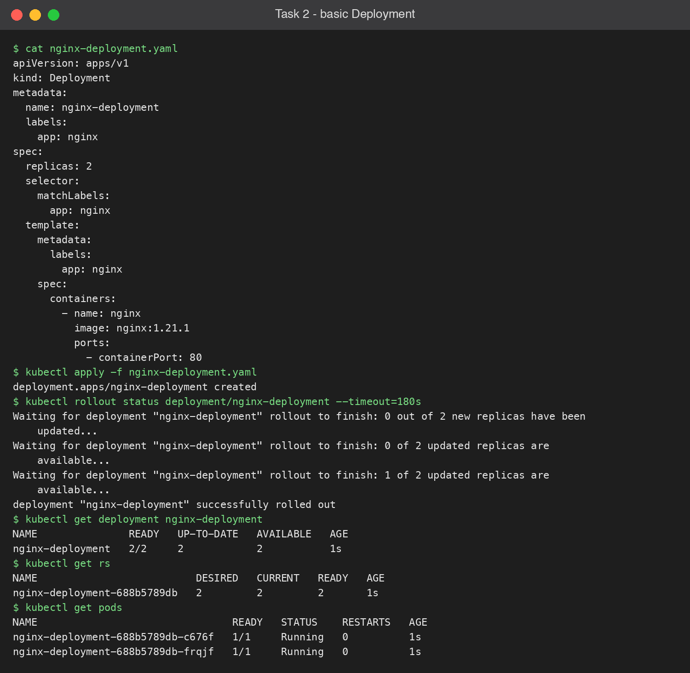
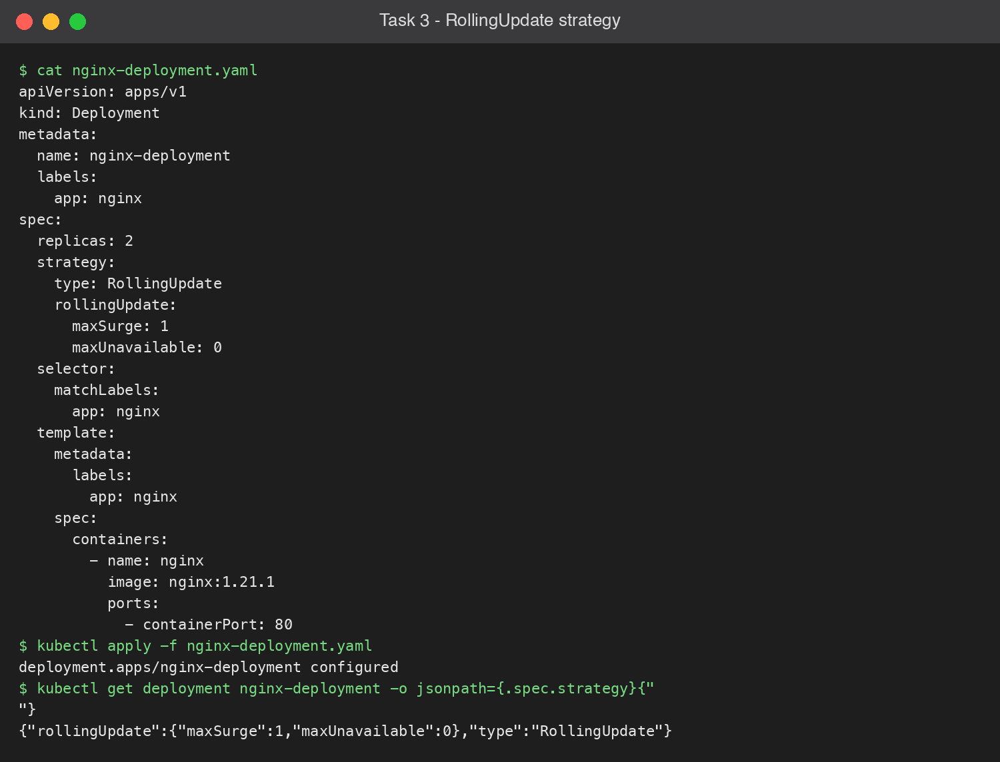
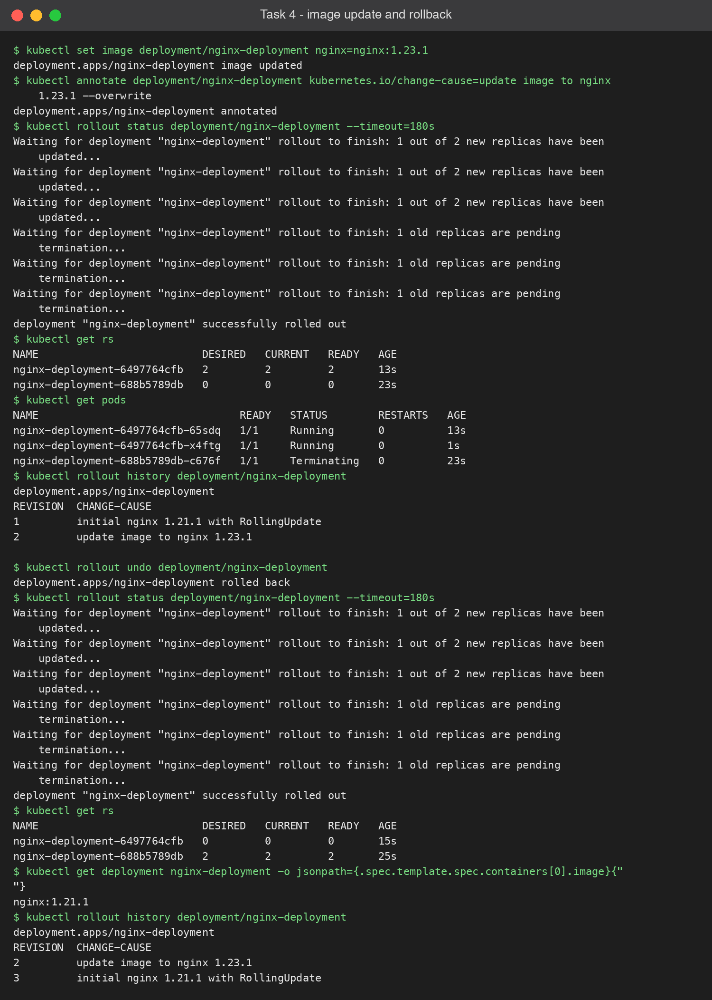
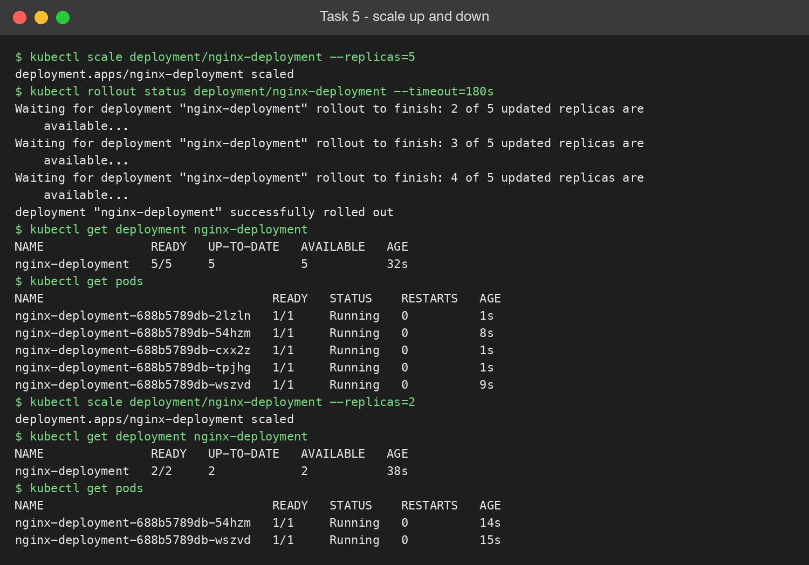

# Assignment 3 — Deployments: From Basics to Rolling Updates

Part of the DevOps Micro Internship (DMI) with Agentic AI

---

## Purpose

In this guided lab, you will create an NGINX Deployment, add a zero-downtime RollingUpdate strategy, perform an image update, roll it back, and scale the workload.

---

# Task 1 — Set Up the Working Directory

## Goal

Create the `~/k8s-labs/deployments` working directory.

### Evidence

#### Screenshot 1 — Terminal showing the `~/k8s-labs/deployments` working directory



```bash
mkdir -p k8s-labs/deployments
cd k8s-labs/deployments
pwd
```

Note: the folder was created as `k8s-labs/deployments` inside a scratch working directory (the path in the screenshot), not under `~`. The lab ran on a local kind cluster named `w12-a`.

---

# Task 2 — Create the Basic Deployment

## Goal

Create `nginx-deployment.yaml` with two replicas and image `nginx:1.21.1`, apply it, and verify the Deployment, ReplicaSet, and Pods.

### Evidence

#### Screenshot 2 — Manifest plus `kubectl` output showing the Deployment, ReplicaSet, and two Pods



`nginx-deployment.yaml` (first version):

```yaml
apiVersion: apps/v1
kind: Deployment
metadata:
  name: nginx-deployment
  labels:
    app: nginx
spec:
  replicas: 2
  selector:
    matchLabels:
      app: nginx
  template:
    metadata:
      labels:
        app: nginx
    spec:
      containers:
        - name: nginx
          image: nginx:1.21.1
          ports:
            - containerPort: 80
```

```bash
kubectl apply -f nginx-deployment.yaml
kubectl rollout status deployment/nginx-deployment
kubectl get deployment nginx-deployment
kubectl get rs
kubectl get pods
```

The Deployment is `2/2` ready, it created one ReplicaSet (`nginx-deployment-688b5789db`), and that ReplicaSet owns two Running Pods.

---

# Task 3 — Configure the RollingUpdate Strategy

## Goal

Add `strategy.rollingUpdate` with `maxSurge: 1` and `maxUnavailable: 0` to the Deployment and reapply it.

### Evidence

#### Screenshot 3 — Deployment YAML showing the RollingUpdate strategy and successful apply output



Updated `nginx-deployment.yaml`:

```yaml
apiVersion: apps/v1
kind: Deployment
metadata:
  name: nginx-deployment
  labels:
    app: nginx
spec:
  replicas: 2
  strategy:
    type: RollingUpdate
    rollingUpdate:
      maxSurge: 1
      maxUnavailable: 0
  selector:
    matchLabels:
      app: nginx
  template:
    metadata:
      labels:
        app: nginx
    spec:
      containers:
        - name: nginx
          image: nginx:1.21.1
          ports:
            - containerPort: 80
```

```bash
kubectl apply -f nginx-deployment.yaml
kubectl get deployment nginx-deployment -o jsonpath='{.spec.strategy}'
```

The apply returned `configured`, and the live object shows `maxSurge: 1`, `maxUnavailable: 0`, type `RollingUpdate`. With `maxUnavailable: 0` a new Pod must be Ready before an old one is removed.

---

# Task 4 — Perform and Roll Back an Image Update

## Goal

Update the image to `nginx:1.23.1` with `kubectl set image`, watch the rollout, then roll it back with `kubectl rollout undo` and check rollout history.

### Evidence

#### Screenshot 4 — Rolling-update status, multiple ReplicaSets, and successful rollback/history output



```bash
kubectl set image deployment/nginx-deployment nginx=nginx:1.23.1
kubectl annotate deployment/nginx-deployment kubernetes.io/change-cause="update image to nginx 1.23.1" --overwrite
kubectl rollout status deployment/nginx-deployment
kubectl get rs
kubectl get pods
kubectl rollout history deployment/nginx-deployment
kubectl rollout undo deployment/nginx-deployment
kubectl rollout status deployment/nginx-deployment
kubectl get rs
kubectl rollout history deployment/nginx-deployment
```

The image change created a second ReplicaSet (`nginx-deployment-6497764cfb`) that scaled up one Pod at a time while the old one (`nginx-deployment-688b5789db`) scaled down to 0. `rollout undo` reversed this: the old ReplicaSet went back to 2 and the new one to 0, and the image is `nginx:1.21.1` again. Before the update I annotated the Deployment with a change-cause, so history shows readable text. After the undo, history lists revisions 2 and 3, and revision 3 keeps the original change-cause text because it is the old Pod template restored.

---

# Task 5 — Scale the Deployment

## Goal

Scale to five replicas, verify, then scale back to two.

### Evidence

#### Screenshot 5 — Terminal showing the scale-up and scale-down results



```bash
kubectl scale deployment/nginx-deployment --replicas=5
kubectl rollout status deployment/nginx-deployment
kubectl get deployment nginx-deployment
kubectl get pods
kubectl scale deployment/nginx-deployment --replicas=2
kubectl get deployment nginx-deployment
kubectl get pods
```

The Deployment went to `5/5` with five Running Pods, then back to `2/2` with two Pods.

---

### Notes

Write a short note describing what the lab demonstrated.

This lab showed that a Deployment manages ReplicaSets for me. A RollingUpdate with `maxSurge: 1` and `maxUnavailable: 0` replaced the nginx 1.21.1 Pods with 1.23.1 one at a time, so capacity never dropped below two ready Pods. The old ReplicaSet stays at 0 replicas, which is what makes `kubectl rollout undo` fast and gives a revision history. Scaling is a single command and the Deployment keeps the Pod count at the desired number. A small thing I noticed: after an undo, the revision numbers move forward, so the restored revision appears as a new number.

---

# Submission Instructions

- Add all required screenshots in your submission
- Include the completed YAML manifests used in the lab

---

# Completion Checklist

- [x] Task 1: Lab directory created (Screenshot 1)
- [x] Task 2: Two-replica Deployment applied (Screenshot 2)
- [x] Task 3: RollingUpdate strategy configured (Screenshot 3)
- [x] Task 4: Image updated and rolled back (Screenshot 4)
- [x] Task 5: Scaled up and down (Screenshot 5)
- [x] Reflection notes written (Notes)

---

## 📌 About DMI & CloudAdvisory

DevOps Micro Internship (DMI) is a project-based DevOps program run by Pravin Mishra (The CloudAdvisory) focused on real-world execution, systems thinking, and career readiness.

It helps learners build strong DevOps foundations with hands-on experience.

---

## 📌 Resources

- 🌐 DMI Official Website: https://dmi.pravinmishra.com?utm_source=github&utm_medium=readme  
- 🎓 University: https://university.pravinmishra.com?utm_source=github&utm_medium=readme  
- 💬 Discord Community: https://discord.pravinmishra.com?utm_source=github&utm_medium=readme  
- 📝 Blog: https://dmi.pravinmishra.com/blog?utm_source=github&utm_medium=readme  
- ▶️ YouTube Playlist: https://www.youtube.com/playlist?list=PLFeSNDtI4Cho  
- 🔗 Pravin Mishra (LinkedIn): https://www.linkedin.com/in/pravin-mishra-aws-trainer/  
- 🏢 CloudAdvisory (LinkedIn): https://www.linkedin.com/company/thecloudadvisory/

---

*This submission is part of DevOps Micro Internship (DMI) — Agentic AI Track.*
