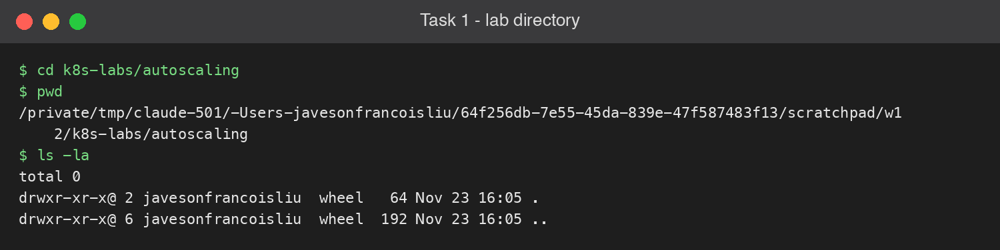
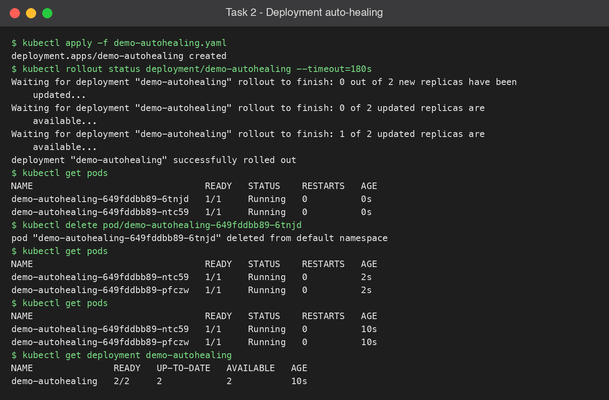
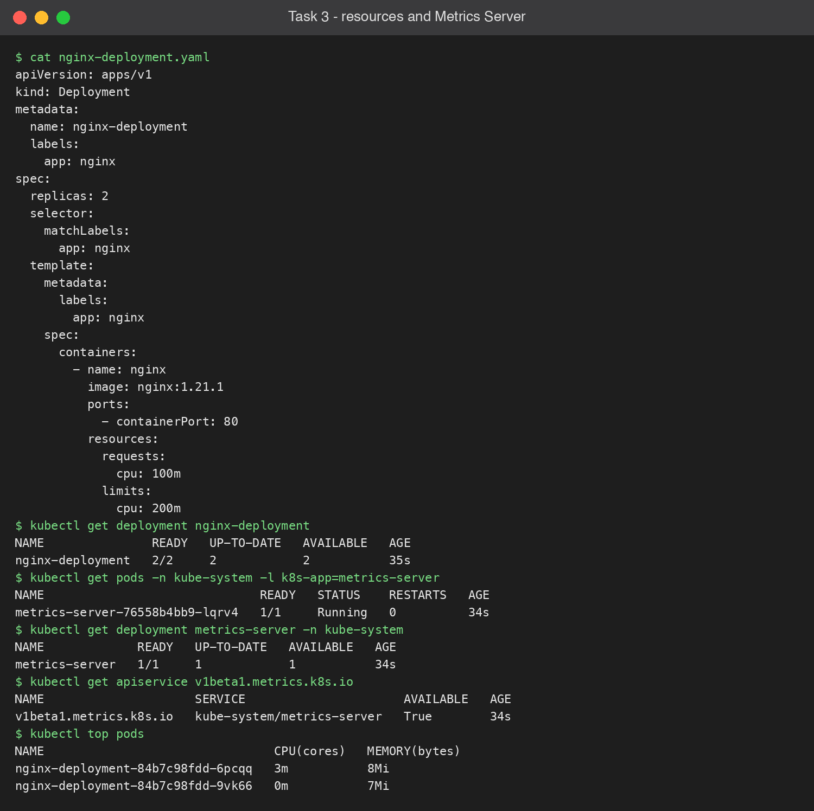
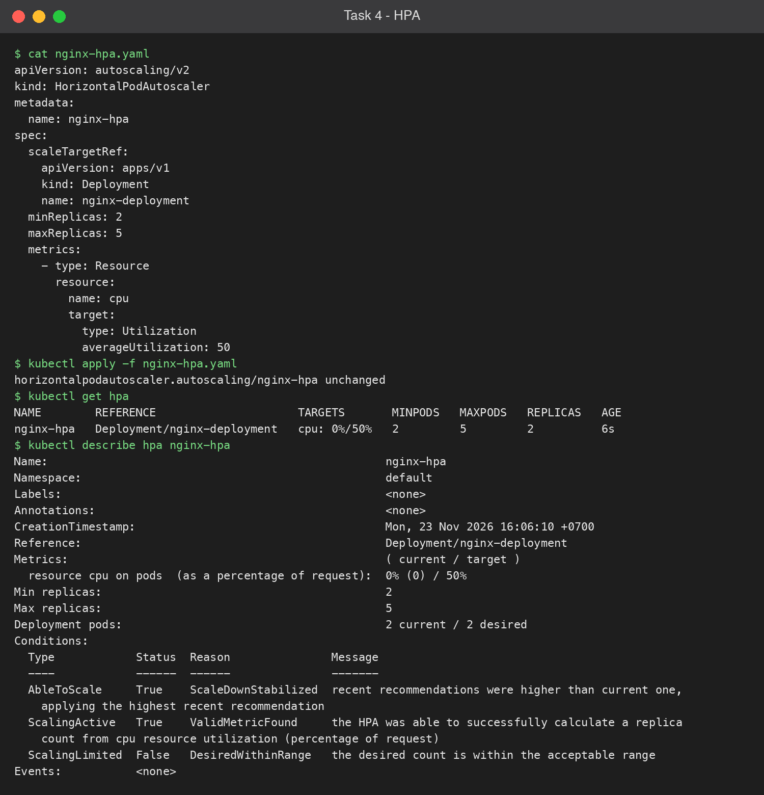
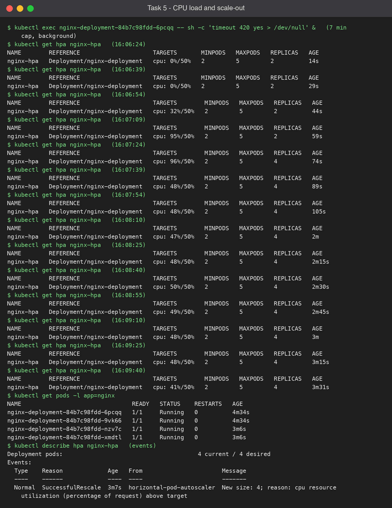

# Assignment 4 — Auto-Scaling & Auto-Healing: Let Kubernetes React for You

Part of the DevOps Micro Internship (DMI) with Agentic AI

---

## Purpose

In this guided lab, you will prove Deployment auto-healing by deleting a Pod, then configure a CPU-based Horizontal Pod Autoscaler that maintains between two and five NGINX Pods.

---

# Task 1 — Set Up the Lab Directory

## Goal

Create the `~/k8s-labs/autoscaling` working directory.

### Evidence

#### Screenshot 1 — Terminal showing the `autoscaling` directory



```bash
mkdir -p k8s-labs/autoscaling
cd k8s-labs/autoscaling
pwd
```

Note: the folder was created as `k8s-labs/autoscaling` inside a scratch working directory (the path in the screenshot), not under `~`. The lab ran on a local kind cluster named `w12-a`.

---

# Task 2 — Prove Deployment Auto-Healing

## Goal

Create `demo-autohealing` (two replicas), delete one Pod, and confirm the desired count of two is restored automatically.

### Evidence

#### Screenshot 2 — Deleted Pod and replacement Pod with the replica count restored



`demo-autohealing.yaml`:

```yaml
apiVersion: apps/v1
kind: Deployment
metadata:
  name: demo-autohealing
  labels:
    app: demo-autohealing
spec:
  replicas: 2
  selector:
    matchLabels:
      app: demo-autohealing
  template:
    metadata:
      labels:
        app: demo-autohealing
    spec:
      containers:
        - name: nginx
          image: nginx:1.21.1
          ports:
            - containerPort: 80
```

```bash
kubectl apply -f demo-autohealing.yaml
kubectl get pods
kubectl delete pod/demo-autohealing-649fddbb89-6tnjd
kubectl get pods
kubectl get deployment demo-autohealing
```

I deleted `demo-autohealing-649fddbb89-6tnjd`. The Deployment's ReplicaSet created `demo-autohealing-649fddbb89-pfczw` straight away, and the Deployment is back to `2/2`.

---

# Task 3 — Create the HPA-Ready Deployment and Enable Metrics

## Goal

Deploy `nginx-deployment` with CPU `requests: 100m` / `limits: 200m`, then enable Metrics Server (Minikube addon or manifest + kubelet TLS patch for kind) and confirm it reports `READY 1/1`.

### Evidence

#### Screenshot 3 — Deployment resources plus successful Metrics Server status



`nginx-deployment.yaml`:

```yaml
apiVersion: apps/v1
kind: Deployment
metadata:
  name: nginx-deployment
  labels:
    app: nginx
spec:
  replicas: 2
  selector:
    matchLabels:
      app: nginx
  template:
    metadata:
      labels:
        app: nginx
    spec:
      containers:
        - name: nginx
          image: nginx:1.21.1
          ports:
            - containerPort: 80
          resources:
            requests:
              cpu: 100m
            limits:
              cpu: 200m
```

This is a kind cluster, so I installed Metrics Server from the official manifest and added the kubelet TLS flag:

```bash
kubectl apply -f nginx-deployment.yaml
kubectl apply -f https://github.com/kubernetes-sigs/metrics-server/releases/latest/download/components.yaml
kubectl patch deployment metrics-server -n kube-system --type=json -p='[{"op":"add","path":"/spec/template/spec/containers/0/args/-","value":"--kubelet-insecure-tls"}]'
kubectl get deployment metrics-server -n kube-system
kubectl top pods
```

`metrics-server` shows `READY 1/1`, the `v1beta1.metrics.k8s.io` APIService is `Available: True`, and `kubectl top pods` returns real CPU and memory numbers.

---

# Task 4 — Create and Inspect the HPA

## Goal

Create an HPA (imperatively via `kubectl autoscale` or declaratively via `autoscaling/v2`) targeting `nginx-deployment` with min 2, max 5, and 50% target CPU utilization.

### Evidence

#### Screenshot 4 — `kubectl get hpa` and `kubectl describe hpa nginx-hpa` output



`nginx-hpa.yaml` (declarative, `autoscaling/v2`):

```yaml
apiVersion: autoscaling/v2
kind: HorizontalPodAutoscaler
metadata:
  name: nginx-hpa
spec:
  scaleTargetRef:
    apiVersion: apps/v1
    kind: Deployment
    name: nginx-deployment
  minReplicas: 2
  maxReplicas: 5
  metrics:
    - type: Resource
      resource:
        name: cpu
        target:
          type: Utilization
          averageUtilization: 50
```

```bash
kubectl apply -f nginx-hpa.yaml
kubectl get hpa
kubectl describe hpa nginx-hpa
```

The HPA targets `nginx-deployment` with min 2, max 5 and 50% CPU. It reads `cpu: 0%/50%` at idle with 2 replicas. The screenshot shows `unchanged` because I applied the file once to create it (`created`) and again while capturing the output.

---

# Task 5 — Optionally Generate CPU Load

## Goal

Generate CPU load inside an NGINX Pod (`yes > /dev/null`) and monitor whether the HPA increases replicas.

### Evidence

#### Screenshot 5 — HPA output showing current metrics and any replica increase



```bash
kubectl exec nginx-deployment-84b7c98fdd-6pcqq -- sh -c 'timeout 420 yes > /dev/null' &
kubectl get hpa nginx-hpa
kubectl get pods -l app=nginx
kubectl describe hpa nginx-hpa
```

I ran `yes > /dev/null` inside one NGINX Pod (with a 7 minute `timeout` so it could not run forever) and polled the HPA every 15 seconds. CPU went `0%` then `32%` then `95%/50%`, and the HPA scaled from 2 to 4 replicas (`SuccessfulRescale: New size: 4; reason: cpu resource utilization above target`). With the new Pods sharing the load, the average settled at about 48% to 50%, so it stayed at 4 and did not reach the maximum of 5.

---

### Notes

Write a short note describing what the lab demonstrated.

This lab showed two reactions I no longer have to do by hand. Auto-healing: when I deleted a Pod, the Deployment's ReplicaSet noticed the count was below the desired two and created a replacement within seconds. Auto-scaling: the HPA compares the average CPU use to the 50% target, measured against the CPU request (100m), so setting `requests` is required for it to work. On kind, Metrics Server only worked after adding `--kubelet-insecure-tls`. Under load the HPA added Pods (2 to 4) after about 15 to 30 seconds, and it stops adding Pods once the average is back near the target. Scale-down is deliberately slower because of the stabilization window, so I did not wait for it.

---

# Submission Instructions

- Add all required screenshots in your submission
- Include the completed YAML manifests used in the lab

---

# Completion Checklist

- [x] Task 1: Lab directory created (Screenshot 1)
- [x] Task 2: Auto-healing observed (Screenshot 2)
- [x] Task 3: HPA-ready Deployment applied and Metrics Server verified (Screenshot 3)
- [x] Task 4: HPA created and inspected (Screenshot 4)
- [x] Task 5: CPU load generated and scaling observed (Screenshot 5, optional)
- [x] Reflection notes written (Notes)

---

## 📌 About DMI & CloudAdvisory

DevOps Micro Internship (DMI) is a project-based DevOps program run by Pravin Mishra (The CloudAdvisory) focused on real-world execution, systems thinking, and career readiness.

It helps learners build strong DevOps foundations with hands-on experience.

---

## 📌 Resources

- 🌐 DMI Official Website: https://dmi.pravinmishra.com?utm_source=github&utm_medium=readme  
- 🎓 University: https://university.pravinmishra.com?utm_source=github&utm_medium=readme  
- 💬 Discord Community: https://discord.pravinmishra.com?utm_source=github&utm_medium=readme  
- 📝 Blog: https://dmi.pravinmishra.com/blog?utm_source=github&utm_medium=readme  
- ▶️ YouTube Playlist: https://www.youtube.com/playlist?list=PLFeSNDtI4Cho  
- 🔗 Pravin Mishra (LinkedIn): https://www.linkedin.com/in/pravin-mishra-aws-trainer/  
- 🏢 CloudAdvisory (LinkedIn): https://www.linkedin.com/company/thecloudadvisory/

---

*This submission is part of DevOps Micro Internship (DMI) — Agentic AI Track.*
