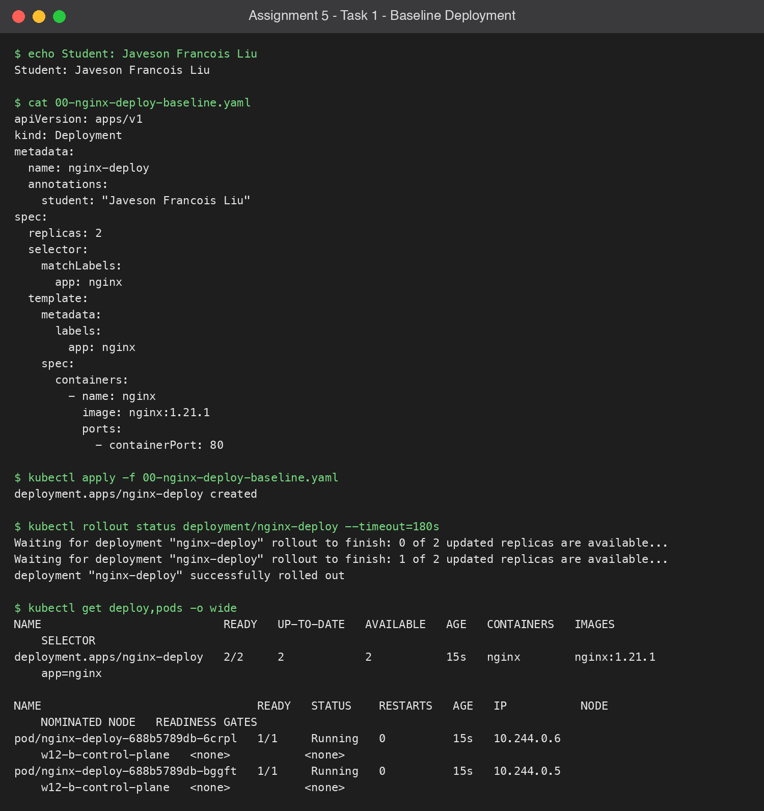
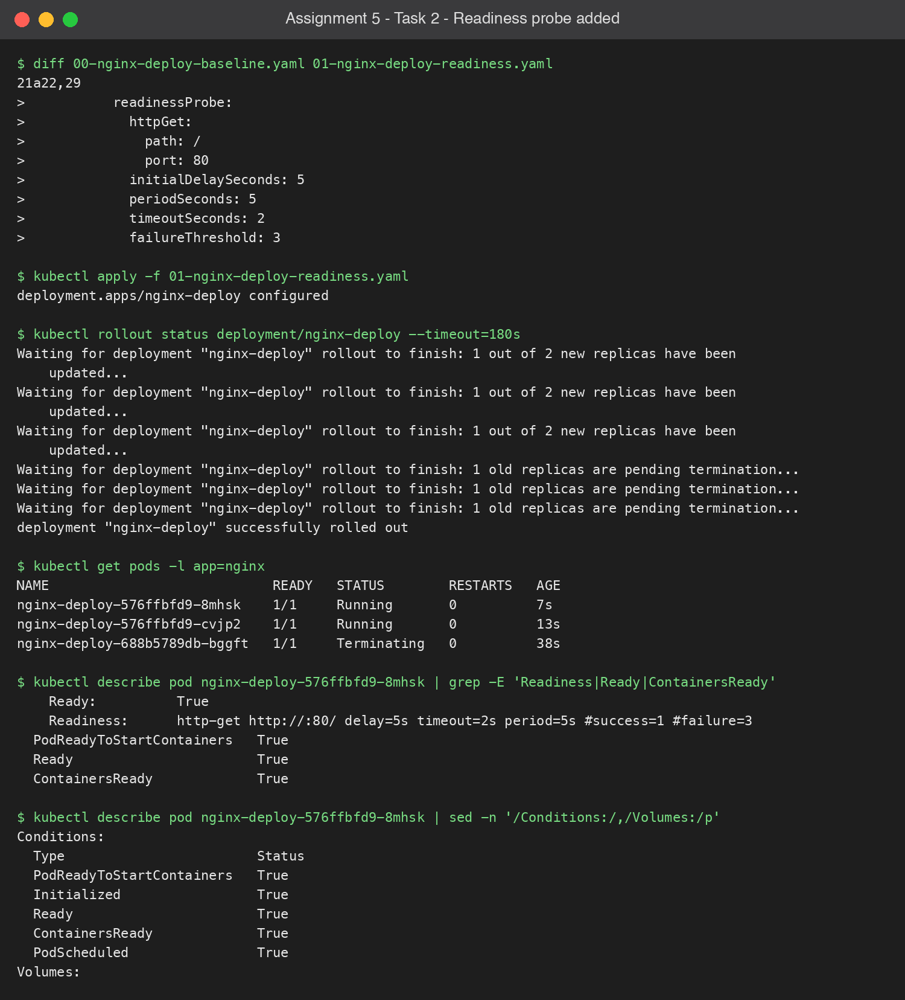
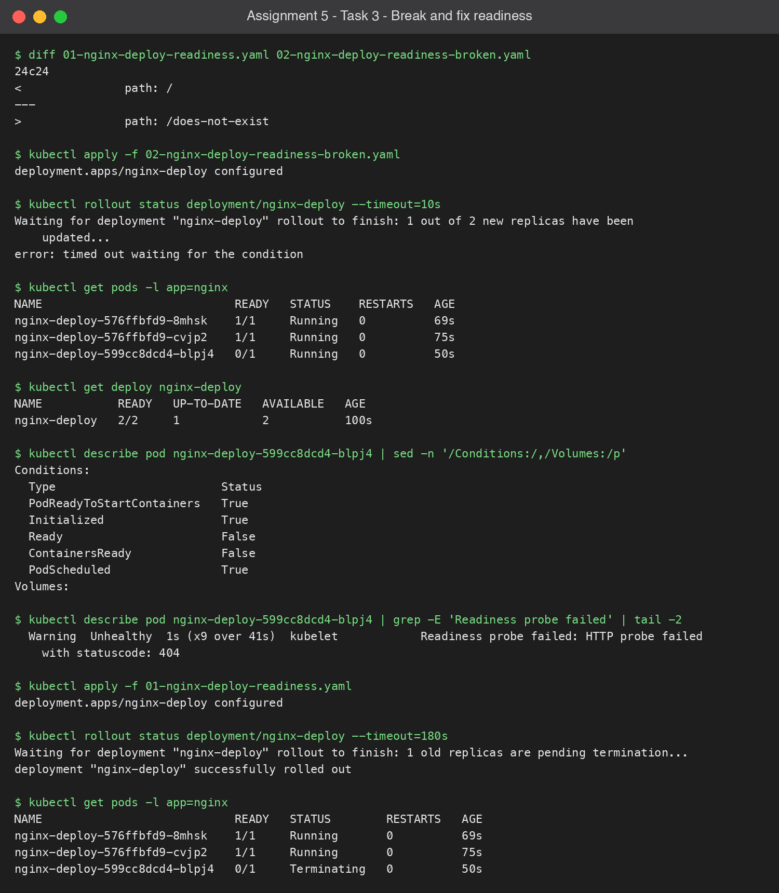
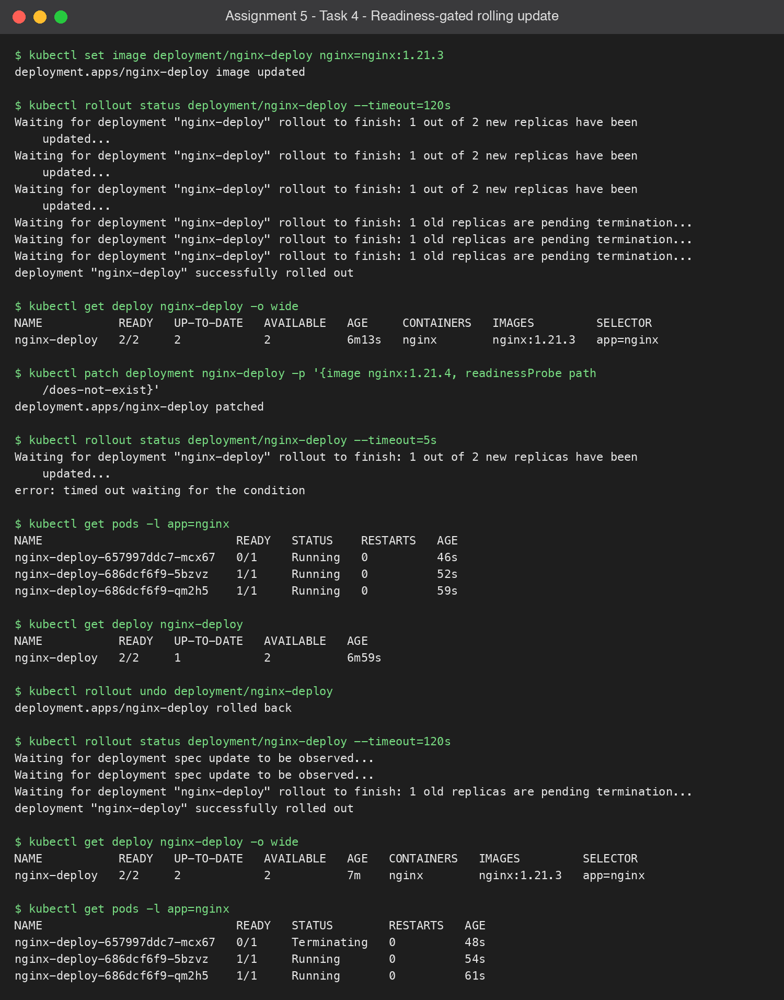
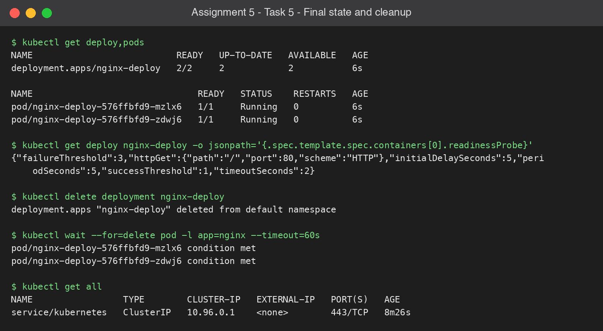

# Assignment 5 — Kubernetes Health Probes (Readiness)

Part of the DevOps Micro Internship (DMI) with Agentic AI

---

## Purpose

In this guided lab, you will add an HTTP readiness probe to NGINX, intentionally break it, fix it, and prove that readiness gates Pod availability and safe rolling updates.

---

# Task 1 — Create the Baseline Deployment

## Goal

Deploy two NGINX Pods without probes (`00-nginx-deploy-baseline.yaml`) to establish the comparison state.

### Evidence

#### Screenshot 1 — Baseline manifest and healthy two-Pod rollout output



Commands: `kubectl apply -f 00-nginx-deploy-baseline.yaml`, `kubectl rollout status deployment/nginx-deploy`, `kubectl get deploy,pods -o wide`. Result: two `nginx:1.21.1` Pods, both `1/1 Running`, no probes defined. Cluster: local kind cluster `w12-b`.

---

# Task 2 — Add the Readiness Probe

## Goal

Add an HTTP readiness probe on `/` port 80 (`01-nginx-deploy-readiness.yaml`) and confirm Pods become Ready only after it succeeds.

### Evidence

#### Screenshot 2 — Pod description showing the readiness probe and `Ready=True`



Commands: `kubectl apply -f 01-nginx-deploy-readiness.yaml`, `kubectl describe pod <pod>`. Result: the Pod shows `Readiness: http-get http://:80/ delay=5s timeout=2s period=5s #success=1 #failure=3` and the conditions `Ready=True`, `ContainersReady=True`. Adding the probe changed the Pod template, so a new ReplicaSet rolled out and the old Pods were replaced.

---

# Task 3 — Break and Fix Readiness

## Goal

Change the readiness path to `/does-not-exist`, observe `NotReady` and a stalled rollout, then restore the good manifest.

### Evidence

#### Screenshot 3 — `NotReady` conditions followed by a successful fixed rollout



Commands: `kubectl apply -f 02-nginx-deploy-readiness-broken.yaml` (path `/does-not-exist`), then `kubectl apply -f 01-nginx-deploy-readiness.yaml`. Result: the new Pod stayed `0/1 Running` with `Ready=False`, the event `Readiness probe failed: HTTP probe failed with statuscode: 404`, and `rollout status` timed out. The two old Pods stayed `1/1` and kept serving. Re-applying the good manifest completed the rollout and removed the broken Pod.

---

# Task 4 — Prove Readiness-Gated Rolling Updates

## Goal

Perform a good image update to `nginx:1.21.2`, then attempt an update to `nginx:1.21.3` with a broken readiness patch, and confirm the rollout stalls before restoring the good spec.

### Evidence

#### Screenshot 4 — Successful good rollout, stalled broken rollout, and successful recovery



Deviation: the image tag `nginx:1.21.2` does not exist on Docker Hub (the Pod failed with `ErrImagePull ... not found` in my first attempt), so I used `nginx:1.21.3` as the good update and `nginx:1.21.4` as the update with the broken readiness patch.

Commands: `kubectl set image deployment/nginx-deploy nginx=nginx:1.21.3` (rolled out, 2/2 Ready), then `kubectl patch deployment nginx-deploy` with image `nginx:1.21.4` and readiness path `/does-not-exist`. Result: the new Pod stayed `0/1`, `UP-TO-DATE` stayed at 1 and the two `1.21.3` Pods kept `AVAILABLE=2`. `kubectl rollout undo deployment/nginx-deploy` restored the good spec (`nginx:1.21.3`, 2/2 Ready).

---

# Task 5 — Review Tuning and Optional Cleanup

## Goal

Review probe timing/thresholds and retain or delete the Deployment.

### Evidence

#### Screenshot 5 — Final healthy Pod state or optional cleanup output



I reviewed the live probe settings (`initialDelaySeconds: 5`, `periodSeconds: 5`, `timeoutSeconds: 2`, `failureThreshold: 3`, `successThreshold: 1`), then deleted the Deployment with `kubectl delete deployment nginx-deploy`. The final `kubectl get all` shows only the default `kubernetes` Service.

---

### Notes

Readiness decides whether a Pod receives traffic and whether a rolling update may continue. With a good probe, new Pods became `Ready` only after `GET /` on port 80 returned success. With a bad path the probe failed with 404, the container kept running (readiness never restarts it), the Pod stayed `NotReady`, and the Deployment stopped the rollout while the old Pods kept serving, so users saw no outage. Rolling back with the good manifest or `kubectl rollout undo` recovered. Tuning lesson: `initialDelaySeconds`, `periodSeconds` and `failureThreshold` set how fast a Pod is admitted or removed, and too aggressive values cause flapping. Lab note: `nginx:1.21.2` is not a published tag, so I used 1.21.3 and 1.21.4.

---

### Manifests

`00-nginx-deploy-baseline.yaml`

```yaml
apiVersion: apps/v1
kind: Deployment
metadata:
  name: nginx-deploy
  annotations:
    student: "Javeson Francois Liu"
spec:
  replicas: 2
  selector:
    matchLabels:
      app: nginx
  template:
    metadata:
      labels:
        app: nginx
    spec:
      containers:
        - name: nginx
          image: nginx:1.21.1
          ports:
            - containerPort: 80
```

`01-nginx-deploy-readiness.yaml`

```yaml
apiVersion: apps/v1
kind: Deployment
metadata:
  name: nginx-deploy
  annotations:
    student: "Javeson Francois Liu"
spec:
  replicas: 2
  selector:
    matchLabels:
      app: nginx
  template:
    metadata:
      labels:
        app: nginx
    spec:
      containers:
        - name: nginx
          image: nginx:1.21.1
          ports:
            - containerPort: 80
          readinessProbe:
            httpGet:
              path: /
              port: 80
            initialDelaySeconds: 5
            periodSeconds: 5
            timeoutSeconds: 2
            failureThreshold: 3
```

`02-nginx-deploy-readiness-broken.yaml` is identical to `01-nginx-deploy-readiness.yaml` except `readinessProbe.httpGet.path: /does-not-exist`.

---

# Submission Instructions

- Add all required screenshots in your submission
- Include the completed YAML manifests used in the lab

---

# Completion Checklist

- [x] Task 1: Baseline Deployment applied (Screenshot 1)
- [x] Task 2: Readiness probe added and verified (Screenshot 2)
- [x] Task 3: Readiness broken and fixed (Screenshot 3)
- [x] Task 4: Readiness-gated rolling update proven (Screenshot 4)
- [x] Task 5: Tuning reviewed / cleanup completed (Screenshot 5)
- [x] Reflection notes written (Notes)

---

## 📌 About DMI & CloudAdvisory

DevOps Micro Internship (DMI) is a project-based DevOps program run by Pravin Mishra (The CloudAdvisory) focused on real-world execution, systems thinking, and career readiness.

It helps learners build strong DevOps foundations with hands-on experience.

---

## 📌 Resources

- 🌐 DMI Official Website: https://dmi.pravinmishra.com?utm_source=github&utm_medium=readme  
- 🎓 University: https://university.pravinmishra.com?utm_source=github&utm_medium=readme  
- 💬 Discord Community: https://discord.pravinmishra.com?utm_source=github&utm_medium=readme  
- 📝 Blog: https://dmi.pravinmishra.com/blog?utm_source=github&utm_medium=readme  
- ▶️ YouTube Playlist: https://www.youtube.com/playlist?list=PLFeSNDtI4Cho  
- 🔗 Pravin Mishra (LinkedIn): https://www.linkedin.com/in/pravin-mishra-aws-trainer/  
- 🏢 CloudAdvisory (LinkedIn): https://www.linkedin.com/company/thecloudadvisory/

---

*This submission is part of DevOps Micro Internship (DMI) — Agentic AI Track.*
