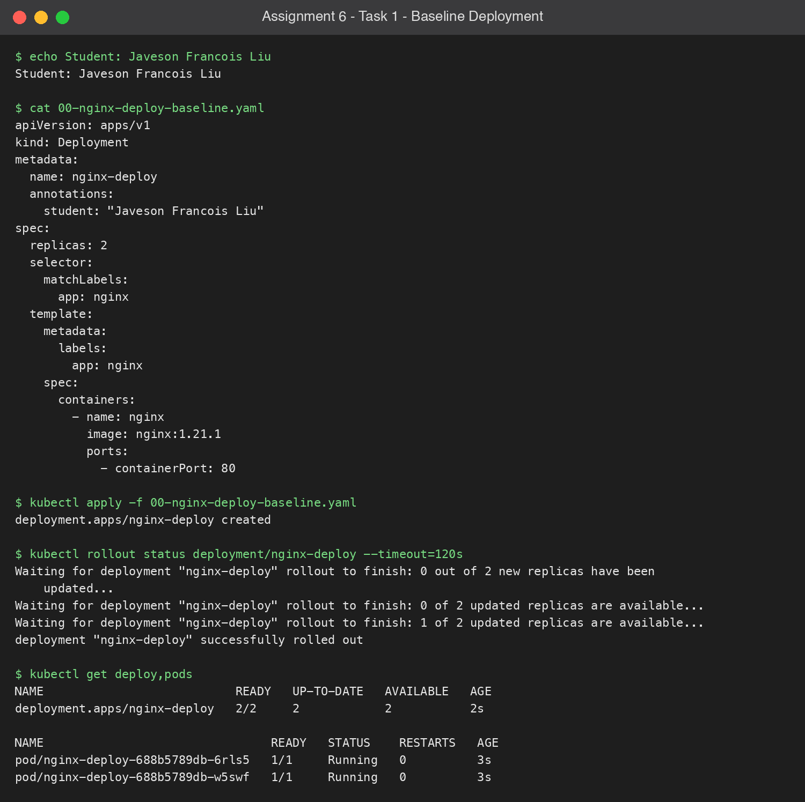
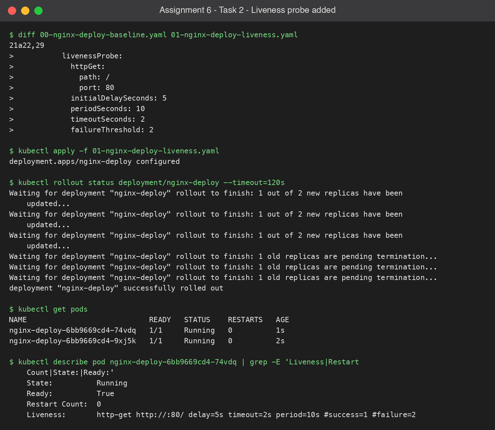
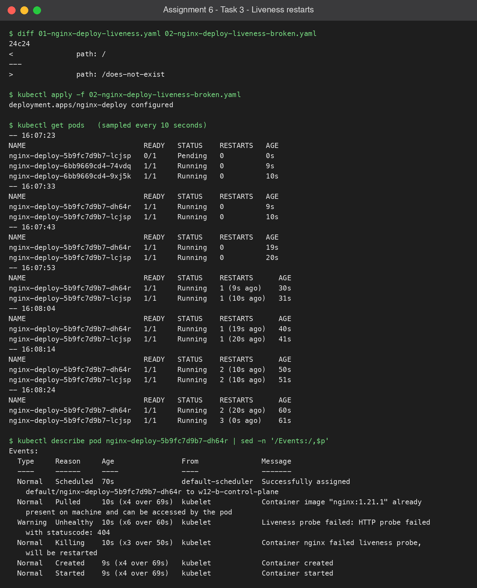
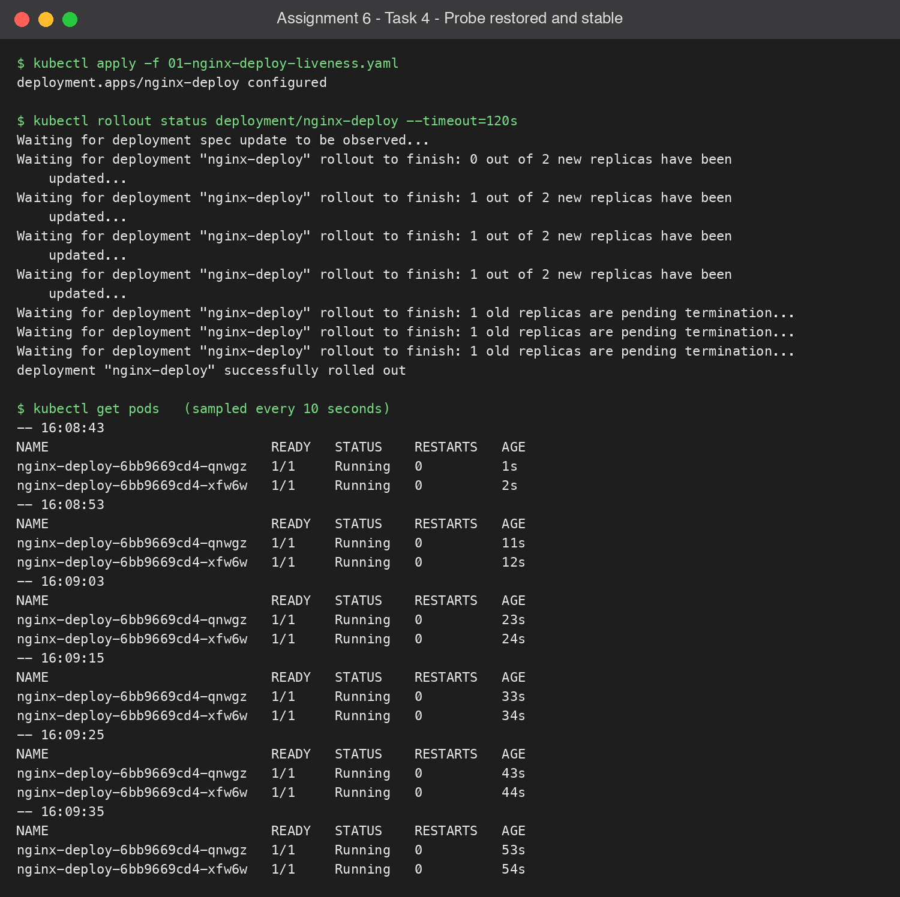
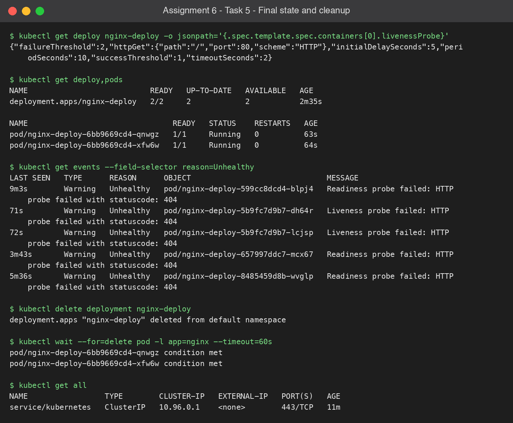

# Assignment 6 — Kubernetes Health Probes (Liveness)

Part of the DevOps Micro Internship (DMI) with Agentic AI

---

## Purpose

In this guided lab, you will add an HTTP liveness probe to NGINX, force repeated failures, observe container restarts, restore the healthy probe, and review safe tuning.

---

# Task 1 — Create the Baseline Deployment

## Goal

Deploy two NGINX Pods without probes (`00-nginx-deploy-baseline.yaml`).

### Evidence

#### Screenshot 1 — Baseline Deployment and two running Pods



Commands: `kubectl apply -f 00-nginx-deploy-baseline.yaml`, `kubectl rollout status deployment/nginx-deploy`, `kubectl get deploy,pods`. Result: Deployment `2/2`, two `nginx:1.21.1` Pods `1/1 Running`, `RESTARTS 0`, no probes. Cluster: local kind cluster `w12-b`.

---

# Task 2 — Add the Liveness Probe

## Goal

Add an HTTP liveness probe on `/` port 80 (`01-nginx-deploy-liveness.yaml`) and confirm the kubelet checks it every 10 seconds after the initial delay.

### Evidence

#### Screenshot 2 — Pod description showing the liveness probe



Commands: `kubectl apply -f 01-nginx-deploy-liveness.yaml`, `kubectl describe pod <pod>`. Result: `Liveness: http-get http://:80/ delay=5s timeout=2s period=10s #success=1 #failure=2`, container `Running`, `Restart Count: 0`. The kubelet checks `GET /` every 10 seconds after a 5 second initial delay.

---

# Task 3 — Trigger and Observe a Liveness Restart

## Goal

Change the liveness path to `/does-not-exist`, apply it, and watch `RESTARTS` increase over roughly 20 seconds.

### Evidence

#### Screenshot 3 — Pod RESTARTS increment and the corresponding liveness failure events



Command: `kubectl apply -f 02-nginx-deploy-liveness-broken.yaml` (path `/does-not-exist`). Result: sampled every 10 seconds, `RESTARTS` went from 0 to 1 at about 30 seconds and to 2 at about 50 seconds, and one Pod reached 3 within a minute. Pod events show `Liveness probe failed: HTTP probe failed with statuscode: 404` followed by `Container nginx failed liveness probe, will be restarted`. With `failureThreshold: 2` and `periodSeconds: 10` a restart follows roughly every 20 seconds after the first failures.

---

# Task 4 — Restore and Stabilize the Probe

## Goal

Reapply the good liveness manifest and confirm restart counts stop increasing.

### Evidence

#### Screenshot 4 — Stable Pod state after the fixed manifest is applied



Command: `kubectl apply -f 01-nginx-deploy-liveness.yaml`. Result: two fresh Pods, both `1/1 Running`, and over the next minute (samples every 10 seconds) `RESTARTS` stayed at 0.

---

# Task 5 — Review Tuning, Troubleshooting, and Cleanup

## Goal

Review recommended probe ranges and retain or delete the Deployment.

### Evidence

#### Screenshot 5 — Final healthy state and any troubleshooting evidence used



I reviewed the live probe settings (`initialDelaySeconds: 5`, `periodSeconds: 10`, `timeoutSeconds: 2`, `failureThreshold: 2`, `successThreshold: 1`) and the `Unhealthy` events, which list the earlier readiness failures from Assignment 5 on the same cluster and the liveness failures from this lab. I then deleted the Deployment with `kubectl delete deployment nginx-deploy`. `kubectl get all` shows only the default `kubernetes` Service.

---

### Notes

Liveness answers a different question from readiness: is the container still healthy, or should the kubelet restart it. With a good probe the Pods stayed at `RESTARTS 0`. When the probe path returned 404, the kubelet counted failures, killed the container and restarted it, so `RESTARTS` climbed about every 20 seconds while the Pod stayed `Running`. Restoring the good manifest created new stable Pods. Tuning lesson: a liveness probe that is too strict (low `failureThreshold`, short `timeoutSeconds`, or a heavy endpoint) can restart healthy containers under load, so use generous values and a cheap endpoint, and pair it with a readiness probe. I used `failureThreshold: 2` here only to make the restart visible within a minute.

---

### Manifests

`00-nginx-deploy-baseline.yaml`

```yaml
apiVersion: apps/v1
kind: Deployment
metadata:
  name: nginx-deploy
  annotations:
    student: "Javeson Francois Liu"
spec:
  replicas: 2
  selector:
    matchLabels:
      app: nginx
  template:
    metadata:
      labels:
        app: nginx
    spec:
      containers:
        - name: nginx
          image: nginx:1.21.1
          ports:
            - containerPort: 80
```

`01-nginx-deploy-liveness.yaml`

```yaml
apiVersion: apps/v1
kind: Deployment
metadata:
  name: nginx-deploy
  annotations:
    student: "Javeson Francois Liu"
spec:
  replicas: 2
  selector:
    matchLabels:
      app: nginx
  template:
    metadata:
      labels:
        app: nginx
    spec:
      containers:
        - name: nginx
          image: nginx:1.21.1
          ports:
            - containerPort: 80
          livenessProbe:
            httpGet:
              path: /
              port: 80
            initialDelaySeconds: 5
            periodSeconds: 10
            timeoutSeconds: 2
            failureThreshold: 2
```

`02-nginx-deploy-liveness-broken.yaml` is identical to `01-nginx-deploy-liveness.yaml` except `livenessProbe.httpGet.path: /does-not-exist`.

---

# Submission Instructions

- Add all required screenshots in your submission
- Include the completed YAML manifests used in the lab

---

# Completion Checklist

- [x] Task 1: Baseline Deployment applied (Screenshot 1)
- [x] Task 2: Liveness probe added and verified (Screenshot 2)
- [x] Task 3: Liveness restart triggered and observed (Screenshot 3)
- [x] Task 4: Probe restored and stabilized (Screenshot 4)
- [x] Task 5: Tuning reviewed / cleanup completed (Screenshot 5)
- [x] Reflection notes written (Notes)

---

## 📌 About DMI & CloudAdvisory

DevOps Micro Internship (DMI) is a project-based DevOps program run by Pravin Mishra (The CloudAdvisory) focused on real-world execution, systems thinking, and career readiness.

It helps learners build strong DevOps foundations with hands-on experience.

---

## 📌 Resources

- 🌐 DMI Official Website: https://dmi.pravinmishra.com?utm_source=github&utm_medium=readme  
- 🎓 University: https://university.pravinmishra.com?utm_source=github&utm_medium=readme  
- 💬 Discord Community: https://discord.pravinmishra.com?utm_source=github&utm_medium=readme  
- 📝 Blog: https://dmi.pravinmishra.com/blog?utm_source=github&utm_medium=readme  
- ▶️ YouTube Playlist: https://www.youtube.com/playlist?list=PLFeSNDtI4Cho  
- 🔗 Pravin Mishra (LinkedIn): https://www.linkedin.com/in/pravin-mishra-aws-trainer/  
- 🏢 CloudAdvisory (LinkedIn): https://www.linkedin.com/company/thecloudadvisory/

---

*This submission is part of DevOps Micro Internship (DMI) — Agentic AI Track.*
