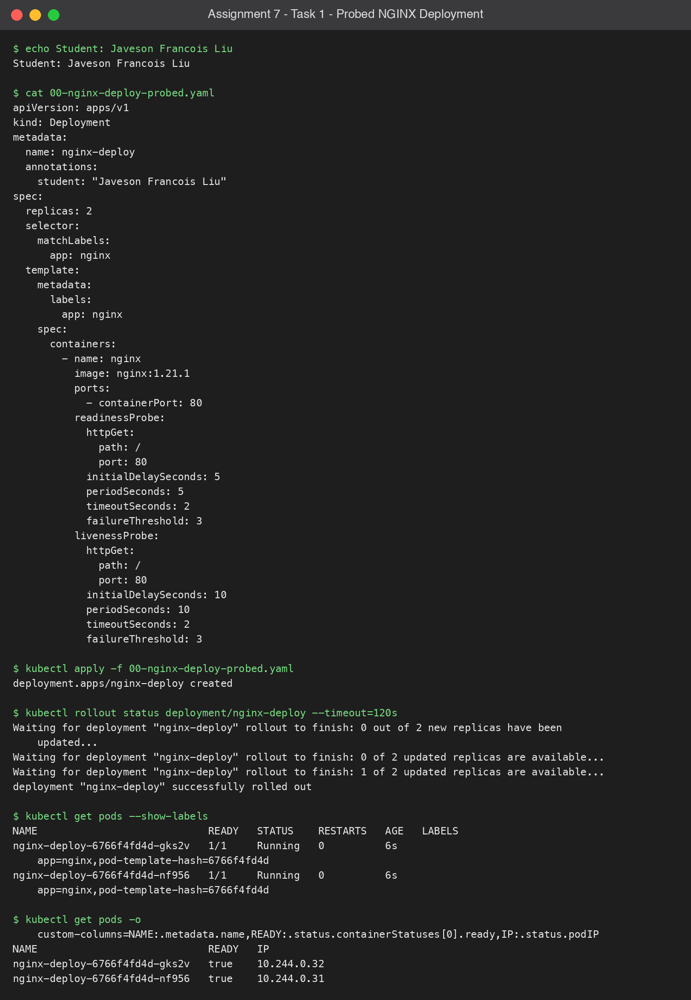
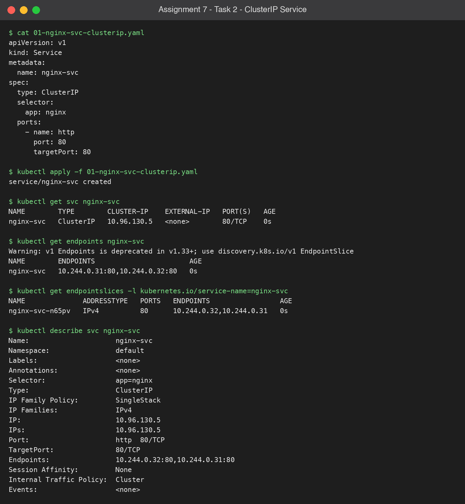
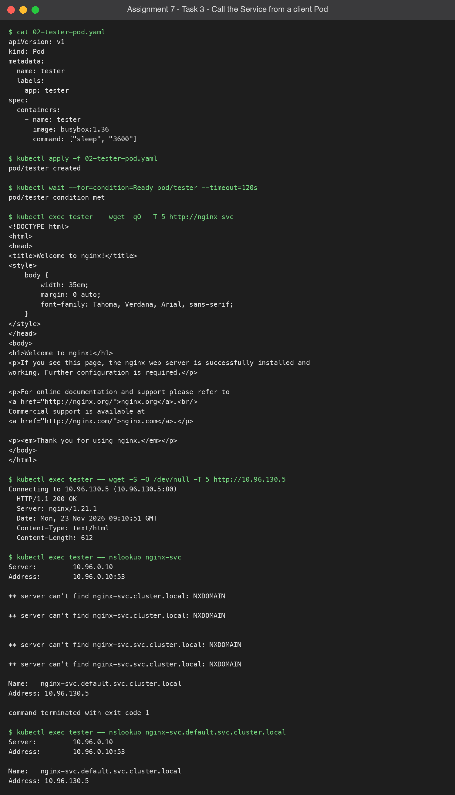
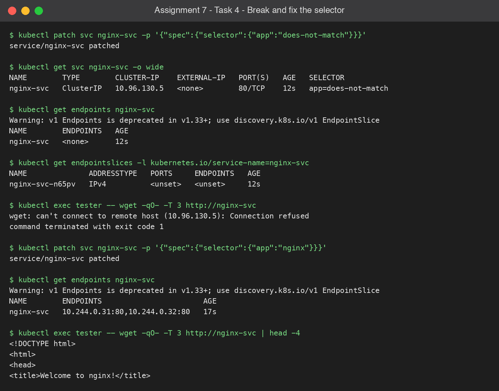
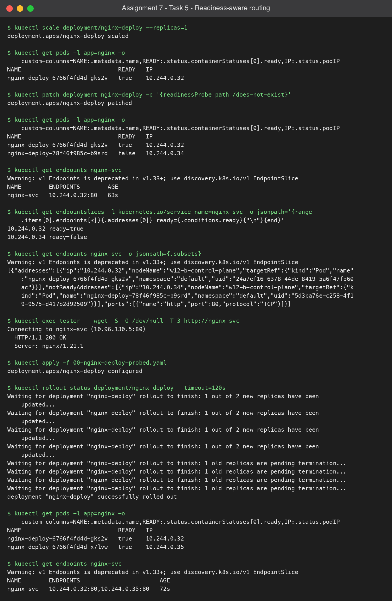
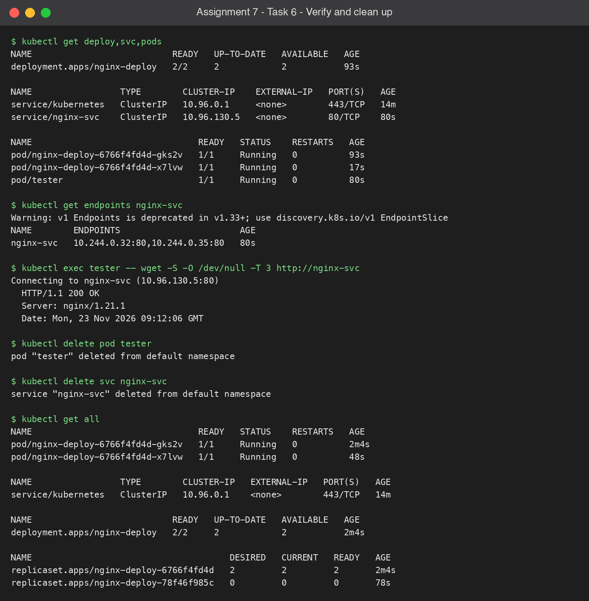

# Assignment 7 — Kubernetes Services (ClusterIP)

Part of the DevOps Micro Internship (DMI) with Agentic AI

---

## Purpose

In this guided lab, you will create an internal ClusterIP Service for NGINX, call it by DNS and virtual IP, break and fix its selector, and prove readiness-aware endpoint routing.

---

# Task 1 — Deploy the Probed NGINX Workload

## Goal

Create two healthy, labeled NGINX Pods (readiness + liveness probes) as Service backends.

### Evidence

#### Screenshot 1 — Two Ready Pods with labels and IPs



Commands: `kubectl apply -f 00-nginx-deploy-probed.yaml`, `kubectl rollout status deployment/nginx-deploy`, `kubectl get pods --show-labels`. Result: two `nginx:1.21.1` Pods, `1/1 Running`, label `app=nginx`, Pod IPs `10.244.0.31` and `10.244.0.32`, each with readiness and liveness probes. Cluster: local kind cluster `w12-b`.

---

# Task 2 — Create and Inspect the ClusterIP Service

## Goal

Create `nginx-svc` (type `ClusterIP`, selector `app: nginx`, port 80) and inspect the Service, Endpoints, and EndpointSlices.

### Evidence

#### Screenshot 2 — Service ClusterIP plus populated Endpoints and EndpointSlices



Commands: `kubectl apply -f 01-nginx-svc-clusterip.yaml`, `kubectl get svc nginx-svc`, `kubectl get endpoints nginx-svc`, `kubectl get endpointslices -l kubernetes.io/service-name=nginx-svc`, `kubectl describe svc nginx-svc`. Result: ClusterIP `10.96.130.5` on port 80, selector `app=nginx`, and both Pod IPs listed as endpoints and in the EndpointSlice. The CLI prints a warning that the v1 Endpoints API is deprecated in favour of EndpointSlice.

---

# Task 3 — Call the Service from a Client Pod

## Goal

Create a BusyBox `tester` Pod and call `nginx-svc` by short name, ClusterIP, and both short/FQDN via `nslookup`.

### Evidence

#### Screenshot 3 — Successful `wget` responses and `nslookup` output



Commands (from a BusyBox `tester` Pod, `02-tester-pod.yaml`): `wget -qO- http://nginx-svc` returned the NGINX welcome page, `wget -S -O /dev/null http://10.96.130.5` returned `HTTP/1.1 200 OK` from `nginx/1.21.1`, and `nslookup` resolved `nginx-svc.default.svc.cluster.local` to `10.96.130.5`. Note: BusyBox `nslookup nginx-svc` first prints NXDOMAIN lines for the extra search-domain suffixes and exits with code 1, then prints the correct answer for `nginx-svc.default.svc.cluster.local`. The FQDN lookup is clean.

---

# Task 4 — Break and Fix the Selector Contract

## Goal

Change the Service selector to `app: does-not-match`, confirm endpoints become empty and requests fail, then restore `app: nginx`.

### Evidence

#### Screenshot 4 — Empty endpoints during failure and restored endpoints after the fix



Commands: `kubectl patch svc nginx-svc` to selector `app: does-not-match`, then back to `app: nginx`. Result: while broken, Endpoints showed `<none>`, the EndpointSlice had no endpoints and `wget` failed with `Connection refused`. After restoring the selector, Endpoints listed both Pod IPs again and `wget` returned the NGINX page.

---

# Task 5 — Prove Readiness-Aware Routing

## Goal

Scale to one replica, apply a broken readiness patch, confirm the NotReady Pod is excluded from Service endpoints, then restore the healthy Deployment.

### Evidence

#### Screenshot 5 — NotReady Pod with excluded endpoint, followed by restored endpoint membership



Commands: `kubectl scale deployment/nginx-deploy --replicas=1`, then `kubectl patch deployment` setting the readiness path to `/does-not-exist`. Result: the new Pod (`10.244.0.34`) stayed `READY false`. The Service endpoints contained only the old Ready Pod (`10.244.0.32`), the EndpointSlice marked `10.244.0.34` as `ready=false`, and the Endpoints object listed it under `notReadyAddresses`. Requests through the Service still returned 200. Re-applying `00-nginx-deploy-probed.yaml` restored two Ready Pods and two endpoints.

---

# Task 6 — Troubleshoot and Optionally Clean Up

## Goal

Verify the Service path, then optionally delete `tester` and `nginx-svc`.

### Evidence

#### Screenshot 6 — Final verification or optional cleanup output



Final verification: two Ready Pods, two endpoints and a `200 OK` through `nginx-svc` from `tester`. Cleanup: `kubectl delete pod tester` and `kubectl delete svc nginx-svc`. The Deployment was kept until the end of the session.

---

### Notes

A ClusterIP Service gives a stable virtual IP and DNS name in front of changing Pod IPs, reachable only inside the cluster. I called it by short name, by ClusterIP and by FQDN from a client Pod. The Service finds its backends only through the label selector, so a wrong selector gave an empty endpoint list and `Connection refused` until the selector matched again. Readiness feeds the endpoints: a NotReady Pod is kept out of the ready endpoints (it appears under `notReadyAddresses`), so traffic only reaches Pods that can serve it. Gotcha: BusyBox `nslookup` with a short name prints search-path NXDOMAIN noise and a non-zero exit code even though the final answer is correct.

---

### Manifests

`00-nginx-deploy-probed.yaml`

```yaml
apiVersion: apps/v1
kind: Deployment
metadata:
  name: nginx-deploy
  annotations:
    student: "Javeson Francois Liu"
spec:
  replicas: 2
  selector:
    matchLabels:
      app: nginx
  template:
    metadata:
      labels:
        app: nginx
    spec:
      containers:
        - name: nginx
          image: nginx:1.21.1
          ports:
            - containerPort: 80
          readinessProbe:
            httpGet:
              path: /
              port: 80
            initialDelaySeconds: 5
            periodSeconds: 5
            timeoutSeconds: 2
            failureThreshold: 3
          livenessProbe:
            httpGet:
              path: /
              port: 80
            initialDelaySeconds: 10
            periodSeconds: 10
            timeoutSeconds: 2
            failureThreshold: 3
```

`01-nginx-svc-clusterip.yaml`

```yaml
apiVersion: v1
kind: Service
metadata:
  name: nginx-svc
spec:
  type: ClusterIP
  selector:
    app: nginx
  ports:
    - name: http
      port: 80
      targetPort: 80
```

`02-tester-pod.yaml`

```yaml
apiVersion: v1
kind: Pod
metadata:
  name: tester
  labels:
    app: tester
spec:
  containers:
    - name: tester
      image: busybox:1.36
      command: ["sleep", "3600"]
```

---

# Submission Instructions

- Add all required screenshots in your submission
- Include the completed YAML manifests used in the lab

---

# Completion Checklist

- [x] Task 1: Probed NGINX Deployment applied (Screenshot 1)
- [x] Task 2: ClusterIP Service created and inspected (Screenshot 2)
- [x] Task 3: Service reached by DNS and ClusterIP (Screenshot 3)
- [x] Task 4: Selector broken and fixed (Screenshot 4)
- [x] Task 5: Readiness-aware routing proven (Screenshot 5)
- [x] Task 6: Verified / cleaned up (Screenshot 6)
- [x] Reflection notes written (Notes)

---

## 📌 About DMI & CloudAdvisory

DevOps Micro Internship (DMI) is a project-based DevOps program run by Pravin Mishra (The CloudAdvisory) focused on real-world execution, systems thinking, and career readiness.

It helps learners build strong DevOps foundations with hands-on experience.

---

## 📌 Resources

- 🌐 DMI Official Website: https://dmi.pravinmishra.com?utm_source=github&utm_medium=readme  
- 🎓 University: https://university.pravinmishra.com?utm_source=github&utm_medium=readme  
- 💬 Discord Community: https://discord.pravinmishra.com?utm_source=github&utm_medium=readme  
- 📝 Blog: https://dmi.pravinmishra.com/blog?utm_source=github&utm_medium=readme  
- ▶️ YouTube Playlist: https://www.youtube.com/playlist?list=PLFeSNDtI4Cho  
- 🔗 Pravin Mishra (LinkedIn): https://www.linkedin.com/in/pravin-mishra-aws-trainer/  
- 🏢 CloudAdvisory (LinkedIn): https://www.linkedin.com/company/thecloudadvisory/

---

*This submission is part of DevOps Micro Internship (DMI) — Agentic AI Track.*
