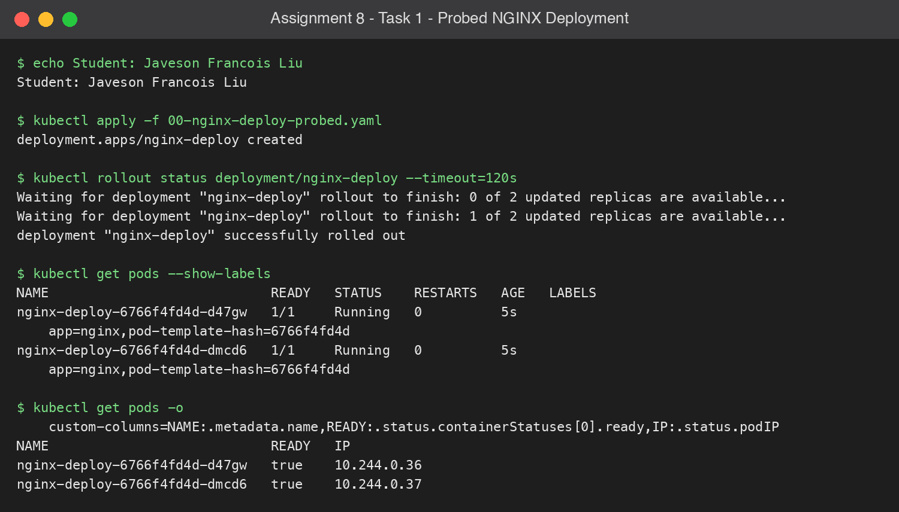
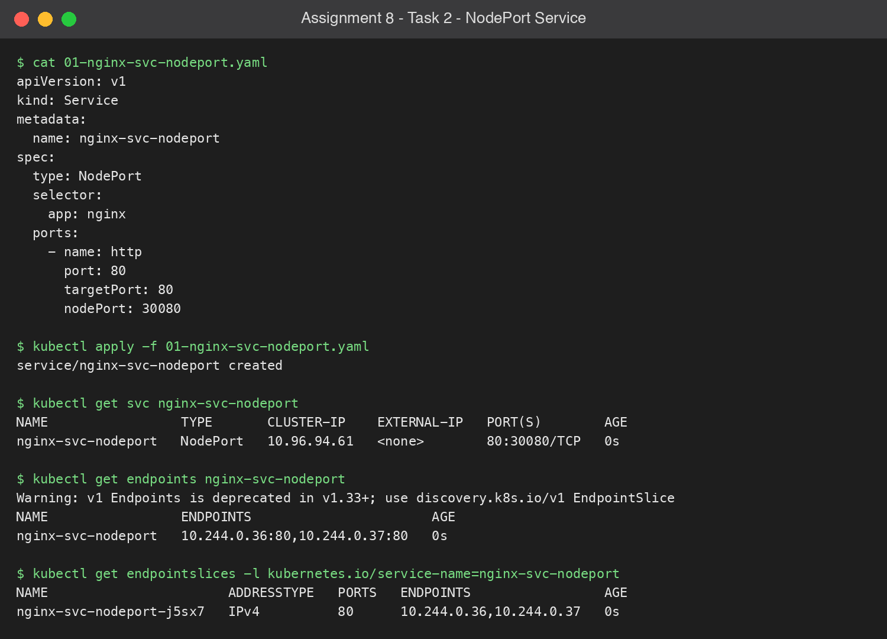
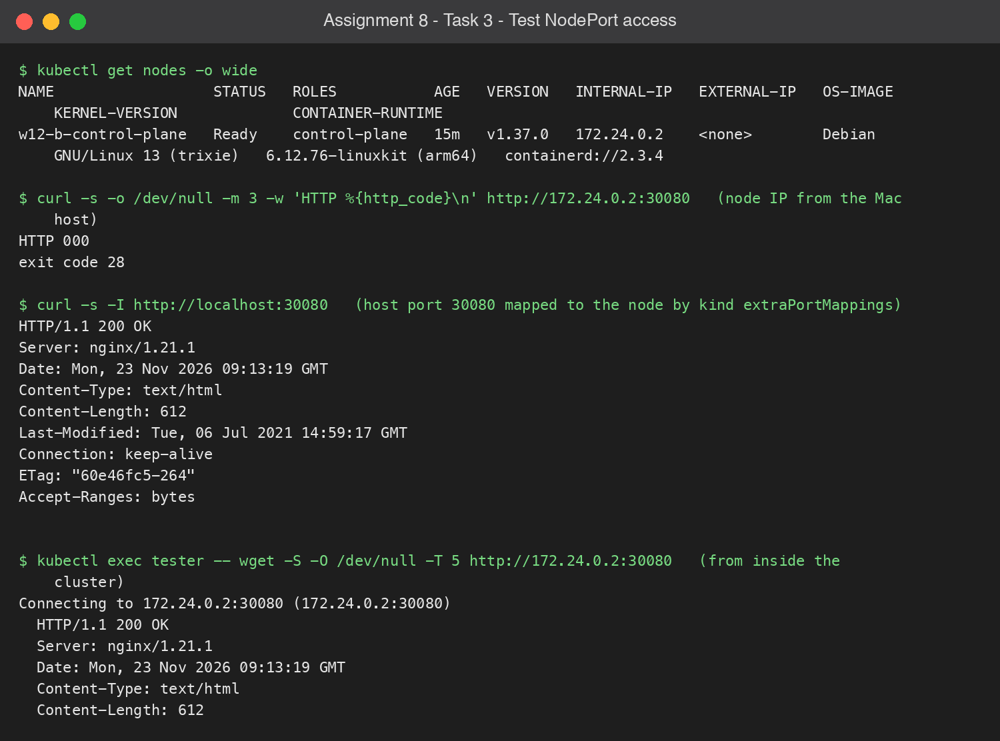
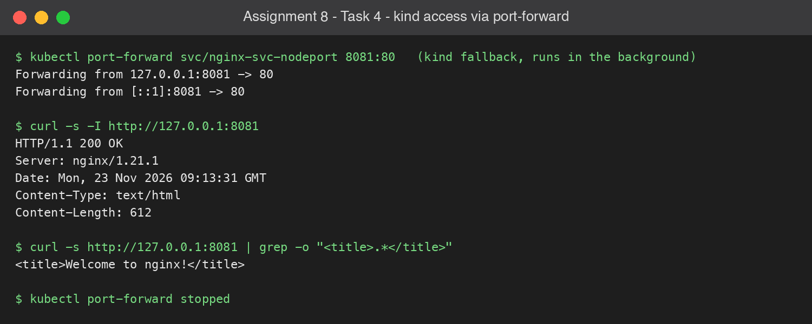
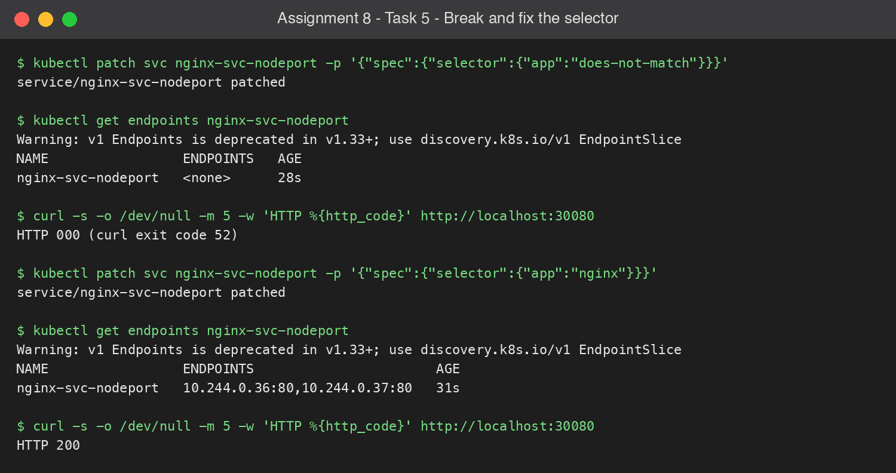
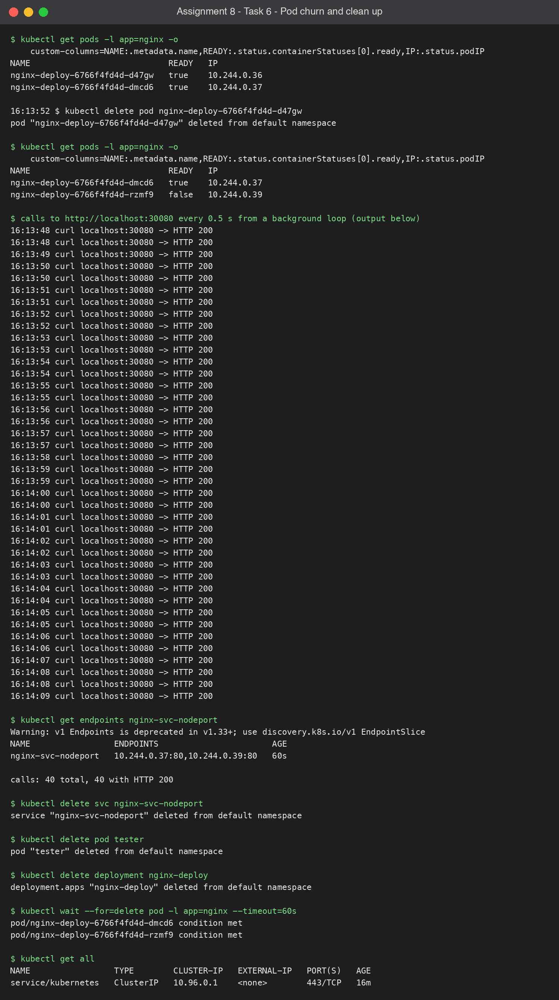

# Assignment 8 — Kubernetes Services (NodePort)

Part of the DevOps Micro Internship (DMI) with Agentic AI

---

## Purpose

In this guided lab, you will expose NGINX on node port 30080, test it from outside and inside the cluster, break and fix the selector, and verify availability during Pod churn.

---

# Task 1 — Deploy the Probed NGINX Workload

## Goal

Create healthy, labeled NGINX Pods (readiness + liveness probes) for the NodePort Service.

### Evidence

#### Screenshot 1 — Healthy NGINX Pods before Service creation



Commands: `kubectl apply -f 00-nginx-deploy-probed.yaml`, `kubectl rollout status deployment/nginx-deploy`, `kubectl get pods --show-labels`. Result: two `nginx:1.21.1` Pods, `1/1 Running`, label `app=nginx`, with readiness and liveness probes. Cluster: local kind cluster `w12-b`, created with an `extraPortMappings` entry that maps host port 30080 to node port 30080.

---

# Task 2 — Create the NodePort Service

## Goal

Create `nginx-svc-nodeport` (type `NodePort`, port 80, `nodePort: 30080`) and inspect the Service and endpoints.

### Evidence

#### Screenshot 2 — Service output showing `80:30080` and populated endpoints



Commands: `kubectl apply -f 01-nginx-svc-nodeport.yaml`, `kubectl get svc nginx-svc-nodeport`, `kubectl get endpoints nginx-svc-nodeport`, `kubectl get endpointslices`. Result: type `NodePort`, `PORT(S) 80:30080/TCP`, ClusterIP `10.96.94.61`, and both Pod IPs (`10.244.0.36`, `10.244.0.37`) as endpoints.

---

# Task 3 — Find a Node IP and Test Access

## Goal

Find a reachable node IP and test `<NODE_IP>:30080` externally (curl) and internally (from a `tester` Pod).

### Evidence

#### Screenshot 3 — Successful external or internal NodePort response



The kind node IP is `172.24.0.2`. From the Mac host, `curl http://172.24.0.2:30080` timed out (HTTP 000, exit code 28) because the node IP lives on the Docker network and is not routable from macOS. Through the kind port mapping, `curl -I http://localhost:30080` returned `HTTP/1.1 200 OK` from `nginx/1.21.1`. From inside the cluster, the `tester` Pod (`02-tester-pod.yaml`) got `HTTP/1.1 200 OK` from `http://172.24.0.2:30080`.

---

# Task 4 — Use the Environment-Specific Access Method

## Goal

Use the appropriate fallback for your cluster environment (`minikube service --url`, or port-forward for kind/Docker Desktop) to validate the Service.

### Evidence

#### Screenshot 4 — Minikube helper URL or local validation result



This is a kind cluster, so the Minikube helper does not apply. I used the kind fallback: `kubectl port-forward svc/nginx-svc-nodeport 8081:80`, then `curl -I http://127.0.0.1:8081` returned `HTTP/1.1 200 OK` and the page title `Welcome to nginx!`. The port-forward was stopped afterwards.

---

# Task 5 — Break and Fix the Selector

## Goal

Change the selector to `app: does-not-match`, confirm endpoints empty and the request fails, then restore the good selector.

### Evidence

#### Screenshot 5 — Empty then restored endpoint output



Commands: `kubectl patch svc nginx-svc-nodeport` to selector `app: does-not-match`, then back to `app: nginx`. Result: while broken, Endpoints showed `<none>` and `curl http://localhost:30080` failed (HTTP 000, curl exit code 52, empty reply). After restoring the selector, both endpoints returned and `curl` gave `HTTP 200`.

---

# Task 6 — Test Pod Churn and Clean Up

## Goal

Delete one backend Pod while calling the NodePort from another terminal, confirm the Service remains available, then optionally clean up.

### Evidence

#### Screenshot 6 — Pod replacement while NodePort remains available



While a background loop called `http://localhost:30080` every 0.5 seconds (40 calls), I ran `kubectl delete pod nginx-deploy-6766f4fd4d-d47gw`. The Deployment created a replacement (`10.244.0.39`) that was briefly `READY false`, and all 40 calls returned `HTTP 200` because the other Pod kept serving and the replacement joined the endpoints once Ready. Cleanup: deleted `nginx-svc-nodeport`, `tester` and `nginx-deploy`; `kubectl get all` shows only the default `kubernetes` Service.

---

### Notes

A NodePort Service opens the same port (30080) on every node and forwards it to the Service ClusterIP and then to a ready Pod. On kind the node is a Docker container, so its IP (172.24.0.2) works from inside the cluster but not from macOS. I made it reachable from the host with `extraPortMappings` at cluster creation, and also validated with `kubectl port-forward`. A wrong selector emptied the endpoints and the NodePort stopped answering until the selector matched again. Deleting a backend Pod caused no downtime in the test (40 of 40 calls returned 200) because the Service routes only to ready endpoints and the Deployment replaces the Pod.

---

### Manifests

kind cluster config (passed on stdin to `kind create cluster --name w12-b --config -`)

```yaml
kind: Cluster
apiVersion: kind.x-k8s.io/v1alpha4
nodes:
- role: control-plane
  extraPortMappings:
  - containerPort: 30080
    hostPort: 30080
    listenAddress: "127.0.0.1"
    protocol: TCP
```

`00-nginx-deploy-probed.yaml`

```yaml
apiVersion: apps/v1
kind: Deployment
metadata:
  name: nginx-deploy
  annotations:
    student: "Javeson Francois Liu"
spec:
  replicas: 2
  selector:
    matchLabels:
      app: nginx
  template:
    metadata:
      labels:
        app: nginx
    spec:
      containers:
        - name: nginx
          image: nginx:1.21.1
          ports:
            - containerPort: 80
          readinessProbe:
            httpGet:
              path: /
              port: 80
            initialDelaySeconds: 5
            periodSeconds: 5
            timeoutSeconds: 2
            failureThreshold: 3
          livenessProbe:
            httpGet:
              path: /
              port: 80
            initialDelaySeconds: 10
            periodSeconds: 10
            timeoutSeconds: 2
            failureThreshold: 3
```

`01-nginx-svc-nodeport.yaml`

```yaml
apiVersion: v1
kind: Service
metadata:
  name: nginx-svc-nodeport
spec:
  type: NodePort
  selector:
    app: nginx
  ports:
    - name: http
      port: 80
      targetPort: 80
      nodePort: 30080
```

`02-tester-pod.yaml`

```yaml
apiVersion: v1
kind: Pod
metadata:
  name: tester
  labels:
    app: tester
spec:
  containers:
    - name: tester
      image: busybox:1.36
      command: ["sleep", "3600"]
```

---

# Submission Instructions

- Add all required screenshots in your submission
- Include the completed YAML manifests used in the lab

---

# Completion Checklist

- [x] Task 1: Probed NGINX Deployment applied (Screenshot 1)
- [x] Task 2: NodePort Service created on 30080 (Screenshot 2)
- [x] Task 3: NodePort tested externally/internally (Screenshot 3)
- [x] Task 4: Environment-specific access method used (Screenshot 4)
- [x] Task 5: Selector broken and fixed (Screenshot 5)
- [x] Task 6: Pod churn tested and Service continuity confirmed (Screenshot 6)
- [x] Reflection notes written (Notes)

---

## 📌 About DMI & CloudAdvisory

DevOps Micro Internship (DMI) is a project-based DevOps program run by Pravin Mishra (The CloudAdvisory) focused on real-world execution, systems thinking, and career readiness.

It helps learners build strong DevOps foundations with hands-on experience.

---

## 📌 Resources

- 🌐 DMI Official Website: https://dmi.pravinmishra.com?utm_source=github&utm_medium=readme  
- 🎓 University: https://university.pravinmishra.com?utm_source=github&utm_medium=readme  
- 💬 Discord Community: https://discord.pravinmishra.com?utm_source=github&utm_medium=readme  
- 📝 Blog: https://dmi.pravinmishra.com/blog?utm_source=github&utm_medium=readme  
- ▶️ YouTube Playlist: https://www.youtube.com/playlist?list=PLFeSNDtI4Cho  
- 🔗 Pravin Mishra (LinkedIn): https://www.linkedin.com/in/pravin-mishra-aws-trainer/  
- 🏢 CloudAdvisory (LinkedIn): https://www.linkedin.com/company/thecloudadvisory/

---

*This submission is part of DevOps Micro Internship (DMI) — Agentic AI Track.*
