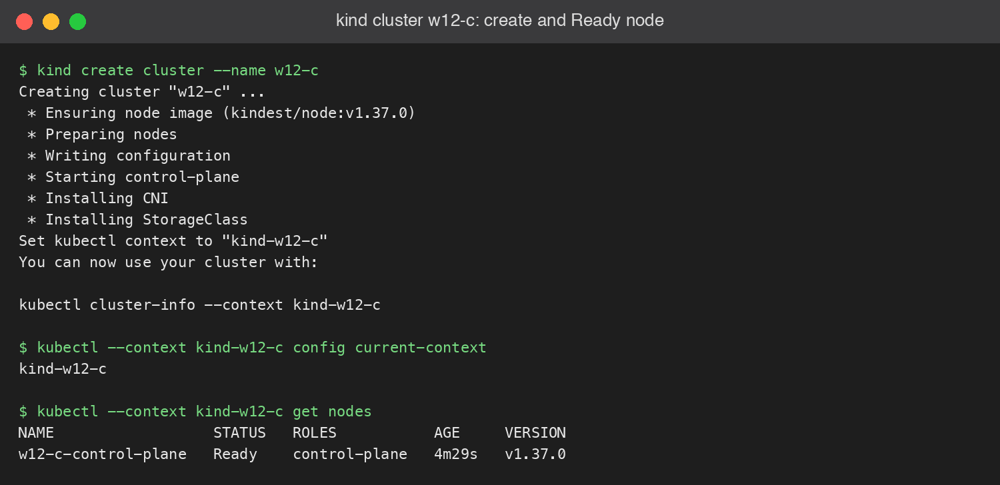
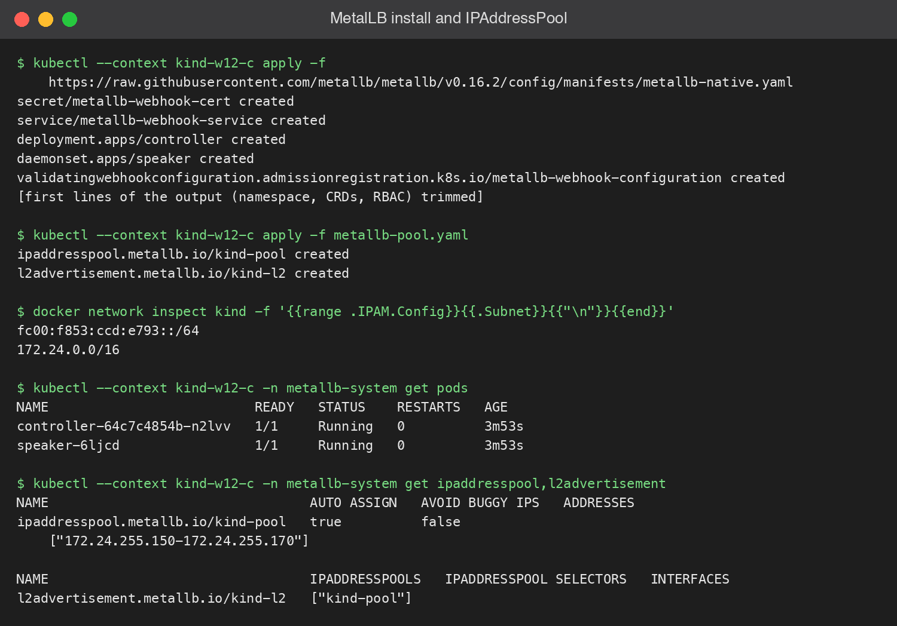
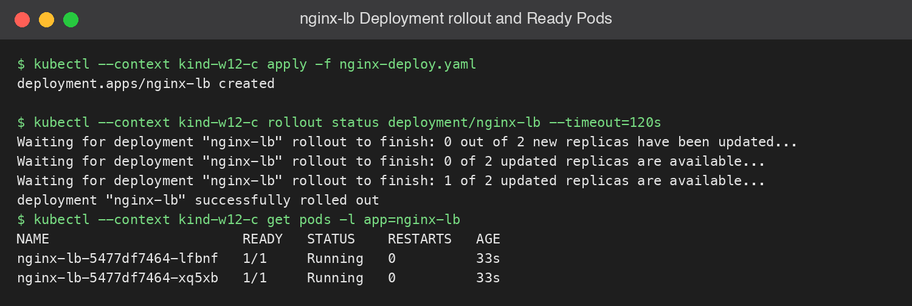
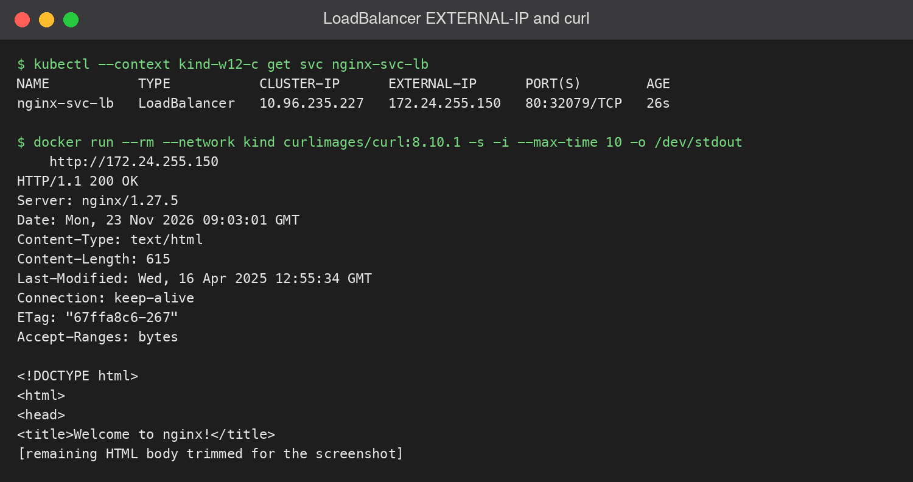
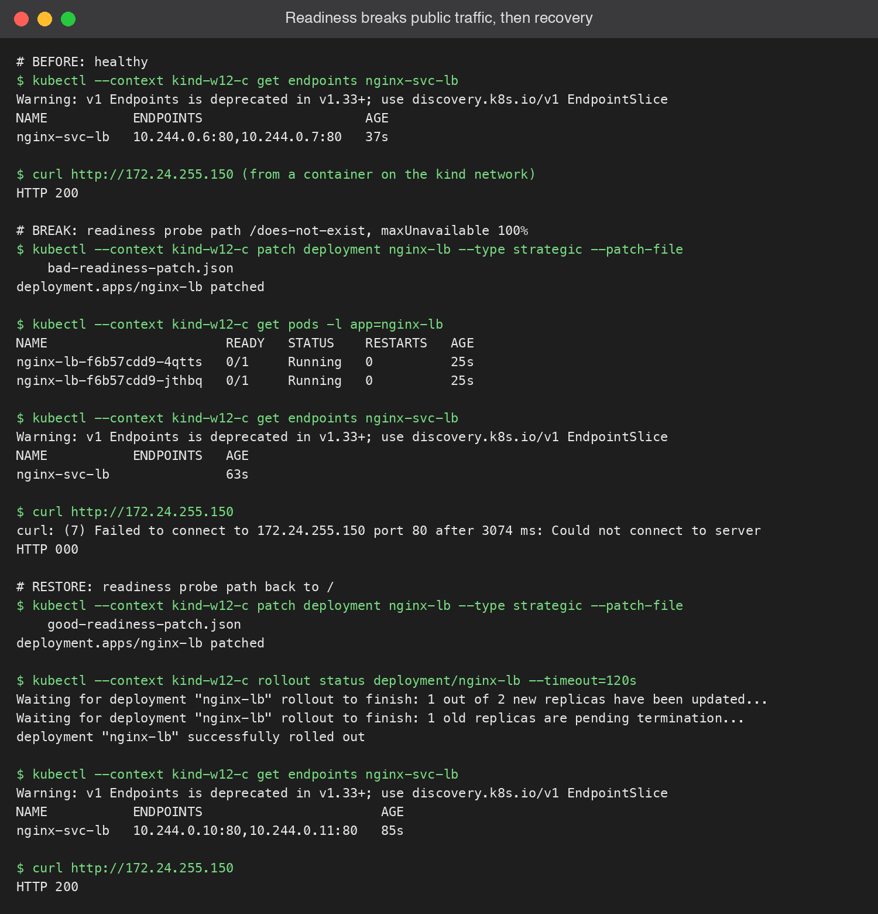
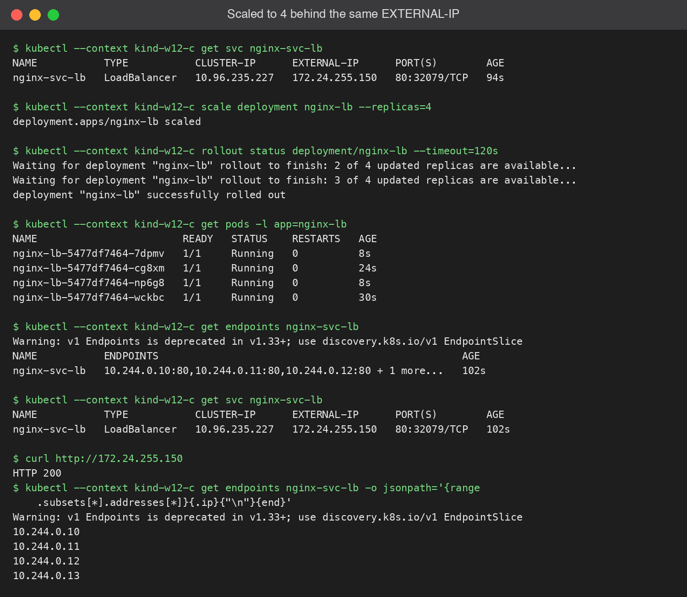
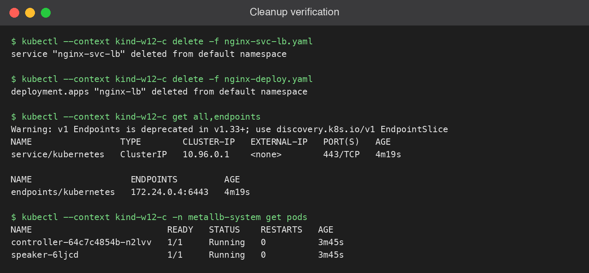

# Assignment 9 — Kubernetes Services (LoadBalancer)

Part of the DevOps Micro Internship (DMI) with Agentic AI

---

## Environment note (read first)

This lab was written for AKS on Azure. I ran it on a **local kind cluster** (`w12-c`, Kubernetes v1.37.0, one control-plane node, Docker Desktop on macOS), with no Azure resources. Every command used `--context kind-w12-c`.

A `type: LoadBalancer` Service gets its `EXTERNAL-IP` from a cloud controller. kind has none, so the IP would stay `<pending>` forever. To get a real assignment I installed **MetalLB v0.16.2** (the official `metallb-native.yaml` manifest, version pinned) and gave it an `IPAddressPool` taken from the Docker `kind` network. MetalLB's speaker answers ARP for the assigned IP (L2 mode), so the behaviour matches a cloud LoadBalancer: the Service receives a stable external IP, and traffic reaches the ready Pods.

Differences from the AKS version, stated honestly:

- Task 1 is `kind create cluster` instead of `az aks create`. There is no resource group and no `westeurope` region.
- The `EXTERNAL-IP` is a private address on the Docker network (`172.24.255.150`), not a public internet IP. Docker Desktop on macOS does not route that network to the host, so I ran `curl` from a throwaway container attached to the `kind` network (`docker run --rm --network kind curlimages/curl:8.10.1 ...`). That container plays the role of "a client outside the cluster".
- Task 6 deletes the Kubernetes objects. The kind cluster itself is deleted once at the very end of my Week 12 work (it is shared with Assignments 10 and 11).

---

## Purpose

In this guided lab, you will provision a small AKS cluster, deploy probed NGINX Pods, expose them with a public LoadBalancer Service, test the internet endpoint, and observe readiness and scaling.

---

# Task 1 — Provision and Connect to AKS

## Goal

Create resource group `rg-aks-lb-lab` and a one-node AKS cluster `aks-lb-lab` (`westeurope`, `Standard_B2s`), then fetch credentials and verify the node.

### Evidence

#### Screenshot 1 — AKS creation result and Ready node output

```bash
kind create cluster --name w12-c
kubectl --context kind-w12-c config current-context
kubectl --context kind-w12-c get nodes
```



Extra evidence: MetalLB v0.16.2 installed and an address pool taken from the `kind` Docker network (`docker network inspect kind` reports `172.24.0.0/16`, so I reserved `172.24.255.150-172.24.255.170`).



`metallb-pool.yaml`:

```yaml
apiVersion: metallb.io/v1beta1
kind: IPAddressPool
metadata:
  name: kind-pool
  namespace: metallb-system
spec:
  addresses:
    - 172.24.255.150-172.24.255.170
---
apiVersion: metallb.io/v1beta1
kind: L2Advertisement
metadata:
  name: kind-l2
  namespace: metallb-system
spec:
  ipAddressPools:
    - kind-pool
```

---

# Task 2 — Deploy the Probed NGINX Workload

## Goal

Create two healthy, probed NGINX Pods for the public Service.

### Evidence

#### Screenshot 2 — Successful rollout and two Ready Pods

`nginx-deploy.yaml`:

```yaml
apiVersion: apps/v1
kind: Deployment
metadata:
  name: nginx-lb
  labels:
    app: nginx-lb
spec:
  replicas: 2
  selector:
    matchLabels:
      app: nginx-lb
  template:
    metadata:
      labels:
        app: nginx-lb
    spec:
      containers:
        - name: nginx
          image: nginx:1.27-alpine
          ports:
            - containerPort: 80
          readinessProbe:
            httpGet:
              path: /
              port: 80
            initialDelaySeconds: 3
            periodSeconds: 5
            failureThreshold: 2
          livenessProbe:
            httpGet:
              path: /
              port: 80
            initialDelaySeconds: 10
            periodSeconds: 10
          resources:
            requests:
              cpu: 50m
              memory: 32Mi
            limits:
              cpu: 200m
              memory: 64Mi
```



---

# Task 3 — Create and Test the LoadBalancer Service

## Goal

Create `nginx-svc-lb` (type `LoadBalancer`, port 80), wait for `EXTERNAL-IP`, and test it with `curl`.

### Evidence

#### Screenshot 3 — Service with public `EXTERNAL-IP` and successful `curl` output

`nginx-svc-lb.yaml`:

```yaml
apiVersion: v1
kind: Service
metadata:
  name: nginx-svc-lb
spec:
  type: LoadBalancer
  selector:
    app: nginx-lb
  ports:
    - port: 80
      targetPort: 80
```

`EXTERNAL-IP` was assigned by MetalLB (not `<pending>`), the endpoints list both Pods, and the `curl` returns `HTTP/1.1 200 OK` with the NGINX welcome page.



---

# Task 4 — Prove Readiness Affects Public Traffic

## Goal

Apply a broken readiness patch, confirm the Pod leaves the endpoint set and public availability is affected, then restore health.

### Evidence

#### Screenshot 4 — Endpoint changes and public `curl` behavior before and after recovery

I patched the Deployment so the readiness probe checks `/does-not-exist` (NGINX answers 404) and set `maxUnavailable: 100%` and `maxSurge: 0` in the same patch. With the default rolling update (25 percent) the two old healthy Pods would have stayed in the endpoint set and the public IP would have kept answering, which hides the effect. With 100 percent, both old Pods are replaced by Pods that run but never become Ready.

Result: Pods `0/1 Running`, endpoints empty, and `curl` to the `EXTERNAL-IP` fails (`HTTP 000`, connection refused). The Pods are not restarted, because readiness only removes a Pod from the Service and liveness is a separate probe. Restoring the probe path to `/` and the default strategy brought the endpoints back and `curl` returned 200.

Bad patch:

```json
{"spec":{"strategy":{"type":"RollingUpdate","rollingUpdate":{"maxUnavailable":"100%","maxSurge":0}},"template":{"spec":{"containers":[{"name":"nginx","readinessProbe":{"httpGet":{"path":"/does-not-exist","port":80},"initialDelaySeconds":3,"periodSeconds":5,"failureThreshold":2}}]}}}}
```

Restore patch:

```json
{"spec":{"strategy":{"type":"RollingUpdate","rollingUpdate":{"maxUnavailable":"25%","maxSurge":"25%"}},"template":{"spec":{"containers":[{"name":"nginx","readinessProbe":{"httpGet":{"path":"/","port":80},"initialDelaySeconds":3,"periodSeconds":5,"failureThreshold":2}}]}}}}
```



---

# Task 5 — Scale Behind the Stable Public Endpoint

## Goal

Scale to four replicas and confirm the endpoint set grows while the public IP stays the same.

### Evidence

#### Screenshot 5 — Four replicas/endpoints behind the unchanged public endpoint

`kubectl scale deployment nginx-lb --replicas=4` gave four Ready Pods and four endpoints. The `EXTERNAL-IP` stayed `172.24.255.150` and the `curl` still returned 200: clients keep one stable address while the backends behind it change.



---

# Task 6 — Troubleshoot and Clean Up

## Goal

Resolve any pending endpoint or unhealthy backend issues, then delete the Kubernetes objects and Azure resource group when finished.

### Evidence

#### Screenshot 6 — Clean final verification or resource deletion command output

No pending endpoints remained. I deleted the Service and the Deployment; the cluster then listed only the built-in `kubernetes` Service, and the MetalLB Pods stay up for the next assignment. The kind cluster `w12-c` is deleted at the end of the Week 12 work.

```bash
kubectl --context kind-w12-c delete -f nginx-svc-lb.yaml
kubectl --context kind-w12-c delete -f nginx-deploy.yaml
kubectl --context kind-w12-c get all,endpoints
```



---

### Notes

Write a short note describing what the lab demonstrated.

The lab showed that a `LoadBalancer` Service is a ClusterIP plus a NodePort plus an external address, and that the external address is only as real as the controller behind it. On kind nothing assigns one, so I installed MetalLB in L2 mode with a pool from the Docker network and the Service got `172.24.255.150` for real (a NodePort `32079` was allocated as well, as on any cluster).

It also showed that readiness is what ties Pods to public traffic: a failing readiness probe removed every Pod from the endpoint set and the external IP stopped answering, even though the Pods were still Running. The probe change alone would not have caused an outage under the default rolling update; I forced one with `maxUnavailable: 100%` to make the effect visible, and I record that here as my own choice. Scaling from 2 to 4 changed only the endpoint list, not the IP.

Honest limits: this is a local simulation of AKS. The IP is private to the Docker network, not on the internet, and `curl` ran from a container on that network because macOS cannot reach it directly. No Azure resources were created or deleted.

---

# Submission Instructions

- Add all required screenshots in your submission
- Include the completed YAML manifests used in the lab

---

# Completion Checklist

- [x] Task 1: Cluster provisioned and connected (kind `w12-c` instead of AKS, Screenshot 1)
- [x] Task 2: Probed NGINX Deployment applied (Screenshot 2)
- [x] Task 3: LoadBalancer Service created and tested (Screenshot 3)
- [x] Task 4: Readiness impact on public traffic proven (Screenshot 4)
- [x] Task 5: Scaled behind the stable endpoint (Screenshot 5)
- [x] Task 6: Kubernetes objects cleaned up (no Azure resources existed, Screenshot 6)
- [x] Reflection notes written (Notes)

---

## 📌 About DMI & CloudAdvisory

DevOps Micro Internship (DMI) is a project-based DevOps program run by Pravin Mishra (The CloudAdvisory) focused on real-world execution, systems thinking, and career readiness.

It helps learners build strong DevOps foundations with hands-on experience.

---

## 📌 Resources

- 🌐 DMI Official Website: https://dmi.pravinmishra.com?utm_source=github&utm_medium=readme  
- 🎓 University: https://university.pravinmishra.com?utm_source=github&utm_medium=readme  
- 💬 Discord Community: https://discord.pravinmishra.com?utm_source=github&utm_medium=readme  
- 📝 Blog: https://dmi.pravinmishra.com/blog?utm_source=github&utm_medium=readme  
- ▶️ YouTube Playlist: https://www.youtube.com/playlist?list=PLFeSNDtI4Cho  
- 🔗 Pravin Mishra (LinkedIn): https://www.linkedin.com/in/pravin-mishra-aws-trainer/  
- 🏢 CloudAdvisory (LinkedIn): https://www.linkedin.com/company/thecloudadvisory/

---

*This submission is part of DevOps Micro Internship (DMI) — Agentic AI Track.*
