# Assignment 10 — Capstone: Deploy the Book Review App to Kubernetes

Part of the DevOps Micro Internship (DMI) with Agentic AI

---

## Environment summary

- **Platform:** local **kind** cluster `w12-c` (Kubernetes v1.37.0, one control-plane node, Docker Desktop on macOS). Every command used `--context kind-w12-c`.
- **Namespace:** `bookreview`.
- **Images:** built locally and loaded with `kind load docker-image --name w12-c` (no registry): `bookreview-backend:1.0.0`, `bookreview-frontend:1.0.0`. Nginx (`nginx:1.27-alpine`) and MySQL (`mysql:8.4`) come from Docker Hub.
- **Public entry point:** Service `frontend` of type `LoadBalancer`. kind has no cloud controller, so **MetalLB v0.16.2** (installed in Assignment 9, pool `172.24.255.150-172.24.255.170` from the Docker `kind` network) assigns the `EXTERNAL-IP` `172.24.255.150`. That address is on the Docker network, not the public internet.
- **App source:** `pravinmishraaws/book-review-app`, built from a scratch copy (the original repo was not modified).

---

## Purpose

In this capstone assignment, you will deploy the Book Review App as a production-style three-tier application on Kubernetes (EKS, AKS, GKE, Minikube, or k3s): a Next.js frontend behind Nginx exposed publicly, an internal Node.js/Express backend on port 3010, and a persistent or managed MySQL database — configured with ConfigMaps, Secrets, and validated end to end.

---

# Task 1 — Prepare the Kubernetes Cluster and Tooling

## Goal

Select a Kubernetes platform, confirm `kubectl` (and Helm, if used) can communicate with the cluster, and verify nodes are Ready.

### Evidence

#### Screenshot 1 — Terminal showing the active Kubernetes context and Ready nodes

```bash
kubectl --context kind-w12-c config current-context
kubectl --context kind-w12-c get nodes -o wide
kind load docker-image bookreview-backend:1.0.0 bookreview-frontend:1.0.0 --name w12-c
```

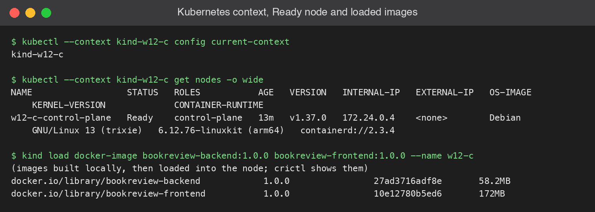

---

#### Screenshot 2 (if using Helm) — Terminal showing `helm version`

Not applicable. Helm was not used; the app is deployed with plain manifests (shown below).

---

# Task 2 — Design the Three-Tier Kubernetes Architecture

## Goal

Create an architecture diagram showing the public entry point, frontend, internal backend, MySQL, ConfigMaps/Secrets, and the permitted traffic flow.

### Evidence

#### Screenshot 3 — Completed Kubernetes architecture diagram

Diagram of the deployed layout: Client, LoadBalancer Service, the frontend Pods (Nginx plus Next.js in one Pod), the internal backend Service and Pods, the headless MySQL Service and StatefulSet with its PVC, the ConfigMaps and Secret, and the NetworkPolicies. It was drawn from the manifests actually applied.

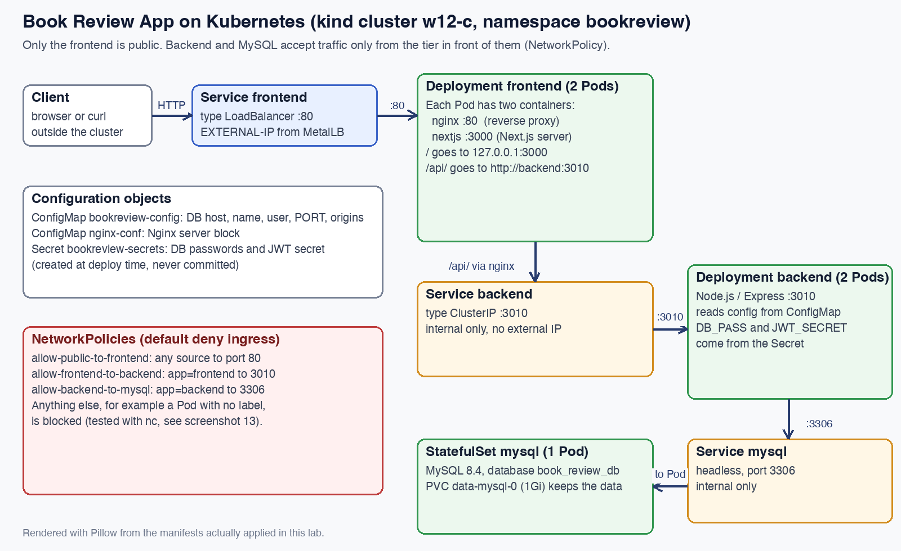

---

# Task 3 — Create ConfigMaps and Secrets

## Goal

Externalize non-sensitive configuration into ConfigMaps and sensitive values (database credentials, JWT secret) into Secrets, referenced from the Pod specs without committing plaintext values.

### Evidence

#### Screenshot 4 — ConfigMap manifest or `kubectl describe configmap` output showing non-sensitive configuration

`01-configmaps.yaml` (namespace in `00-namespace.yaml` is `bookreview`):

```yaml
apiVersion: v1
kind: ConfigMap
metadata:
  name: bookreview-config
  namespace: bookreview
data:
  PORT: "3010"
  DB_HOST: mysql
  DB_PORT: "3306"
  DB_NAME: book_review_db
  DB_USER: bookreview
  DB_DIALECT: mysql
  ALLOWED_ORIGINS: "http://172.24.255.150,http://localhost:8080"
---
apiVersion: v1
kind: ConfigMap
metadata:
  name: nginx-conf
  namespace: bookreview
data:
  default.conf: |
    server {
      listen 80;
      server_name _;

      location /api/ {
        rewrite ^/api/api/(.*)$ /api/$1 break;
        proxy_pass http://backend:3010;
        proxy_set_header Host $host;
        proxy_set_header X-Real-IP $remote_addr;
        proxy_set_header X-Forwarded-For $proxy_add_x_forwarded_for;
      }

      location / {
        proxy_pass http://127.0.0.1:3000;
        proxy_set_header Host $host;
        proxy_set_header X-Real-IP $remote_addr;
        proxy_set_header X-Forwarded-For $proxy_add_x_forwarded_for;
      }
    }
```

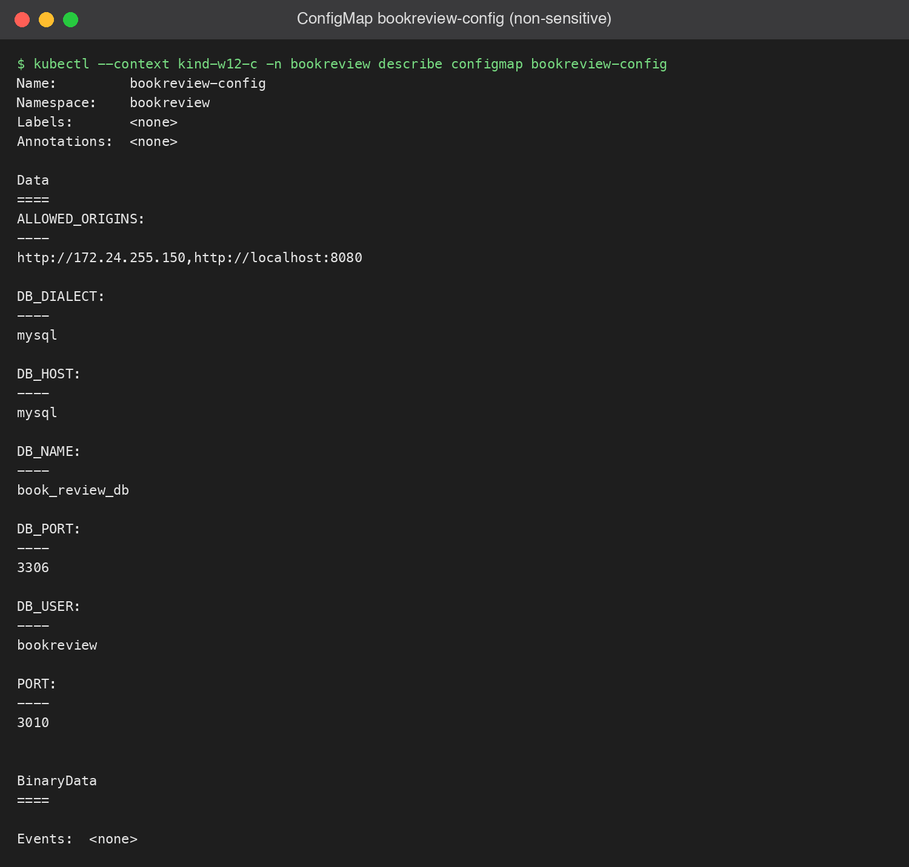

---

#### Screenshot 5 — Secret object usage with sensitive values hidden or redacted

The Secret `bookreview-secrets` is created at deploy time with random values, so no plaintext is in any file or in this report:

```bash
kubectl --context kind-w12-c -n bookreview create secret generic bookreview-secrets \
  --from-literal=MYSQL_ROOT_PASSWORD="$(openssl rand -hex 16)" \
  --from-literal=DB_PASS="$(openssl rand -hex 16)" \
  --from-literal=JWT_SECRET="$(openssl rand -hex 32)"
```

The screenshot shows only key names and byte sizes, plus the `secretKeyRef` wiring in the backend Deployment. No value is decoded or printed.

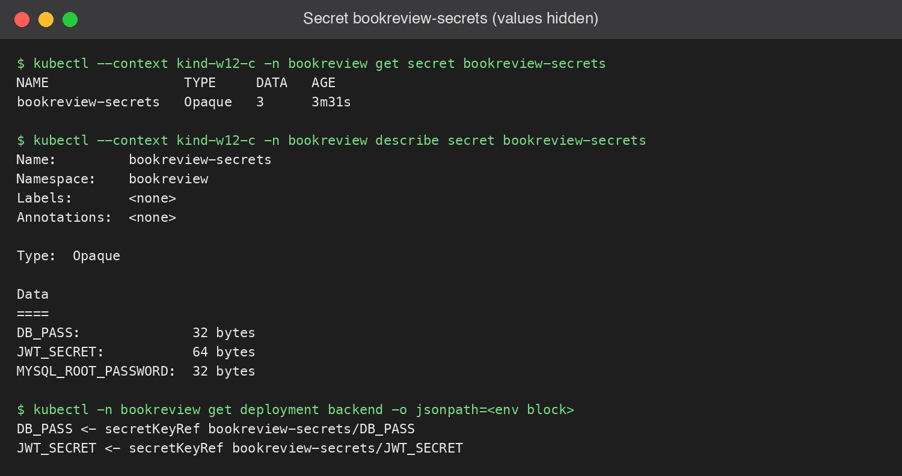

---

# Task 4 — Deploy and Configure the MySQL Data Tier

## Goal

Provide a persistent MySQL database (managed service or StatefulSet + PVC) reachable only by the backend, initialize the schema, and test connectivity.

### Evidence

#### Screenshot 6 — Managed MySQL status or MySQL StatefulSet/PVC status

`02-mysql.yaml`: a headless Service `mysql` and a StatefulSet with a 1Gi `volumeClaimTemplate` (kind's `standard` StorageClass). The credentials come from the ConfigMap and the Secret.

```yaml
apiVersion: v1
kind: Service
metadata:
  name: mysql
  namespace: bookreview
  labels:
    app: mysql
spec:
  clusterIP: None
  selector:
    app: mysql
  ports:
    - name: mysql
      port: 3306
      targetPort: 3306
---
apiVersion: apps/v1
kind: StatefulSet
metadata:
  name: mysql
  namespace: bookreview
spec:
  serviceName: mysql
  replicas: 1
  selector:
    matchLabels:
      app: mysql
  template:
    metadata:
      labels:
        app: mysql
        tier: data
    spec:
      containers:
        - name: mysql
          image: mysql:8.4
          ports:
            - containerPort: 3306
          env:
            - name: MYSQL_DATABASE
              valueFrom:
                configMapKeyRef:
                  name: bookreview-config
                  key: DB_NAME
            - name: MYSQL_USER
              valueFrom:
                configMapKeyRef:
                  name: bookreview-config
                  key: DB_USER
            - name: MYSQL_PASSWORD
              valueFrom:
                secretKeyRef:
                  name: bookreview-secrets
                  key: DB_PASS
            - name: MYSQL_ROOT_PASSWORD
              valueFrom:
                secretKeyRef:
                  name: bookreview-secrets
                  key: MYSQL_ROOT_PASSWORD
          readinessProbe:
            exec:
              command: ["mysqladmin", "ping", "-h", "127.0.0.1"]
            initialDelaySeconds: 15
            periodSeconds: 5
          livenessProbe:
            exec:
              command: ["mysqladmin", "ping", "-h", "127.0.0.1"]
            initialDelaySeconds: 60
            periodSeconds: 10
          resources:
            requests:
              cpu: 100m
              memory: 256Mi
            limits:
              memory: 768Mi
          volumeMounts:
            - name: data
              mountPath: /var/lib/mysql
  volumeClaimTemplates:
    - metadata:
        name: data
      spec:
        accessModes: ["ReadWriteOnce"]
        resources:
          requests:
            storage: 1Gi
```

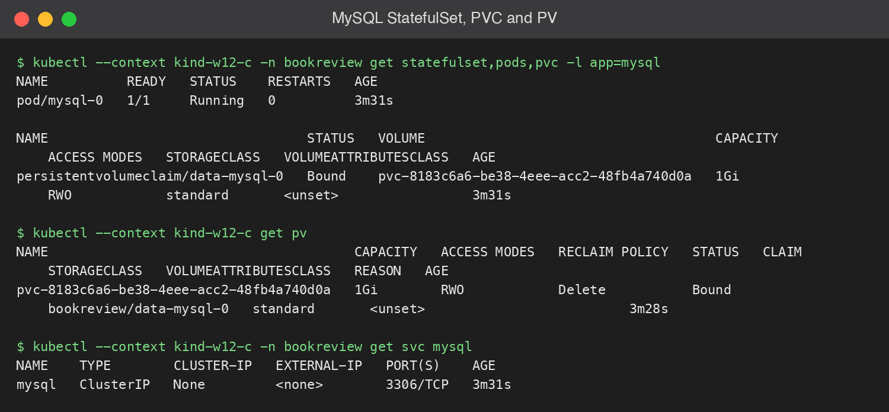

---

#### Screenshot 7 — Successful database connectivity or schema verification with credentials hidden

I connected from inside the `mysql-0` Pod as the application user. The password is read from the container's environment variable inside the shell, so it is never typed or printed. The schema (`Users`, `Books`, `Reviews`) was created by the backend at startup and the seed data plus my end-to-end review are present.

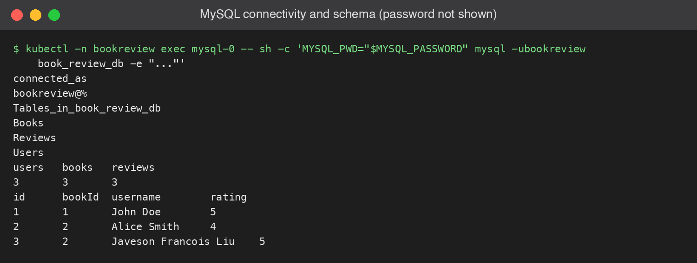

---

# Task 5 — Deploy the Backend Application Tier

## Goal

Run one or two Node.js/Express backend replicas on port 3010, expose them via ClusterIP (or internal LoadBalancer), and connect them to MySQL using ConfigMaps/Secrets.

### Evidence

#### Screenshot 8 — Backend Deployment, Pods, and internal Service

The backend Deployment starts with one replica so only one Pod runs the schema sync and seed, then goes to two (see Notes). The Service is ClusterIP only.

`03-backend.yaml` (final state, `replicas: 2`):

```yaml
apiVersion: apps/v1
kind: Deployment
metadata:
  name: backend
  namespace: bookreview
  labels:
    app: backend
spec:
  replicas: 2
  selector:
    matchLabels:
      app: backend
  template:
    metadata:
      labels:
        app: backend
        tier: backend
    spec:
      initContainers:
        - name: wait-for-mysql
          image: busybox:1.37
          command: ["sh", "-c", "until nc -z mysql 3306; do echo waiting for mysql; sleep 3; done"]
      containers:
        - name: backend
          image: bookreview-backend:1.0.0
          imagePullPolicy: IfNotPresent
          ports:
            - containerPort: 3010
          envFrom:
            - configMapRef:
                name: bookreview-config
          env:
            - name: DB_PASS
              valueFrom:
                secretKeyRef:
                  name: bookreview-secrets
                  key: DB_PASS
            - name: JWT_SECRET
              valueFrom:
                secretKeyRef:
                  name: bookreview-secrets
                  key: JWT_SECRET
          readinessProbe:
            httpGet:
              path: /
              port: 3010
            initialDelaySeconds: 5
            periodSeconds: 5
          livenessProbe:
            httpGet:
              path: /
              port: 3010
            initialDelaySeconds: 20
            periodSeconds: 10
          resources:
            requests:
              cpu: 50m
              memory: 96Mi
            limits:
              memory: 256Mi
---
apiVersion: v1
kind: Service
metadata:
  name: backend
  namespace: bookreview
spec:
  type: ClusterIP
  selector:
    app: backend
  ports:
    - port: 3010
      targetPort: 3010
```

Backend image (`backend/Dockerfile`, non-root, port 3010):

```dockerfile
FROM node:20-alpine
WORKDIR /app
ENV NODE_ENV=production
COPY package*.json ./
RUN npm ci --omit=dev
COPY src ./src
USER node
EXPOSE 3010
CMD ["node", "src/server.js"]
```

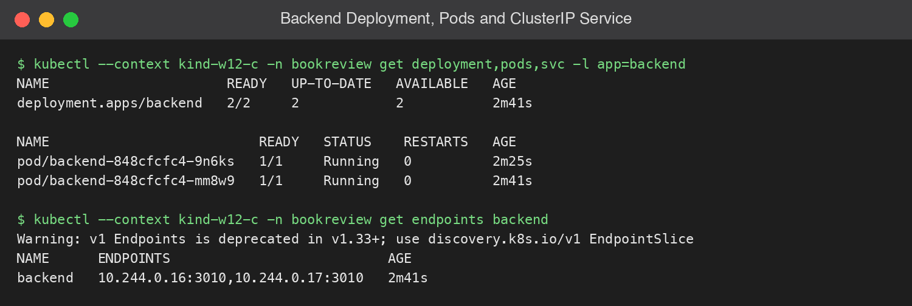

---

#### Screenshot 9 — Backend logs showing successful startup and database connectivity

The first Pod shows the database connection (over SSL, which the app requires), the schema sync, the seed data and the server start on port 3010.

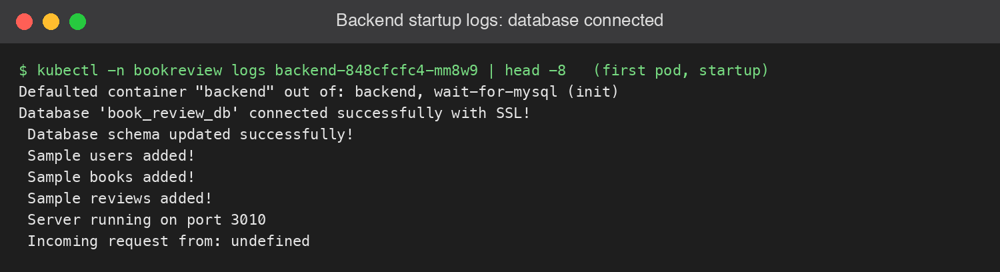

---

# Task 6 — Deploy the Frontend and Configure Nginx

## Goal

Run one or two Next.js frontend replicas behind Nginx on port 80, reverse-proxying to the backend's internal Service name.

### Evidence

#### Screenshot 10 — Frontend Deployment and Ready Pods

Each frontend Pod runs two containers: `nextjs` (port 3000, production `next start`) and `nginx` (port 80). Both are Ready (`2/2`).

`04-frontend.yaml`:

```yaml
apiVersion: apps/v1
kind: Deployment
metadata:
  name: frontend
  namespace: bookreview
  labels:
    app: frontend
spec:
  replicas: 2
  selector:
    matchLabels:
      app: frontend
  template:
    metadata:
      labels:
        app: frontend
        tier: frontend
    spec:
      containers:
        - name: nextjs
          image: bookreview-frontend:1.0.0
          imagePullPolicy: IfNotPresent
          ports:
            - containerPort: 3000
          readinessProbe:
            httpGet:
              path: /
              port: 3000
            initialDelaySeconds: 5
            periodSeconds: 5
          livenessProbe:
            httpGet:
              path: /
              port: 3000
            initialDelaySeconds: 20
            periodSeconds: 10
          resources:
            requests:
              cpu: 50m
              memory: 128Mi
            limits:
              memory: 384Mi
        - name: nginx
          image: nginx:1.27-alpine
          ports:
            - containerPort: 80
          readinessProbe:
            httpGet:
              path: /
              port: 80
            initialDelaySeconds: 5
            periodSeconds: 5
          livenessProbe:
            httpGet:
              path: /
              port: 80
            initialDelaySeconds: 15
            periodSeconds: 10
          resources:
            requests:
              cpu: 20m
              memory: 16Mi
            limits:
              memory: 64Mi
          volumeMounts:
            - name: nginx-conf
              mountPath: /etc/nginx/conf.d/default.conf
              subPath: default.conf
      volumes:
        - name: nginx-conf
          configMap:
            name: nginx-conf
---
apiVersion: v1
kind: Service
metadata:
  name: frontend
  namespace: bookreview
spec:
  type: LoadBalancer
  selector:
    app: frontend
  ports:
    - port: 80
      targetPort: 80
```

Frontend image (`frontend/Dockerfile`, multi-stage, non-root, `NEXT_PUBLIC_API_URL=/api` baked in at build time):

```dockerfile
FROM node:20-alpine AS build
WORKDIR /app
COPY package*.json ./
RUN npm ci
COPY . .
ARG NEXT_PUBLIC_API_URL=/api
ENV NEXT_PUBLIC_API_URL=$NEXT_PUBLIC_API_URL
ENV NEXT_TELEMETRY_DISABLED=1
RUN npm run build

FROM node:20-alpine
WORKDIR /app
ENV NODE_ENV=production
ENV NEXT_TELEMETRY_DISABLED=1
COPY --from=build /app/package*.json ./
COPY --from=build /app/node_modules ./node_modules
COPY --from=build /app/.next ./.next
COPY --from=build /app/public ./public
USER node
EXPOSE 3000
CMD ["npx", "next", "start", "-p", "3000"]
```

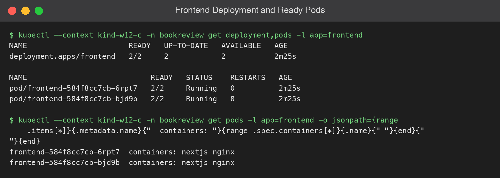

---

#### Screenshot 11 — Nginx reverse-proxy configuration showing the internal backend Service name

The Nginx server block is mounted from the `nginx-conf` ConfigMap. `/api/` goes to the internal Service name `backend` on port 3010, and `/` goes to the Next.js container on `127.0.0.1:3000`. `nginx -t` passes. The `rewrite` line collapses `/api/api/` to `/api/`, because the app's home page requests `${NEXT_PUBLIC_API_URL}/api/books` while every other page requests `${API_URL}/books`.

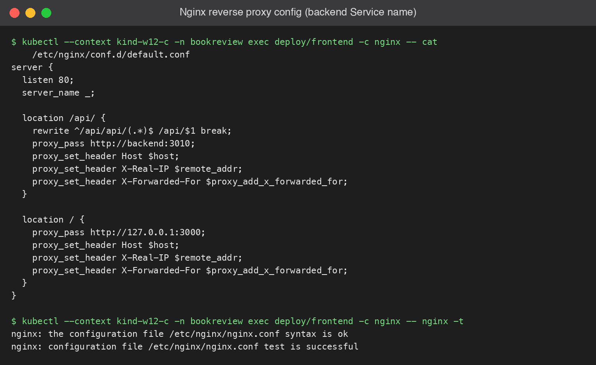

---

# Task 7 — Configure External and Internal Networking

## Goal

Expose only the frontend publicly (LoadBalancer or Ingress), restrict backend access to the frontend path (NetworkPolicy or platform equivalent), and confirm MySQL is not publicly reachable.

### Evidence

#### Screenshot 12 — Frontend LoadBalancer or Ingress showing the public endpoint

Only the frontend Service is exposed (`LoadBalancer`, MetalLB assigned `172.24.255.150`).

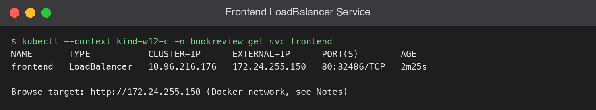

---

#### Screenshot 13 — Internal backend Service and NetworkPolicy (or equivalent restriction)

`backend` is ClusterIP and `mysql` is headless, so neither has an external IP. Four NetworkPolicies are applied (`05-networkpolicy.yaml`): default deny ingress, public to frontend on 80, frontend to backend on 3010, backend to MySQL on 3306.

```yaml
apiVersion: networking.k8s.io/v1
kind: NetworkPolicy
metadata:
  name: default-deny-ingress
  namespace: bookreview
spec:
  podSelector: {}
  policyTypes:
    - Ingress
---
apiVersion: networking.k8s.io/v1
kind: NetworkPolicy
metadata:
  name: allow-public-to-frontend
  namespace: bookreview
spec:
  podSelector:
    matchLabels:
      app: frontend
  policyTypes:
    - Ingress
  ingress:
    - ports:
        - protocol: TCP
          port: 80
---
apiVersion: networking.k8s.io/v1
kind: NetworkPolicy
metadata:
  name: allow-frontend-to-backend
  namespace: bookreview
spec:
  podSelector:
    matchLabels:
      app: backend
  policyTypes:
    - Ingress
  ingress:
    - from:
        - podSelector:
            matchLabels:
              app: frontend
      ports:
        - protocol: TCP
          port: 3010
---
apiVersion: networking.k8s.io/v1
kind: NetworkPolicy
metadata:
  name: allow-backend-to-mysql
  namespace: bookreview
spec:
  podSelector:
    matchLabels:
      app: mysql
  policyTypes:
    - Ingress
  ingress:
    - from:
        - podSelector:
            matchLabels:
              app: backend
      ports:
        - protocol: TCP
          port: 3306
```

kind's default CNI (kindnet) enforces NetworkPolicy. I proved it with a throwaway busybox Pod: before the policies a Pod with an unrelated label could reach `backend:3010` and `mysql:3306`; after, it is blocked, a Pod labelled `app=frontend` can reach only the backend, and a Pod labelled `app=backend` can reach MySQL. The public address still serves the app. The "from outside the cluster" lines show the ClusterIP is not reachable from outside and nothing answers on port 3306 at the public IP. That alone is not proof of the policy (ClusterIPs are not routable from outside anyway); the `nc` tests above are the proof.

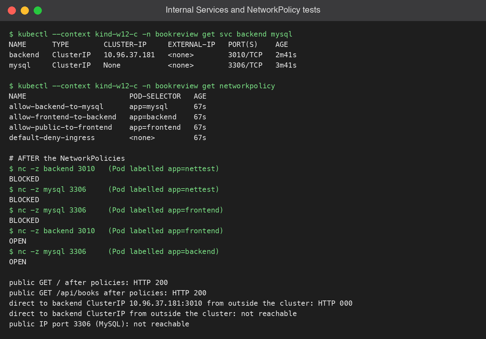

---

# Task 8 — Validate the Application End to End

## Goal

Confirm the frontend loads publicly, a full user flow reaches the backend and MySQL, and collect operational evidence.

### Evidence

#### Screenshot 14 — `kubectl get all` output

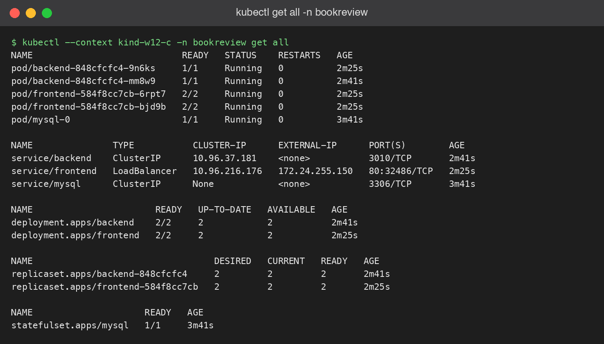

---

#### Screenshot 15 — Functional Book Review App in the browser with the public URL or IP visible

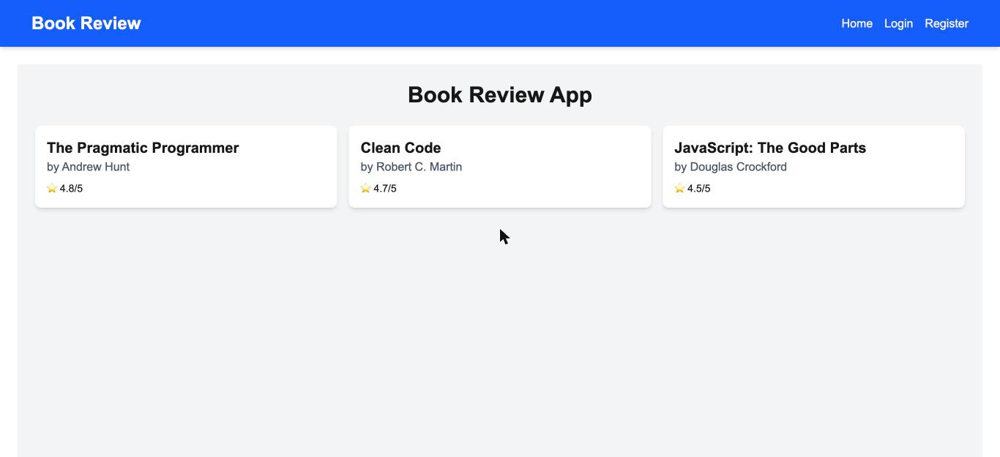

Opened through `kubectl --context kind-w12-c -n bookreview port-forward svc/frontend 8080:80` at `http://localhost:8080` (this origin is in `ALLOWED_ORIGINS`). The LoadBalancer address `http://172.24.255.150` is on the Docker network and is not reachable from the macOS host, so the port-forward address is the URL shown. The API behaviour (register, login, JWT-protected review, read back, 401 without a token) is verified with `curl` below.

End-to-end test through the LoadBalancer address (from a container on the `kind` network, with the same `Origin` header a browser sends):

```text
GET / (Next.js through Nginx):
  HTTP 200
GET /api/books:
[{"id":1,"title":"The Pragmatic Programmer","author":"Andrew Hunt","rating":4.8,"createdAt":"2026-11-23T09:11:04.000Z","updatedAt":"2026-11-23T09:11:04.000Z"},{"id":2,"title":"Clean Code","author":"Ro

GET /api/api/books (the home page URL, collapsed by the Nginx rewrite):
  HTTP 200
POST /api/users/register:
{"message":"User registered successfully"}
POST /api/users/login: token length 143 (value not shown)
POST /api/reviews (JWT protected):
{"message":"Review added successfully","review":{"createdAt":"2026-11-23T09:11:34.531Z","id":3,"userId":3,"bookId":2,"comment":"Read on a kind cluster.","rating":5,"username":"Javeson Francois Liu","updatedAt":"2026-11-2

POST /api/reviews without a token:
  HTTP 401
GET /api/reviews/2:
[{"id":3,"userId":3,"bookId":2,"comment":"Read on a kind cluster.","rating":5,"username":"Javeson Francois Liu","createdAt":"2026-11-23T09:11:34.000Z","updatedAt":"2026-11-23T09:11:34.000Z"},{"id":2,"userId":2,"bookId":2,"comment":"Very insightful.","rating":4,"username":"Alice Smith","createdAt":"2
```

---

#### Screenshot 16 — Frontend Pod logs

Frontend Pod logs: the Next.js container started ("Ready in 193ms") and the Nginx access log shows the proxied requests (probes filtered out).

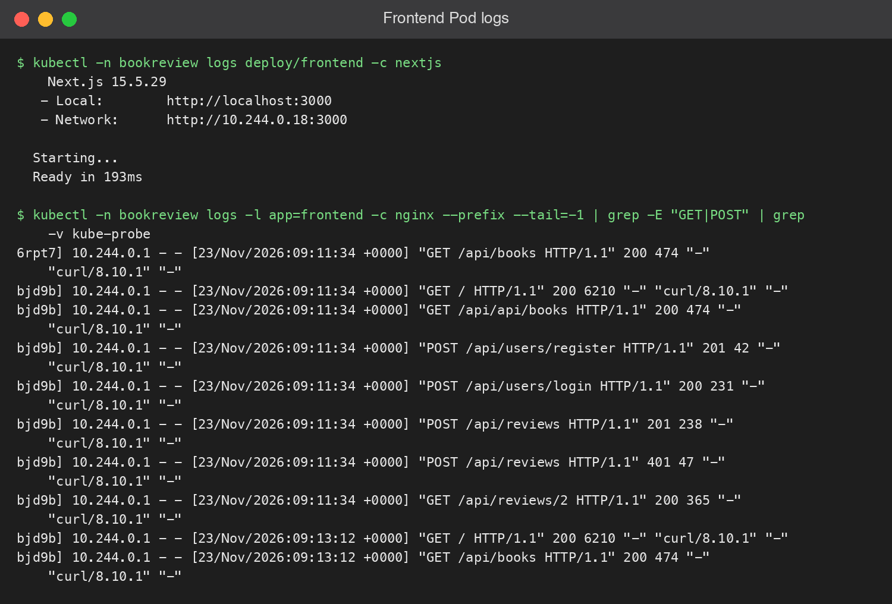

---

#### Screenshot 17 — Backend Pod logs showing successful requests or database activity

Backend logs: every request logs its `Origin`. The requests with `http://172.24.255.150` are the test requests through Nginx; the lines with `undefined` are kubelet probes and were filtered out.

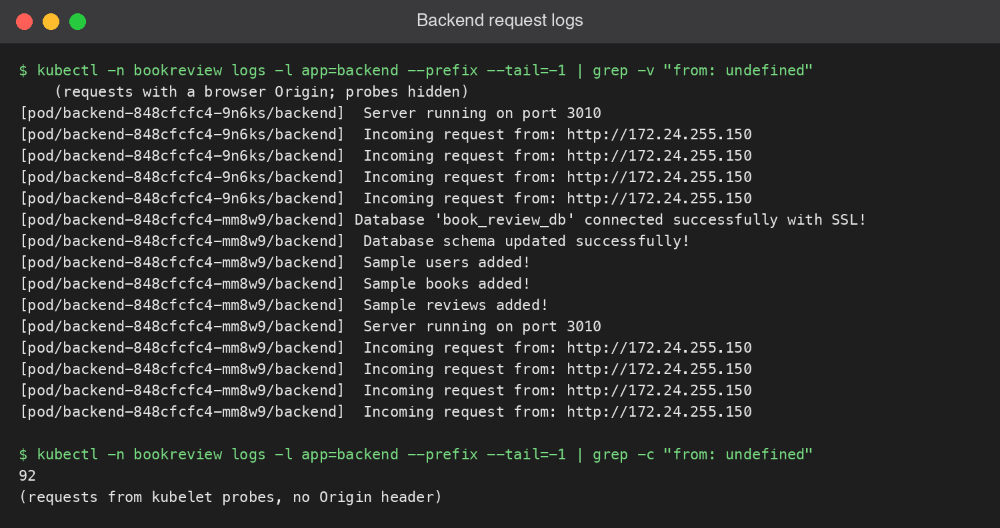

---

#### Screenshot 18 (optional) — Kubernetes dashboard

Not taken. The Kubernetes dashboard was not installed (optional).

---

# Task 9 — Implement Optional Production Enhancements

## Goal

Optionally package as a Helm chart, add HPA, add readiness/liveness probes, or configure TLS via cert-manager — without changing the core architecture.

### Evidence

#### Screenshot 19 (optional) — Helm release, HPA, probes, or TLS evidence

Only probes were added (optional item). Readiness and liveness probes are on every tier: HTTP on the backend (3010), the Next.js container (3000) and Nginx (80), and `mysqladmin ping` on MySQL. HPA, Helm and TLS were not done.

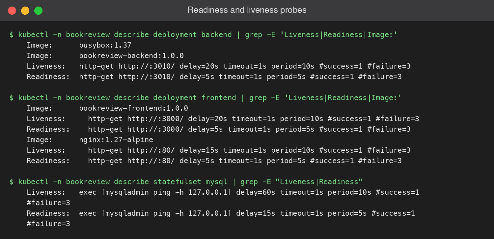

---

### Notes

Report the Kubernetes platform used, the public frontend URL/IP, a GitHub link to your manifests/Helm chart (if applicable), and the architecture diagram link. Summarize what worked, issues encountered and how they were resolved, and the tools/sources that helped the most.

**Platform:** local kind cluster `w12-c` (v1.37.0), namespace `bookreview`. **Public frontend address:** `http://172.24.255.150` (MetalLB, Docker network only; browse with `kubectl port-forward svc/frontend 8080:80`). **GitHub manifests link:** none, the manifests are included in this file. **Architecture diagram:** `screenshots/a10-ss3.png`.

**What worked:**

- The three tiers run as designed: Next.js behind Nginx (2 Pods, two containers each), Node/Express backend on 3010 (2 replicas, ClusterIP), MySQL 8.4 StatefulSet with a 1Gi PVC.
- Configuration is in ConfigMaps; the DB password, MySQL root password and JWT secret are in a Secret created with random values at deploy time, never written to a file.
- NetworkPolicies were tested for allow and deny with real `nc` checks. The full flow (register, login, JWT-protected review, read) works through the LoadBalancer address.

**Issues and fixes:**

1. The upstream Dockerfiles run `npm run dev` and the app pins Next.js 15.2.3, which has public advisories. I wrote my own production Dockerfiles and upgraded to Next.js 15.5.29 in my build copy only, then built successfully.
2. The home page requests `/api/api/books` once `NEXT_PUBLIC_API_URL=/api`. An Nginx `rewrite` collapses it, so the browser only ever talks to one origin.
3. The backend ships `ssl.require` for the DB connection. MySQL 8.4 provides a self-signed certificate by default, so it connects without changes.
4. Two backend Pods starting together could both seed an empty database. I applied the Deployment with one replica, waited for the seed, then set `replicas: 2` and re-applied.
5. My first NetworkPolicy test was wrong (the shell helper dropped the port argument), so everything showed BLOCKED even before the policies. I fixed the helper, removed the policies, re-tested to get a real OPEN baseline, then re-applied them.
6. The assignment says Nginx and Next.js; I put both in one Pod so Nginx reaches Next.js on localhost and only Nginx is exposed.

**Not done / limits:** Screenshot 2 (Helm) and 18 (dashboard) do not apply, HPA, Helm and TLS were not attempted. NetworkPolicy covers ingress only; egress is not restricted. The LoadBalancer IP is private to the Docker network.

**Tools and sources that helped most:** the kind and MetalLB documentation, the Kubernetes NetworkPolicy documentation, the Next.js and `npm audit` advisories, `kubectl describe` and `kubectl logs`, and Claude Code as a pairing tool (every result above was checked against live command output).

---

# Submission Instructions

- Add all required screenshots and links in your submission
- Do not display decoded Secret values in screenshots or the report

---

# Completion Checklist

- [x] Task 1: Cluster and tooling verified (Screenshots 1–2)
- [x] Task 2: Architecture diagram completed (Screenshot 3)
- [x] Task 3: ConfigMaps and Secrets created (Screenshots 4–5)
- [x] Task 4: MySQL data tier deployed and verified (Screenshots 6–7)
- [x] Task 5: Backend tier deployed internally (Screenshots 8–9)
- [x] Task 6: Frontend deployed behind Nginx (Screenshots 10–11)
- [x] Task 7: External/internal networking configured (Screenshots 12–13)
- [x] Task 8: End-to-end validation completed (Screenshots 14 to 17; 18 optional, not taken)
- [x] Task 9: Optional production enhancements documented (probes only, Screenshot 19)
- [x] Report completed (Notes)
- [x] No sensitive information exposed

---

## 📌 About DMI & CloudAdvisory

DevOps Micro Internship (DMI) is a project-based DevOps program run by Pravin Mishra (The CloudAdvisory) focused on real-world execution, systems thinking, and career readiness.

It helps learners build strong DevOps foundations with hands-on experience.

---

## 📌 Resources

- 🌐 DMI Official Website: https://dmi.pravinmishra.com?utm_source=github&utm_medium=readme  
- 🎓 University: https://university.pravinmishra.com?utm_source=github&utm_medium=readme  
- 💬 Discord Community: https://discord.pravinmishra.com?utm_source=github&utm_medium=readme  
- 📝 Blog: https://dmi.pravinmishra.com/blog?utm_source=github&utm_medium=readme  
- ▶️ YouTube Playlist: https://www.youtube.com/playlist?list=PLFeSNDtI4Cho  
- 🔗 Pravin Mishra (LinkedIn): https://www.linkedin.com/in/pravin-mishra-aws-trainer/  
- 🏢 CloudAdvisory (LinkedIn): https://www.linkedin.com/company/thecloudadvisory/

---

*This submission is part of DevOps Micro Internship (DMI) — Agentic AI Track.*
