# Assignment 11 — AI-Assisted Kubernetes Incident Triage

Part of the DevOps Micro Internship (DMI) with Agentic AI

---

## Environment and honesty note (read first)

- **Cluster:** local kind cluster `w12-c` (context `kind-w12-c`), Book Review App in namespace `bookreview` from Assignment 10 (backend x2, frontend x2, `mysql-0`).
- **Workspace:** `week-12-kubernetes/k8s-triage/` with `CLAUDE.md`, `k8s-triage.sh`, `reports/` (git-ignored) and `.claude/skills/k8s-triage/SKILL.md`.
- **What Claude did, versus what I did.** I ran Claude Code headlessly (`/opt/homebrew/bin/claude -p ... --model sonnet --disallowedTools Write Edit NotebookEdit`) for three things only: the five-check plan (Task 3), and the `/k8s-triage` skill runs (Tasks 6, 7 and 8). Everything else was done by me: writing `CLAUDE.md`, the script and `SKILL.md`, creating the incident, applying the fix, and every change to the cluster. The skill never changed the cluster. Each Claude output in the screenshots is the real output of that run, with non-ASCII characters removed so the terminal image renders.
- **Order caveat for Task 3.** I wrote `k8s-triage.sh` before I ran the plan prompt. To keep the plan run honest, I moved the script out of the folder while it ran, and the folder held no script and no report, so Claude planned from the cluster alone. I then moved the script back. The script is therefore my own version of the five checks, and Claude's plan was checked against it, not the other way around.
- **Screenshots show terminal renders** of real command output (Pillow images made from the captured text), not editor windows.

---

## Purpose

In this assignment, you will build a read-only Bash script that checks the health of the Book Review App running on your Kubernetes cluster, connect it to Claude Code as a reusable `/k8s-triage` skill, then deliberately break your own deployment, use the skill to diagnose the failure from evidence alone, recover it yourself, and verify the fix. This closes out the AI Assignment series with the same discipline applied at every layer so far — a single Linux host, two clouds, Terraform, Ansible, a CI/CD pipeline, a Docker image, and now an orchestrated Kubernetes cluster: gather evidence with a read-only tool, let AI analyze it and recommend a fix, keep a human in charge of every action that changes the cluster, and verify again.

---

# Task 1 — Confirm the Healthy Baseline and Create the Workspace

## Goal

Confirm every Book Review App pod is `Running` and `Ready` and that its Service has active Endpoints, then set up a workspace folder for this assignment before writing any automation.

### Evidence

#### Screenshot 1 — `kubectl get pods` and `kubectl get endpoints` showing the Book Review App healthy

```bash
kubectl --context kind-w12-c -n bookreview get pods
kubectl --context kind-w12-c -n bookreview get endpointslices
kubectl --context kind-w12-c -n bookreview get svc
```

All five Pods are `Running` and `Ready`, and all three Services have endpoints (I used `endpointslices`, because the `endpoints` kind is deprecated in this Kubernetes version).

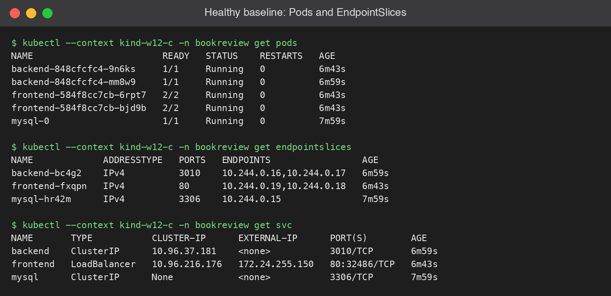

---

#### Screenshot 2 — Workspace folder structure for this assignment

The workspace is `week-12-kubernetes/k8s-triage/`. The screenshot is the final layout (the reports are the runs made during the assignment). The Claude Code memory plugin also writes a `.remember/` folder there on each headless run; it is tooling data, not part of the work, and is left out of the listing.

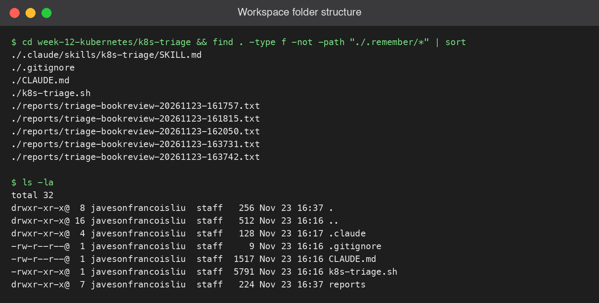

---

# Task 2 — Add Safety Rules to CLAUDE.md

## Goal

Add a `CLAUDE.md` telling Claude this is a read-only Kubernetes triage workflow: it must never run `kubectl apply`, `delete`, `rollout restart`, `edit`, or `scale` on its own, and every recovery action must be reviewed and run by you.

### Evidence

#### Screenshot 3 — `CLAUDE.md` showing the project overview, incident workflow, and safety rules

`CLAUDE.md` (project overview, incident workflow and safety rules):

```markdown
# Kubernetes Incident Triage

## Project overview

- Read-only triage of the Book Review App running on the local kind cluster `w12-c` (context `kind-w12-c`, namespace `bookreview`).
- `k8s-triage.sh` runs five read-only `kubectl` checks and writes a PASS/WARN/FAIL report in `reports/`.
- The `/k8s-triage` skill reads the report, explains each finding with its evidence line and recommends one fix.

## Incident workflow

1. Confirm the baseline: `kubectl --context kind-w12-c -n bookreview get pods` and `get endpointslices`.
2. Run the triage: `bash k8s-triage.sh`.
3. Read the newest file in `reports/`.
4. For every WARN and FAIL, quote the evidence line and explain the risk in one sentence.
5. Recommend one specific `kubectl` command in chat. Claude never runs it.
6. The owner reviews the recommendation, runs the fix, then re-runs the triage to verify.

## Safety rules

- Always pass `--context kind-w12-c`. Never touch another cluster or context.
- Allowed kubectl verbs: `get`, `describe`, `logs`, `events`. Nothing else.
- NEVER run `kubectl apply`, `delete`, `rollout restart`, `rollout undo`, `edit`, `patch`, `scale`, `set`, `exec` or `port-forward` on your own.
- NEVER edit a manifest or any file outside `reports/`.
- Never print Secret values, kubeconfig contents, certificates or tokens. Do not run `kubectl get secret -o yaml` or `kubectl config view`.
- Every recovery action is reviewed and run by the owner.
- Report findings honestly, including failures. Do not soften a FAIL into a WARN.
```

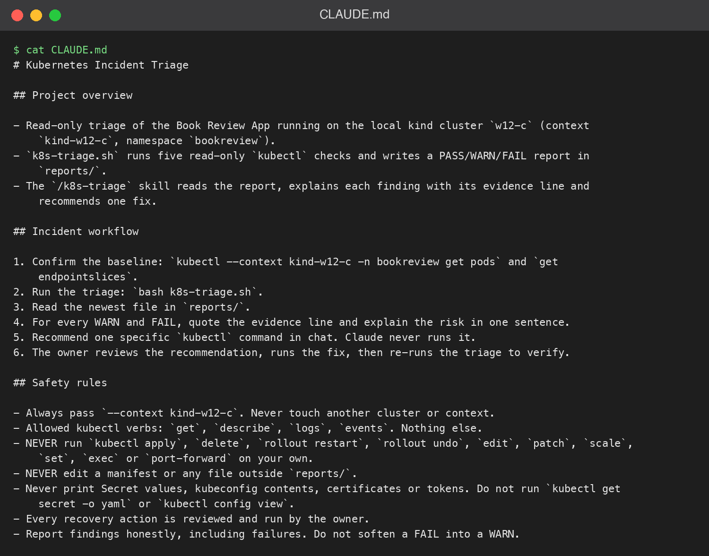

---

# Task 3 — Use Agentic AI to Plan the Triage Checks

## Goal

Ask Claude to propose a read-only, five-check `kubectl` triage plan — pod status, pod readiness, restart counts, recent namespace events, and Service endpoints — before you write any script.

### Evidence

#### Screenshot 4 — Claude's proposed five-check plan, with no file created or cluster state changed

Headless run of Claude Code (`--model sonnet`) inside `k8s-triage/`, with only read-only `kubectl get` and `describe` plus `Read` allowed and `Write`, `Edit` and `NotebookEdit` disallowed. The prompt asked for a five-check plan and said not to create files or change the cluster. Right after the run the folder contained no new file (only the `.remember/` data that the Claude Code memory plugin writes on every session) and the cluster was unchanged.

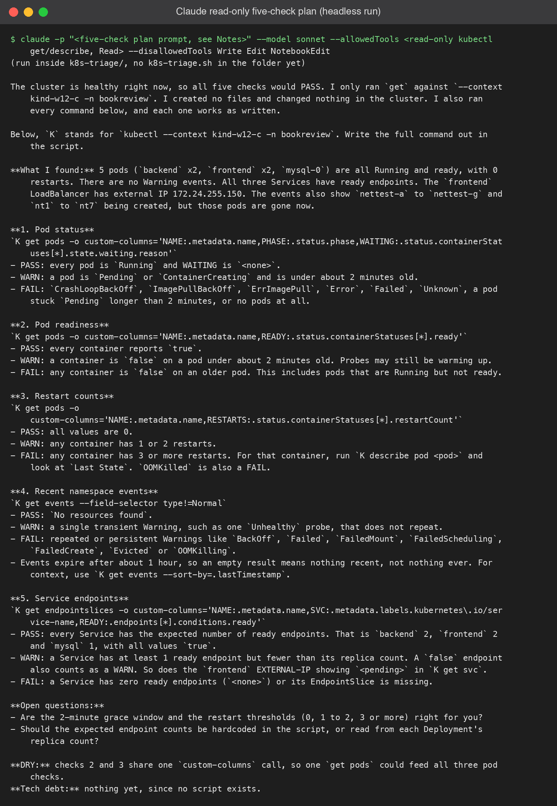

---

# Task 4 — Build the Kubernetes Triage Script

## Goal

Write a Bash script that runs the five read-only `kubectl` checks and writes a PASS/WARN/FAIL report with an overall status and exit code.

### Evidence

#### Screenshot 5 — Script showing the five checks and how each one gathers its evidence

`k8s-triage.sh` (full file, 165 lines; read-only, only `kubectl get` is used). The screenshots show the five checks and the setup and report code:

- **1 pod status:** `get pods` custom columns (phase and waiting reason). FAIL if any Pod is not `Running` or has a waiting reason such as `ErrImagePull`.
- **2 pod readiness:** the `READY x/y` column. FAIL if any Pod has fewer ready containers than containers.
- **3 restart counts:** sum of `restartCount` per Pod. WARN above 0, FAIL at 5 or more.
- **4 recent events:** `Warning` events from the last 15 minutes (`EVENT_WINDOW_MIN`). WARN if any.
- **5 service endpoints:** for every Service with a selector, the count of ready addresses in its EndpointSlices. FAIL if zero.

The script prints and saves a report, then exits 0 (PASS), 1 (WARN) or 2 (FAIL).

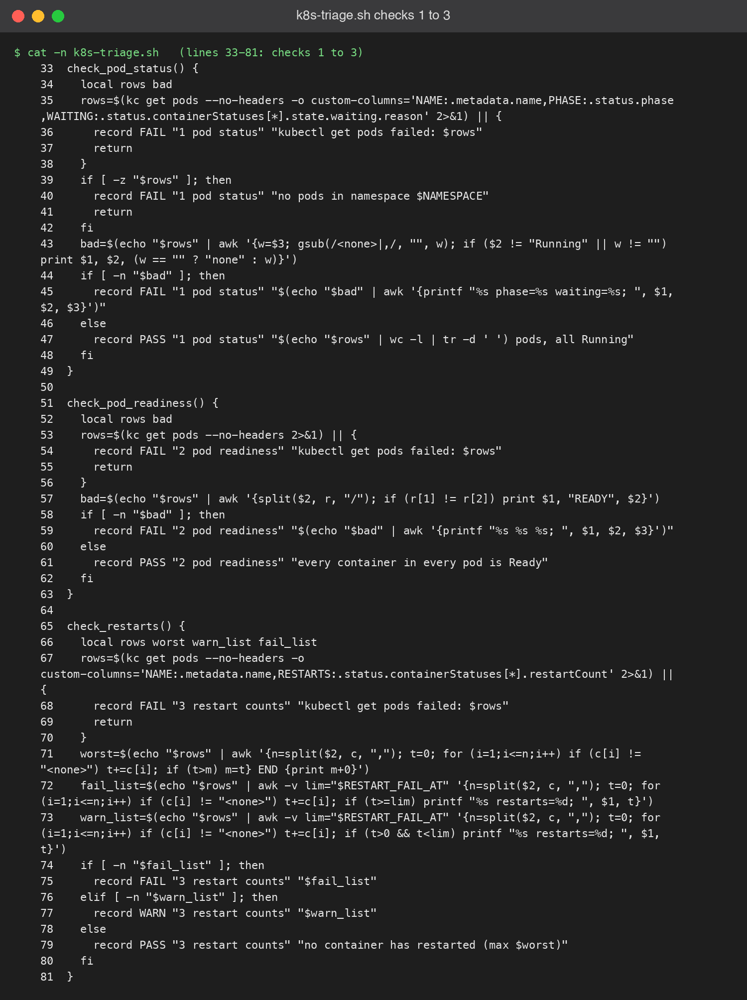

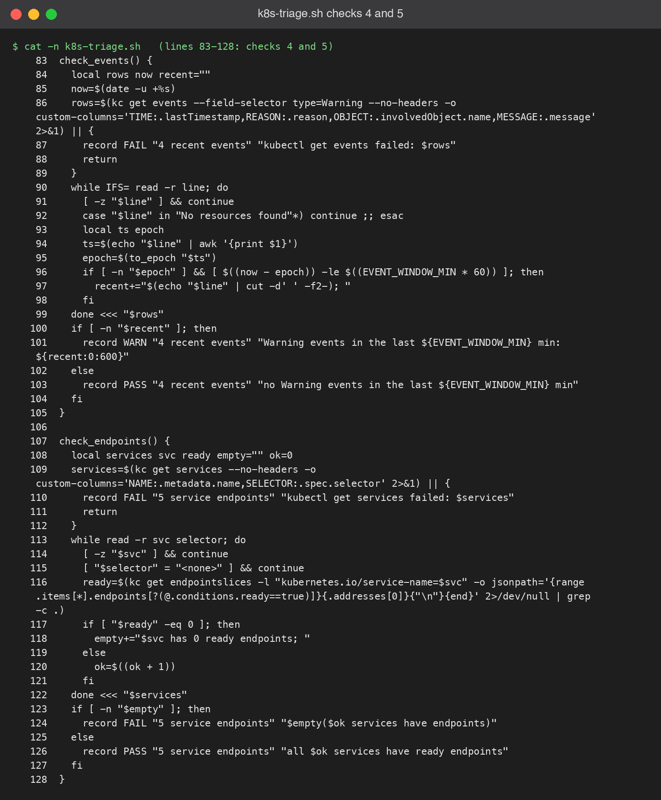

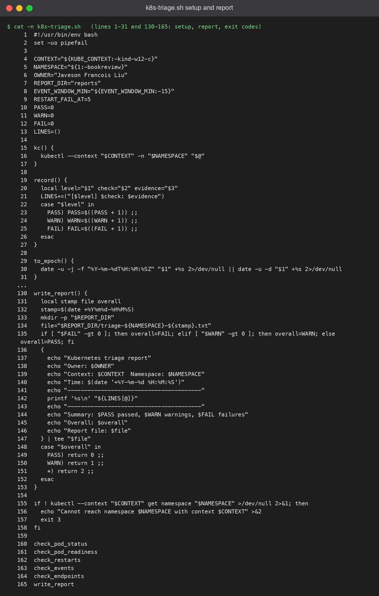

```bash
#!/usr/bin/env bash
set -uo pipefail

CONTEXT="${KUBE_CONTEXT:-kind-w12-c}"
NAMESPACE="${1:-bookreview}"
OWNER="Javeson Francois Liu"
REPORT_DIR="reports"
EVENT_WINDOW_MIN="${EVENT_WINDOW_MIN:-15}"
RESTART_FAIL_AT=5
PASS=0
WARN=0
FAIL=0
LINES=()

kc() {
  kubectl --context "$CONTEXT" -n "$NAMESPACE" "$@"
}

record() {
  local level="$1" check="$2" evidence="$3"
  LINES+=("[$level] $check: $evidence")
  case "$level" in
    PASS) PASS=$((PASS + 1)) ;;
    WARN) WARN=$((WARN + 1)) ;;
    FAIL) FAIL=$((FAIL + 1)) ;;
  esac
}

to_epoch() {
  date -u -j -f "%Y-%m-%dT%H:%M:%SZ" "$1" +%s 2>/dev/null || date -u -d "$1" +%s 2>/dev/null
}

check_pod_status() {
  local rows bad
  rows=$(kc get pods --no-headers -o custom-columns='NAME:.metadata.name,PHASE:.status.phase,WAITING:.status.containerStatuses[*].state.waiting.reason' 2>&1) || {
    record FAIL "1 pod status" "kubectl get pods failed: $rows"
    return
  }
  if [ -z "$rows" ]; then
    record FAIL "1 pod status" "no pods in namespace $NAMESPACE"
    return
  fi
  bad=$(echo "$rows" | awk '{w=$3; gsub(/<none>|,/, "", w); if ($2 != "Running" || w != "") print $1, $2, (w == "" ? "none" : w)}')
  if [ -n "$bad" ]; then
    record FAIL "1 pod status" "$(echo "$bad" | awk '{printf "%s phase=%s waiting=%s; ", $1, $2, $3}')"
  else
    record PASS "1 pod status" "$(echo "$rows" | wc -l | tr -d ' ') pods, all Running"
  fi
}

check_pod_readiness() {
  local rows bad
  rows=$(kc get pods --no-headers 2>&1) || {
    record FAIL "2 pod readiness" "kubectl get pods failed: $rows"
    return
  }
  bad=$(echo "$rows" | awk '{split($2, r, "/"); if (r[1] != r[2]) print $1, "READY", $2}')
  if [ -n "$bad" ]; then
    record FAIL "2 pod readiness" "$(echo "$bad" | awk '{printf "%s %s %s; ", $1, $2, $3}')"
  else
    record PASS "2 pod readiness" "every container in every pod is Ready"
  fi
}

check_restarts() {
  local rows worst warn_list fail_list
  rows=$(kc get pods --no-headers -o custom-columns='NAME:.metadata.name,RESTARTS:.status.containerStatuses[*].restartCount' 2>&1) || {
    record FAIL "3 restart counts" "kubectl get pods failed: $rows"
    return
  }
  worst=$(echo "$rows" | awk '{n=split($2, c, ","); t=0; for (i=1;i<=n;i++) if (c[i] != "<none>") t+=c[i]; if (t>m) m=t} END {print m+0}')
  fail_list=$(echo "$rows" | awk -v lim="$RESTART_FAIL_AT" '{n=split($2, c, ","); t=0; for (i=1;i<=n;i++) if (c[i] != "<none>") t+=c[i]; if (t>=lim) printf "%s restarts=%d; ", $1, t}')
  warn_list=$(echo "$rows" | awk -v lim="$RESTART_FAIL_AT" '{n=split($2, c, ","); t=0; for (i=1;i<=n;i++) if (c[i] != "<none>") t+=c[i]; if (t>0 && t<lim) printf "%s restarts=%d; ", $1, t}')
  if [ -n "$fail_list" ]; then
    record FAIL "3 restart counts" "$fail_list"
  elif [ -n "$warn_list" ]; then
    record WARN "3 restart counts" "$warn_list"
  else
    record PASS "3 restart counts" "no container has restarted (max $worst)"
  fi
}

check_events() {
  local rows now recent=""
  now=$(date -u +%s)
  rows=$(kc get events --field-selector type=Warning --no-headers -o custom-columns='TIME:.lastTimestamp,REASON:.reason,OBJECT:.involvedObject.name,MESSAGE:.message' 2>&1) || {
    record FAIL "4 recent events" "kubectl get events failed: $rows"
    return
  }
  while IFS= read -r line; do
    [ -z "$line" ] && continue
    case "$line" in "No resources found"*) continue ;; esac
    local ts epoch
    ts=$(echo "$line" | awk '{print $1}')
    epoch=$(to_epoch "$ts")
    if [ -n "$epoch" ] && [ $((now - epoch)) -le $((EVENT_WINDOW_MIN * 60)) ]; then
      recent+="$(echo "$line" | cut -d' ' -f2-); "
    fi
  done <<< "$rows"
  if [ -n "$recent" ]; then
    record WARN "4 recent events" "Warning events in the last ${EVENT_WINDOW_MIN} min: ${recent:0:600}"
  else
    record PASS "4 recent events" "no Warning events in the last ${EVENT_WINDOW_MIN} min"
  fi
}

check_endpoints() {
  local services svc ready empty="" ok=0
  services=$(kc get services --no-headers -o custom-columns='NAME:.metadata.name,SELECTOR:.spec.selector' 2>&1) || {
    record FAIL "5 service endpoints" "kubectl get services failed: $services"
    return
  }
  while read -r svc selector; do
    [ -z "$svc" ] && continue
    [ "$selector" = "<none>" ] && continue
    ready=$(kc get endpointslices -l "kubernetes.io/service-name=$svc" -o jsonpath='{range .items[*].endpoints[?(@.conditions.ready==true)]}{.addresses[0]}{"\n"}{end}' 2>/dev/null | grep -c .)
    if [ "$ready" -eq 0 ]; then
      empty+="$svc has 0 ready endpoints; "
    else
      ok=$((ok + 1))
    fi
  done <<< "$services"
  if [ -n "$empty" ]; then
    record FAIL "5 service endpoints" "$empty($ok services have endpoints)"
  else
    record PASS "5 service endpoints" "all $ok services have ready endpoints"
  fi
}

write_report() {
  local stamp file overall
  stamp=$(date +%Y%m%d-%H%M%S)
  mkdir -p "$REPORT_DIR"
  file="$REPORT_DIR/triage-${NAMESPACE}-${stamp}.txt"
  if [ "$FAIL" -gt 0 ]; then overall=FAIL; elif [ "$WARN" -gt 0 ]; then overall=WARN; else overall=PASS; fi
  {
    echo "Kubernetes triage report"
    echo "Owner: $OWNER"
    echo "Context: $CONTEXT  Namespace: $NAMESPACE"
    echo "Time: $(date '+%Y-%m-%d %H:%M:%S')"
    echo "----------------------------------------"
    printf '%s\n' "${LINES[@]}"
    echo "----------------------------------------"
    echo "Summary: $PASS passed, $WARN warnings, $FAIL failures"
    echo "Overall: $overall"
    echo "Report file: $file"
  } | tee "$file"
  case "$overall" in
    PASS) return 0 ;;
    WARN) return 1 ;;
    *) return 2 ;;
  esac
}

if ! kubectl --context "$CONTEXT" get namespace "$NAMESPACE" >/dev/null 2>&1; then
  echo "Cannot reach namespace $NAMESPACE with context $CONTEXT" >&2
  exit 3
fi

check_pod_status
check_pod_readiness
check_restarts
check_events
check_endpoints
write_report
```

---

#### Screenshot 6 — `bash -n` and `ls -l` confirming the script is valid and executable

`bash -n` prints nothing (no syntax errors), the file is executable, and a grep for write verbs finds none.

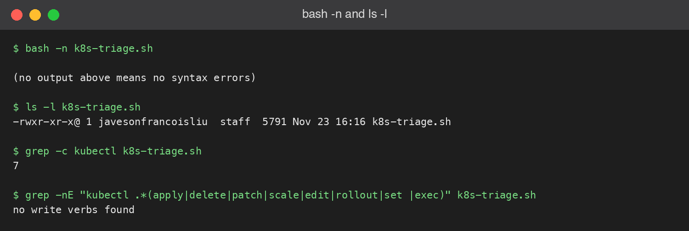

---

# Task 5 — Run the Script Against the Healthy Cluster

## Goal

Run the script against your current, unmodified deployment and confirm it reports a clean, healthy baseline before you simulate anything.

### Evidence

#### Screenshot 7 — Script output showing all five checks passing

All five checks PASS and the exit code is 0. The report is saved in `reports/`.

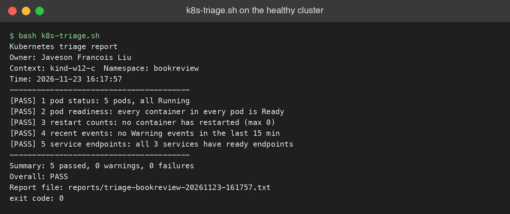

---

# Task 6 — Build and Run the /k8s-triage Skill

## Goal

Wrap the script in a Claude Code skill restricted to read-only tools (no `Write`), and confirm `/k8s-triage` reports the healthy baseline using the script's evidence without touching the cluster.

### Evidence

#### Screenshot 8 — `SKILL.md` frontmatter showing the tool restrictions and safety rules

`.claude/skills/k8s-triage/SKILL.md`. `allowed-tools` lists `Read`, the triage script and read-only `kubectl get`, `describe` and `logs` with the fixed context. There is no `Write` or `Edit`.

```markdown
---
name: k8s-triage
description: Run the read-only Kubernetes triage on the Book Review App, explain each finding with evidence, and recommend one kubectl fix without running it. Use when asked to triage, diagnose or check the health of the Book Review App on the kind cluster.
argument-hint: [namespace]
allowed-tools: Read, Bash(bash k8s-triage.sh:*), Bash(kubectl --context kind-w12-c get:*), Bash(kubectl --context kind-w12-c -n bookreview get:*), Bash(kubectl --context kind-w12-c -n bookreview describe:*), Bash(kubectl --context kind-w12-c -n bookreview logs:*)
---

# k8s-triage

Triage the Book Review App on the kind cluster `w12-c`. This skill gathers evidence and recommends. It never changes the cluster.

## Steps

1. Run `bash k8s-triage.sh` (the namespace defaults to `bookreview`; pass the argument if one was given).
2. Read the newest file in `reports/`.
3. If everything is PASS, say the cluster is healthy and quote the Summary and Overall lines. Stop.
4. For every WARN and FAIL, quote the evidence line from the report and explain the risk in one sentence.
5. If needed, gather more evidence with the allowed read-only commands: `kubectl --context kind-w12-c -n bookreview describe pod <pod>` or `get events`.
6. Recommend one specific `kubectl` command as the fix. Show it in a code block and say that the owner runs it. Do not run it.
7. End with the command the owner runs to verify: `bash k8s-triage.sh`.

## Safety rules

- NEVER run `kubectl apply`, `delete`, `rollout`, `edit`, `patch`, `scale`, `set`, `exec` or `port-forward`.
- NEVER create or edit any file. There is no Write or Edit tool in this skill. The owner applies the fix.
- Only the tools listed in `allowed-tools` are used.
- Do not read Secret values or print kubeconfig contents, certificates or tokens.
- Report failures honestly. Do not soften a FAIL into a WARN.
```

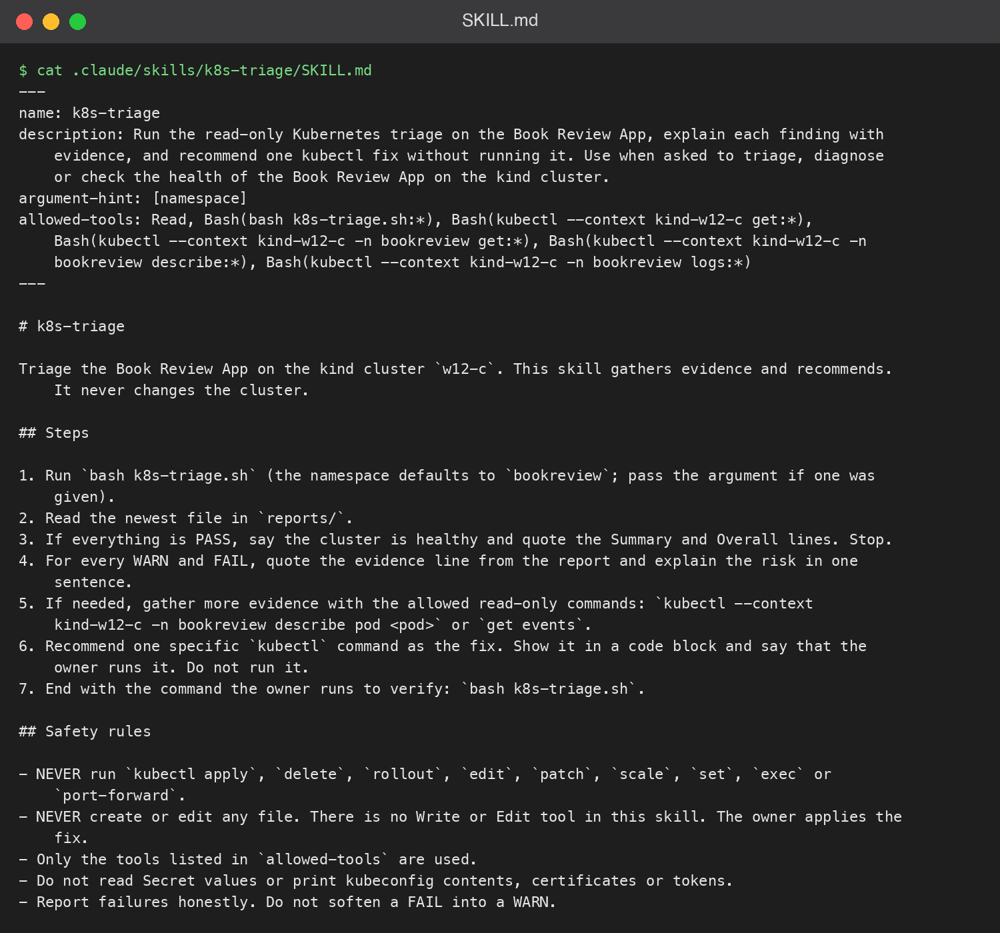

---

#### Screenshot 9 — `/k8s-triage` output for the healthy cluster

Headless run: `claude -p "/k8s-triage" --model sonnet --disallowedTools Write Edit NotebookEdit`. The skill ran the script, read the report and said the cluster is healthy. It changed nothing.

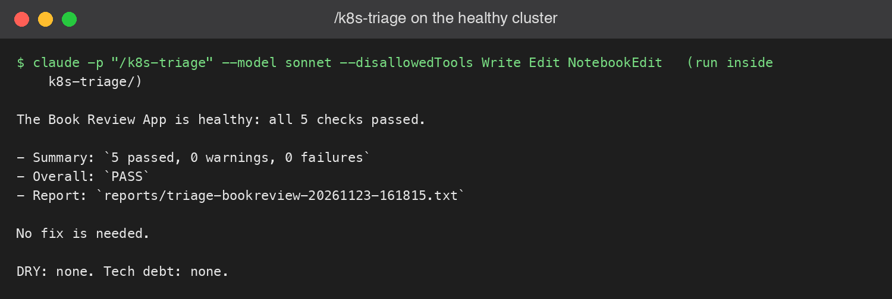

---

# Task 7 — Simulate an Incident and Let the Skill Diagnose It

## Goal

Deliberately break your own deployment — an image tag that does not exist, or a misconfigured readiness probe — then run `/k8s-triage` and confirm it correctly identifies the failure, quotes the evidence, and recommends a fix without applying it.

### Evidence

#### Screenshot 10 — The pod in a failed state and the Service showing no Endpoints

I created the incident myself with one patch: the backend image was set to `bookreview-backend:9.9.9`, a tag that does not exist, and the strategy was set to `Recreate`. With the default rolling update the old healthy Pods would have stayed in service during a failed rollout and the Service would never have shown zero endpoints, so I chose `Recreate` to make the failure total. This is my own setup choice, not something Claude did.

```json
{"spec":{"strategy":{"type":"Recreate","rollingUpdate":null},"template":{"spec":{"containers":[{"name":"backend","image":"bookreview-backend:9.9.9"}]}}}}
```

Result: both backend Pods are `ErrImagePull` or `ImagePullBackOff`, `kubectl get endpoints backend` is empty, the Deployment is `0/2`, and a request to `/api/books` through the public address gets no answer within 8 seconds (the frontend page `/` itself still loaded). The `mysql` and `frontend` Pods stayed healthy.

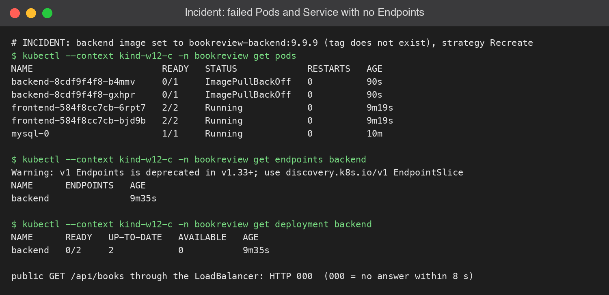

---

#### Screenshot 11 — `/k8s-triage` output showing the diagnosis and the recommended `kubectl` command, not executed by Claude

The skill ran the script (FAIL), quoted the evidence lines for pod status, readiness and endpoints, and used a read-only event to confirm the root cause (`Failed to pull image "bookreview-backend:9.9.9"`). It recommended `kubectl --context kind-w12-c -n bookreview rollout undo deployment/backend` and did not run it. Its `allowed-tools` has no `rollout`, and my own `rollout undo` afterwards brought back the working `1.0.0` image, which could not have happened if the skill had already undone the rollout (a second undo would have flipped back to the bad tag). Note that the skill reported check 4 as a WARN, not a FAIL, because of the script's own thresholds; it did not soften anything.

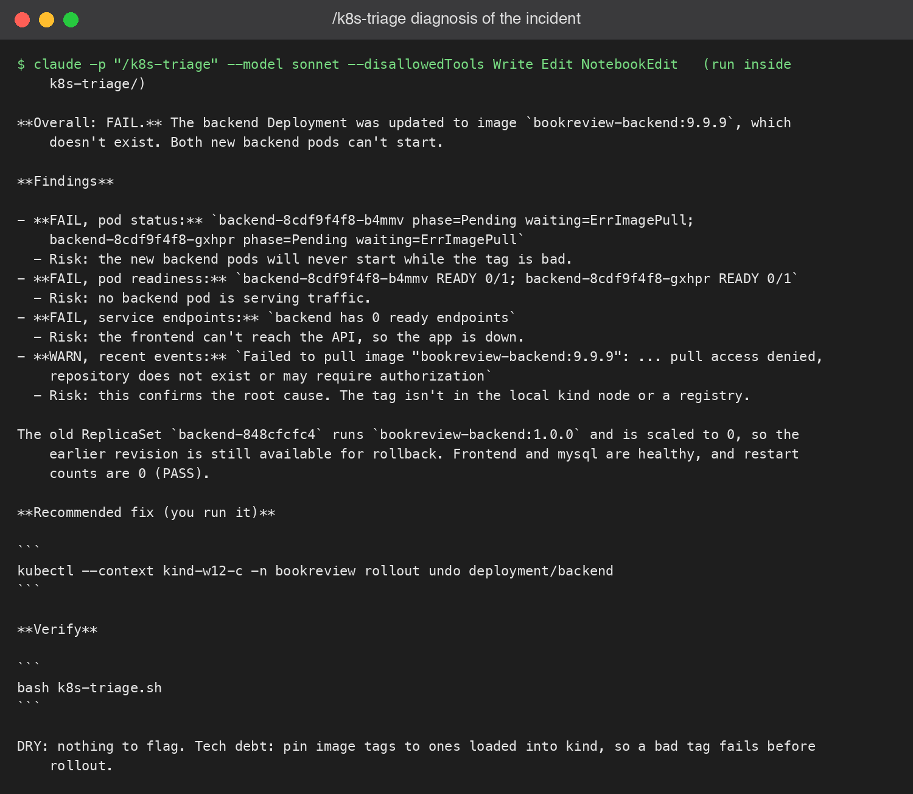

---

# Task 8 — Recover, Verify, and Summarize

## Goal

Review the recommendation, apply the fix yourself, confirm the pod returns to `Running`/`Ready` with active Endpoints, run `/k8s-triage` again to verify, and write a short incident summary.

### Evidence

#### Screenshot 12 — Pod back to `Running`/`Ready` and the Service showing Endpoints again

I reviewed the recommendation and ran it myself: `rollout undo` restored the image `bookreview-backend:1.0.0`, and a second patch put the strategy back to `RollingUpdate` (an undo only reverts the Pod template, not the strategy). Both backend Pods are `1/1 Running`, the Service has two endpoints again and `/api/books` returns 200.

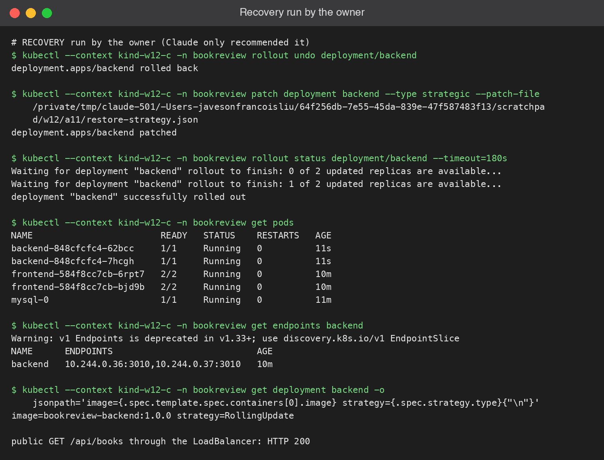

---

#### Screenshot 13 — Second `/k8s-triage` run confirming recovery

I waited until the incident's Warning events were older than the script's 15 minute window, so check 4 could not flag the old incident, then ran the script and the skill again. The script shows 5 passed, 0 warnings, 0 failures, and `/k8s-triage` reports the cluster healthy and notes the earlier bad-tag failure is gone. Honest note: I did not run the skill immediately after the fix, so I have no output of it reporting the still-recent events as a WARN.

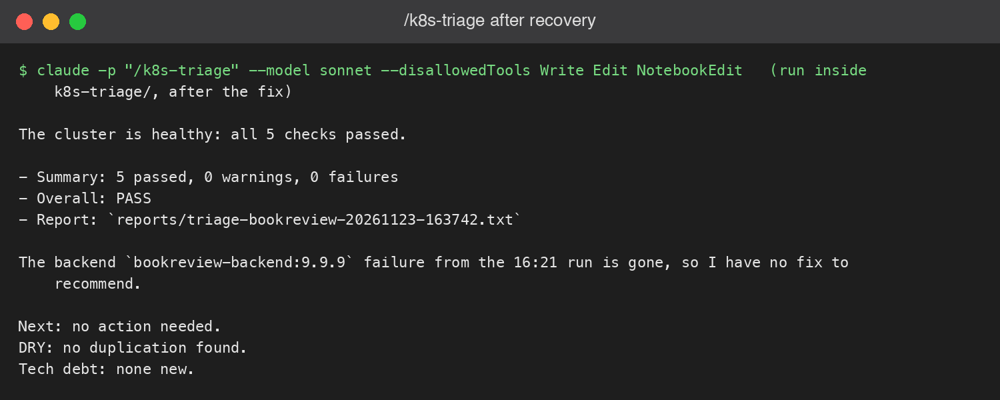

---

### Notes

Compare this incident to the Nginx incident from Week 3's AI-Assisted Linux Health Check. What stayed the same about the process, and what changed about the evidence you had to gather?

**Incident summary.** At the start of the incident the backend Deployment was moved to a missing image tag with the `Recreate` strategy, so both backend Pods went to `ErrImagePull`/`ImagePullBackOff`, the `backend` Service had no endpoints and API calls through the LoadBalancer hung. `/k8s-triage` identified the failing Pods, the zero endpoints and the root cause from the report and one event. I ran `kubectl rollout undo deployment/backend`, restored the strategy, and verified with the script and the skill.

**Compared with the Week 3 Nginx incident.** The process stayed the same: gather evidence with a read-only tool first, let the AI explain the evidence and recommend one fix, keep the change in human hands, then verify with the same tool. What changed is the evidence. On one Linux host the evidence was a service status and a log file for one process. On Kubernetes the symptom and the cause sit in different objects: the Service had no endpoints (symptom), the Pods were in `ErrImagePull` (state), and the reason was in an event (`Failed to pull image`). The checks therefore have to cross objects (Pods, events, EndpointSlices) and respect time, because events expire and a rolling update can hide a failure behind the old healthy Pods. The recovery also changed shape: instead of restarting a service I rolled a Deployment back to its previous ReplicaSet.

**Limits.** This is a small local kind cluster with one node. Claude ran headlessly, so it ran the checks in one pass without interactive approval prompts, restricted by the skill's `allowed-tools`. The check 4 event window (15 minutes) means a WARN can linger after a fix, which is why the final run happened after the window passed.

---

# Submission Instructions

Complete all tasks in sequence.

Your submission must include:
- All 13 required screenshots
- Do not expose kubeconfig contents, cluster certificates, or tokens

---

# Completion Checklist

- [x] Task 1: Healthy baseline confirmed and workspace created (Screenshots 1–2)
- [x] Task 2: `CLAUDE.md` safety rules added (Screenshot 3)
- [x] Task 3: Read-only five-check plan produced (Screenshot 4; the script already existed, see the order caveat)
- [x] Task 4: Triage script built and validated (Screenshots 5–6)
- [x] Task 5: Script run against the healthy cluster (Screenshot 7)
- [x] Task 6: `/k8s-triage` skill built and run against the healthy baseline (Screenshots 8–9)
- [x] Task 7: Incident simulated and correctly diagnosed without being applied (Screenshots 10–11)
- [x] Task 8: Recovery applied by the human, verified, and summarized (Screenshots 12–13, Notes)
- [x] No kubeconfig, tokens, or cluster credentials exposed

---

## 📌 About DMI & CloudAdvisory

DevOps Micro Internship (DMI) is a project-based DevOps program run by Pravin Mishra (The CloudAdvisory) focused on real-world execution, systems thinking, and career readiness.

It helps learners build strong DevOps foundations with hands-on experience.

---

## 📌 Resources

- 🌐 DMI Official Website: https://dmi.pravinmishra.com?utm_source=github&utm_medium=readme  
- 🎓 University: https://university.pravinmishra.com?utm_source=github&utm_medium=readme  
- 💬 Discord Community: https://discord.pravinmishra.com?utm_source=github&utm_medium=readme  
- 📝 Blog: https://dmi.pravinmishra.com/blog?utm_source=github&utm_medium=readme  
- ▶️ YouTube Playlist: https://www.youtube.com/playlist?list=PLFeSNDtI4Cho  
- 🔗 Pravin Mishra (LinkedIn): https://www.linkedin.com/in/pravin-mishra-aws-trainer/  
- 🏢 CloudAdvisory (LinkedIn): https://www.linkedin.com/company/thecloudadvisory/

---

*This submission is part of DevOps Micro Internship (DMI) — Agentic AI Track.*
