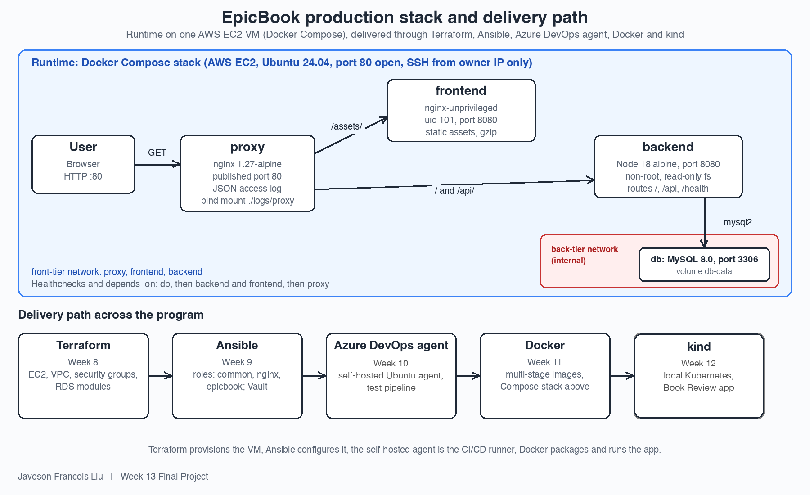
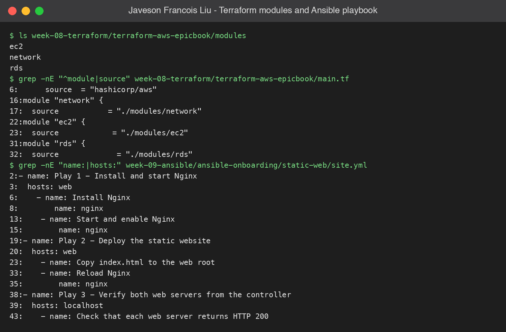
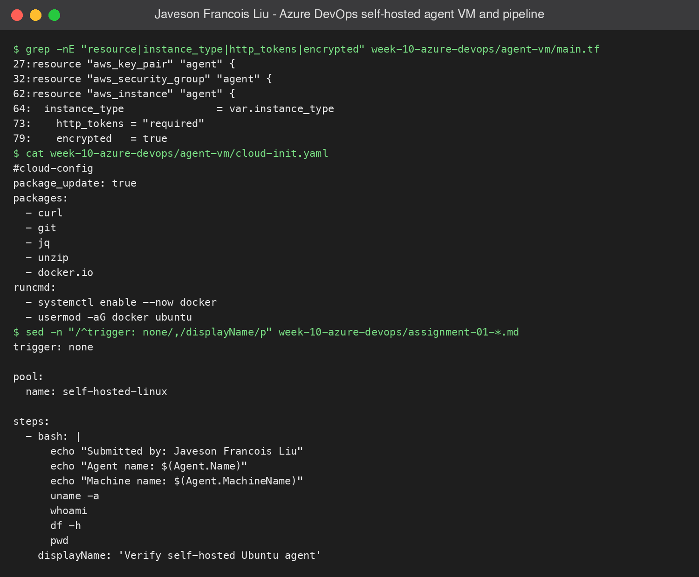
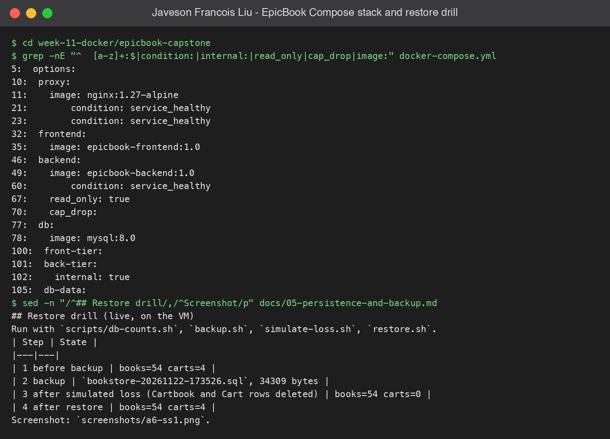

# Week 13 — Final Project

Part of the DevOps Micro Internship (DMI) with Agentic AI

**Full Name:** Javeson Francois Liu

---

## Purpose

Bring together everything from the program into one capstone project. Describe what you built, how it's architected, and what you learned across the full 14 weeks.

---

# Task 1 — Project Overview

## Goal

Describe your final project in 2-3 sentences. What does it do? What problem does it solve?

### Evidence

The EpicBook is an online bookstore (Node.js and Express app with server-side pages and a MySQL `bookstore` database). I packaged it as a production-style Docker Compose stack of four services (reverse proxy, frontend, backend, database) with isolated networks, healthchecks, a persistent database volume with a tested backup and restore, structured JSON logs and a runbook. The stack solves the "it works on my machine" and fragile-deployment problem: one `docker compose up` gives the same hardened, observable, recoverable result on any VM, and the VM and its configuration come from code (Terraform and Ansible) rather than manual clicks.

**Project Name:** The EpicBook production Docker stack (Week 11 Assignment 6 capstone), with the cloud, IaC, config management and CI/CD work from Weeks 8 to 12

**GitHub Repo:** https://github.com/javesonfrancoisliu/devops-micro-internship-pravinmishra (project path: `week-11-docker/epicbook-capstone`)

**Live URL:** Not deployed (torn down to avoid cost); runs with docker compose up

---

# Task 2 — Architecture

## Goal

Describe or embed a diagram of your project architecture.

### Evidence

#### Screenshot 1 — Architecture diagram

How to read it:

- A user reaches the proxy (nginx 1.27-alpine) on port 80, the only published port.
- The proxy sends `/assets/` to the frontend (nginx-unprivileged, user 101, port 8080) and `/` and `/api/` to the backend (Node 18 alpine, port 8080, non-root, read-only filesystem).
- The backend is the only service on both networks. It talks to MySQL 8.0 on the `back-tier` network, which is `internal: true`, so the database has no route to or from the outside. Data lives in the named volume `db-data`.
- Startup order is enforced with healthchecks: db, then backend and frontend, then proxy.
- Delivery path: Terraform provisions the AWS VM (Week 8), Ansible configures servers with roles (Week 9), Azure DevOps pipelines on a self-hosted agent are the CI/CD runner (Week 10: infra pipeline for Terraform, app pipeline for Ansible), Docker packages and runs the app (Week 11), and Kubernetes on a local kind cluster runs the Book Review app and the incident triage (Week 12).

---

# Task 3 — Tech Stack

## Goal

List the technologies used in each layer of your project.

### Evidence

| Layer | Technology Used |
|-------|----------------|
| Cloud | AWS EC2 (Ubuntu 24.04, t3.micro for the Week 11 stack, gp3 encrypted disk, IMDSv2 required, security group with SSH from my IP only and HTTP 80 open) in `ap-southeast-5`; Amazon RDS for MySQL and VPC networking in the Week 8 and Week 9 EpicBook labs |
| IaC | Terraform with reusable modules (network, ec2, rds) for the EpicBook VPC, EC2 and private RDS in Week 8, plus a standalone Terraform stack for the Week 11 VM and the Week 10 agent VM; Terraform plan and drift review with Claude Code, with apply kept human-only |
| CI/CD | Azure DevOps with a self-hosted Linux agent (`dmi-agent-01`, pool `self-hosted-linux`) running YAML pipelines (Week 10 Assignments 1 to 5): a Mini Finance deploy, a React deploy, the EpicBook dual pipelines (`infra-epicbook` with Terraform, `theepicbook` with Ansible) and a read-only AI failure triage with a deliberate break and fix. A GitHub Actions design for the Docker stack is documented but not built |
| Containers | Docker and Docker Compose: multi-stage Dockerfiles (backend 1.79 GB naive image down to 281 MB), nginx reverse proxy, nginx-unprivileged frontend, MySQL 8.0, networks `front-tier` and internal `back-tier`, named volume `db-data`, healthchecks, `json-file` log rotation. Kubernetes on a local kind cluster (Week 12): pods, ReplicaSets, Deployments with rolling updates, autoscaling, readiness and liveness probes, ClusterIP, NodePort and LoadBalancer Services, the Book Review app and an AI-assisted incident triage |
| Config Mgmt | Ansible: inventory, `ansible.cfg`, multi-play playbooks, roles `common`, `nginx` and `epicbook`, group variables, Ansible Vault for the database password, handlers and idempotent re-runs (Week 9) |

---

# Task 4 — What I Built

## Goal

Walk through what you implemented, step by step.

### Evidence

#### Step 1 — Provision with Terraform and configure with Ansible

I wrote Terraform with separate `network`, `ec2` and `rds` modules wired together from the root `main.tf`: a VPC with a public subnet and two private database subnets, an EC2 Ubuntu instance, and a private RDS MySQL instance whose security group only accepts port 3306 from the EC2 security group. State, keys and my public IP stay out of Git through `.gitignore`. Then I configured servers with Ansible: a multi-play playbook (install Nginx, deploy the site with a reload handler, verify with HTTP 200 from the controller) and, in the EpicBook lab, roles `common`, `nginx` and `epicbook` with the database password in an encrypted Ansible Vault file. A second playbook run reporting `changed=0` proved idempotency.

#### Screenshot 2 — Step 1

#### Step 2 — Self-hosted Azure DevOps agent as the CI/CD runner

With Terraform I provisioned an Ubuntu 24.04 `t3.small` EC2 VM (encrypted gp3 disk, IMDSv2 required, SSH limited to my IP, Docker installed by cloud-init). I registered the Azure Pipelines agent `dmi-agent-01` in the pool `self-hosted-linux` as a systemd service using a PAT limited to Agent Pools, and confirmed it Online. A YAML pipeline with `trigger: none` and `pool: name: self-hosted-linux` ran `uname -a`, `whoami`, `df -h` and `pwd` on that VM and succeeded. The later Week 10 assignments reuse this agent: the EpicBook capstone ran an infra pipeline (Terraform: network, VMs, MySQL) and an app pipeline (Ansible: Nginx frontend, Node.js backend), and Assignment 5 added a read-only triage script and skill that classified a deliberate typo failure as a dependency problem before the fix turned the run green.

#### Screenshot 3 — Step 2

#### Step 3 — The production Docker Compose stack (Week 11 capstone)

I discovered the app components and documented environment variables, ports and persistence paths. I built multi-stage Dockerfiles (backend `epicbook-backend:1.0` is 281 MB against 1.79 GB for a naive single-stage build, about 84% smaller; frontend `epicbook-frontend:1.0` is 141 MB), then a Compose file with proxy, frontend, backend and db, `front-tier` and internal `back-tier` networks, and the `db-data` volume. I added healthchecks with `depends_on: service_healthy`, a `/health` endpoint that returns 503 when the database is down, nginx routing with runtime DNS resolution and a CORS allowlist from `ALLOWED_ORIGINS`, JSON logs with 10m x 3 rotation, `mysqldump` backup and restore scripts, a runbook and reliability tests. A live drill on the AWS VM went books=54 carts=4, then carts=0 after simulated loss, then carts=4 after restore. After a container audit (Assignment 7) the frontend was moved to a non-root image on port 8080.

#### Screenshot 4 — Step 3

---

# Task 5 — Challenges & Key Learnings

## Goal

Reflect on what was hard, how you solved it, and your biggest takeaways from the full program.

### Evidence

#### Challenges & How I Solved Them

- Memory exhaustion on the 1 GB t3.micro: building a `node:18` image next to the running stack pushed load above 12 and the site returned 502. I killed the build, `restart: unless-stopped` plus healthchecks brought the backend and database back healthy, and I recorded the lesson that builds belong in CI, not on the VM.
- Healthchecks failing inside alpine images: `localhost` resolved to IPv6, so every check used `127.0.0.1`. Separately, nginx refused to start or kept a stale IP with a static `proxy_pass`, so I used the Docker DNS resolver with upstreams in variables and the proxy now recovers by itself when a container restarts.
- Firewall rules tied to my public IP broke SSH when Cloudflare WARP changed it, and the first Azure DevOps agent registration failed with `VS30063: You are not authorized` because I passed the wrong text as the token. I kept WARP off and verified the IP before applying, and I regenerated a scoped PAT and kept it out of every screenshot.
- First Ansible run of the `epicbook` role failed on `/opt/epicbook` permissions, and the site still showed the Nginx welcome page because the reload handler never ran. I added a task that creates the directory with the right owner and `meta: flush_handlers`.

#### Key Learnings from the Full Program

- Build in layers and isolate them: an internal back-tier network, a non-root read-only backend with dropped capabilities, and a private database mean a compromised front layer still cannot reach the data.
- Everything should be repeatable and checkable: Terraform for infrastructure, Ansible for configuration (idempotent, secrets in Vault), healthchecks and `depends_on` for startup order, and a tested backup and restore drill rather than a backup plan on paper.
- AI helps most with evidence and a human gate: Claude Code reviewed plans and drift, but hooks blocked `terraform apply` and `destroy`, so I decided and applied every change myself, and I did not accept every recommendation.
- Only claim what you verified: the optional CI/CD pipeline for the Docker stack was not built, screenshots of terminal views are labelled when they are rendered images, and the cloud resources (AWS VMs, Azure resource groups, service principal) were destroyed after grading to avoid cost.

---

# Task 6 — LinkedIn Post

## Goal

Publish a LinkedIn post summarizing your final project and your journey through the program.

### Evidence

#### LinkedIn Post URL

Add your LinkedIn post URL here after you publish the post.

Add the following credit note at the end of your post:

> **P.S. This post is part of the DevOps Micro Internship (DMI) with Agentic AI — Cohort 3 — by Pravin Mishra. My graded progress is public: https://dmi.pravinmishra.com/s/javesonfrancoisliu.html · Start your DevOps journey: https://dmi.pravinmishra.com/?utm_source=student&utm_medium=ps-linkedin&utm_campaign=cohort3**

---

*Part of the [DevOps Micro Internship with Agentic AI](https://www.linkedin.com/in/pravin-mishra-aws-trainer/) by Pravin Mishra — Join: https://discord.pravinmishra.com/?utm_source=github&utm_medium=readme*
